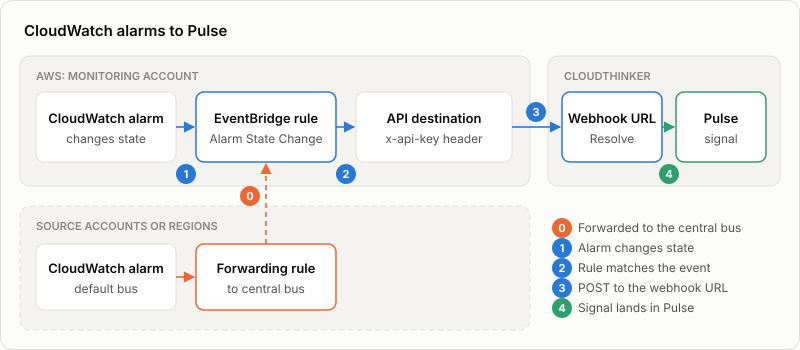
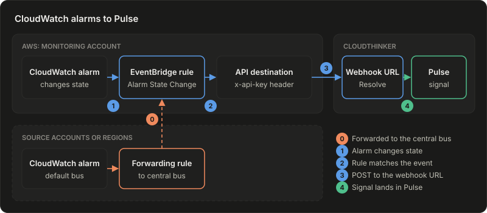

このガイドでは、CloudWatch アラームのすべての状態変化を Resolve に送ります。これにより、CloudThinker は数秒以内にアラームを確認し、インシデントを開いて根本原因分析（RCA）を開始できます。配信は Amazon EventBridge が行うため、Lambda 関数も保守するコードも不要です。

## 仕組み

<Frame caption="アラームの状態変化は 1 つの EventBridge ルールと API 送信先を通じて Pulse に届きます。他のアカウントは中央のバスに転送できます。">
  
  
</Frame>

アラームの状態が変わると、EventBridge がそのイベントを CloudThinker の Webhook URL に転送します。Resolve はそれを [Pulse](/ja/guide/pulse/overview) の **シグナル**（ノイズ抑制を通過したイベント）に変えます。Pulse は関連するシグナルを 1 つの問題である **クラスター** にまとめ、トリアージが対応可能なクラスターをインシデントにするかどうかを判断します。

## 前提条件

- ワークスペースの **Admin** ロール。Developer と Viewer は Resolve Triggers & Outcomes を閲覧できますが、追加や変更はできません。[Roles](/guide/security/roles) を参照してください。
- EventBridge の接続、API 送信先、ルールを作成できる AWS アカウント。
- セットアップするリージョンに少なくとも 1 つの CloudWatch アラーム。
- シミュレートしたアラームでテストしたい場合（推奨）は AWS CLI。呼び出し元には IAM 権限 `cloudwatch:SetAlarmState` が必要です。

## CloudThinker で Webhook を作成する

<Steps>
  <Step title="AWS のプラットフォームを開く">
    **Resolve → Triggers & Outcomes** に移動し、**Amazon Web Services** を選びます。**Signals to Resolve** で **Add signal** をクリックします。AWS CloudWatch のプリセットで **Create Webhook** ダイアログが開きます。

    先に AWS 接続を用意する必要はありません。接続がない場合、プラットフォームには **Not configured** または **Needs setup** と表示され（**Needs connection** にはなりません）、**Add signal** は引き続き機能します。[AWS 接続](/ja/guide/connections/aws)が必要なのは、RCA の間に CloudThinker に影響を受けたリソースを照会させたい場合だけです。
  </Step>
  <Step title="Basic Info">
    デフォルトの **Webhook Name** のままにするか、`Production CloudWatch` などに変更します。**Next** をクリックします。
  </Step>
  <Step title="Configure">
    **Field Mapping** と **Severity Mapping** は、EventBridge のイベント用にあらかじめ入力されています（下の表を参照）。最初のセットアップではそのままにしてください。本番のアカウントでは、今のうちに `INSUFFICIENT_DATA` を下げることを検討してください（[フィールドと重大度の対応付け](#フィールドと重大度の対応付け)を参照）。**Next** をクリックします。
  </Step>
  <Step title="Advanced">
    **Auth Method** はそのまま、つまりヘッダー `x-api-key` を使う **API Key** にします。これは EventBridge が送るものです。次に、2 つのオプションを決めます。

    | オプション | デフォルト | 変更する場面 |
    |---|---|---|
    | **Auto-investigate** | オン | アラームを Pulse でクラスターにまとめたいが、人が対応するまで何も開始したくない場合。オフにします。 |
    | **Only from a minimum severity** | オフ | 一部のアラームだけで調査を開始したい場合。オンにしてレベルを選びます（例: **High and above**）。 |

    両方がデフォルトのままの場合、インシデントになるすべてのアラームで調査が開始されます。[Webhook options](/ja/guide/pulse/setup#動作を変える-webhook-のオプション) を参照してください。**Create** をクリックします。
  </Step>
  <Step title="URL とシークレットをコピーする">
    開いたダイアログから **Webhook URL** と **API Secret** をコピーします。URL は EventBridge の API 送信先に、**API Secret** は接続の API キーの **Value** に入れます。
  </Step>
  <Step title="レート制限を引き上げる（本番）">
    **Signals to Resolve** で Webhook の **...** メニューを開き、**Edit** を選んで、**Rate limit (requests per hour)** を少なくとも `3600` に設定します。デフォルトの 1,000 は、アラームの嵐の中で毎秒 1 イベントを送る API 送信先が到達しうる量を下回り、制限を超えたイベントはエラーなしで破棄されます。**Create Webhook** ダイアログにはこのフィールドはありません。
  </Step>
</Steps>

**成功時の状態:** Amazon Web Services のプラットフォームの **Signals to Resolve** に Webhook が表示され、プラットフォームの[準備状況のバッジ](/guide/incident/triggers-and-outcomes#read-readiness)に **Ready** と表示されます。**Ready** は Webhook がセットアップされ有効であることを意味します。アラームが届いたことの証明ではないため、下の[テスト](#連携をテストする)を実行してください。

<Warning>
**API Secret** は一度しか表示されません。コピーせずにダイアログを閉じた場合は、**Signals to Resolve** で Webhook の **...** メニューを開き、**Regenerate credentials** を選んでください。これによりシークレットと **Webhook URL** の両方が置き換わり、古い組はすぐに機能しなくなります。直後に、EventBridge の接続の **Value** と API 送信先のエンドポイントを更新してください。
</Warning>

## AWS で EventBridge をセットアップする

これらの手順は、アラームと同じリージョンの AWS コンソールで行います。

<Steps>
  <Step title="接続を作成する">
    **Amazon EventBridge → Integration → Connections** を開き、**Create connection** をクリックします。次のように設定します。

    | フィールド | 値 |
    |---|---|
    | Name | `cloudthinker-webhook` |
    | Authorization type | API Key |
    | API key name | `x-api-key` |
    | Value | CloudThinker の **API Secret** |
  </Step>
  <Step title="API 送信先を作成する">
    **Integration → API destinations** を開き、**Create API destination** をクリックします。次のように設定します。

    | フィールド | 値 |
    |---|---|
    | Name | `cloudthinker-resolve` |
    | API destination endpoint | CloudThinker の **Webhook URL** |
    | HTTP method | `POST` |
    | Connection | `cloudthinker-webhook` |

    **Invocation rate limit per second** を `1` に設定します。上で [Webhook のレート制限を引き上げた](#cloudthinker-で-webhook-を作成する)ことを確認してください。
  </Step>
  <Step title="ルールを作成する">
    **Rules** を開き、**default** のイベントバスを選んで、**Create rule** をクリックします。**Rule with an event pattern** を選び、次のパターンを貼り付けます。

    ```json
    {
      "source": ["aws.cloudwatch"],
      "detail-type": ["CloudWatch Alarm State Change"]
    }
    ```

    ターゲットには **EventBridge API destination** を選び、`cloudthinker-resolve` を選択して、**Execution role** で **Create a new role for this specific resource** を選びます（`events:InvokeApiDestination` が付与されます）。

    任意ですが本番では推奨: ターゲットの **Additional settings** で再試行ポリシーとデッドレターキューを設定し、障害中に配信に失敗したアラームが失われず保持されるようにします。出発点としては、**Maximum age of event** を 1 時間、**Retry attempts** を 10 にするのがよいでしょう。1 時間より古いアラームで新たに調査する価値はほとんどありません。デッドレターキューとして SQS キューを関連付けます。**Create rule** をクリックします。
  </Step>
</Steps>

**成功時の状態:** ルールが **Enabled** と表示され、API 送信先がそのターゲットになっています。

## 連携をテストする

テストのアラームは本物と同様に扱われます。**Auto-investigate** がオンの場合、インシデントが開き、CloudThinker が調査を開始します。配信だけをテストするには、先にこの Webhook の **Auto-investigate** をオフにし（**...** メニュー → **Edit**）、終わったらオンに戻してください。稼働中のワークスペースで、このために **AI auto-investigate** をオフにしないでください。これはこのソースだけでなく、すべてのソースの自動のトリアージと調査を止めてしまいます（[What starts an investigation](/guide/incident/settings#what-starts-an-investigation) を参照）。

<Steps>
  <Step title="アラームを強制的に発生させる">
    `YourAlarmName` を現在 `OK` の実際のアラームに、`us-east-1` をそのアラームのリージョンに置き換えます。リージョンが誤っていると、アラームが見つからないというエラーで失敗します。CloudWatch は状態が実際に変わったときにしかイベントを送らないため、すでに `ALARM` のアラームでは何も送られません。その場合は、まず `OK` に設定してから `ALARM` にしてください。

    ```bash
    aws cloudwatch set-alarm-state \
      --alarm-name "YourAlarmName" \
      --region us-east-1 \
      --state-value ALARM \
      --state-reason "Testing CloudThinker integration"
    ```
  </Step>
  <Step title="Pulse を確認する">
    **Resolve → Signals** を開きます。数秒以内に、アラーム名をタイトルとし、重大度が **High** のシグナルが表示されます。
  </Step>
  <Step title="アラームをリセットする">
    同じコマンドを `--state-value OK` で実行します。これで CloudWatch は再びアラームを通常どおり評価します。次の評価で自動的に `OK` に戻ることもあるため、リセットする前に `OK` のシグナルが届くことがあります。

    `OK` のイベントは **Info** のシグナルとして届きます。Pulse の分類器は回復を対応不要として扱うため、通常は 2 つ目のインシデントは開きません。このチェックはモデルの判断なので、回復がトリアージまで通り抜けることもあります。また、`ALARM` が開いたインシデントを解決することもありません。そのインシデントは誰かがクローズするまで開いたままです。
  </Step>
</Steps>

**成功時の状態:** シグナルのタイトルにアラーム名、説明に状態の理由、サービスにメトリクスの名前空間（例: `AWS/EC2`）が表示されます。

## フィールドと重大度の対応付け

プリセットは、EventBridge のイベントから次のフィールドを読みます。

| フィールド | パス | 値の例 |
|---|---|---|
| **Title Path** | `detail.alarmName` | `HighCPUUtilization` |
| **Description Path** | `detail.state.reason` | `Threshold Crossed: 1 out of the last 1 datapoints [85.0] was greater than the threshold (80.0)` |
| **Severity Path** | `detail.state.value` | `ALARM` |
| **Service Path** | `detail.configuration.metrics[0].metricStat.metric.namespace` | `AWS/EC2` |

| CloudWatch の状態 | CloudThinker の重大度 |
|---|---|
| `ALARM` | High |
| `INSUFFICIENT_DATA` | Medium |
| `OK` | Info |

デフォルトのままでは、`INSUFFICIENT_DATA` の揺れ（デプロイ後のメトリクスの欠落など）で調査が開始されることがあります。これを止めるには、**Severity Mapping** で `INSUFFICIENT_DATA` の行を見つけ、**Maps To** のドロップダウンを開いて **Low** または **Info** を選びます。または、**Only from a minimum severity** をオンにして **High and above** を選びます。

Pulse のノイズ制限（1 分あたり 100 アラート）は、Critical と High を常に通し、嵐の中では残りを破棄することがあります。失いたくない状態は、**High** 以上に対応付けてください。

アラームを Critical にしたい場合は、Webhook を編集し、**Severity Mapping** の `ALARM` の行を変更します。対応付けは、Webhook が受け取るすべてのアラームに適用されます。本番と非本番を別々に扱うには、Webhook と EventBridge のルールを 2 つずつ作成し、それぞれをアラーム名のプレフィックスで絞り込みます（[必要なアラームだけを送る](#必要なアラームだけを送る)を参照）。対応付けの行がない状態は Medium になります。

複合アラームとメトリクス演算のアラームには `metricStat` ブロックがないため、**Service** は `unknown` になります。それらのアラームに頼る場合は、`detail.alarmName` など、それらが持つフィールドを **Service Path** に指定し、アラームにサービス名を付けてください。1 つのアラームの繰り返しは、**Service** が何であれ、アラームの ARN でまとめられます。それでも **Service** は意味を持ちます。6 時間以内に同じ **Service** の値を共有するアラームは 1 つのクラスターに合流できるため、同時に発火した 2 つの異なる `AWS/EC2` アラームが同じクラスターに入ることがあります。[How signals join a cluster](/ja/guide/pulse/clusters#シグナルがクラスターに合流する仕組み) を参照してください。

## 必要なアラームだけを送る

CloudThinker でフィルタリングするのではなく、EventBridge のルールのイベントパターンを絞り込みます。基本のパターンに `detail` ブロックを追加します。

| 目的 | パターンに追加するもの |
|---|---|
| `prod-*` という名前のアラームだけ | `"detail": { "alarmName": [{ "prefix": "prod-" }] }` |
| 回復をスキップする | `"detail": { "state": { "value": ["ALARM", "INSUFFICIENT_DATA"] } }`。`OK` のシグナルが失われるため、Pulse にはアラームが解消したタイミングが表示されなくなります。 |

## 複数のリージョンやアカウント

CloudWatch は、アラーム自身のリージョンとアカウントの EventBridge にしかアラームのイベントを送りません。次のいずれかの構成を選んでください。

| 構成 | 構築するもの | 最適な場面 |
|---|---|---|
| リージョンごとのルール | すべてのリージョンとアカウントに接続、API 送信先、ルールを置き、すべて同じ Webhook URL に向ける | 1 つのアカウントで少数のリージョン |
| 中央のイベントバス | 各送信元のリージョンまたはアカウントに、アラームのイベントを 1 つの監視アカウントのイベントバスに転送するルールを置く。接続と API 送信先はそのアカウントにだけ存在します。 | AWS Organizations、または多数のアカウント |

### CloudFormation でデプロイする

このテンプレートは、接続、API 送信先、ルール、デッドレターキューを構築し、監視できるようキューの URL を出力します。リージョンごとの構成では各アカウントとリージョンに（たとえば StackSets で）デプロイし、中央のバスの構成では監視アカウントに 1 回、`EventBusName` をそのバスに設定してデプロイします。

各アカウントとリージョンで、Webhook ごとに 1 つのスタックをデプロイします。同じリージョンから本番と非本番のアラームを 2 つの Webhook に送るには、異なる `NamePrefix` の値で 2 回デプロイし、各ルールのパターンを絞り込みます（[必要なアラームだけを送る](#必要なアラームだけを送る)を参照）。

```yaml
AWSTemplateFormatVersion: "2010-09-09"
Parameters:
  NamePrefix:
    Type: String
    Default: cloudthinker
    Description: Prefix for the connection and API destination names. Unique per stack in a region.
  EventBusName:
    Type: String
    Default: default
    Description: The bus that receives the alarm events. Use your central bus name for the central layout.
  WebhookUrl:
    Type: String
    Description: The Webhook URL from the CloudThinker webhook dialog
  ApiSecret:
    Type: String
    NoEcho: true
    Description: The API Secret from the CloudThinker webhook dialog
Resources:
  DeadLetterQueue:
    Type: AWS::SQS::Queue
    Properties:
      MessageRetentionPeriod: 1209600
  DeadLetterQueuePolicy:
    Type: AWS::SQS::QueuePolicy
    Properties:
      Queues: [!Ref DeadLetterQueue]
      PolicyDocument:
        Version: "2012-10-17"
        Statement:
          - Effect: Allow
            Principal: { Service: events.amazonaws.com }
            Action: sqs:SendMessage
            Resource: !GetAtt DeadLetterQueue.Arn
            Condition:
              ArnEquals: { "aws:SourceArn": !GetAtt AlarmRule.Arn }
  Connection:
    Type: AWS::Events::Connection
    Properties:
      Name: !Sub "${NamePrefix}-webhook"
      AuthorizationType: API_KEY
      AuthParameters:
        ApiKeyAuthParameters:
          ApiKeyName: x-api-key
          ApiKeyValue: !Ref ApiSecret
  Destination:
    Type: AWS::Events::ApiDestination
    Properties:
      Name: !Sub "${NamePrefix}-resolve"
      ConnectionArn: !GetAtt Connection.Arn
      InvocationEndpoint: !Ref WebhookUrl
      HttpMethod: POST
      InvocationRateLimitPerSecond: 1
  InvokeRole:
    Type: AWS::IAM::Role
    Properties:
      AssumeRolePolicyDocument:
        Version: "2012-10-17"
        Statement:
          - Effect: Allow
            Principal: { Service: events.amazonaws.com }
            Action: sts:AssumeRole
      Policies:
        - PolicyName: invoke-cloudthinker
          PolicyDocument:
            Version: "2012-10-17"
            Statement:
              - Effect: Allow
                Action: events:InvokeApiDestination
                Resource: !GetAtt Destination.Arn
  AlarmRule:
    Type: AWS::Events::Rule
    Properties:
      EventBusName: !Ref EventBusName
      EventPattern:
        source: ["aws.cloudwatch"]
        detail-type: ["CloudWatch Alarm State Change"]
      Targets:
        - Id: cloudthinker
          Arn: !GetAtt Destination.Arn
          RoleArn: !GetAtt InvokeRole.Arn
          RetryPolicy:
            MaximumEventAgeInSeconds: 3600
            MaximumRetryAttempts: 10
          DeadLetterConfig:
            Arn: !GetAtt DeadLetterQueue.Arn
Outputs:
  DeadLetterQueueUrl:
    Value: !Ref DeadLetterQueue
```

AWS CLI でデプロイします。先にシークレットを環境変数に読み込みます（`read -rs` はそれを表示せず、シェルの履歴にも書き込みません）。

```bash
read -rs CT_API_SECRET   # paste the API Secret, then press Enter
aws cloudformation deploy \
  --stack-name cloudthinker-cloudwatch \
  --template-file cloudthinker-cloudwatch.yaml \
  --capabilities CAPABILITY_IAM \
  --parameter-overrides \
    WebhookUrl="https://your-webhook-url" \
    ApiSecret="$CT_API_SECRET"
```

接続は、EventBridge が作成・管理する AWS Secrets Manager のシークレットに API キーを保存するため、シークレットがテンプレートやルールに残ることはありません。再試行後も失敗したアラームは SQS のデッドレターキューに入り、14 日間保持されます。

### アラームを中央のバスに転送する

中央の構成では、上のテンプレートを監視アカウントに、`EventBusName` をあなたのバスに設定してデプロイします。その後、2 つの要素を追加します。

監視アカウントで、組織がイベントを送信できるようにするリソースポリシーを中央のバスに付与します。バス名、リージョン、アカウント ID、組織 ID を置き換えてください。

```json
{
  "Version": "2012-10-17",
  "Statement": [{
    "Sid": "AllowOrgPutEvents",
    "Effect": "Allow",
    "Principal": "*",
    "Action": "events:PutEvents",
    "Resource": "arn:aws:events:us-east-1:111111111111:event-bus/central-alarms",
    "Condition": { "StringEquals": { "aws:PrincipalOrgID": "o-exampleorgid" } }
  }]
}
```

各送信元のアカウントとリージョンで、**default** のバスに転送ルールをデプロイします。

```yaml
AWSTemplateFormatVersion: "2010-09-09"
Parameters:
  CentralBusArn:
    Type: String
    Description: ARN of the central bus in the monitoring account
Resources:
  ForwardRole:
    Type: AWS::IAM::Role
    Properties:
      AssumeRolePolicyDocument:
        Version: "2012-10-17"
        Statement:
          - Effect: Allow
            Principal: { Service: events.amazonaws.com }
            Action: sts:AssumeRole
      Policies:
        - PolicyName: put-central-bus
          PolicyDocument:
            Version: "2012-10-17"
            Statement:
              - Effect: Allow
                Action: events:PutEvents
                Resource: !Ref CentralBusArn
  ForwardRule:
    Type: AWS::Events::Rule
    Properties:
      EventBusName: default
      EventPattern:
        source: ["aws.cloudwatch"]
        detail-type: ["CloudWatch Alarm State Change"]
      Targets:
        - Id: central-bus
          Arn: !Ref CentralBusArn
          RoleArn: !GetAtt ForwardRole.Arn
```

転送されたイベントは `source` と `detail-type` を保持するため、中央のバスのルールはそのまま一致します。その他の選択肢については、[クロスアカウント](https://docs.aws.amazon.com/eventbridge/latest/userguide/eb-cross-account.html)と[クロスリージョン](https://docs.aws.amazon.com/eventbridge/latest/userguide/eb-cross-region.html)の配信に関する AWS のガイドを参照してください。

<Note>
Amazon SNS も機能しますが、推奨しません。SNS は `x-api-key` ヘッダーを送れないため、Webhook の **Auth Method** を **No Authentication** に設定する必要があり、URL が唯一の認証情報になります。それでも使う場合は、HTTPS プロトコルで **Webhook URL** をトピックにサブスクライブしてください。CloudThinker がサブスクリプションを自動で確認します。
</Note>

## トラブルシューティング

<AccordionGroup>
  <Accordion title="Pulse にシグナルが表示されない">
    - **ルールを確認する:** EventBridge でルールの **Monitoring** タブを開きます。`Invocations` が 0 のままなら、パターンが一致していません（次の項目を参照）。
    - **送信先を確認する:** API 送信先のエンドポイントは、CloudThinker の **Webhook URL** と完全に一致している必要があります。**Regenerate credentials** の後は URL も変わります。
    - **失敗した配信を確認する:** ルールの **Monitoring** タブで `FailedInvocations` を確認し、次に SQS のデッドレターキューを確認します。そこにあるメッセージには、返ってきた HTTP エラーが含まれています。
    - **Signals を確認する:** **Resolve → Signals** で **History** レーンを選び、ページヘッダーの期間のセレクター（デフォルトは **Last 7 days**）を確認します。Pulse がアラートをノイズとして破棄することもあります。[noise suppression](/ja/guide/pulse/clusters#ノイズ抑制) を参照してください。
  </Accordion>
  <Accordion title="ルールが一致しない">
    ルールは、アラームのイベントを受け取るバス（アラームのリージョンの **default** のバス、または中央のバス）にある必要があります。`detail-type` の値は大文字と小文字を区別します: `CloudWatch Alarm State Change`。
  </Accordion>
  <Accordion title="EventBridge が 401 または 403 を報告する">
    `401` は、`x-api-key` ヘッダーがないか、エンドポイントが現在の **Webhook URL** でないことを意味します。`403` はキーの値が誤っていることを意味します。接続の API キー名は `x-api-key` で、値は **API Secret** である必要があります。シークレットを紛失した場合は、**Resolve → Triggers & Outcomes → Amazon Web Services** を開き、**Signals to Resolve** で Webhook の **...** メニューを開いて、**Regenerate credentials** を選びます。URL も変わるため、その後に接続の **Value** と API 送信先のエンドポイントの両方を更新してください。
  </Accordion>
  <Accordion title="シグナルは届くが、タイトルや重大度が空になる">
    EventBridge はアラームを `detail.` の下に置くため、フィールドのパスは `detail.` で始まる必要があります。CloudThinker は SNS のアラームメッセージも同じ形に変換するため、SNS であっても `AlarmName` や `NewStateValue` のようなパスは一致しません。複合アラームやメトリクス演算のアラームでサービスが空になるのは想定どおりです。[フィールドと重大度の対応付け](#フィールドと重大度の対応付け)を参照してください。
  </Accordion>
  <Accordion title="嵐の中でアラームが失われる、または EventBridge が 429 を報告する">
    Webhook には 1 時間あたりの **Rate limit (requests per hour)** があります。デフォルトは 1,000、最大は 10,000 で、`0` は無制限を意味します。制限を超えたイベントにも成功のレスポンスが返り、その後、重大度に関係なく Pulse に届く前に破棄されるため、EventBridge にはエラーが表示されません。これは Pulse の 1 分あたり 100 のノイズ制限とは別の制限で、そちらは Critical と High を常に通します。

    `429` が返るのは、1 時間あたりの制限の 10 倍に達したときだけです。デフォルトの 1,000 では、同じ 1 時間内に 10,000 リクエストを超えた後です。15 分以内に 10 回認証に失敗した後や、CloudThinker が一時的に混雑している間（`Retry-After` ヘッダー付き）にも返ります。EventBridge は、ルールの再試行ポリシーの範囲内で `429` を再試行します。

    **確認:** 破棄ではエラーが残らないため、件数を比較します。バーストの直後に、**Resolve → Signals** の期間を **Last 1 hour** に設定し、ヘッダーの **Events in** の件数を読みます。それを同じ 1 時間のルールの `Invocations` メトリクス（その **Monitoring** タブ）と比較します。**Events in** はワークスペースのすべてのソースを数えるため、EventBridge が送った数より少なければ、イベントが破棄されたことを意味します。

    **対処:** Webhook の **...** メニューを開き、**Edit** を選んで、**Rate limit (requests per hour)** を引き上げます。または、ルールのイベントパターンを絞り込みます。先に `401` や `403` が出ていた場合は、シークレットを修正してください。
  </Accordion>
  <Accordion title="アラームは Pulse に届いたが、RCA が開始されなかった">
    **Auto-investigate** がオフになっている、重大度がその最低値を下回っている、または **AI auto-investigate** がオフになっています。[What starts an investigation](/guide/incident/settings#what-starts-an-investigation) を参照してください。
  </Accordion>
</AccordionGroup>

## 次のステップ

<CardGroup cols={2}>
  <Card title="調査を見る" icon="magnifying-glass" href="/ja/guide/incident/root-cause-analysis">
    CloudWatch のインシデントが RCA を起動したときに、CloudThinker が何を確認するかを見ます。
  </Card>
  <Card title="Pulse を調整する" icon="filter" href="/ja/guide/pulse/setup">
    どのシグナルをまとめ、抑制し、振り分けるかを制御します。
  </Card>
</CardGroup>
