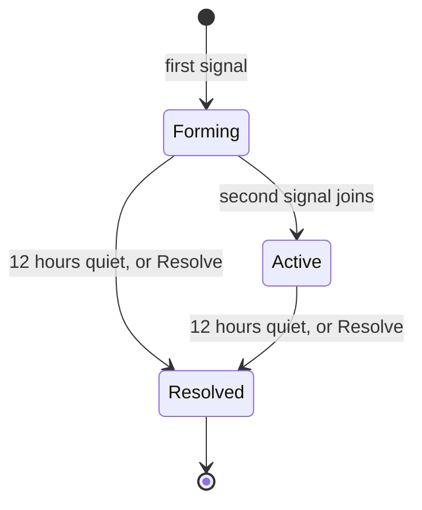

**クラスター**は、Pulse（アプリでは **Signals** と表示されます）が 1 つの問題として扱う、関連するシグナルのグループです（**シグナル**とは、ノイズ抑制を通過したイベントです）。そのため、18 回発火する不安定なアラームは、18 のメンバーを持つ 1 つの項目になります。このページでは、クラスターがどのように開いて閉じるか、Pulse がクラスター化の前に何を破棄するか、各操作が何をするかを説明します。**Snooze** を含むすべてのクラスターの操作には、ワークスペースの **Admin** ロールが必要です。Developer と Viewer はクラスターを読めますが、操作は表示されません。[Roles](/guide/security/roles) を参照してください。

## クラスターのライフサイクル

クラスターには 3 つのステータスがあります。それを動かすのは、そのクラスター自身のシグナルか、人だけです。

解決したクラスターが再び開くことはありません。次に一致するシグナルは、新しいクラスターを開始します。12 時間のルールはクラスター自身のシグナルだけを見るため、振り分け済みのクラスターも閉じます。

| ステータス | 意味 |
|---|---|
| **Forming** | まだシグナルが 1 つだけ。 |
| **Active** | シグナルが 2 つ以上。 |
| **Resolved** | 12 時間シグナルがないか、人が解決した。これが唯一の閉じたステータスです。 |

**振り分け済み（routed）はステータスではありません。** オープン中のインシデントがクラスターを保持しているとき、そのクラスターは振り分け済みで、その下では Forming または Active のままです。振り分け済みのクラスターは **Handled** レーンに表示されます。次の 3 つのルールが適用されます。

- 一致する新しいシグナルは振り分け済みのクラスターに合流し、インシデントを更新します。2 つ目の調査は開始しません。
- インシデントをクローズしても、クラスターはクローズされません。同じ障害が再び発火した場合、そのインシデントを再オープンするか新しいものを開くかは、トリアージが判断します。
- インシデントがクローズされると、そのクラスターを再びエスカレーションできます。

## シグナルがクラスターに合流する仕組み

Pulse は、新しいシグナルを、クラスターがまだ開いている過去 6 時間のシグナルと比較します。最初に一致したルールが行き先を決めます。

1. **同じリソース、または同じタイトル。** シグナルがリソース ID を共有しているか、タイトル（大文字と小文字は無視）を共有しています。両方のシグナルが異なるリソース ID を持つ場合、共有するタイトルは考慮されません。2 つのリソースでの同じアラーム名は 2 つの障害です。
2. **同じサービス。** シグナルが **Service** の値を共有しています。サービスのないシグナル（`unknown` と表示されます）とチャットのメッセージは、このルールをスキップします。このルールはリソース ID を無視するため、異なるリソースでの 2 つの障害が同じサービスを示していれば合流します。

どちらのルールも一致しない場合、シグナルは **Forming** で新しいクラスターを開きます。解決したクラスターが新しいシグナルを受け取ることはありません。

リソース ID は **Resource ID Path** から、パスが設定されていない場合は最上位の `resource_id` キーから取得されます。どちらでも値が見つからない場合、CloudWatch のアラームはアラームの ARN を使います。**Resource** フィールド（表示名）は使われません。そのため、Webhook のソースでは:

- タイトルが異なっても 1 つの障害の繰り返しがまとまり、2 つのリソースでの同じアラートが分かれたままになるよう、**Resource ID Path** を対応付けます。
- **Service Path** は、`checkout-api` のように 1 つのサービスを示す値にだけ対応付けます。`prod` のような広い値では、無関係な障害が 1 つのクラスターにまとまってしまいます。

## ノイズ抑制

生のイベントがシグナルになる前に、Pulse は 4 つのチェックを順に実行します。最初に一致したものがそれを破棄します。

| チェック | 破棄するもの | 例外 |
|---|---|---|
| Dedup | 完全な繰り返し: 同じソース、イベントの種類、リソース、タイトル、重大度で、タイムスタンプが以前のイベントと同じ分にあるもの。Pulse は繰り返しを捉えるため、各イベントを 1 時間記憶します。 | なし。 |
| Rate limit | 1 つのソースから 1 分あたり 100 を超えるイベント。制限は固定で、設定ではありません。 | Critical と High のイベントは常に通過します。 |
| Snooze | 誰かが設定したスヌーズに一致するイベント。 | なし。 |
| Verdict | CloudThinker が調査中にノイズだと学習したパターンの繰り返し。静かにする期間は 6 時間から 24 時間、7 日へと延びます。 | Critical と High のイベントは常に通過します。 |

タイムスタンプはイベント自身の時刻です。Webhook では **Timestamp Path** が指すフィールド、パスが設定されていない場合は最上位の `timestamp` キーです。そのフィールドがないか、Pulse が読める日付でない場合、Pulse はイベントを受け取った時刻を使います。たとえば、20 分後に元のタイムスタンプでアラートを再試行するツールは、重複として破棄されます。タイムスタンプなしで 1 分間隔の 2 回の送信は、重複になりません。

Dedup は、破棄した各繰り返しを元のシグナルに数えます。Rate limit、Snooze、Verdict は、イベントを削除せず、抑制済みとしてマークして保持します。抑制されたイベントはクラスターに合流しません。その数を確認するには、到着したすべての生のイベントを数える **Resolve → Signals** の上部のファネルにカーソルを合わせるか、**Resolve → Insights → Signal quality** で **Noise suppressed** と **Top noisy sources** を開きます。[Pulse Analytics](/ja/guide/pulse/analytics) を参照してください。

学習した Verdict のパターンは、編集できる場所には一覧されていません。次の 3 つのことでパターンが早く終了します: 同じパターンの Critical または High のイベント（通過し、パターンを解除します）、一致するスヌーズされたシグナルでの **Unsnooze**（これも解除します）、または静かにする期間の終了（最大 7 日後）。

シグナルがクラスターに合流した後、CloudThinker がそれを分類します。**Not actionable** と判断されたシグナルは、そのクラスターをトリアージに送りません。ただし、IAM、SSO、KMS の鍵のライフサイクルのイベントは例外で、この方法で破棄されることはありません。

## クラスターをトリアージする

<Steps>
  <Step title="クラスターを開く">
    **Resolve → Signals** で、まず **Needs you** レーンから始めます。クラスターをクリックすると、詳細パネルが開きます。**AI summary**（または **Likely cause**）、**Next steps**、**Volume**、**Affected resources** が表示されます。シグナル自身のパネルには、その生のペイロードと、通過した抑制とエンリッチメントのステップが表示されます。
  </Step>
  <Step title="担当するか割り当てる">
    **Take it** をクリックすると、クラスターを自分に割り当てて確認済みにします。確認済みにするだけなら、**⋯** メニューを開いて **Acknowledge** をクリックします。元に戻すには **Undo acknowledge** をクリックします。どちらの場合もクラスターは開いたままで、新しいシグナルは引き続き合流します。別のオーナーに渡すには、**⋯** メニューを開き、**Assign to…** をクリックしてチームメイトを選びます。割り当てはチームメイトに通知されないため、本人に伝えてください。

    **成功時の状態:** クラスターが **Needs you** を離れ、**Handled** に表示されます。
  </Step>
  <Step title="インシデントに引き渡す">
    **Open incident**（または **⋯** メニューの **Escalate**）をクリックし、続いて **Send to triage** をクリックします。トリアージは、クラスターをオープン中のインシデント、再発したクローズ済みのインシデント、または新しいインシデントに対応付けます。インシデントを自分で選ぶには、**⋯** メニューの **Link to incident** を使います。オープン中のインシデントが最初に一覧され、クローズ済みのものを選ぶと再オープンされます。

    **成功時の状態:** クラスターが **Handled** レーンに移ります。
  </Step>
  <Step title="修正したらクローズする">
    **⋯** メニューを開き、**Resolve** をクリックして、**Resolve Cluster** で確定します。これは元に戻せません。障害が再び発火すると、一致する新しいシグナルが新しいクラスターを開きます。振り分け済みのクラスターでは、インシデントが所有しているため、**Open incident**、**Escalate**、**Resolve** が非表示になります。
  </Step>
</Steps>

## 操作のリファレンス

| 操作 | 場所 | 結果 |
|---|---|---|
| **Open incident** | クラスターのパネル、メインのボタン | **Send to triage** を開きます。オープン中のインシデントがクラスターを保持している間は非表示です。トリアージが失敗した後は、ボタンが **Retry triage** になります。 |
| **Take it** | クラスターのパネル | クラスターを自分に割り当てて確認済みにします。担当後は非表示になります。 |
| **Escalate** | クラスターのパネル、**⋯** メニュー | **Open incident** と同じで、クラスターをトリアージに送ります。振り分け済みの間は非表示です。 |
| **Link to incident** | クラスターのパネル、**⋯** メニュー | 選んだインシデントにクラスターを関連付けます。クラスターが解決されるまで使えます。すでに振り分け済みのクラスターでは 2 つ目の関連付けを追加し、クラスターは最初のインシデントにも残ります。 |
| **Resolve** | クラスターのパネル、**⋯** メニュー | クラスターを完全にクローズします。振り分け済みの間は非表示です。 |
| **Assign to…** | クラスターのパネル、**⋯** メニュー | クラスターにオーナーを付けます。 |
| **Acknowledge** | クラスターのパネル、**⋯** メニュー | クラスターを確認済みにし、**Needs you** から外します。開いたままです。**Undo acknowledge** で元に戻します。 |
| **Snooze** | 一覧からクラスターを開いたときのクラスターのパネルの **⋯** メニュー、またはシグナルのパネルの **Snooze** ボタン | クラスターの代表のシグナルに似たアラートを、**1 hour**、**4 hours**、**1 day**、**Forever** のいずれかの期間ミュートします。元に戻すには **Unsnooze** をクリックします。 |

リソースを示すシグナルのスヌーズは、そのリソースでの似たアラートだけをミュートします。それ以外の場合は、同じソースとイベントの種類を持つすべてのアラートをミュートするため、期間を選ぶ前にメニューのヒントを確認してください。**Forever** のスヌーズは期限切れになりません。誰かがそのシグナルで **Unsnooze** をクリックするまで、一致するアラートはミュートされたままです。

## トラブルシューティング

<AccordionGroup>
  <Accordion title="Open incident、Escalate、Resolve が表示されない">
    クラスターは振り分け済みで、オープン中のインシデントが保持しています。インシデントから作業するか、先にインシデントをクローズしてください。
  </Accordion>
  <Accordion title="Send to triage の後にトリアージが開始されなかった">
    クラスターのパネルに **Queued for triage** または **Triage could not run** と表示されます。実行できなかった場合は、そのメッセージの横の **Retry** をクリックします。トリアージが失敗すると、Critical と High のクラスターも **Needs you** に戻ります。
  </Accordion>
  <Accordion title="重要なアラートが表示されなかった">
    各原因を順に確認してください。

    - **Snooze:** 誰かがそのソースやリソースをミュートしました。一致するシグナルを開き、**Unsnooze** をクリックします。
    - **Rate limit:** バースト中は、1 つのソースから 1 分あたり 100 を超える Low と Medium のアラートが破棄されます。
    - **Verdict:** CloudThinker がそのパターンをノイズだと学習しました。Low と Medium の繰り返しは最大 7 日間静かなままです。解除するには[ノイズ抑制](#ノイズ抑制)を参照してください。
    - **Not actionable:** アラートは届いてクラスター化されましたが、分類で対応不要と判断されたため、トリアージには送られませんでした。**History** レーンでそのクラスターを探して開き、**Open incident** をクリックします。

    イベントが抑制されているかどうかを確認するには、**Resolve → Signals** の上部のファネルにカーソルを合わせます。
  </Accordion>
</AccordionGroup>

## 次のステップ

<CardGroup cols={2}>
  <Card title="根本原因分析" icon="magnifying-glass" href="/ja/guide/incident/root-cause-analysis">
    振り分け済みのクラスターを、その調査まで追います。
  </Card>
  <Card title="Pulse Analytics" icon="chart-line" href="/ja/guide/pulse/analytics">
    Signals がどれだけのノイズを取り除き、クラスターがどれだけ早く閉じるかを確認します。
  </Card>
  <Card title="Pulse のソースを接続する" icon="plug" href="/ja/guide/pulse/setup">
    Webhook、ポーリング、チャットのソースをさらに追加します。
  </Card>
  <Card title="On-call" icon="users" href="/guide/incident/oncall">
    インシデントが条件を満たしたときに誰を呼ぶかを選びます。
  </Card>
</CardGroup>
