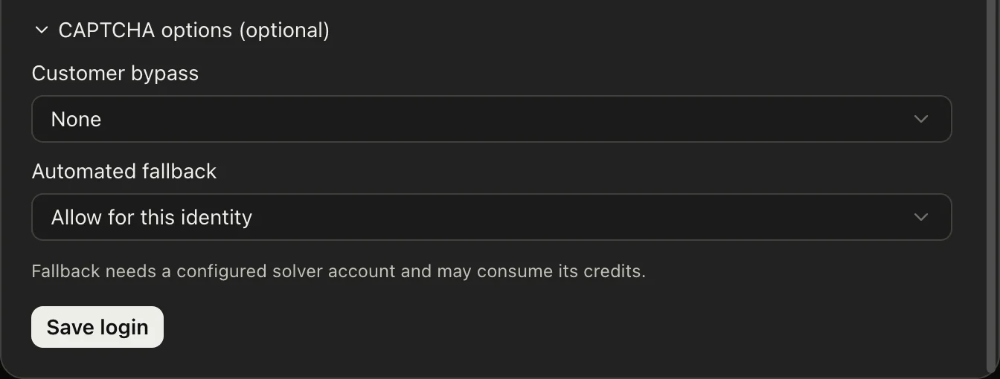
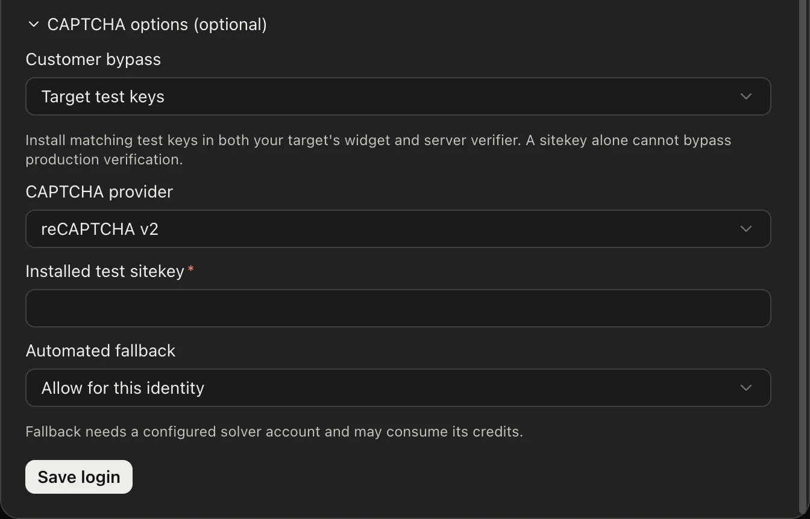

アプリのログインページに CAPTCHA (reCAPTCHA、hCaptcha、Cloudflare Turnstile) が表示される場合、CloudThinker にその突破方法を伝えるまで、[テスト実行](/ja/guide/security/security-testing) は保存したパスワードでサインインできません。テストキー、バイパス、自動フォールバックのいずれもない場合、ログインは失敗し、実行は **Incomplete** で終わります。このページでは、これに対応する 4 つの方法と、ログインが本当に成功したかを確認する方法を説明します。

## 方法を選ぶ

| 方法 | 使う場面 | フォームでの設定 | 必要なもの |
| --- | --- | --- | --- |
| **Target test keys** | 自分で管理するステージングまたはテスト環境をテストする場合 | **Customer bypass** = **Target test keys** | ログインウィジェットとサーバー側の検証の両方にインストールした、CAPTCHA プロバイダーのテストキー |
| **Bypass header** | 特定のヘッダーとシークレットがあるとアプリがすでに CAPTCHA をスキップする場合 | フォームでは **Customer bypass** = **None** にし、ヘッダーはチャットで設定 | ヘッダー名と、シークレットを `CAPTCHA_BYPASS_` 認証情報として保存するワークスペースの Admin |
| **Automated fallback** (ターゲットの変更なし) | ターゲットを変更できない場合 | **Customer bypass** = **None**、**Automated fallback** = **Allow for this identity** | CloudThinker 全体でオンになっている **CAPTCHA solver enabled**。それでも失敗することがあります |
| パスワードの代わりの **[Session token](/ja/guide/security/security-testing#テストユーザーを追加する)** | 上記のいずれも機能しない場合、ログインに MFA が必要な場合、またはログインページが別のドメインにある場合 | パスワードのフォームではなく、別の **Session token** テストユーザー | ブラウザの Network パネルから cURL としてコピーした、サインイン済みの `GET` リクエスト |

最も確実なのは Target test keys です。Automated fallback はベストエフォートで、テストユーザーごとに設定するため、予備としてバイパスと併せて許可できます。

### Automated fallback で対応できるもの

フォールバックは CAPTCHA 解決サービスを使いません。ログインと同じブラウザセッションの中で、ログインの期限内に収まるソルバーの期限内で動作します。

| プロバイダー | フォールバック |
| --- | --- |
| **reCAPTCHA v2**、**hCaptcha** | ベストエフォート。画像タイルやドラッグのチャレンジは、CloudThinker に設定されている AI ビジョンモデルに送られます |
| **reCAPTCHA v3** | ブラウザ内でのベストエフォート。ページが reCAPTCHA のアクションを提供する場合のみ。それ以外は非対応です |
| **Cloudflare Turnstile** | ブラウザ内でのベストエフォート。画像は送られません |

フォールバックは **CAPTCHA solver enabled** がオンになるまでオフです。この設定は 1 つのワークスペースや組織ではなく CloudThinker 全体に適用されるため、CloudThinker のサポート、または社内で CloudThinker を運用している担当者に依頼してください。Target test keys と Bypass header は、チャレンジの画像をどこにも送りません。

## 始める前に

- 登録済みの Cyber アプリと、そのテストユーザーを編集する権限。[セキュリティテストを実行する](/ja/guide/security/security-testing) を参照してください。
- **テストユーザー**: テスト実行がユーザー名とパスワードでサインインする、アプリ内の専用アカウント。テスト用に作成したものを使い、実際のユーザーのアカウントは決して使わないでください。追加するボタンの名前は場所によって異なります。[テストユーザーを追加する](/ja/guide/security/security-testing#テストユーザーを追加する) を参照してください。
- テストキーまたはバイパスヘッダーの場合: ターゲットアプリの CAPTCHA 設定へのアクセス。
- バイパスヘッダーの場合: キーが `CAPTCHA_BYPASS_` で始まる [認証情報](/guide/credentials) (たとえば `CAPTCHA_BYPASS_STAGING`) を、バイパスのシークレットを値として追加できるワークスペースの Admin。

## ログインを設定する

<Steps>
  <Step title="パスワードのフォームを開く">
    **Cyber** を開き、**Pentest apps** でアプリを選び、**Settings** タブを開いて、**Test identities** の行で **Add** または **Manage** をクリックします。テスト ID を追加し、**Authentication method** として **Password** を選びます。

    ユーザー名とパスワードを入力します。ログインフォームのあるページがアプリの開始ページでない場合は、**Login URL (optional)** にそのページを設定します。アプリのターゲットと同じオリジンを使い、その [スコープ](/ja/guide/security/security-testing#スコープとコンテキストを設定する) に収まっている必要があります。別の SSO や ID プロバイダーのドメインでホストされているログインは拒否されるため、そのようなアプリには **Session token** を使ってください。たとえばターゲットが `https://staging.shop.com` の場合、`https://staging.shop.com/login` は使えますが、`https://auth.shop.com/login` は拒否されます。

    **CAPTCHA options (optional)** を展開します。

    <Frame>
      
    </Frame>
  </Step>
  <Step title="Customer bypass を設定する">
    **Customer bypass** で値を 1 つ選びます。

    - **None**: ターゲット側の例外はありません。許可されている場合、実行は Automated fallback に頼ります。
    - **Target test keys**: **CAPTCHA provider** (reCAPTCHA v2、reCAPTCHA v3、hCaptcha、Cloudflare Turnstile) を選び、ログインウィジェットの公開サイトキーを **Installed test sitekey** に貼り付けます。対応するテストシークレットはサーバーに置いたままにします。CloudThinker がそれを必要とすることはありません。reCAPTCHA v3 には常に成功するテストキーがないため、v3 ではステージングのサイトキーを入力してステージングの検証でスコアのしきい値を下げるか、代わりに **Bypass header** を使ってください。

    <Frame>
      
    </Frame>

    - **Bypass header**: フォームには **Header name** と **Bypass secret** の欄が表示されますが、フォームからヘッダーバイパスを保存しようとすると常に拒否されます。代わりに、テストユーザーを **None** で保存し、[始める前に](#始める前に) の `CAPTCHA_BYPASS_` 認証情報が存在することを確認してから、チャットで CloudThinker に設定を依頼します。たとえば「Set a header bypass for the qa-member test user on the Shop staging app, header `X-QA-Bypass`, using credential CAPTCHA_BYPASS_STAGING.」のように依頼します。ワークスペースの Admin である必要があります。CloudThinker は、そのテストユーザーの更新された CAPTCHA ポリシーを返信します。ポリシーにはバイパスの種類が表示されますが、シークレットは決して表示されません。ターゲットがすでにヘッダーを受け付けている必要があり、パスワードでのサインインも引き続き必要です。
  </Step>
  <Step title="Automated fallback を設定する">
    **Automated fallback** で **Allow for this identity** または **Disable for this identity** を選びます。既定値: **Allow for this identity**。

    Allow は、CloudThinker で **CAPTCHA solver enabled** がオンの場合にのみ有効になります。ソルバーをオンにすることはできません。このユーザーのチャレンジ画像を AI モデルに送りたくない場合は、**Disable for this identity** を選んでください。
  </Step>
  <Step title="保存して実行する">
    **Save login** をクリックします。CloudThinker はサインインせずにパスワードのテストユーザーを保存するため、保存してもログインが機能することは証明されません。

    パスワードのテストユーザーには、ログインだけのテストはありません。チェックは Pentest の実行の開始時に行われます。**Run pentest** をクリックして実行を開始してください。ログインのステップには既定で 60 秒の期限があるため、約 1 分以内に成功したかどうかが分かります。CloudThinker のサポート、または社内で CloudThinker を運用している担当者は、この期限を 20 秒から 120 秒の範囲で変更できます。

    **成功時の状態:** 実行は、サインインした状態で保護されたページを読み込めることを証明し、その後 run workbench でテストを続けます。ログインを証明できない場合、実行は早期に停止して **Incomplete** で終わるため、失敗したログインが匿名のみのテストとして通ることはありません。保護されたルートがテストされたとみなすのは、実行がログインを通過した場合だけにしてください。
  </Step>
</Steps>

## プロバイダーのテストキー

reCAPTCHA v2、hCaptcha、Turnstile は、常に成功するテストキーを公開しています。サイトキーをログインウィジェットに、対応するテストシークレットをサーバー側の検証にインストールし、サイトキーを **Installed test sitekey** に入力します。

| プロバイダー | 知っておくこと | 参考 |
| --- | --- | --- |
| **reCAPTCHA v2** | Google のテストキーのペアはチャレンジをスキップし、検証に成功します | [reCAPTCHA FAQ](https://developers.google.com/recaptcha/docs/faq#id-like-to-run-automated-tests-with-recaptcha.-what-should-i-do) |
| **reCAPTCHA v3** | Google は v3 向けの常に成功するテストキーを公開しておらず、テスト用に別のキーを使うよう推奨しているだけです。スコアは実際のトラフィックと異なる場合があるため、サーバーがログインを拒否することもあります。v3 では **Bypass header** か、ステージングの検証での低いスコアしきい値を優先してください | [reCAPTCHA FAQ](https://developers.google.com/recaptcha/docs/faq) |
| **hCaptcha** | テストサイトキーは、対応するテストシークレットとの組み合わせでのみ機能します | [hCaptcha test keys](https://docs.hcaptcha.com/#integration-testing-test-keys) |
| **Cloudflare Turnstile** | ダミーのサイトキーには、対応するダミーのシークレットが必要です。本番のシークレットはダミーのレスポンスを拒否します | [Turnstile testing](https://developers.cloudflare.com/turnstile/troubleshooting/testing/) |

<Warning>
  テストキーはボット対策を無効にします。テスト環境でのみ使い、本番環境では決して使わないでください。
</Warning>

## ログインの実行が CAPTCHA をどう処理するか

1. 実行はログインページを開き、保存したユーザー名とパスワードを入力します。
2. Customer bypass を設定している場合は、まずそれを適用します。
3. それでも CAPTCHA が表示され、CloudThinker とそのテストユーザーの両方でフォールバックが許可されている場合、実行は同じブラウザセッション内で解決を試みます。
4. 実行は、サインインした状態で保護されたページが読み込まれることを確認します。それを証明できない場合、匿名の訪問者としてテストする代わりに **Incomplete** で終わります。

フォールバックは、画像のチャレンジやプロバイダーのチェックで失敗することがあり、プロバイダーを選んでも成功が保証されるわけではありません。ログインにパスワードのあとの MFA や別のステップが必要な場合、CAPTCHA のオプションは役に立ちません。代わりに **Session token** を使ってください。

## トラブルシューティング

Cyber のすべての問題をまとめて確認するには、[Cyber のトラブルシューティング](/guide/security/cyber-troubleshooting) を参照してください。

パスワードのテストユーザーを保存してもサインインは行われないため、**Save login** をクリックしたときに表示されるのは、フォームの問題 (拒否されたヘッダー名やヘッダーバイパス、ターゲット外の Login URL) だけです。CAPTCHA、タイムアウト、MFA のメッセージは、テスト実行のログインのステップから表示されます。

<AccordionGroup>
  <Accordion title="CAPTCHA blocked this login">
    チャレンジが解決されませんでした。テストキーまたはバイパスヘッダーがターゲットにインストールされていることを確認するか、CloudThinker でソルバーがオンの場合は Automated fallback を許可してください。いずれも機能しない場合は、**Session token** を添付してください。
  </Accordion>
  <Accordion title="CAPTCHA fallback is unavailable">
    CloudThinker で **CAPTCHA solver enabled** がオフになっているか、呼び出せる AI ビジョンモデルがありません。**Allow for this identity** でこれを上書きすることはできません。CloudThinker のサポート、または社内で CloudThinker を運用している担当者にオンにするよう依頼するか、**Target test keys** または **Bypass header** に切り替えてください。
  </Accordion>
  <Accordion title="This CAPTCHA flow is not supported">
    実行が対応できない種類のチャレンジです。ターゲット側のバイパスか **Session token** を使ってください。
  </Accordion>
  <Accordion title="Login could not stay within its safety boundary">
    ログインがアプリのターゲットまたはスコープの外にリダイレクトしました。**Login URL (optional)** とアプリのターゲットの設定を確認してください。
  </Accordion>
  <Accordion title="The test sitekey does not work">
    ウィジェットとサーバーは、選んだプロバイダーの対応するテストキーを使う必要があります。CloudThinker にサイトキーを入力しても、サーバーの検証は変わりません。また、テストサイトキーは本番の検証に成功しません。
  </Accordion>
  <Accordion title="Use a dedicated CAPTCHA bypass header">
    ヘッダー名が予約されているか、有効なヘッダー名ではありません。`Authorization`、`Proxy-Authorization`、`Cookie`、`Host`、`Content-Length`、`Transfer-Encoding`、`Connection`、`Upgrade`、`TE`、`Trailer`、`Origin`、`Referer` は、フォームでもチャットでも拒否されます。`X-QA-Bypass` のように、バイパスだけが使う名前を選んでください。

    有効な名前であっても、ログインフォームはヘッダーバイパスを拒否します。**None** で保存し、[ログインを設定する](#ログインを設定する) の **Customer bypass を設定する** のステップのとおり、チャットでヘッダーを設定してください。
  </Accordion>
  <Accordion title="Login did not finish in time">
    CAPTCHA の試行を含むログインが、ログインの期限を過ぎました。再試行するか、CloudThinker のサポート、または社内で CloudThinker を運用している担当者に期限の引き上げを依頼してください。テストキーまたはバイパスヘッダーを使えば、ソルバーの時間はまったくかかりません。
  </Accordion>
  <Accordion title="This login requires MFA or another authentication step">
    パスワードのフォームが最後のステップではありません。サインイン済みのブラウザからコピーした **Session token** を添付してください。
  </Accordion>
</AccordionGroup>

## 次のステップ

実行がサインイン状態でのアクセスを証明したら、ログインの後ろで何が見つかったかをレビューします。

<CardGroup cols={2}>
  <Card title="セキュリティテストを実行する" icon="crosshairs" href="/ja/guide/security/security-testing">
    スコープを設定し、他のログイン方法を添付し、強度を選びます
  </Card>
  <Card title="Issue をトリアージする" icon="list-check" href="/guide/security/cyber-findings">
    修正の優先順位を付ける前に、証拠とカバレッジの不足を確認します
  </Card>
</CardGroup>
