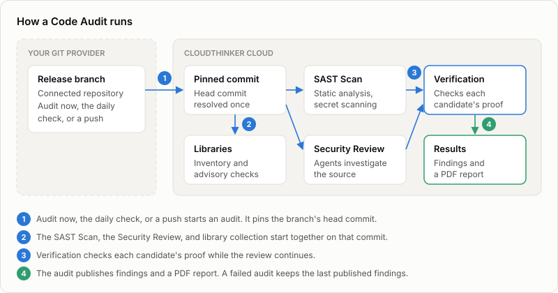
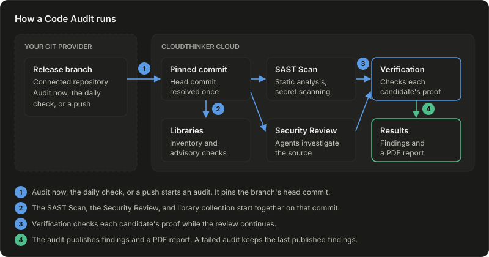
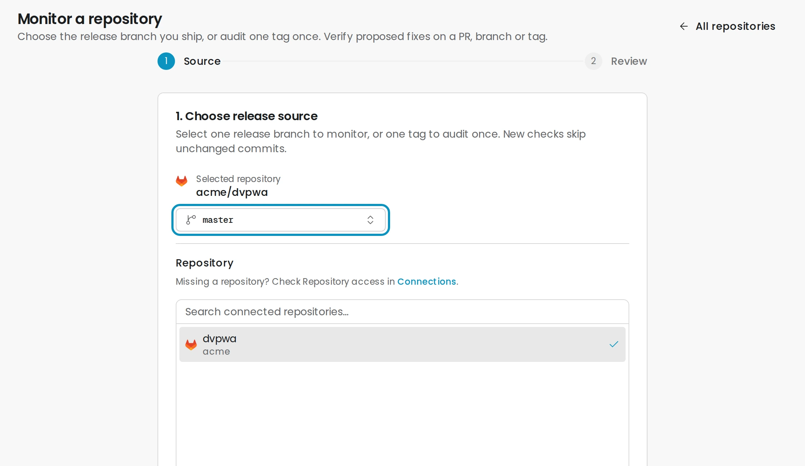
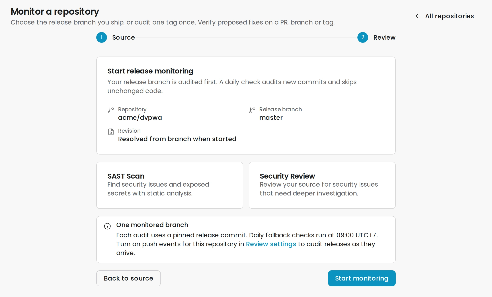
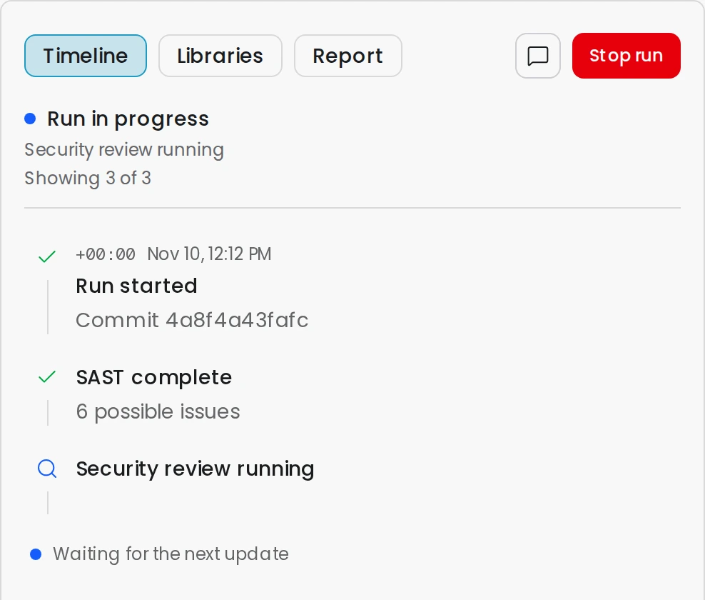
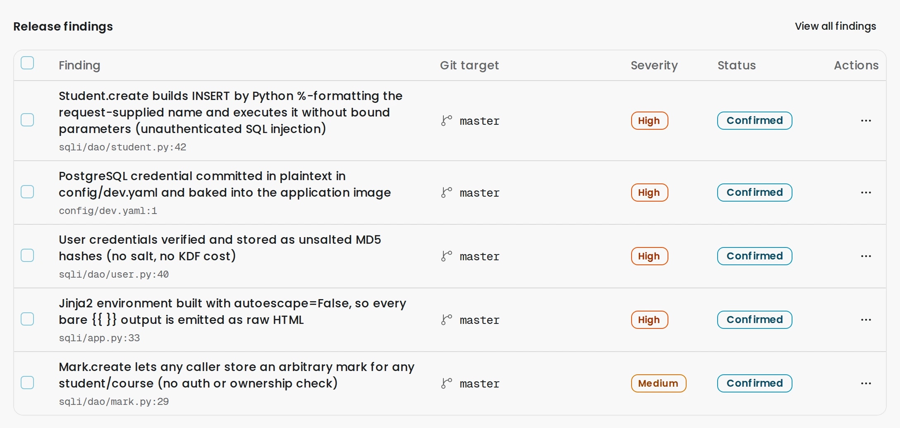
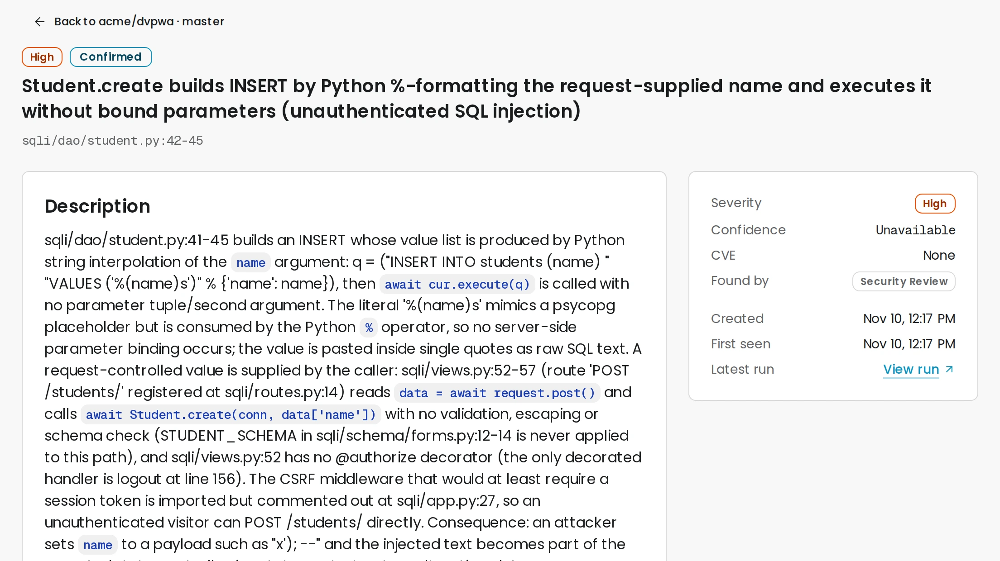
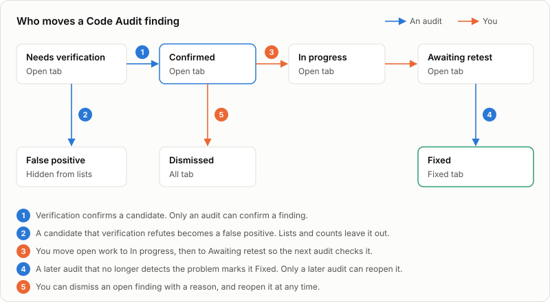
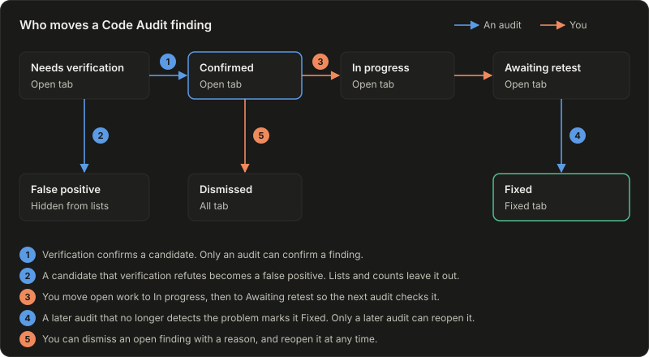
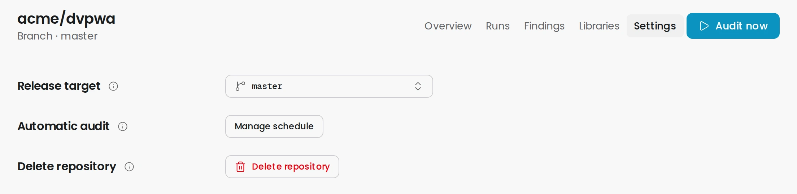

Code Audit は、1 つのリポジトリのブランチまたはタグのソースコードを読み、疑わしいコードを指摘して調査し、問題として報告する前に各候補を検証します。その問題は [Pentest のアプリとその問題](/ja/guide/security/security-testing)とは別に保持されますが、どちらも Cyber の **Issues** タブに表示されます。

## 前提条件

- リポジトリにアクセスできる[接続済みの Git プロバイダー](/ja/guide/connections/overview): GitHub、GitLab、Bitbucket、Azure DevOps、AWS CodeCommit。
- そのソースを監査する権限。アプリ、URL、DNS による証明、テスト用のログインは不要です。
- 適切なワークスペースロール。[Roles](/guide/security/roles) を参照してください。

| タスク | Admin | Developer | Viewer |
| --- | --- | --- | --- |
| ブランチを監視し、そのスケジュールを設定し、リポジトリを削除する | ✓ | | |
| タグを 1 回監査する、**Audit now**、実行の停止または再開、修正の検証 | ✓ | ✓ | |
| 問題のトリアージ、**Open PR** | ✓ | ✓ | |
| 監査、問題、ライブラリ、レポートを読む | ✓ | ✓ | ✓ |

## 監査の仕組み

<Frame caption="1 回の監査はコミットを固定し、並行してスキャンとレビューを行い、検証してから公開します">
  
  
</Frame>

1. **Audit now**、毎日のチェック、またはプッシュが監査を開始します。監査はブランチの先頭のコミットを固定するため、実行中のプッシュで読む内容が変わることはありません。
2. **SAST Scan** は、静的解析で疑わしいコードと露出したシークレットを見つけます。**Security Review** では、エージェントがソースを詳しく調査します。Code Audit はブランチの[ライブラリ](/ja/guide/security/cyber-libraries)も収集します。
3. レビューが続く間に、検証が各候補の証拠を確認します。
4. 監査はその問題と PDF のレポートを公開します。失敗した監査は、最後に公開された問題を保持します。

## リポジトリの監視を開始する

<Steps>
  <Step title="リポジトリとブランチを選ぶ">
    **Cyber** を開き、**Code audit** タブをクリックして、**New audit** をクリックします。

    **1. Choose release source** でリポジトリを選び、出荷するブランチを選びます。1 つのリリースを 1 回監査するには、タグを選びます。

    <Frame caption="リポジトリとそのリリースブランチを選択した Source のステップ">
      
    </Frame>

    **Review → Settings → Repositories** を開き、リポジトリの操作メニューから **Run Code Audit** を選ぶこともできます。リポジトリがそのデフォルトのブランチとともに事前に選択されます。
  </Step>
  <Step title="確認して開始する">
    **Review audit** をクリックします。リポジトリ、リリースブランチ、毎日のチェックの時刻を確認し、**Start monitoring** をクリックします。タグの場合、ボタンは **Audit tag** です。

    <Frame caption="リリースブランチの Review のステップ">
      
    </Frame>

    **成功時の状態:** リポジトリの **Runs** タブが新しい実行で開きます。各リポジトリは 1 つのリリースブランチを監視します。
  </Step>
</Steps>

ブランチを監視すると、UTC+7 の 09:00 の毎日の監査も作成されます。プッシュによる監査は、リポジトリが [Review](/ja/guide/code-review/setup) でセットアップされるとオンになります。Developer はタグを監査できますが、ブランチの監視は開始できません。

## 実行を追う

**Runs** タブは、**Run history** にすべての実行を一覧します。実行を選ぶと、その **Timeline**、**Libraries**、**Report** が表示されます。

<Frame caption="進行中の実行: SAST は完了、Security Review は実行中">
  
</Frame>

- **Stop audit** は、確定後に実行を終了します。
- 未完了または失敗した実行では、**Restart audit**、**Resume saved work**、**Resume audit** が表示されます。いずれも同じコミットで続行し、完了した作業を保持します。**Resume audit** は、まずその実行の試行回数の追加とクレジットの上限の引き上げを求めます。ワークスペースのクレジットは引き続き適用されます。
- 会話のアイコンは、実行の背後にあるエージェントの会話を開きます。

実行が終わると、開始した人に、監査が完了した、部分的な結果で停止した、または完了しなかったことを知らせる通知が届きます。

## 結果を読む

リポジトリの **Overview** タブには、重大度別のオープン中の問題、リリースの上位の問題、最近の実行が表示されます。リポジトリのタブは **Overview**、**Runs**、**Issues**、**Settings** です。

<Frame caption="リポジトリの Overview タブのリリースの検出事項（サンプルデータ）">
  
</Frame>

すべての問題には 1 つのステータスがあります。

| ステータス | 意味 |
| --- | --- |
| **Confirmed** | 検証により、監査したコミットで問題の証拠が見つかった |
| **To verify** | 検証が保留中、ブロック中、または決定的でない。未解決として扱います |
| **Fixed** | 後の監査で検出されなくなったか、修正のチェックで修復が証明された |
| **Snoozed** | 誰かが **Remind me later…** を選び、選んだ日付以降に修正することにした |
| **Dismissed** | 誰かが理由を付けて却下した |
| **False positive** | 検証により候補が反証された |

一覧、件数、PDF のレポートには誤検知は含まれません。

問題を開くと、その説明、エージェントの評価、**Source trace**、**Source evidence**、**Verification** の記録を読めます。**Confidence** は監査エージェントの評価に対する確信度であり、問題が悪用可能である確率ではありません。

<Frame caption="説明と要約を含む確認済みの検出事項（サンプルデータ）">
  
</Frame>

ソースコードでの証拠は、稼働中のアプリで問題に到達できることの証明にはなりません。それをテストするのは [Pentest](/ja/guide/security/security-testing) です。

## 問題をトリアージする

**Issues** タブには **All**、**Open**、**Fixed**、**Snoozed** のタブがあります。**Search issues…**、**Type**（**Code** または **Libraries**）、**Severity**、**Source**、**Status** で絞り込みます。一覧には、リポジトリが **Settings** で追跡する参照が表示されます。

<Frame caption="検出事項のステータスを誰が動かすか">
  
  
</Frame>

1. 問題を確認できるのは検証だけです。
2. 反証された候補は誤検知になり、一覧から外れます。
3. 問題のページで、オープン中の作業をステッパーに沿って **In progress**、続いて **Awaiting retest** に進めると、次の監査がそれを確認します。
4. 後の監査で問題が検出されなくなると、**Fixed** になります。**Issues** の一覧で問題のステータスから **Fixed…** を選ぶこともできます。
5. 問題のステータスをクリックすると、**Remind me later…** または **Dismiss…** を選べます。却下には理由が求められます。却下やスヌーズした問題は、同じメニュー、または問題のページの **Reopen issue** で再オープンできます。

Cyber 全体で共通のワークフローは、[Triage security issues](/guide/security/cyber-findings) を参照してください。

## 修正して検証する

確認済みの問題で **Open PR** をクリックします。CloudThinker がチャットを開き、ブランチの現在のコードで作業し、修正をコミットして、あなたがレビューするプルリクエストを開きます。**Open conversation** でそのチャットに戻ります。

修正のプルリクエストは問題を変更しません。マージして次の監査に確認させるか、先に修正を検証します。

<Steps>
  <Step title="問題を選ぶ">
    **Overview** または **Issues** タブで、最大 20 のリリースの問題を選び、**Verify fixes** をクリックします。1 つの問題の場合は、その問題のページで **Verify fix** を選びます。
  </Step>
  <Step title="対象を選ぶ">
    **Verify against** で、修正を含むプルリクエスト、ブランチ、タグを選び、**Verify fixes** をクリックします。

    **成功時の状態:** 各問題に **Fix verified**、**Still detected**、**Unable to verify** のいずれかが表示されます。
  </Step>
</Steps>

修正のチェックはクレジットを使います。リリースの問題をクローズすることはなく、クローズするのは次のリリースの監査です。

## ブランチを監査し続ける

リポジトリの **Settings** タブを開きます。**General**、**Auditing**、**Schedule**、**Reports**、**Remove** のセクションがあります。**Schedule** で **Add schedule** をクリックするか、保存済みのものでは **Manage schedule** をクリックします。

<Frame caption="リポジトリの Settings タブ">
  
</Frame>

- スケジュールは、ブラウザのタイムゾーンで定期的な時刻を設定します。保存したスケジュールは [Automation](/guide/automation/automations) として開きます。
- **Also audit after commits are pushed to this branch** は、ブランチが静かになった後、一連のプッシュごとに 1 回の監査を実行します。
- 監査は、すでに監査済みのコミットをスキップします。

リポジトリのヘッダー、または **Code audit** の一覧のその行にある **Audit now** は、**Incremental** か **Full** を選ぶ確認ダイアログを開きます。Incremental は前回の監査以降に変わったものだけを監査し、Full はブランチ全体を再スキャンし、より多くの時間とクレジットを要します。

Code Audit は、最初の監査、7 日後、スキャナーの設定やブランチの履歴が変わったときに、自動でフルスキャンを実行します。

## レポートをダウンロードする

完了した実行を開き、**Report** を選びます。各実行は、確認済み、要検証、修正済みの問題の PDF を保存します。大きなレポートが分割されている場合は **Part** を選び、**Download report** をクリックします。PDF が失敗した場合は、**Retry PDF** をクリックします。

## リポジトリを削除する

**Settings** タブの **Remove** で **Remove repository** をクリックし、確定します。Code Audit は、リポジトリのブランチ、監査、問題、証拠、ライブラリの結果、監査の会話を完全に削除します。ソースのリポジトリ、Review のセットアップ、別の修正のチャットは残ります。リポジトリを再度追加すると、履歴なしで始まります。

監査の実行中はリポジトリを削除できません。

## トラブルシューティング

Cyber のすべての問題を 1 か所で確認するには、[Cyber troubleshooting](/guide/security/cyber-troubleshooting) を参照してください。

<AccordionGroup>
  <Accordion title="Source のステップにリポジトリが表示されない">
    Connections でリポジトリのアクセスを確認してください。Source のステップからそこにリンクしています。Review 用にセットアップしたリポジトリは、ここで選ぶまで Code Audit には追加されません。
  </Accordion>
  <Accordion title="ブランチの監視にスケジュールの編集権限が必要と表示される">
    ブランチを監視するとそのスケジュールも作成され、それには Admin ロールが必要です。Admin に開始を依頼するか、タグを選んで 1 回監査してください。
  </Accordion>
  <Accordion title="監査は失敗したが、古い問題がまだ表示されている">
    失敗した監査が、最後に公開された問題を置き換えることはありません。実行のタイムラインで原因を確認し、実行の再開始または再開のボタンを使うか、**Audit now** をクリックしてください。
  </Accordion>
  <Accordion title="Audit may be stuck">
    実行がしばらく進捗を報告していません。会話を開いてエージェントが何をしているかを確認するか、**Stop audit** をクリックして新しい監査を開始してください。
  </Accordion>
  <Accordion title="マージした修正で問題が変わらない">
    問題が変わるのは、後の監査が修正を確認したときだけです。**Audit now** をクリックするか、ブランチに対して **Verify fix** を使ってください。
  </Accordion>
</AccordionGroup>

## 次のステップ

<CardGroup cols={2}>
  <Card title="ライブラリの脆弱性を監視する" icon="cubes" href="/ja/guide/security/cyber-libraries">
    依存関係のアドバイザリと、そのコードへの影響を読みます
  </Card>
  <Card title="セキュリティテストを実行する" icon="crosshairs" href="/ja/guide/security/security-testing">
    稼働中のアプリケーションをテストし、実行時の証拠を集めます
  </Card>
  <Card title="接続" icon="plug" href="/ja/guide/connections/overview">
    Code Audit が使うリポジトリのアクセスを管理します
  </Card>
</CardGroup>
