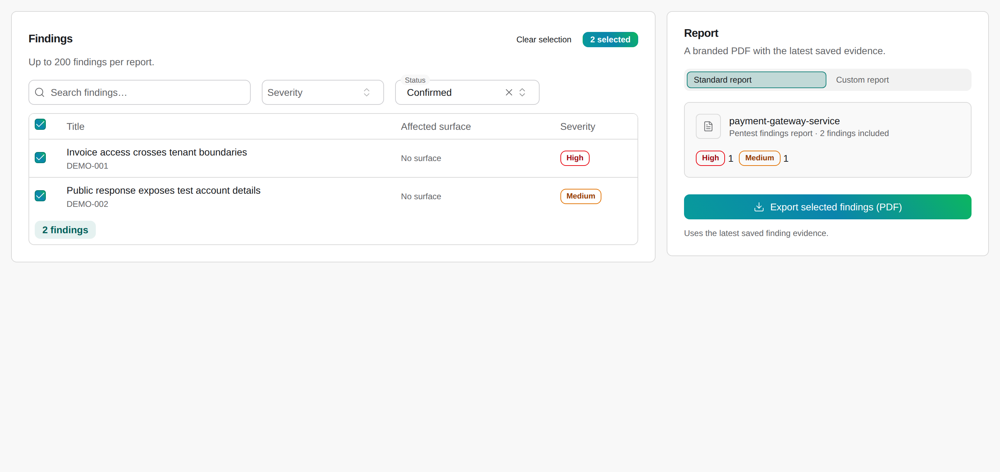

Cyber には 2 種類のレポートがあります。チケット、修正のレビュー、顧客向けに選んだ問題のエクスポートと、各 [pentest の実行](/ja/guide/security/security-testing)が完了時に作成する完全なレポートです。エクスポートが新しいスキャンを開始することはないため、必要なだけ何度でもエクスポートできます。

## 前提条件

- Cyber のアプリへの閲覧アクセス。Viewer は問題をエクスポートし、実行のレポートをダウンロードできます。
- エクスポートの場合: アプリに少なくとも 1 つの問題。[Triage security issues](/guide/security/cyber-findings) を参照してください。
- カスタムレポートの場合: ワークスペースでのチャットへのアクセス。

## レポートを選ぶ

| レポート | 含まれる内容 | 入手場所 |
| --- | --- | --- |
| **CSV** | フィルターや選択に一致する問題ごとに 1 行 | **Issues** の一覧の **Export** |
| **PDF report** | エクスポートする問題のブランド付きの PDF: 表紙、重大度の要約、エクスポートの範囲、索引、続いて問題ごとにその詳細と証拠を含む 1 つのセクション | **Issues** の一覧の **Export** |
| **Custom report…** | エクスポートする問題を、CloudThinker があなたの指示書から、必要に応じて参考レポートの構成とスタイルで作成したもの | **Issues** の一覧の **Export**。チャットで届きます |
| 実行のレポート | 1 つの実行の完全な評価。テストできなかったことも含みます | 実行の **Report** タブ |

## 問題をエクスポートする

<Steps>
  <Step title="Issues を開く">
    **Pentest apps** からアプリを開き、その **Issues** タブをクリックします。**Target** のフィルターを 1 つのアプリに設定して、Cyber の上部にある **Issues** タブを使うこともできます。
  </Step>
  <Step title="問題を選ぶ">
    一覧を絞り込むか、必要な行にチェックを入れます。チェックした行は一覧のページを移動しても選択されたままで、フィルターを変更すると解除されます。
  </Step>
  <Step title="エクスポートする">
    ツールバーの右にある **Export** をクリックします。**Issues** で **All matching filters** または **Selected rows** を選び、続いて **CSV** または **PDF report** を選びます。

    **成功時の状態:** **Issues exported as CSV** または **PDF report ready** と表示され、ファイルがダウンロードされます。
  </Step>
</Steps>

<Frame>
  
</Frame>

**PDF report** と **Custom report…** は、1 つの pentest のアプリから最大 200 の問題を受け付けます。Cyber 全体の **Issues** の一覧では、先に 1 つのアプリに絞り込むか、1 つのアプリから行を選んでください。それらがオフになっている場合、メニューにその理由が表示されます。エクスポートが失敗しても選択は保持されるため、再試行できます。

## あなたの形式でカスタムレポートを作成する

社内のセキュリティレビューの形式など、チームや顧客がすでに使っているテンプレートに問題を合わせる必要がある場合は、カスタムレポートを使います。

<Steps>
  <Step title="Custom report を開く">
    **Issues** で **Export** をクリックし、範囲を選んで、**Custom report…** をクリックします。
  </Step>
  <Step title="指示書を書く">
    **Brief** に、レポートが何をすべきかを書きます。例:

    ```text
    Write an executive summary for leadership, then group issues by risk with clear fix steps.
    ```

    テンプレートの構成とスタイルを写すには、**Upload a reference report** をクリックし、5 MB までの PDF または DOCX を選びます。
  </Step>
  <Step title="生成する">
    **Generate report** をクリックします。

    **成功時の状態:** 問題と参考資料が読み込まれた状態でチャットが開き、CloudThinker がそこでレポートを作成します。同じチャットでフォローアップを依頼して改善します。
  </Step>
</Steps>

CloudThinker が写すのは参考資料の構成とスタイルであり、その事実ではありません。参考資料にある検出事項の例が、あなたの結果として表示されることはありません。

## 今後の実行がレポートを作成する方法を設定する

レポートの設定は、ワークスペースではなくアプリに属します。各実行は開始時に保存されていた設定でレポートを作成するため、次の実行の前に変更してください。

<Steps>
  <Step title="Reports のセクションを開く">
    アプリの **Settings** タブを開き、**Reports** に移動します。
  </Step>
  <Step title="スタイルと形式を選ぶ">
    **Style** で **Standard** または **Custom** を選びます。Custom の場合は指示書を書き、必要に応じて参考レポート（PDF または DOCX、5 MB まで）を追加します。**Format** で **PDF** または **DOCX** を選びます。**Delivery** は通知の設定にリンクしています。
  </Step>
  <Step title="保存する">
    表示されるバーで **Save changes** をクリックします。

    **成功時の状態:** バーが閉じます。次の実行でこれらの設定が使われます。すでに開始された実行と、**Issues** からのエクスポートには影響しません。
  </Step>
</Steps>

## 実行のレポートをダウンロードする

<Steps>
  <Step title="実行のレポートを開く">
    アプリの **Runs** タブを開き、実行を選んで、その **Report** タブをクリックします。
  </Step>
  <Step title="ダウンロードする">
    **Download report** をクリックします。先に大きく表示して読むには、**Expand preview** をクリックします。

    **成功時の状態:** その実行の開始時にアプリのレポートの設定で選ばれていた形式で、ファイルがダウンロードされます。
  </Step>
</Steps>

結論を共有する前に、レポートのカバー範囲と認証の制限を読んでください。修正後に新しい判定を得るには、別の pentest を実行してください。

## レポートに含まれるもの

- **証拠:** 実行中に保存された、キャプチャしたリクエスト、レスポンス、スクリーンショット。エクスポートで新しい証拠がキャプチャされることはありません。
- **マスキング:** パスワード、トークン、Cookie、キーはプレースホルダーに置き換えられます。リクエストを再現するには、自分のテスト用の認証情報を使ってください。
- **制限:** 実行のレポートには、ログインに失敗した先の領域など、実行でテストできなかったことと、必要なスクリーンショットが欠けている場合が記載されます。
- **証明のフロー:** 問題のページとコピーした問題には表示されますが、PDF のレポートには含まれません。

## トラブルシューティング

Cyber のすべての問題を 1 か所で確認するには、[Cyber troubleshooting](/guide/security/cyber-troubleshooting) を参照してください。

<AccordionGroup>
  <Accordion title="PDF report や Custom report が無効になっている">
    これらには、1 つの pentest のアプリからの最大 200 の問題が必要です。メニューに理由が表示されます（例: **Select issues from one pentest app.**）。フィルターを絞り込むか、1 つのアプリに絞り込むか、選ぶ行を減らしてください。
  </Accordion>
  <Accordion title="Custom report を選択できない">
    カスタムレポートはチャットを開始するため、チャットへのアクセスが必要です。ワークスペースの Admin に依頼してください。
  </Accordion>
  <Accordion title="エクスポートが失敗する">
    **Could not export issues.** と表示されます。選択は保持されているため、確認して再度エクスポートしてください。
  </Accordion>
  <Accordion title="実行に No report yet と表示される">
    レポートは実行の完了時に作成されます。作成前に終了した失敗した実行でも、同じメッセージが表示されます。停止した実行はレポートを作成せず、代わりに **Run stopped** と表示されます。レポートを得るには新しい実行を開始してください。
  </Accordion>
  <Accordion title="新しいレポートの設定で古いレポートが変わらない">
    各実行は、開始時のレポートの設定を保持します。新しいスタイルのレポートを得るには、新しい実行を開始してください。
  </Accordion>
</AccordionGroup>

## 次のステップ

<CardGroup cols={2}>
  <Card title="セキュリティの問題をトリアージする" icon="list-check" href="/guide/security/cyber-findings">
    共有する前に、各問題の証拠を確認します
  </Card>
  <Card title="セキュリティテストを実行する" icon="crosshairs" href="/ja/guide/security/security-testing">
    再度実行して修正を検証し、新しいレポートを得ます
  </Card>
</CardGroup>
