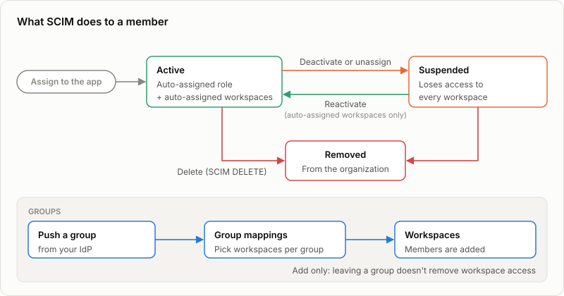
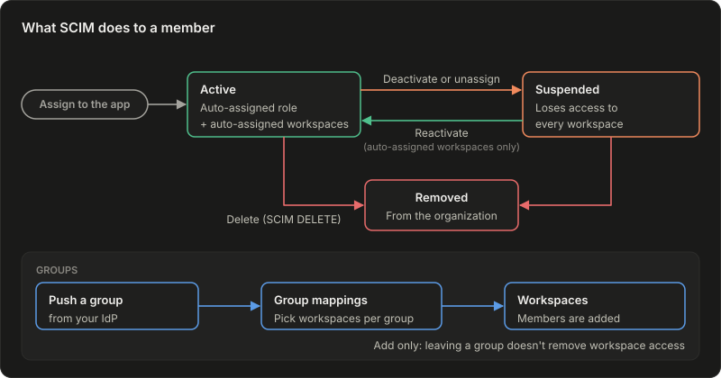

SCIM（System for Cross-domain Identity Management）を使うと、Okta や Microsoft Entra ID などの ID プロバイダー（IdP）が CloudThinker のアカウントを代わりに管理します。IdP で誰かを CloudThinker のアプリに割り当てると組織に参加し、割り当てを解除するとアクセスが終了します。手動の招待や削除は不要です。

## 前提条件

- **Scale** または **Enterprise** プランの組織。[料金](/ja/guide/billing/pricing)を参照してください。
- 検証済みのドメインを持つ、有効な [SSO 接続](/ja/guide/security/sso)。プロビジョニングの設定は、SSO が有効になって初めて表示されます。
- CloudThinker での組織の **Owner** ロール。Admin はページを読み取り専用で開けますが、SSO や SCIM は変更できません。[ロールと権限](/guide/security/roles)を参照してください。
- IdP の CloudThinker のアプリのプロビジョニングの設定への管理者アクセス。

## SCIM が CloudThinker で変更すること

<Frame caption="割り当ての解除はメンバーを停止します。メンバーを削除するのは SCIM の DELETE だけで、グループの対応付けはアクセスを追加するだけです。">
  
  
</Frame>

| IdP での操作 | CloudThinker での結果 |
|---|---|
| CloudThinker のアプリに人を割り当てる | **Auto-assigned organization role** で組織に追加され、**Auto-assigned workspaces** を得ます |
| 名前やメールアドレスを変更する | CloudThinker のプロフィールが更新されます |
| 無効化する（inactive に設定） | メンバーシップが停止され、すべてのワークスペースへのアクセスを失います |
| 再度有効化する | メンバーシップが、自動割り当てのワークスペースとともに戻ります |
| 削除する（SCIM の `DELETE`） | 組織から削除されます |
| グループをプッシュする | グループが **Group mappings** に表示され、そこでメンバーのワークスペースを選びます |

アプリからの割り当ての解除は、通常は削除ではなく無効化として扱われます。Okta と Microsoft Entra ID はどちらも、ユーザーの割り当てを解除すると `active=false` を送るため、その人は CloudThinker で削除されるのではなく **停止** されます。削除されるのは、IdP が `DELETE` を送ったときだけです。

SCIM がオンの間は、組織に誰がいるかについて IdP が信頼できる情報源になります。

- **メンバーの招待はオフになります。** CloudThinker から招待すると "Member invitations are disabled because this organization uses SCIM provisioning. Manage users through your identity provider." が返ります。
- **SCIM でプロビジョニングされたメンバーは CloudThinker で削除できません。** エラーには "This member was provisioned via SCIM." と表示されます。代わりに IdP で削除してください。
- **ジャストインタイムのプロビジョニングはオフになります。** SCIM とジャストインタイム（SSO での初回サインイン時にアカウントを作成）は同時に実行できません。SCIM をオンにすると、ジャストインタイムは自動でオフになります。IdP がプロビジョニングしていない、あなたのドメインの人は、IdP がプロビジョニングするまで、SSO のサインイン時に "No account found. Contact your administrator for access." で拒否されます。

メンバーのロールやワークスペースのアクセスは、引き続き CloudThinker で変更できます。[組織](/ja/guide/organization)を参照してください。

## CloudThinker で SCIM をオンにする

<Steps>
  <Step title="プロビジョニングの設定を開く">
    **Settings → Organization → Identity** に移動し、**Provisioning** のセクションを見つけます。

    セクションがない場合、SSO 接続がまだ有効になっていません。先に [SSO のセットアップ](/ja/guide/security/sso)を完了してください。
  </Step>
  <Step title="SCIM を選ぶ">
    **SCIM**（Sync users and groups from your identity provider）を選びます。他の選択肢は、**Manual**（自分で人を招待する）と **Just-in-time**（SSO での初回サインイン時にアカウントを作成する）です。

    **成功時の状態:** **SCIM enabled** ダイアログが開きます。
  </Step>
  <Step title="2 つの値をコピーする">
    ダイアログには次が表示されます。

    - **Bearer token**: リクエストが許可されていることを証明するために IdP が送るシークレット。
    - **SCIM base URL**: IdP が呼び出すエンドポイント。`https://<your-cloudthinker-host>/api/v1/scim/<organization-id>/v2` のような形式です。

    両方をコピーし、**Done** をクリックします。

    **成功時の状態:** **Provisioning** のセクションに、"SCIM directory sync is active." とともに **Directory sync (SCIM)** が表示されます。
  </Step>
</Steps>

<Warning>
Bearer トークンは一度しか表示されません。コピーせずにダイアログを閉じた場合は、**Rotate token** をクリックして新しいものを取得してください。
</Warning>

## 新しいメンバーのデフォルトを設定する

プロビジョニングの選択肢の下にある 2 つの設定が、新しくプロビジョニングされた人が得るものを決めます。IdP が最初のユーザーを送る前に設定してください。

| 設定 | 動作 | デフォルト |
|---|---|---|
| **Auto-assigned organization role** | 新しいメンバーが得る組織のロール: **Viewer**、**Developer**、**Admin** | **Viewer** |
| **Auto-assigned workspaces** | 新しいメンバーが参加するワークスペース | デフォルトのワークスペース |

この方法で Owner を割り当てることはできません。各ロールができることは、[ロールと権限](/guide/security/roles)を参照してください。

## ID プロバイダーを設定する

SSO 用に作成した CloudThinker のアプリを使います。

<Tabs>
  <Tab title="Okta">
    <Steps>
      <Step title="アプリで SCIM を有効にする">
        CloudThinker のアプリを開きます。**General** タブで **App Settings** の **Edit** をクリックし、**Provisioning** を **SCIM** に設定して保存します。
      </Step>
      <Step title="接続の詳細を入力する">
        **Provisioning → Integration** で **Edit** をクリックします。

        | Okta のフィールド | 値 |
        |---|---|
        | **SCIM connector base URL** | CloudThinker の **SCIM base URL** |
        | **Unique identifier field for users** | `userName` |
        | **Supported provisioning actions** | **Push New Users**、**Push Profile Updates**、**Push Groups** |
        | **Authentication Mode** | **HTTP Header** |
        | **Authorization** | CloudThinker の **Bearer token** |

        **Test Connector Configuration** をクリックし、続いて **Save** をクリックします。
      </Step>
      <Step title="To App のアクションをオンにする">
        **Provisioning → To App** で **Edit** をクリックし、**Create Users**、**Update User Attributes**、**Deactivate Users** を有効にします。保存します。
      </Step>
      <Step title="グループをプッシュする">
        **Push Groups** タブで、ワークスペースに対応付けたいグループを追加します。
      </Step>
    </Steps>
  </Tab>
  <Tab title="Microsoft Entra ID">
    <Steps>
      <Step title="管理者の資格情報を設定する">
        **Enterprise applications → CloudThinker → Provisioning** を開きます。**Provisioning Mode** を **Automatic** に設定します。**Admin Credentials** で、**Tenant URL** に **SCIM base URL** を、**Secret Token** に **Bearer token** を入力します。**Test Connection** をクリックし、続いて **Save** をクリックします。
      </Step>
      <Step title="対応付けを確認する">
        **Mappings** で、ユーザーとグループのプロビジョニングを有効のままにします。`userName` に対応付けられた属性が、検証済みのドメインのユーザーのメールアドレスを持っていることを確認します。
      </Step>
      <Step title="プロビジョニングを開始する">
        **Settings** で **Scope** を **Sync only assigned users and groups** に設定します。**Provisioning Status** を **On** に設定して保存します。Entra は約 40 分ごとにサイクルを実行します。
      </Step>
    </Steps>
  </Tab>
  <Tab title="その他の SCIM 2.0 プロバイダー">
    | IdP のフィールド | 値 |
    |---|---|
    | SCIM base URL / Tenant URL | CloudThinker の **SCIM base URL** |
    | 認証 | HTTP ヘッダー、Bearer トークン |
    | Bearer token / Secret token | CloudThinker の **Bearer token** |
    | ユーザーの一意の識別子 | `userName`。ユーザーのメールアドレスに設定します |

    ユーザーの作成、ユーザー属性の更新、ユーザーの無効化、グループのプッシュをオンにします。IdP に **Test connection** があれば実行します。
  </Tab>
</Tabs>

CloudThinker は次の属性を読みます。

| リソース | 属性 | 必須 | 用途 |
|---|---|---|---|
| User | `userName` | はい | `emails` が空の場合のメールアドレス |
| User | `emails` | いいえ | メールアドレス。`primary` のエントリーが優先され、なければ最初のもの。 |
| User | `name.givenName`、`name.familyName` | いいえ | 表示名 |
| User | `active` | いいえ（デフォルトは `true`） | 停止と再有効化 |
| User | `externalId` | いいえ | フィルターでのユーザーの照合 |
| Group | `displayName` | はい | **Group mappings** での名前 |
| Group | `members` | いいえ | 誰がグループのワークスペースを得るか |
| Group | `externalId` | いいえ | グループの照合 |

**成功時の状態:** テスト用のユーザーを 1 人アプリに割り当てます。IdP の同期間隔内に **Settings → Organization → Members** に表示され、**View sync logs** にステータス `SUCCESS` の `CREATE` のエントリーが表示されます。

IdP の選択肢と合わせられるよう、CloudThinker の SCIM API がサポートするものを示します。

| 機能 | サポート |
|---|---|
| Users と Groups のリソース（作成、読み取り、置換、パッチ、削除） | はい |
| `userName`、`emails.value`、`externalId`、`active`（ユーザー）と `displayName`（グループ）に対する `eq` のフィルター | はい。最大 100 件の結果 |
| 一括操作 | いいえ |
| ソート、ETag、パスワードの変更 | いいえ |

<Note>
誰かがすでに別の組織の CloudThinker のアカウントを持っている場合、CloudThinker がその既存のアカウントをあなたの組織に追加するのは、そのメールのドメインがあなたの検証済みの SSO ドメインの 1 つである場合だけです。そうでない場合、IdP は "User email domain not verified for this organization." を受け取ります。
</Note>

## グループをワークスペースに対応付ける

グループを使えば、IdP での 1 つの変更でチーム全体を適切なワークスペースに入れられます。

<Steps>
  <Step title="IdP からグループをプッシュする">
    IdP で、グループを CloudThinker のアプリに割り当ててプッシュします。

    **成功時の状態:** 各グループが **Settings → Organization → Identity** の **Group mappings** に、**Group name** と **Members** の件数とともに表示されます。それまでは、セクションに "No groups synced yet." と表示されます。
  </Step>
  <Step title="各グループのワークスペースを選ぶ">
    グループの行で **Auto-assigned workspaces** を開き、メンバーが参加すべきワークスペースを選びます。
  </Step>
  <Step title="グループのロールを選ぶ">
    グループの **Auto-assigned organization role** を設定するか、**Inherit from connection** のままにして、上で設定したデフォルトのロールを使います。

    CloudThinker がメンバーの組織のロールを設定するのは、メンバーを作成するときの 1 回だけです。後の同期で変わることはないため、CloudThinker で手動で変更したロールはそのまま残ります。
  </Step>
  <Step title="行を保存する">
    **Actions** の列で **Save** をクリックします。

    **成功時の状態:** グループの現在のメンバーが選んだワークスペースに追加され、今後のメンバーは IdP がグループに同期したときに追加されます。
  </Step>
</Steps>

<Warning>
グループの対応付けは、ワークスペースのアクセスを追加するだけです。誰かをグループから外しても、対応付けからワークスペースを外しても、その人がそのワークスペースから外れることはありません。[ワークスペースのメンバー](/ja/guide/workspace-users)で削除するか、IdP でアプリの割り当てを解除してすべての場所から削除してください。
</Warning>

最初の同期の後、**Settings → Organization → Members** で新しいメンバーのロールを確認し、変えるべきものを調整してください。

## 誰かが離れたときに起こること

| IdP での操作 | CloudThinker でのメンバーシップ | ワークスペース | その人のオートメーション |
|---|---|---|---|
| 無効化（inactive に設定） | 停止 | すべてから削除 | オフ |
| 再有効化 | 空きシートがあれば再び有効 | 自動割り当てのワークスペースのみ。残りは再度追加します | 誰かがオンにするまでオフのまま |
| 削除（SCIM の `DELETE`） | 削除 | すべてから削除 | オフ |

[Automations](/guide/automation/automations) のオーナーが自動で変わることはありません。ワークスペースの Admin がオートメーションのページで **Take ownership** を選べ、その Admin がオンにするまではオフのままです。[オートメーションのオーナー](/ja/guide/automation/autonomous-agents)を参照してください。

<Note>
プランがシート単位の請求を使い、すべてのシートが埋まっている場合、新しくプロビジョニングされた人や再有効化された人は inactive として追加され、まだ CloudThinker を使えません。有効なメンバーと保留中の招待はシートを使い、停止中と inactive のメンバーは使いません。Owner は **Settings → Organization → Billing** でシートを追加します。[Add or remove seats](/ja/guide/billing/subscription#シートを追加削除する) を参照してください。その後、**Settings → Organization → Members** でステータスを確認してください。
</Note>

## トークンをローテーションまたはオフにする

漏洩した可能性がある場合やポリシーで求められる場合は、**トークンをローテーション** します。

<Steps>
  <Step title="ローテーションする">
    **Directory sync (SCIM)** で **Rotate token** をクリックし、確認で **Rotate** をクリックします。

    **成功時の状態:** ダイアログに新しい **Bearer token** と **SCIM base URL** が表示されます。古いトークンは 24 時間機能し続けます。
  </Step>
  <Step title="IdP を更新する">
    新しいトークンを IdP のプロビジョニングの設定に貼り付け、接続をテストします。24 時間以内に行ってください。そうしないと、同期が認証エラーで失敗し始めます。
  </Step>
</Steps>

**SCIM をオフにする** には、**Provisioning** で **Manual** または **Just-in-time** を選び、確認で **Disable SCIM** を選びます。これによりトークンがすぐに取り消され、ディレクトリの同期が止まります。既存のメンバーはアカウントを保持し、それ以降は CloudThinker で管理します。IdP でもプロビジョニングをオフにしてください。そうしないと、失敗するリクエストが送られ続けます。

トークンの変更（生成、ローテーション、取り消し）と、SCIM がプロビジョニング、更新、削除したすべてのユーザーとグループは、[監査ログ](/guide/security/audit-logs)に記録されます。

## 同期のアクティビティを確認する

**Directory sync (SCIM)** で **View sync logs** をクリックすると、**SCIM sync logs** が開きます。

| 列 | 表示内容 |
|---|---|
| **Timestamp** | CloudThinker がリクエストを処理した時刻 |
| **Action** | `CREATE`、`UPDATE`、`DEACTIVATE`、`DELETE` |
| **Resource** | `User` または `Group` と、その ID |
| **Status** | `SUCCESS`、`SKIPPED`、`FAILED` |

CloudThinker は、7 日間同期のアクティビティがない SCIM でプロビジョニングされた人を 1 日に 1 回確認し、それぞれにステータス `SKIPPED` の `UPDATE` のエントリーを追加します。これはリマインダーにすぎず、CloudThinker がアクセスを変更することはありません。その人がまだ IdP で割り当てられているかを確認し、離れている場合はそこで割り当てを解除してください。

## トラブルシューティング

<AccordionGroup>
  <Accordion title="Provisioning のセクションがない">
    このセクションは、SSO 接続が有効な場合にのみ表示されます。ドメインの検証を含め、[SSO のセットアップ](/ja/guide/security/sso)を完了してください。変更には Owner ロールが必要です。
  </Accordion>
  <Accordion title="Group mappings にグループが表示されない">
    CloudThinker はグループを取得しません。IdP がプッシュする必要があります。IdP でグループを CloudThinker のアプリに割り当て、プッシュを実行してから、**View sync logs** で `Group` のエントリーを探してください。
  </Accordion>
  <Accordion title="ユーザーがプロビジョニングされなかった">
    IdP でユーザーが CloudThinker のアプリに割り当てられていることを確認し、同期ログで `FAILED` のエントリーを探します。よくある原因: トークンが 24 時間以上前にローテーションされたか取り消された、その人の既存のアカウントが未検証のメールのドメインを使っている（"User email domain not verified for this organization"）、またはメールアドレスが CloudThinker の内部アカウント用に予約されている（"This email belongs to a CloudThinker System user"）。最後の場合は、別のメールアドレスを使うかサポートにお問い合わせください。
  </Accordion>
  <Accordion title="離れた人がまだサインインできる">
    CloudThinker のアプリ自体で、その人の割り当てを解除するか無効化してください。グループから外しても、グループのメンバーシップが変わるだけです。一部の IdP はスケジュールで同期する（Microsoft Entra ID は約 40 分ごと）ため、次のサイクルを待って同期ログを確認してください。
  </Accordion>
  <Accordion title="すべての同期が認証エラーで失敗する">
    IdP のトークンがもう有効ではありません。トークンが 24 時間以上前にローテーションされたか、SCIM がオフにされています。**Rotate token** をクリックし、新しい値を IdP に貼り付けてください。SCIM がオフにされていた場合は、再度 **SCIM** を選んで新しいトークンを取得してください。
  </Accordion>
  <Accordion title="Cannot enable JIT provisioning while SCIM is active">
    ジャストインタイムと SCIM は同時に実行できません。**Provisioning** で **Just-in-time** を選び、**Disable SCIM** を確定してください。これによりトークンが取り消され、ディレクトリの同期が止まります。
  </Accordion>
  <Accordion title="メンバーを招待または削除できない">
    SCIM がオンの間は想定どおりです。代わりに IdP で人を割り当てるか、割り当てを解除してください。
  </Accordion>
</AccordionGroup>

## 次のステップ

<CardGroup cols={2}>
  <Card title="ロールと権限" icon="user-shield" href="/guide/security/roles">
    プロビジョニングされたメンバーに適切なデフォルトのロールを選びます。
  </Card>
  <Card title="ワークスペースのメンバー" icon="users" href="/ja/guide/workspace-users">
    各ワークスペースを開ける人を細かく調整します。
  </Card>
  <Card title="監査ログ" icon="clipboard-list" href="/guide/security/audit-logs">
    トークンの変更とプロビジョニングの解除を確認します。
  </Card>
  <Card title="シングルサインオン" icon="key" href="/ja/guide/security/sso">
    SSO 接続や検証済みのドメインを変更します。
  </Card>
</CardGroup>
