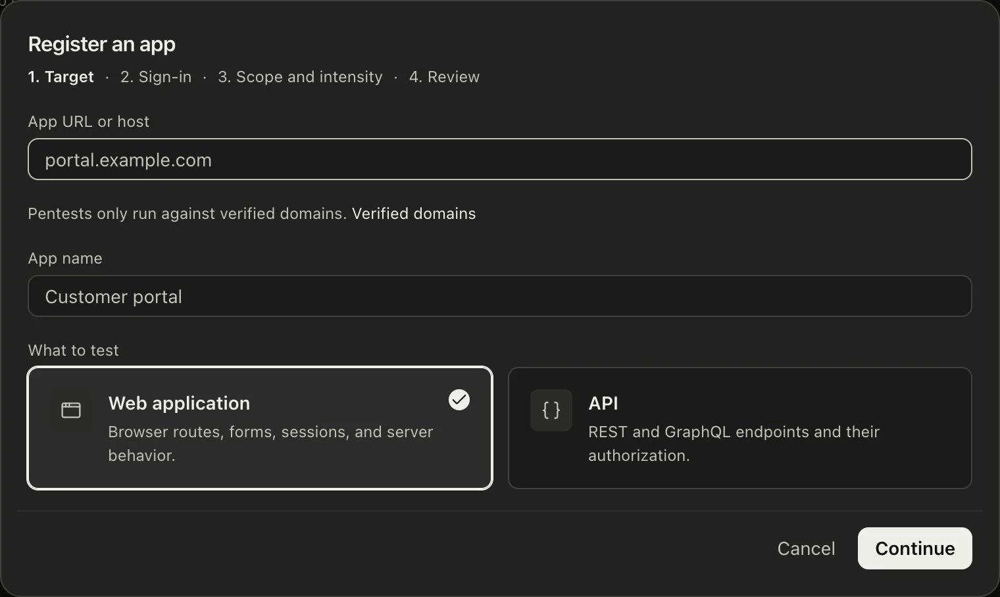
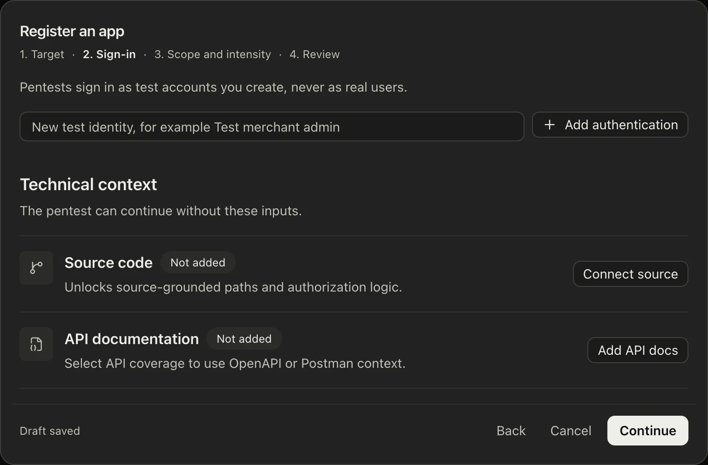
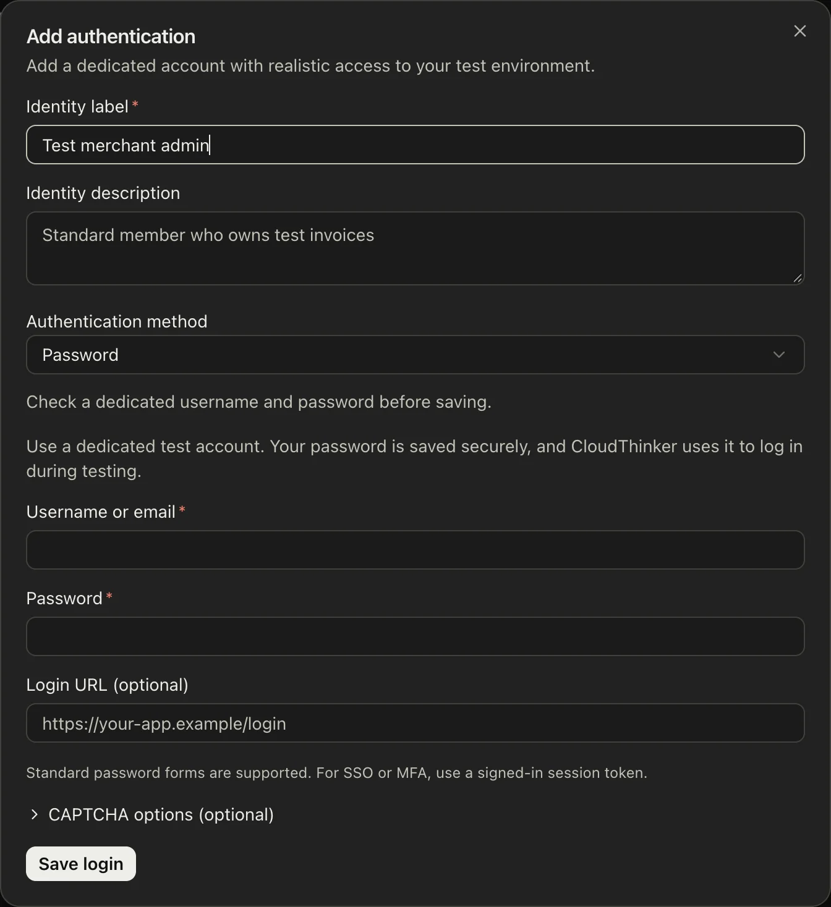
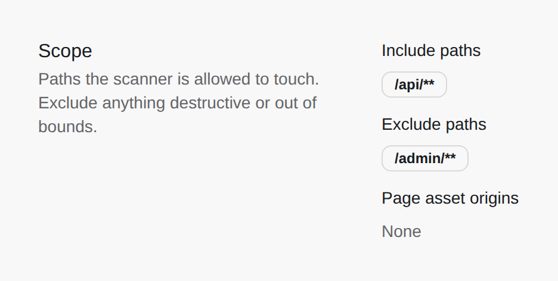
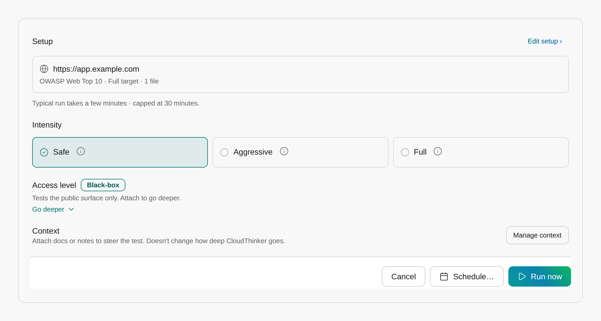
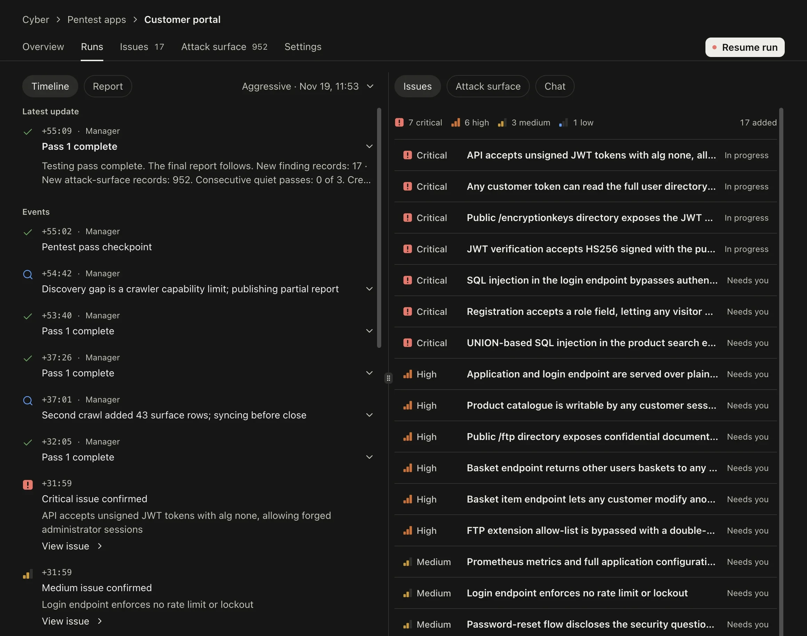

Pentest の実行は、稼働中のアプリの 1 つに対する DAST スキャンです。CloudThinker は設定した制限の範囲内でアプリをテストし、確認したすべての問題についてリクエストとレスポンスの証拠を記録します。このページではすべての設定オプションを説明します。最小限の構成で最初の実行を行うには、[Cyber クイックスタート](/guide/security/cyber-quickstart) を使ってください。

## 前提条件

- テストする権限があり、ドメインの URL でアクセスできるアプリ。**Safe** より強い強度には、ステージングを使ってください。
- ドメインの DNS レコードへのアクセスと、ドメインを検証するためのワークスペースの Admin 権限。
- 実行のためのクレジット。すべての実行でクレジットを使い、Deep dive と Fortress が最も多く使います。[Usage](/ja/guide/billing/usage) を参照してください。
- 任意: 専用のテストアカウント、OpenAPI 仕様または Postman コレクション、ホワイトボックステスト用の [Git 接続](/guide/connections/github)。

## アプリを登録する

<Steps>
  <Step title="ターゲットを設定する">
    **Cyber** を開き、**Pentest apps** に移動して、**Register an app** をクリックします。ダイアログには **Target**、**Sign-in**、**Scope and intensity**、**Review** の 4 つのステップがあります。**Target** で **App URL or host** と **App name** を入力し、**What to test** で **Web application** または **API** を選びます。**Continue** をクリックします。

    この選択によって、カバレッジレポートが測定する OWASP のカテゴリーが決まります。両方を組み合わせたり、後から変更したりすることはできません。同じホストを API としてテストするには、2 つ目のアプリを作成してください。

    <Frame>
      
    </Frame>
  </Step>
  <Step title="ドメインを検証する">
    **Target ownership** の下で **Create DNS proof** をクリックします。表示された **DNS record name** と **TXT value** を DNS プロバイダーで TXT レコードとして追加し、**Check again** をクリックします。プロバイダーがゾーン名を付け加える場合は、そのサフィックスを省いてください。

    **成功時の状態:** **Target ownership** に **Verified** と表示されます。ホストがすでに検証済みのドメインに含まれている場合、カードには **Proof reused from** とそのドメインが表示され、新しいレコードは不要です。
  </Step>
  <Step title="アクセスを追加する">
    **Sign-in** で、テストユーザー、**Source code**、**API documentation** を追加します。3 つとも任意です。それぞれについては下記のセクションを参照してください。

    <Frame>
      
    </Frame>
  </Step>
  <Step title="強度を選んでレビューする">
    **Scope and intensity** で **Default intensity** を選び、毎週実行する場合は **Weekly pentest** をオンにします。**Continue** をクリックします。**Review** で概要を確認し、**Register app** をクリックしてアプリを登録して実行を開始するか、**Run later** をクリックして実行せずに保存します。

    セットアップでは含めるパスや除外するパスは設定されないため、**Register app** はターゲット全体に対して実行されます。最初の実行では **Safe** を選んで **Run later** をクリックし、実行前にアプリの **Settings** の [Scope](#スコープとコンテキストを設定する) で含めるパスと除外するパスを設定してください。[Cyber クイックスタート](/guide/security/cyber-quickstart) でこの手順を説明しています。

    **成功時の状態:** **Register app** は最初の実行を開始します。**Run later** は実行なしで保存したアプリを開きます。
  </Step>
</Steps>

ワークスペース全体の検証済みドメインは **Cyber → Settings** から管理できます。ドメインを検証すると、そのドメインでのテストが認可されます。アプリのスコープが広がることはありません。

## テストユーザーを追加する

テストユーザーを使うと、Cyber はログインの後ろにあるページにアクセスし、認可をチェックできます。たとえば、ユーザー A がユーザー B のデータを見られるかどうかです。セットアップ中は、名前を入力して **Add authentication** をクリックします。アプリの **Settings** では、**Test identities** の行で **Add** または **Manage** を使います。**Run pentest** ダイアログでは **Add auth** をクリックします。3 つとも同じフォームが開きます。ユーザーの説明 (**Identity label**、**Identity description**) を入力し、**Authentication method** を選びます。

| 方法 | 入力するもの | チェック方法 |
| --- | --- | --- |
| **Password** | **Username or email**、**Password**、**Login URL (optional)** | サインインせずに保存されます。実行の開始時にサインインし、サインインに失敗すると実行は **Incomplete** で終わります。[CAPTCHA ログインに対応する](/ja/guide/security/captcha#ログインを設定する) を参照してください |
| **Session token** | ブラウザの Network パネルから cURL としてコピーした、サインイン済みの `GET` リクエスト | **Verify and attach** はリクエストを 1 回送り、成功した場合にのみ保存します。CloudThinker はさらに 2 回再チェックします。**Run pentest** を開いたときと、実行の開始時です |
| **Long-lived token** | 1 行につき 1 つのヘッダー名と値。たとえば名前 `Authorization`、値 `Bearer <token>`。最初の名前が空の場合は `Authorization` になります。 | チェックなしで保存されます。アクセスが拒否された場合は実行が報告します。 |
| **Agent creates new account** | サインアップページまたは管理 API を通じてユーザーを作成するための **Instructions** | 手動の実行ごとに新しいユーザーを作成し、サインアップとログインが機能したかどうかを報告します。サインアップによってアプリに実際のアカウントが作成されるため、この方法では **Aggressive** 以上を選んでください |

**Agent creates new account** の場合は、作成するロールを指定し、認証情報には `<generated_username>` と `<generated_password>` を使い、何をもってログインの成功とするかを記述した指示を書きます。

```text
Sign up at /register with <generated_username> and <generated_password>.
Create one "member" and one "admin" user.
Login succeeded when the page shows "Welcome back" and the URL is /dashboard.
```

指示は暗号化して保存され、再び表示されることはありません。変更するには、アプリの **Settings** の **Test identities** の行からアカウントを開き、新しい指示を入力します。新しい指示が保存済みの指示を置き換えます。メールや SMS のコードが必要なサインアップには対応していません。

スケジュールされた実行は、**Long-lived token** のユーザーでのみサインインします。無人で安全に再利用できるのはそれだけだからです。セッションは期限切れになり、パスワードとエージェントが作成したログインはスケジュールでは使われません。スケジュールが自動でオフになることはありません。実行時にトークンが削除されていた場合、その回は **Incomplete** で終わって通知が届き、有効なトークンが保存されると次の回から再びサインインします。Long-lived token がない場合、スケジュールはテストユーザーとしてサインインせずに実行されるため、ログインの後ろにあるものはテストも再チェックもできません。それらのチェックは手動で実行するか、Long-lived token のユーザーを追加してください。

<Tip>
  異なるロールまたはテナントのユーザーを 2 人追加してください。2 人いれば、Cyber は一方のユーザーが他方のデータを読み取ったり変更したりできるかをテストできます。
</Tip>

コピーした cURL リクエストには有効なセッションが含まれています。パスワードと同様に扱い、このフォームにのみ貼り付けてください。ログインで CAPTCHA を使っている場合は、先に設定してください。[CAPTCHA ログインに対応する](/ja/guide/security/captcha) を参照してください。

<Frame>
  
</Frame>

## スコープとコンテキストを設定する

アプリを開き、**Settings** をクリックします。ページには **General**、**Testing**、**Schedule**、**Reports**、**Archive** のセクションがあります。ターゲットとフレームワークはセットアップ後に固定されるため、ここには表示されません。

| セクション | 設定する内容 |
| --- | --- |
| **Scope** (Testing) | **Edit** をクリックして **Manage scope** を開きます。**Include paths**、**Exclude paths**、**Page asset origins** を設定し、**Save scope** をクリックします。ルールがない場合、行には **Whole target** と表示されます。 |
| **Context files** (Testing) | OpenAPI 仕様、Postman コレクション、Runbook、アーキテクチャのメモ、その他のドキュメント。クロールでは見つけられないエンドポイントを Cyber が見つけるのに役立ちます。 |
| **Repositories** (Testing) | 接続したリポジトリとブランチ。これにより実行がホワイトボックスになります。 |
| **Test identities** (Testing) | セットアップと同じ方法 |
| **Schedule** | アプリの定期実行。オンまたはオフの切り替え、編集、削除ができます。ない場合は **Add schedule** をクリックします |
| **Default intensity** (General) | 以降の実行で事前に選択される強度 |
| **Reports** | 各実行がレポートをどのように作成するか。[Cyber reports](/ja/guide/security/cyber-reports) を参照してください |

アプリ名、既定の強度、レポートの設定の編集は、**Save changes** バーからまとめて保存されます。

パスのルールは、パス全体に対して照合される glob です。

| パターン | 一致する | 一致しない |
| --- | --- | --- |
| `/api/*` | `/api/users` (1 セグメント) | `/api/users/42` |
| `/api/**` | `/api/users`、`/api/users/42` (任意の深さ) | `/api` 自体 |
| **Exclude paths** の `/admin/**` | `/admin/` の下のすべて | `/administrator` |

- **除外が常に優先されます。** 両方のリストに一致するパスは対象外です。
- **含めるルールがない場合はターゲット全体です。** ルールを追加するまで、アプリのホスト上のすべてのパスがスコープに含まれます。
- **他のホストは対象外のままです。** **Page asset origins** には `https://cdn.example.com` のような正確な HTTPS のオリジンを指定し、ページがそこからスクリプト、スタイル、画像、フォントを読み込むことだけを許可します。ナビゲーションと能動的なリクエストはターゲットにとどまります。
- 各リストには、100 文字以内のルールを最大 100 個入れられます。

<Frame>
  
</Frame>

## アクセスと強度を選ぶ

アクセスレベルは、設定ではなく、提供したものによって決まります。

| アクセスレベル | 提供したもの |
| --- | --- |
| **Black-box** | URL のみ |
| **Gray-box** | URL とテストユーザー |
| **White-box** | URL とリポジトリ (テストユーザーの有無は問いません) |

強度は、実行が何をしてよいかを決めます。これは Cyber のすべてのページで参照する表です。

| 強度 | 動作 | 実行対象 |
| --- | --- | --- |
| **Safe** | 読み取りリクエスト (`GET`、`HEAD`、`OPTIONS`) のみでルートとレスポンスを調べます。書き込みと削除はオフです。 | 新しいアプリでの最初の実行、およびデータを変更してはならないすべての環境 |
| **Aggressive** (UI では **Recommended** と表示) | フォームや業務フローをテストするために `POST`、`PUT`、`PATCH` を追加します。テストデータを作成、編集することがあります。`DELETE` はオフのままです。 | Safe の実行でスコープとログインを確認したあとのステージング |
| **Full** | `DELETE` を追加し、スコープ内のデータの変更や削除を含む、影響の大きいアクションをテストします。最初に確認を求めます。 | 使い捨てのデータがあるステージングのみ |
| **Deep dive** | Full のすべてを、連鎖する多段階の欠陥を追う複数のパスで行います。最も多くの時間とクレジットを使います。最初に確認を求めます。 | 使い捨てのデータがあるステージングのみ。[Deep dive テスト](/guide/security/deep-dive-testing) を参照してください |
| **Fortress** (**Enterprise** と表示) | スコープ内の悪用可能な経路を検証し、影響を証明し、証拠を 1 つのレポートにつなげるエージェントのチームです。Full と同様に破壊的です。最初に確認を求めます。Enterprise プランがない場合は無効です。 | 使い捨てのデータがあるステージングのみ |

Safe は意図的なデータの変更を避けますが、アプリが `GET` で状態を変更する場合は、読み取りリクエストでもデータが変わることがあります。いずれにしても、最初の実行の前に含めるパスを設定してください。**Password** のテストユーザーのサインインのステップは強度の制限とは別なので、Safe を含むどの強度でもログインフォームを送信することがあります。

**Deep dive** と **Fortress** では、**Stop when** で実行の終わり方を設定します。**Investigation complete** (既定値)、または **Duration** (1 から 168 までの整数の時間数で、1、4、8、24 のプリセットあり) です。

<Warning>
  **Full**、**Deep dive**、**Fortress** は、`DELETE` を含む破壊的なリクエストをターゲットに送ります。開始前に、確認を求めるダイアログが表示されます。使い捨ての環境とテストアカウントを使ってください。保存したスコープ内のデータは、恒久的に変更または削除される可能性があります。
</Warning>

## すぐに実行する、またはスケジュールで実行する

<Steps>
  <Step title="実行のダイアログを開く">
    アプリのページで **Run pentest** をクリックします。ダイアログはアプリの保存済みの設定で開き、**Domain verification required** などの妨げになっている要因を表示します。保存済みのスコープ、コンテキスト、その他の任意の設定は **Advanced options** の下にあります。
  </Step>
  <Step title="強度とスキャンのスコープを選ぶ">
    強度を選びます。Deep dive または Fortress の場合は、**Stop when** も設定します。ホワイトボックスのアプリでは、**Scan scope** も設定します。**Changes only** は、添付した各リポジトリの保存済みのブランチで、前回成功した実行が記録したコミット以降のコミットをテストします。**Whole codebase** はすべてをテストします。最初の実行では **Whole codebase** を使う必要があり、新しいコミットのないブランチではコードベース全体のパスが実行されます。
  </Step>
  <Step title="実行またはスケジュールする">
    すぐに開始するには **Run Safe pentest** (ラベルは強度に応じて変わります) をクリックします。繰り返し実行するには、代わりに **Schedule…** をクリックし、**Daily**、**Weekly**、**Monthly**、**Once** などの頻度を選ぶか、**Advanced · Cron expression** に cron 式を入力します。時刻はブラウザのローカルタイムゾーンです。有効期限も設定できます。**Schedule** をクリックして保存します。**Full**、**Deep dive**、**Fortress** の場合は、スケジュールの確認を求めるダイアログが表示されます。スケジュールは **Long-lived token** のテストユーザーでのみサインインします ([テストユーザーを追加する](#テストユーザーを追加する) を参照)。

    **成功時の状態:** 実行の場合は、ステータス **Running** で workbench が開きます。スケジュールの場合は、アプリの **Settings** の **Schedule** セクションにオンの状態で表示されます。
  </Step>
</Steps>

<Frame>
  
</Frame>

スケジュールを変更するには、アプリの **Settings** でそのカードの **Edit** をクリックします。オフにしても設定は保持されます。1 つのアプリで同時に実行できる Pentest は 1 つだけなので、実行中はヘッダーのボタンが **View run** になります。

<Warning>
  スケジュールされた **Full**、**Deep dive**、**Fortress** の実行は、誰もその回を確認しないまま、実行されるたびに破壊的なリクエストを送ります。使い捨てのデータがあり、スコープを厳しく絞ったステージングに対してのみスケジュールしてください。
</Warning>

## 実行を見守る

workbench には、実行履歴、保存された Issue、Cyber が発見したアプリの表面が表示されます。各実行には、リアルタイムのアクティビティを表示する **Timeline** タブと、完成したレポートを表示する **Report** タブがあります。レポートには、ログインに失敗した領域など、実行がテストできなかったものが一覧表示されます。Fortress の実行には **Graph** タブもあります。実行は **Completed**、**Incomplete**、**Stopped** のいずれかで終わります。

実行を開始した人には、実行の終了時に通知が届きます。実行が失敗またはブロックされた場合は、ワークスペースのオーナーにも通知されます。実行の開始時に **Session token** のチェックが失敗した場合、実行は何もテストせずに **Incomplete** で終わり、通知には **Pentest run blocked** と表示されます。**Password** のサインインが失敗した場合も、実行は **Incomplete** で終わります。**Long-lived token** は事前にチェックされないため、アプリがトークンを拒否しても実行は止まりません。実行は続き、レポートにはテストできなかったものが一覧表示されます。アプリの **Settings** の **Test identities** の行でログインを更新し、新しい実行を開始してください。

**Stop run** は実行をキャンセルします。それまでに保存された Issue は残ります。失敗した実行、または停止した Fortress の実行は、保存済みの作業から続行できる場合に **Resume run** を表示します。失敗または停止した実行は不完全なテストなので、その結果を問題なしの証明として読まないでください。

<Frame caption="Runs タブの実行: 左に Timeline、右にその実行で確認された問題">
  
</Frame>

## トラブルシューティング

Cyber のすべての問題をまとめて確認するには、[Cyber のトラブルシューティング](/guide/security/cyber-troubleshooting) を参照してください。

<AccordionGroup>
  <Accordion title="Run pentest が Domain verification required でブロックされる">
    ドメインがまだ検証されていないか、TXT のチェックが失敗しました。DNS レコードを **Target ownership** の **DNS record name** および **TXT value** と比較し、重複したゾーンのサフィックスがあれば修正して、**Check again** をクリックしてください。ワークスペースの Admin でない場合は、Admin に検証を依頼してください。
  </Accordion>
  <Accordion title="実行がサインインでブロックされる、または失敗する">
    保存したログインが機能しませんでした。セッショントークンは 2 回再チェックされます。**Run pentest** を開いたときにはダイアログに **A saved login no longer works** と表示されて実行を開始できず、実行の開始時に失敗すると実行は **Incomplete** で終わります。パスワードが事前にチェックされることはなく、実行の開始時に初めて試され、サインインに失敗すると実行は **Incomplete** で終わります。アプリの **Settings** の **Test identities** の行で、パスワードを更新するか、cURL のセッションを更新するか、トークンを置き換えてから、もう一度実行してください。
  </Accordion>
  <Accordion title="レポートに限定的なチェックが表示される">
    チェックに必要なもの (2 つ目のロール、テナント、リポジトリ、API ドキュメント) が提供されていませんでした。追加して再実行してください。限定的なチェックは、合格したチェックではありません。
  </Accordion>
  <Accordion title="Changes only がロックされている">
    前回成功した実行と比較するためです。先に **Whole codebase** の実行を 1 回完了してください。
  </Accordion>
</AccordionGroup>

## 次のステップ

<CardGroup cols={2}>
  <Card title="Cyber のトラブルシューティング" icon="wrench" href="/guide/security/cyber-troubleshooting">
    Cyber のすべての問題を、原因、確認、対処とともにまとめています
  </Card>
  <Card title="Issue をトリアージする" icon="list-check" href="/guide/security/cyber-findings">
    証拠を読み、修正して、再テストします
  </Card>
  <Card title="Cyber reports" icon="file-lines" href="/ja/guide/security/cyber-reports">
    Issue をエクスポートするか、実行のレポートをダウンロードします
  </Card>
  <Card title="Code Audit を実行する" icon="code" href="/ja/guide/security/code-audit">
    テストしたアプリの背後にあるソースコードを監査します
  </Card>
</CardGroup>
