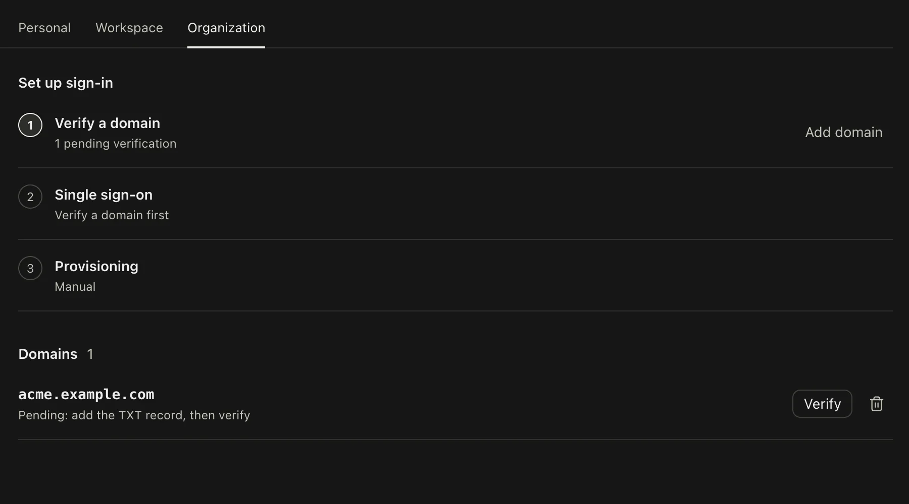

シングルサインオン（SSO）を使うと、チームは Okta、Microsoft Entra ID、Google Workspace などの会社の ID プロバイダー（IdP）を通じて CloudThinker にサインインできるため、アクセスを 1 か所で管理できます。このページでは、未検証のドメインから、機能し強制される SSO 接続までを説明します。

## 前提条件

- **Scale** または **Enterprise** プランの組織。他のプランでは、**Settings → Organization → Identity** に **Unlock SSO with the Scale plan** と表示され、Owner には **Upgrade plan** ボタンが表示されます。[料金](/ja/guide/billing/pricing)を参照してください。
- 組織の **Owner** ロール。SSO を変更できるのは Owner だけです。Admin はページを読み取り専用で開け、**Only organization owners can change single sign-on** と表示されます。[ロールと権限](/guide/security/roles)を参照してください。
- TXT レコードを 1 つ追加するための、DNS プロバイダーへのアクセス。
- ID プロバイダーへの管理者アクセス。

## セットアップの流れ

**Settings → Organization → Identity** を開くと、番号付きの 3 つの行からなる **Set up sign-in** のセクションが表示されます。各行が次の行を開放し、完了した行にはチェックマークが表示されます。

| 行 | すること | 完了の条件 |
|---|---|---|
| 1. **Verify a domain** | DNS の TXT レコードで、メールのドメインを所有していることを証明します | 行に、たとえば **1 verified** と表示される |
| 2. **Single sign-on** | ID プロバイダーへの SAML または OIDC の接続を作成します | 行に接続名、プロトコル、**Active** が表示される |
| 3. **Provisioning** | ユーザーのアカウントの作成方法を選びます | 行に **Just-in-time provisioning** または **SCIM directory sync** と表示される |

<Frame caption="Organization → Identity: ドメインを検証し、シングルサインオンを設定してから、プロビジョニングを選びます">
  
</Frame>

## ドメインを検証する

ドメインは、どのサインインを ID プロバイダーに送るかを CloudThinker に伝えます。メールアドレスが検証済みのドメインで終わる人は、SSO に振り分けられます。

<Steps>
  <Step title="ドメインを追加する">
    **Settings → Organization → Identity** に移動します。**Verify a domain** の行で **Add domain** をクリックします。**Update organization email domains** ダイアログでメールのドメイン（例: `example.com`）を入力し、**+** ボタンをクリックしてから、ダイアログを閉じます。

    ドメインは 1 つの CloudThinker の組織にしか属せません。別の組織がすでに取得している場合はエラーが表示され、その組織の Owner に連絡する必要があります。
  </Step>
  <Step title="DNS の TXT レコードを追加する">
    **Domains** のセクションで、ドメインの横の **Verify** をクリックします。**Verify domain** ダイアログに 2 つの値が表示されます。それらを使って、DNS プロバイダーで TXT レコードを作成します。

    | DNS のフィールド | 値 |
    |---|---|
    | Name / Host | `_cloudthinker`（DNS プロバイダーが `.example.com` を付け加えます） |
    | Type | `TXT` |
    | Value | ダイアログに表示される **Record Value**（例: `cloudthinker-domain-verification=Xy7...`） |
  </Step>
  <Step title="検証を確認する">
    レコードが反映されるのを待ってから、**Check verification** をクリックします。反映は多くの場合数分ですが、DNS プロバイダーによってはさらに時間がかかることがあります。

    **成功時の状態:** **Domains** のセクションでドメインに **Verified** と表示され、**Single sign-on** の行に **Set up SSO** ボタンが表示されます。

    CloudThinker がレコードを確認するのは、**Check verification** をクリックしたときだけです。後で再確認することはないため、ドメインが検証されたら TXT レコードは削除して構いません。
  </Step>
</Steps>

`example.com` と `example.co.uk` のように、複数のドメインを検証できます。接続が有効な間は、最後の検証済みのドメインを削除できません。先に接続を無効化してください。

## 接続を作成する

組織には 1 つの SSO 接続があり、それがすべての検証済みのドメインに対応します。ID プロバイダーが対応するプロトコルを選んでください。両方に対応している場合はどちらでも機能します。エンタープライズの IdP では SAML が最も一般的な選択です。

| プロトコル | 使う場面 | ガイド |
|---|---|---|
| **SAML 2.0** | IdP が Okta、Entra ID、Google Workspace、AWS IAM Identity Center、OneLogin、または他の SAML 2.0 プロバイダーの場合 | [SAML のセットアップ](/guide/security/sso-saml) |
| **OpenID Connect (OIDC)** | IdP が OAuth 2.0 のクライアントを発行し、OIDC のディスカバリードキュメントを公開している場合 | [OIDC のセットアップ](/guide/security/sso-oidc) |

<Steps>
  <Step title="ウィザードを開始する">
    **Single sign-on** の行で **Set up SSO** をクリックします。**SAML 2.0** または **OpenID Connect (OIDC)** を選び、**Next** をクリックします。
  </Step>
  <Step title="プロバイダーのガイドに従う">
    上の SAML または OIDC のガイドを開き、プロバイダーの手順を完了してから、**Create Connection** をクリックします。

    **成功時の状態:** ダイアログに **SSO Connection Created** と表示されます。接続はすぐに有効になり、SSO でのサインインが利用可能になりますが、まだ必須ではありません。
  </Step>
  <Step title="接続のテストを実行する">
    **Single sign-on** の行で **Edit** をクリックします。**Manage SSO** ダイアログの **Overview** タブで、**Connection test** の **Run connection test** をクリックします。

    このテストは、完全なサインインではなく設定を確認します。SAML では IdP の Entity ID、SSO URL、証明書を確認します。OIDC では、ディスカバリードキュメントに到達できること、発行者が一致すること、必要なエンドポイントが存在すること、署名の鍵に到達できることを確認します。

    **成功時の状態:** **All checks passed**。**Some checks failed** と表示された場合は、失敗したチェックとエラーメッセージが一覧されます。**Configuration** タブで値を修正し、**Save Changes** をクリックしてください。
  </Step>
  <Step title="SSO でサインインする">
    プライベートブラウザのウィンドウで、CloudThinker のサインインページ `https://app.cloudthinker.io/auth/login` を開き、検証済みのドメインのメールアドレスを入力して **Continue with email** をクリックし、続いて **Continue with SSO** をクリックします。**Sign in with SSO** をクリックして **Work email** を入力することもできます。

    **成功時の状態:** IdP のサインインページが開き、サインイン後に、あなたの名前が表示された状態で CloudThinker に戻ります。
  </Step>
</Steps>

<Note>
  接続が有効になるとすぐに、検証済みのドメインの新しい人は、Google や GitHub のサインインでアカウントを作成できなくなります。"Your organization signs in with SSO." と表示されます。既存のユーザーは、SSO を必須にするまで、SSO の画面で **Use an email code instead** を引き続き選べます。

  すでに CloudThinker のアカウントを持っている人は、そのアカウントを保持します。最初の SSO のサインインでメールアドレスによってアカウントが照合され、IdP に関連付けられるため、重複は作成されません。
</Note>

## ユーザーのプロビジョニング方法を選ぶ

プロビジョニングとは、社内の誰かのために CloudThinker のアカウントが作成される方法です。**Provisioning** のセクションは、接続が有効になると表示されます。

| モード | 起こること | 選ぶ場面 |
|---|---|---|
| **Manual** | アカウントは自動では作成されません。一人ずつ招待します。 | すべてのメンバーを手動で承認したい場合 |
| **Just-in-time** | 誰かが初めて SSO でサインインしたときにアカウントが作成されます。新しい接続ではこれがデフォルトです。 | IdP が通す人なら誰でもアクセスを得るべき場合 |
| **SCIM** | IdP がユーザーとグループを自動で作成、更新、無効化します | 入社と退社をディレクトリで処理したい場合。[SCIM プロビジョニング](/ja/guide/security/scim)を参照してください |

**Just-in-time** と **SCIM** では、次も設定します。

- **Auto-assigned organization role**: **Viewer**（デフォルト）、**Developer**、**Admin**。Viewer から始めて、後で昇格させてください。
- **Auto-assigned workspaces**: 新しいユーザーが自動で参加するワークスペース。デフォルトは組織のデフォルトのワークスペースです。[ワークスペース](/ja/guide/workspaces)を参照してください。

## SSO を必須にする

SSO が任意の場合、ドメインの人は引き続きメールのコードでサインインできます。**Require single sign-on** をオンにすると、その選択肢がなくなります。

<Steps>
  <Step title="自分で SSO が機能することを確認する">
    まず、自分のアカウントで上のサインインのテストを完了してください。
  </Step>
  <Step title="Require single sign-on をオンにする">
    **Sign-in rules** のセクションで、**Require single sign-on** をオンにします。

    **成功時の状態:** スイッチがオンのままになります。検証済みのドメインのユーザーは、ID プロバイダーを通じてサインインする必要があります。Google と GitHub のサインインは "Your organization signs in with SSO." で拒否され、**Use an email code instead** ではサインインできなくなります。
  </Step>
</Steps>

**Require single sign-on** はサインイン時に確認されます。すでにサインインしている人をサインアウトさせることはなく、次回のサインイン時に SSO に移ります。このトグルは、接続が **Active** の間だけ表示されます。

SSO を必須にすると、招待も変わります。招待できるのは検証済みのドメインのメールアドレスだけです。**SCIM** を選択している場合、手動の招待はオフになり、人は IdP で管理します。

### IdP が利用できない場合

各組織には Owner がちょうど 1 人おり、Owner は **Require single sign-on** の対象外です。そのため、IdP の障害や証明書の期限切れで締め出されることはありません。Owner はサインインページでメールアドレスを入力し、SSO の画面で **Use an email code instead** を選びます。他の人は、IdP が復旧するか、Owner が **Sign-in rules** で **Require single sign-on** をオフにするまで待ちます。

<Warning>
  **Require single sign-on** をオンにする前に、Owner のメールアドレスが、IdP の外でメールを受け取れることを確認してください（例: 監視されている共有メールボックス）。その受信箱が、戻るための手段です。
</Warning>

## 接続を管理または削除する

**Single sign-on** の行で **Edit** をクリックします。**Manage SSO** ダイアログには 2 つのタブがあります。

| タブ | できること |
|---|---|
| **Overview** | **Status**、**Protocol**、**Display name**、**Verified domains**、**SCIM**、**Created** を確認します。接続を **Activate**、**Deactivate**、**Delete** し、接続のテストを実行します。 |
| **Configuration** | ローテーションした証明書や新しいクライアントシークレットなど、IdP の値を編集し、**Save Changes** をクリックします。SAML では、このタブに **SP Metadata URL** も表示されます。 |

| ステータス | その状態になる方法 | ユーザーに見えること |
|---|---|---|
| **Active** | 検証済みのドメインで有効な接続を作成すると自動で設定されるか、**Activate** をクリックして設定します | 検証済みのドメインのサインインは IdP に送られます。**Require single sign-on** がオンであれば適用されます。 |
| **Inactive** | **Deactivate** をクリックします | SSO は使われません。メールのコード、Google、GitHub でサインインし、**Require single sign-on** は適用されません。設定は保持されるため、**Activate** で再びオンになります。 |
| **Testing** | ダッシュボードからは設定されません | **Active** と同様に動作します |

**Delete** は完全な削除で、無効化よりも多くのことを行います。

- **Require single sign-on** は接続とともになくなり、ユーザーはメールのコードでのサインインに戻ります。
- SCIM が削除されます。トークンが機能しなくなり、グループの対応付けと同期ログが削除されます。IdP でもプロビジョニングをオフにしてください。
- ジャストインタイムや SCIM のプロビジョニングで作成された人を含め、メンバーのアカウントとそのロールは残ります。

SSO を一時停止するには、代わりに無効化してください。

## トラブルシューティング

<AccordionGroup>
  <Accordion title="Set up SSO ボタンがない">
    **Single sign-on** の行に **Verify a domain first** と表示されています。**Domains** のセクションでドメインの **Verify** を開き、TXT レコードの名前が `_cloudthinker` で、値が **Record Value** と完全に一致していることを確認してください。DNS プロバイダーによってはドメインを自動で追加するため、`_cloudthinker.example.com` という名前が `_cloudthinker.example.com.example.com` になることがあります。その後、再度 **Check verification** をクリックします。
  </Accordion>
  <Accordion title="Identity に Unlock SSO with the Scale plan と表示される">
    組織のプランに SSO が含まれていません。Owner が **Upgrade plan** をクリックするか、[サブスクリプションの管理](/ja/guide/billing/subscription)を参照してください。
  </Accordion>
  <Accordion title="'Only organization owners can change single sign-on'">
    Admin としてサインインしているため、ページは読み取り専用です。組織の Owner に変更を依頼するか、[ロールの変更](/guide/security/roles)を依頼してください。
  </Accordion>
  <Accordion title="SSO を必須にした後、ユーザーがサインインできない">
    ID プロバイダーで、ユーザーが CloudThinker のアプリに割り当てられていることを確認してください。それでも失敗する場合は、IdP 側を修正する間、Owner が **Require single sign-on** をオフにできます。
  </Accordion>
  <Accordion title="ユーザーがまだメールのコードでサインインしている">
    **Require single sign-on** がオフになっている、ユーザーのメールアドレスが検証済みのドメインにない、またはユーザーが組織の Owner（設計上、対象外）のいずれかです。
  </Accordion>
  <Accordion title="名前がメールアドレスとして表示される">
    ID プロバイダーが名と姓を送っていません。[SAML](/guide/security/sso-saml) または [OIDC](/guide/security/sso-oidc) のガイドで属性の対応付けを修正してください。
  </Accordion>
  <Accordion title="SSO のサインインが失敗した理由を調べる">
    その人がすでに CloudThinker のアカウントを持っている場合、失敗した SSO のサインインは[監査ログ](/guide/security/audit-logs)に `security.sso_login_failed` として記録されます。いずれの場合も、ユーザーが CloudThinker のサインインページで見るメッセージから始めてください。

    | メッセージ | 原因 |
    |---|---|
    | "SSO login is not available for this domain" | メールのドメインが検証されていないか、接続が **Inactive** です |
    | "No account found. Contact your administrator for access." | プロビジョニングが **Manual** または **SCIM** で、その人にはアカウントも招待もありません |
    | "You are not a member of this organization. Please ask your administrator to invite you." | その人は CloudThinker のアカウントを持っていますが組織に所属しておらず、ジャストインタイムのプロビジョニングがオフです |
    | "This organization has reached its seat limit." | すべてのシートが埋まっているため、保留中の招待を受け入れられません |
    | "SSO authentication did not provide an email address" | IdP がメールアドレスを送っていません。属性の対応付けを修正してください |
    | "Your identity provider's signature could not be verified. Ask your administrator to check the SSO certificate." | CloudThinker が IdP の署名を検証できませんでした。たとえば、CloudThinker の SAML の証明書が古い場合です |
    | "SSO sign-in failed. Try again or contact your administrator." | CloudThinker が別の理由で SAML または OIDC のレスポンスを拒否しました。たとえば、署名されていないか暗号化されたアサーションや、時刻のずれです。他の失敗では、確認すべきものを示すより具体的なメッセージが表示されます。[SAML](/guide/security/sso-saml#troubleshooting) または [OIDC](/guide/security/sso-oidc#troubleshooting) のトラブルシューティングを参照してください |
  </Accordion>
</AccordionGroup>

## 次のステップ

<CardGroup cols={2}>
  <Card title="SAML のセットアップ" icon="shield" href="/guide/security/sso-saml">
    Okta、Entra ID、Google Workspace などの SAML の設定を順を追って説明します
  </Card>
  <Card title="OIDC のセットアップ" icon="id-badge" href="/guide/security/sso-oidc">
    Google、Entra ID、Okta などの OIDC の設定を順を追って説明します
  </Card>
  <Card title="SCIM プロビジョニング" icon="users-gear" href="/ja/guide/security/scim">
    ディレクトリがユーザーを自動で追加・削除できるようにします
  </Card>
  <Card title="ロールと権限" icon="user-shield" href="/guide/security/roles">
    自動でプロビジョニングされたユーザーができることを決めます
  </Card>
</CardGroup>
