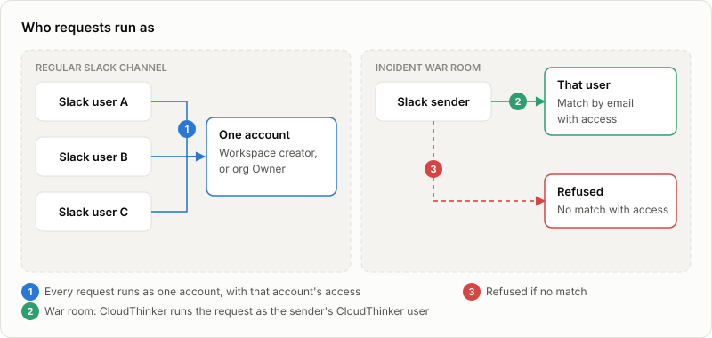
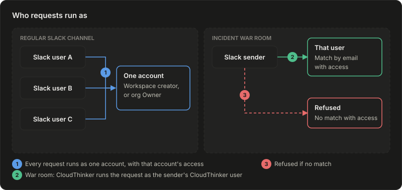

import PromptSyntaxBasics from '/snippets/ja/prompt-syntax-basics.mdx';

Slack を一度接続すれば、対応付けられたチャネルの誰もが `@CloudThinker` をメンションしてクラウドについて質問し、そのままスレッドで会話を続けられます。同じ接続で、アラートやコードレビューの要約などの[通知](/ja/guide/notifications)も選んだチャネルに届きます。

## 前提条件

- CloudThinker の組織の **Owner** または **Admin**。他のロールは Slack のページを閲覧できますが、接続や変更はできません。
- Team、Scale、Enterprise のいずれかのプラン。Free プランでは、Slack の行に **Requires Team plan** と表示され、**Configure** ボタンはありません。[料金](/ja/guide/billing/pricing)を参照してください。
- Slack のワークスペースにアプリをインストールする権限。Slack のワークスペースでアプリの承認を使っている場合は、Slack の Workspace Owner またはアプリの管理者が CloudThinker を承認する必要があります。
- app.cloudthinker.io でホストされている CloudThinker。セルフホストのインストールでは、Slack の行に **Not available on self-host** と表示されます。

各 Slack のワークスペースは、1 つの CloudThinker の組織に接続できます。

## Slack を接続する

<Warning>
ボットが参加しているものの対応付けのないチャネルでも、リクエストは組織の Owner のデフォルトのワークスペースで、そのワークスペースの接続を使って実行されます。対応付けのないチャネルにリクエストを拒否させる設定はありません。招待のたびにすぐに対応付けを確認し、インフラに到達すべきでないチャネルからはボットを削除してください。
</Warning>

<Steps>
  <Step title="Slack 連携を開く">
    **Settings → Organization → Chat integrations** に移動し、**Slack** の行を見つけて **Configure** をクリックします。Settings を開くには、サイドバー上部のワークスペースメニューをクリックし、**Settings** をクリックします。
  </Step>
  <Step title="Connect with Slack をクリックする">
    Slack が承認の画面を開きます。Slack のワークスペースを選び、**Allow** をクリックします。

    接続すると、この組織が以前に接続していた Slack のワークスペースは置き換えられます。

    **成功時の状態:** **Slack connected successfully** のメッセージとともに Slack のページに戻り、**Setup** のカードの **Connect to Slack** に Slack のワークスペース名と Team ID が表示されます。
  </Step>
  <Step title="ボットをチャネルに招待する">
    Slack で、チームが使うチャネルを開き、次を実行します。

    ```text
    /invite @CloudThinker
    ```

    CloudThinker は、チャネルを CloudThinker のワークスペースに自動で対応付けます。組織の Owner のデフォルトのワークスペース、Owner にない場合は最も古いワークスペースを選びます。

    **成功時の状態:** Slack のページの **Configure channel-workspace mappings** にチャネルが表示されます。
  </Step>
  <Step title="各チャネルが使うワークスペースを確認する">
    **Configure channel-workspace mappings** で、各チャネルの行の **Select workspace** メニューを開き、そのチャネルが接続を使うべきワークスペースを選びます。

    **成功時の状態:** **Channel mapping updated** のメッセージが表示され、行に新しいワークスペースが表示されます。
  </Step>
  <Step title="テストのメッセージを送る">
    チャネルで、ボットをメンションして質問します。

    ```text
    @CloudThinker What drove our cloud spend up last week?
    ```

    **成功時の状態:** CloudThinker があなたのメッセージの下のスレッドで返信します。フォローアップはそのスレッドで返信してください。ボットを再度メンションする必要はありません。
  </Step>
</Steps>

## リクエストが誰として実行されるか

<Frame caption="通常のチャネルではすべてのリクエストが 1 つのアカウントとして実行されます。送信者をメールで照合するのはウォールームだけです。">
  
  
</Frame>

CloudThinker は通常のチャネルで Slack のユーザーを CloudThinker のアカウントに照合せず、Slack にはアカウントの関連付けもありません。各リクエストを送信者として実行する [Google Chat](/guide/google-chat-integration) とは異なり、すべてのリクエストは 1 つのアカウント、つまり対応付けられたワークスペースを作成した人（組織が所有するワークスペースの場合は組織の **Owner**）として、そのアカウントのアクセス権で実行されます。Slack のユーザーは、質問するのに CloudThinker のアカウントを必要としません。CloudThinker は、会話の各メッセージに Slack の送信者の名前と Slack のユーザー ID を記録します。

インシデントのウォールームは例外です。ウォールームとは、Resolve が 1 つのインシデントのために作成する Slack のチャネルです（[Add a Slack war room](/guide/incident/oncall#add-a-slack-war-room) を参照）。そこでは、CloudThinker が送信者をメールで照合し、その CloudThinker のユーザーとしてリクエストを実行するか、アクセス権のある一致がない場合は拒否します。ウォールームでの質問は、送信者の名前で **Settings → Organization → Audit log** にも表示されます。

このため、チャネルのメンバーシップをアクセス権として扱ってください。チャネルは、そのチャネルの全員が使ってよいワークスペースにだけ対応付けてください。

## Slack で CloudThinker に質問する

すべてのリクエストは `@CloudThinker` で始まります。その後は、Web アプリで入力するのと同じリクエストを書きます。

<PromptSyntaxBasics />

```text
@CloudThinker Which EC2 instances ran under 10% CPU for the last 14 days?
@CloudThinker Summarize open critical security findings for production
@CloudThinker Why did checkout latency spike at 14:00 UTC today?
```

スレッドで表示されるもの:

| 表示 | 意味 |
| --- | --- |
| **is typing...** | CloudThinker がリクエストに取り組んでいます |
| スレッドでの返信 | 回答です。会話全体は CloudThinker の Web アプリにも表示されます |
| **View in CloudThinker** 付きの、ツールの **Permission required to use** | リクエストに、[Approvals](/guide/approvals/overview) の設定で人の判断待ちになる操作が必要です。インシデントのウォールーム以外では Slack で承認できません。リンクを開き、許可された[承認者](/guide/approvals/approvers)が Web アプリで承認または拒否します。ウォールームでは、カードに **Approve** と **Reject** のボタンがあります |

CloudThinker は、チャネルでのメンションと、自身のスレッドでの返信に応答します。新しい話題を始めるには、新しいメッセージで `@CloudThinker` をメンションします。プライベートチャネルも、ボットを招待すれば同じように機能します。CloudThinker はダイレクトメッセージには応答しません。Slack の **Home** タブには、チャネルでメンションするよう案内が表示されます。CloudThinker はメッセージのテキストだけを読むため、ファイルを添付するのではなく、読ませたい内容を貼り付けてください。

## Slack に通知を送る

Slack はワークスペースの通知の送信先でもあります。各 CloudThinker のワークスペースには独自の Slack のチャネルがあるため、まずサイドバー上部のワークスペースの切り替えで正しいワークスペースに切り替えてください。

<Steps>
  <Step title="通知の設定を開く">
    Slack のページの **Configure notifications** で、**Go to notification settings** をクリックします。**Settings → Workspace → Notifications** に移動することもできます。
  </Step>
  <Step title="ワークスペースのデフォルトのチャネルを選ぶ">
    **Delivery channels** で Slack のカードを見つけます（設定されるまで **Pick a channel** と表示されます）。その設定アイコン（**Change Slack channel**）をクリックし、**Slack channel** でチャネルを検索して選びます。任意のパブリックチャネル、またはボットが招待されたプライベートチャネルを選べます。
  </Step>
  <Step title="通知の種類ごとに上書きする（任意）">
    **What to send** で、イベントの Slack のセルをオンにし、その横の **→ #channel** のチップをクリックして、そのイベントを別のチャネルに送ります。**Alerts** と **Keepers** の行には重大度の選択もあります。種類の完全な一覧は[通知](/ja/guide/notifications)を参照してください。

    **成功時の状態:** 次に一致するイベントが、選んだチャネルに投稿されます。
  </Step>
</Steps>

## コードレビューの通知

[Review](/ja/guide/code-review/overview) が接続されたリポジトリでプルリクエストやマージリクエストを完了すると、CloudThinker は Slack に要約を投稿できます。

- 重大度別の検出事項の件数
- 最大 5 つの未解決の検出事項。それぞれにタイトル、ファイルのパス、行番号が付きます
- 以前の検出事項のうち、解決済みになった数
- CloudThinker でレビューを開く **View Review** ボタン
- レビューに問題がない場合は **No issues found**

レビューのチャネルと重大度のしきい値は、[通知](/ja/guide/notifications)で選びます。

## セキュリティと権限

| 質問 | 回答 |
| --- | --- |
| どのメッセージに対応するか | `@CloudThinker` をメンションしたメッセージと、CloudThinker が開始したスレッドでの返信。既存のスレッドに呼び出された場合は、コンテキストとしてそのスレッドを読めます |
| CloudThinker が保存するもの | リクエストとその返信（対応付けられたワークスペースに会話として保存）と、各 Slack のスレッドとその会話の間の関連付け |

CloudThinker は次の Slack のボットのスコープを要求します。

| スコープ | 理由 |
| --- | --- |
| `app_mentions:read` | `@CloudThinker` をメンションしたメッセージを受け取る |
| `channels:history`、`groups:history` | パブリックとプライベートのチャネルで、自身のスレッドでの返信と、呼び出されたスレッドを読む |
| `channels:read`、`groups:read` | 対応付けの表と通知の選択のためにチャネルを一覧する |
| `channels:manage` | インシデントのウォールームのチャネルを作成し、対応者を招待する |
| `chat:write` | 返信と通知を投稿する |
| `chat:write.public` | 参加せずにパブリックチャネルに通知を投稿する |
| `files:write` | レポートなど、CloudThinker が生成したファイルをスレッドに投稿する |
| `users:read` | 会話に送信者の表示名を表示する |
| `users:read.email` | ウォールームの送信者をメールで CloudThinker のアカウントに照合する |
| `im:read`、`im:history`、`im:write`、`mpim:read`、`mpim:history` | アプリが要求するもの。現在、CloudThinker はダイレクトメッセージやグループメッセージには応答しません |

## 接続を管理する

| タスク | 方法 |
| --- | --- |
| チャネルを別のワークスペースに移す | **Configure channel-workspace mappings** のその行で **Select workspace** を変更します |
| チャネルの振り分けを止める | Slack で、そのチャネルで `/remove @CloudThinker` を実行します。これにより行も削除されます。行だけを削除しないでください。ボットはチャネルに残り、チャネルはデフォルトのワークスペースに戻ってしまいます |
| 新しい権限のために再接続する | ページに **Slack needs one more permission** と表示された場合は、**Reconnect Slack** をクリックします。既存のメッセージと通知のチャネルは引き続き機能します |
| 切断する | Slack のページの下部にある **Disconnect from Slack** をクリックします。CloudThinker は Slack からアプリをアンインストールし、すべてのチャネルの対応付け、Slack のスレッドと会話の関連付け、Slack の通知の設定を削除します。再接続すると最初からやり直しになります |

## トラブルシューティング

<AccordionGroup>
  <Accordion title="Slack authorization not completed">
    Slack が承認を拒否またはキャンセルしたか、Slack のワークスペースで管理者の承認が必要です。Slack の Workspace Owner またはアプリの管理者に、Slack のアプリの管理で CloudThinker を承認するよう依頼してから、再度 **Connect with Slack** をクリックしてください。
  </Accordion>
  <Accordion title="Slack workspace already connected">
    その Slack のワークスペースは、すでに別の CloudThinker の組織に接続されています。Slack のワークスペースは 1 つにしか接続できません。先に別の組織から切断するか、別の Slack のワークスペースを使ってください。
  </Accordion>
  <Accordion title="Not authorized">
    Slack を設定できるのは、組織の Owner と Admin だけです。そのいずれかに接続を依頼するか、[組織のロール](/guide/security/roles)の変更を依頼してください。
  </Accordion>
  <Accordion title="ボットが返信しない">
    ボットがチャネルに参加していること（`/invite @CloudThinker`）と、新しいメッセージでメンションしたことを確認してください。メンションのないメッセージには、CloudThinker がすでに開始したスレッド内でのみ返信されます。

    CloudThinker が **No workspace is configured for this channel** と返信した場合、使うワークスペースが見つかりませんでした。組織に有効なワークスペースがないか、チャネルの行がこの組織外のワークスペースを指しています。Slack のページを開き、チャネルの行でワークスペースを設定してください。
  </Accordion>
  <Accordion title="回答が誤ったアカウントやクラスターを使っている">
    チャネルが、想定とは異なるワークスペースに対応付けられています。**Configure channel-workspace mappings** でその行を確認し、**Select workspace** を変更してください。
  </Accordion>
  <Accordion title="You don't have access to this incident in CloudThinker">
    インシデントのウォールームのチャネルは、そのワークスペースにインシデントとチャットへのアクセス権のある CloudThinker のアカウントを持つ人からのリクエストだけを実行します。CloudThinker はメールで照合するため、Slack と CloudThinker で同じメールアドレスを使うか、ワークスペースの Admin にアクセスを依頼してください。
  </Accordion>
  <Accordion title="通知が届かない">
    **Delivery channels** の Slack のカードでワークスペースのチャネルが設定されていること、通知の種類がオンであること、イベントが重大度のしきい値を満たしていることを確認してください。プライベートチャネルの場合は、先にボットを招待してください。
  </Accordion>
</AccordionGroup>

## 次のステップ

<CardGroup cols={2}>
  <Card title="CloudThinker Language" icon="terminal" href="/guide/commands">
    @、#、/ で、より的確なリクエストを書きます
  </Card>
  <Card title="通知" icon="bell" href="/ja/guide/notifications">
    どのイベントをどの重大度で Slack に届けるかを選びます
  </Card>
  <Card title="Approvals" icon="shield-check" href="/guide/approvals/overview">
    CloudThinker が実行する前に人の判断が必要な操作を決めます
  </Card>
  <Card title="Microsoft Teams" icon="/images/icons/teams.svg" href="/ja/guide/teams-integration">
    Teams で同じワークフローをセットアップします
  </Card>
</CardGroup>
