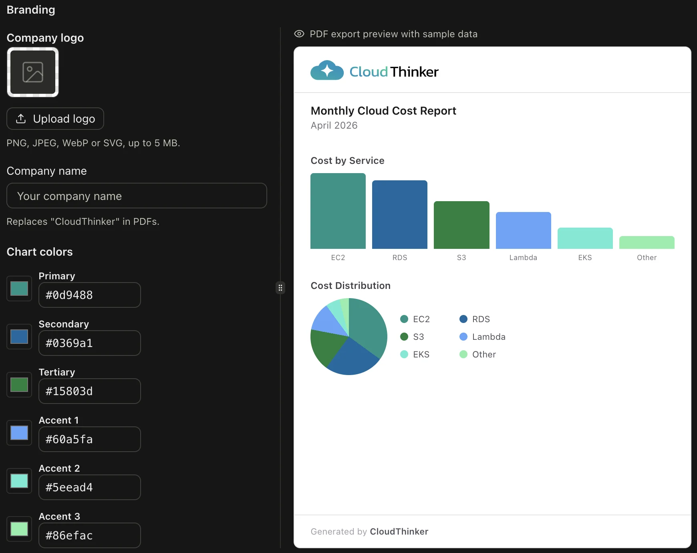
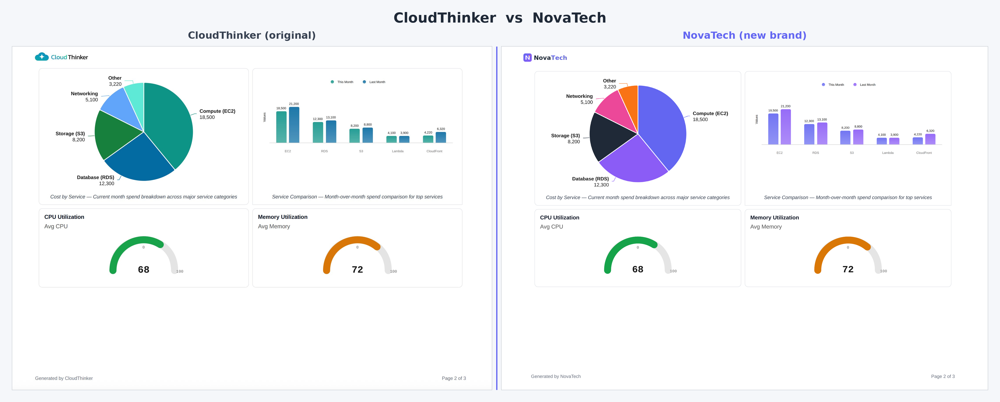

ワークスペースごとにブランディングを一度設定すると、そのワークスペースからのすべての PDF のエクスポートで、ヘッダーにロゴが、フッターに会社名が、グラフに 6 色のパレットが表示されます。同じパレットは、アーティファクト（エージェントが生成するダッシュボードやレポート）をアプリで表示するときのグラフにも使われます。

## 前提条件

| 要件 | 詳細 |
| --- | --- |
| プラン | **Scale** または **Enterprise**。Free または Team では、**Branding** のセクションにエディターの代わりに **Brand customization requires the Scale plan** と表示されます。[料金](/ja/guide/billing/pricing)を参照してください。 |
| ロール | ワークスペースの **Admin**。組織の Owner と Admin は、すべてのワークスペースで Admin です。Developer と Viewer はページを開けますが、フォームは無効になっています。 |
| ロゴのファイル | PNG、JPEG、WebP、SVG のいずれかで、5 MB 以下。透明な背景の横長のロゴが最適です。 |

## ブランディングをセットアップする

<Steps>
  <Step title="Branding を開く">
    **Settings → Workspace → General** に移動し、**Branding** のセクションまでスクロールします。Settings を開くには、サイドバー上部のワークスペースメニューをクリックし、**Settings** をクリックします。

    左側にエディターがあります。右側には、編集に合わせて更新されるサンプルデータ付きの PDF のエクスポートのプレビューが表示されるため、何もエクスポートせずに結果を確認できます。

    <Frame>
      
    </Frame>
  </Step>
  <Step title="ロゴをアップロードする">
    **Company logo** の領域にファイルをドラッグするか、**Upload logo** をクリックして選びます。ロゴは市松模様の背景に表示されるため、透明度が保たれているかを確認できます。

    **成功時の状態:** エディターとプレビューのヘッダーにロゴが表示され、**Upload logo** の横に **Remove** ボタンが表示されます。

    <Note>
    ロゴはアップロードが終わるとすぐに保存され、**Remove** もすぐに反映されます。**Save branding** が対象とするのは、会社名とグラフの色だけです。
    </Note>
  </Step>
  <Step title="会社名を入力する">
    **Company name** に入力します（最大 255 文字）。PDF のフッターの「CloudThinker」が置き換わり、「Generated by Your Company」と表示されます。
  </Step>
  <Step title="グラフの色を選ぶ">
    **Chart colors** には 6 つの枠があります: **Primary**、**Secondary**、**Tertiary**、**Accent 1**、**Accent 2**、**Accent 3**。それぞれ、見本をクリックしてシステムのカラーピッカーを使うか、`#6366F1` のような 16 進数のコードを入力します。

    ブランドの色が 1 つしかない場合は、**Primary** を設定し、残りはデフォルトのままにします。**Reset to defaults** で 6 色すべてが CloudThinker のパレットに戻ります。

    プレビューの棒グラフと円グラフはそれぞれ 6 色すべてを使うため、保存する前に並べてコントラストを確認できます。
  </Step>
  <Step title="保存する">
    名前や色を変更すると、**Save branding** と **Discard** が表示されます。**Save branding** をクリックします。

    **成功時の状態:** "Workspace updated successfully" の通知が表示され、ボタンが消えます。保存が失敗しても、編集内容はフォームに残るため、修正して再試行できます。
  </Step>
  <Step title="実際のエクスポートを確認する">
    任意のレポートやダッシュボードを開き、ページ上部の **Download PDF** をクリックします（**More actions**（⋯）メニューにもあります）。すべてのページで、ヘッダーにロゴ、グラフに色、フッターに「Generated by Your Company」が表示されるはずです。

    <Frame>
      
    </Frame>
  </Step>
</Steps>

後でブランディングを削除するには、ロゴの下の **Remove** をクリックし、**Company name** を空にして、**Reset to defaults** をクリックし、保存します。

## 6 色の選び方

グラフは枠を順に使います。4 つの系列を持つグラフは Primary から Accent 1 までを使い、6 つを超える系列を持つグラフは再び Primary から始まります。

- メインのブランドの色を **Primary** に置いてください。単一の系列のグラフのほとんどは、その枠だけを使います。
- 濃淡だけでなく色相を変えてください。6 つの青では、複数の系列のグラフが読みにくくなります。
- 最初の枠には非常に淡い色を避けてください。PDF は白の上に描画され、薄い棒や線はページに溶け込みます。デフォルトの Accent 2 と Accent 3 は明るい色ですが、そこに達するのは 5 つ以上の系列を持つグラフだけです。
- 赤と緑を隣り合う枠に置かないでください。色覚に障害のある読者は区別できません。

変更するまですべてのワークスペースで使われるデフォルトのパレット:

| 枠 | 16 進数 |
| --- | --- |
| Primary | `#0d9488` |
| Secondary | `#0369a1` |
| Tertiary | `#15803d` |
| Accent 1 | `#60a5fa` |
| Accent 2 | `#5eead4` |
| Accent 3 | `#86efac` |

## リファレンス

| 設定 | ルール | 表示される場所 |
| --- | --- | --- |
| ロゴ | PNG、JPEG、WebP、SVG のいずれかで、最大 5 MB。ファイルの内容が種類と一致している必要があります。SVG はサニタイズされ、スクリプトと安全でない属性は取り除かれます。新しいロゴをアップロードすると、古いものが置き換わります。 | PDF のヘッダーと共有リンク |
| 会社名 | プレーンテキストで、最大 255 文字。デフォルトは「CloudThinker」です。 | PDF のフッターと共有リンクのフッター |
| グラフの色 | `#RRGGBB` 形式のちょうど 6 色。`#fff` のような 3 桁の省略形は拒否されます。 | PDF のエクスポートのグラフと、アプリで表示するアーティファクトのグラフ |
| 共有リンク | 個別の設定はありません | ロゴと、「Shared from Your Company」のフッター。[共有](/guide/sharing#what-viewers-see)を参照してください |

ブランディングは 1 つのワークスペースに属します。組織の各ワークスペースは、それぞれ独自のロゴ、名前、パレットを持てます。インシデントや Review の分析など、アプリの他の場所のグラフは、常に CloudThinker のパレットのままです。ブランディングは通知やメールには適用されません。

## トラブルシューティング

<AccordionGroup>
  <Accordion title="Branding に Brand customization requires the Scale plan と表示される">
    組織のプランにブランディングが含まれていません。表示からアップグレードするか、[サブスクリプション](/ja/guide/billing/subscription)を参照してください。
  </Accordion>
  <Accordion title="フォームがグレー表示になっている">
    閲覧のみのアクセス権で、バナーに **View only.** と表示されています。ワークスペースの Admin に変更を依頼するか、Admin ロールの付与を依頼してください。[ワークスペースのメンバー](/ja/guide/workspace-users)を参照してください。
  </Accordion>
  <Accordion title="アップロードが拒否される">
    "Unsupported file type" は、ファイルが PNG、JPEG、WebP、SVG のいずれでもないか、内容が拡張子と一致しないことを意味します。"File too large" は 5 MB を超えていることを意味します。デザインツールからロゴを書き出し直して、再試行してください。
  </Accordion>
  <Accordion title="ロゴがぼやける、または周りに白い枠がある">
    ぼやける場合: 元の画像が小さすぎます。より横幅の大きい PNG を書き出すか、SVG を使ってください。白い枠: ファイルに透明度がありません。透明な背景の PNG か SVG を書き出してください。SVG がデザインツールと異なって見える場合は、サニタイズで取り除かれたスクリプトやアニメーションに頼っていた可能性が高いため、代わりに静的な PNG を書き出してください。
  </Accordion>
  <Accordion title="以前にダウンロードした PDF に古いブランディングが残っている">
    想定どおりです。各 PDF は、ダウンロードした時点で有効だったブランディングを使います。現在のブランディングを得るには、アーティファクトを再度ダウンロードしてください。
  </Accordion>
  <Accordion title="ブランディングなしでエクスポートできますか?">
    選択肢としてはできません。すべてのエクスポートはワークスペースの現在のブランディングを使います。ブランディングのないコピーを得るには、ロゴを削除し、会社名を空にし、色をリセットして保存し、エクスポートしてから設定を元に戻します。その間にワークスペースからエクスポートした全員も、ブランディングのない PDF を受け取ります。ブランディングのないエクスポートが頻繁に必要な場合は、ブランディングのない別のワークスペースを使ってください。
  </Accordion>
</AccordionGroup>

## 次のステップ

<CardGroup cols={2}>
  <Card title="アーティファクト" icon="file-chart-column" href="/ja/guide/artifacts/overview">
    ブランディングが適用されるダッシュボードとレポートを生成します。
  </Card>
  <Card title="共有" icon="share-nodes" href="/guide/sharing">
    ブランディングされたアーティファクトをワークスペース外の人と共有します。
  </Card>
</CardGroup>
