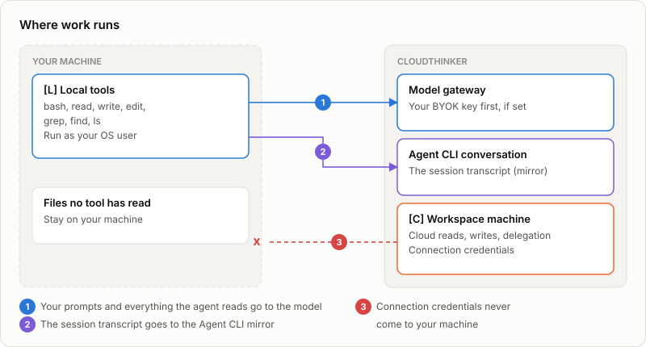
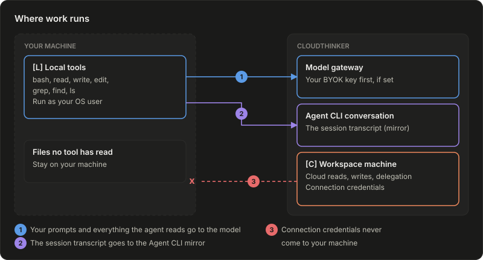

CloudThinker Agent는 터미널에서 실행되는 코딩 에이전트입니다. 사용자의 머신에서 파일을 편집하고 명령을 실행하며, 클라우드에는 워크스페이스 [연결](/ko/guide/connections/overview)을 통해서만 접근하므로 클라우드 자격 증명이 노트북에 놓이는 일이 없습니다.

<Note>
에이전트는 macOS와 Linux(x86_64 및 arm64)에서 실행됩니다. CLI는 Windows에도 설치되지만 에이전트의 Windows 빌드는 없습니다. 유료 플랜(Team, Scale, Enterprise)이 필요합니다. Free 워크스페이스에서는 세션 시작이 업그레이드 안내와 함께 거부됩니다. [요금제](/ko/guide/billing/pricing)를 참고하세요.
</Note>

## 사전 요구 사항

- CloudThinker CLI가 설치되어 있고 로그인되어 있어야 합니다. [CLI](/ko/guide/cli/overview)와 [CLI 인증](/ko/guide/cli/authentication)을 참고하세요.
- 에이전트가 클라우드를 다루게 하려면 워크스페이스에 연결이 하나 이상 있어야 합니다(예: [AWS](/ko/guide/connections/aws) 또는 [Kubernetes](/ko/guide/connections/kubernetes)). 로컬 작업에는 필요하지 않습니다.

## 세션 시작

<Steps>
  <Step title="저장소를 열고 에이전트 실행하기">
    ```bash
    cd my-terraform-repo
    cloudthinker
    ```

    인수 없는 `cloudthinker`와 `cloudthinker agent`는 같은 동작을 합니다. 아직 로그인하지 않았다면 에이전트가 브라우저 로그인을 시작합니다. 다른 명령은 그렇지 않습니다: 코드 3으로 종료하며 `cloudthinker login`을 실행하라고 안내합니다.

    처음 실행하면 CLI가 플랫폼에 맞는 에이전트 빌드를 다운로드하고, 릴리스의 SHA-256 체크섬으로 확인한 뒤 `~/.cloudthinker/agent/bin/<version>/` 아래에 설치합니다. 이후 실행에서는 이를 재사용합니다. 이 단계가 실패하면 원인과 함께 `agent install failed:`가 표시되고 종료 코드 1로 끝납니다. 프록시 뒤에 있다면 `HTTPS_PROXY`를 설정하고, 프록시가 HTTPS를 재서명하면 `SSL_CERT_FILE`도 설정하세요. [환경 변수](/ko/guide/cli/reference#환경-변수)를 참고하세요.
  </Step>
  <Step title="시작 화면 확인하기">
    헤더에는 워크스페이스, 사용자, 세션 링크, 워크스페이스 Approval mode(`· Auto` 또는 `· Manual`)가 표시됩니다. 그 아래 두 줄은 작업이 실행되는 위치를 보여줍니다:

    - 로컬 도구가 있는 `[L] this machine <folder>`
    - 클라우드 도구가 있는 `[C] sandbox workspace <name> - <N> connections`. 클라우드 도구는 워크스페이스 머신에서 실행됩니다(시작 줄에서는 이를 sandbox workspace라고 부릅니다. [작업이 실행되는 위치](#작업이-실행되는-위치) 참고)

    **성공 상태:** 프롬프트가 준비되고, 하단에 워크스페이스, Approval mode, `◆ 0.00 credits`, 연결이 표시됩니다.
  </Step>
  <Step title="작업 맡기기">
    원하는 내용을 평이한 말로 입력하세요. 에이전트가 처음이라면 `/skill:tour`를 실행하세요. 로컬 작업과 클라우드 작업, 연결, 승인을 설명하는 안내형 첫 세션이 시작됩니다.

    클라우드 조사 예시입니다. `[C]` 읽기 줄이 나온 뒤, 저장소를 읽으면서 `[L]` 줄이 나옵니다:

    ```text
    Why is the api deployment in staging restarting? Check the pod events and logs, then tell me which commit in this repo is the likely cause.
    ```

    로컬 편집 예시입니다. `[L]` 읽기와 편집 줄이 나오고, 클라우드 쓰기는 없습니다:

    ```text
    Add a lifecycle rule to the logs bucket in main.tf that expires objects after 90 days. Don't apply it.
    ```

    세션을 끝내려면 `/quit`(또는 `/exit`)를 입력하세요. 이미 클라우드에서 실행 중인 작업은 계속됩니다. 종료할 때 에이전트는 이 세션을 다시 여는 명령 `cloudthinker agent --session <id>`를 출력합니다.
  </Step>
</Steps>

## 작업이 실행되는 위치

모든 도구 호출 줄은 `[L]` 또는 `[C]`로 시작하므로 어느 머신이 작업했는지 항상 알 수 있습니다.

<Frame caption="로컬 도구는 사용자의 머신에서 실행됩니다. 에이전트가 읽은 내용은 모델로 전송되며, 연결 자격 증명은 워크스페이스 머신에 남습니다.">
  
  
</Frame>

| 태그 | 위치 | 실행되는 것 | 자격 증명 |
|---|---|---|---|
| `[L]` | 사용자의 머신 | 로컬 도구: `bash`, `read`, `write`, `edit`, `grep`, `find`, `ls` | CloudThinker가 제공하는 것은 없습니다. 명령은 사용자의 OS 계정으로 실행됩니다. **Manual**에서는 파일 편집이나 무언가를 바꿀 수 있는 명령이 먼저 사용자에게 묻습니다 |
| `[C]` | 워크스페이스 머신 | 클라우드 읽기, 클라우드 쓰기, 위임된 작업 | 워크스페이스 연결 자격 증명. 해당 실행에만 사용되며 사용자의 머신으로 전송되지 않습니다 |

워크스페이스 머신(시작 시 `sandbox workspace`로 표시되며, 클라우드 도구 이름이 `ct_sandbox_*`인 이유)은 워크스페이스 전체가 공유하는 CloudThinker 호스팅 머신입니다. 임시 셸이 아닙니다: 워크스페이스의 메모리, 스킬, 이전 실행이 남긴 파일이 보관됩니다. 각 세션은 그 안에 자체 폴더를 받지만 머신은 공유되므로, 실행이 그곳에 쓰는 파일은 팀원의 실행에서도 보인다고 생각하세요. 각 연결의 CLI가 그곳에 설치되어 있으며 해당 연결의 자격 증명으로 인증되어 있습니다. 워크스페이스 데이터가 저장되는 방식은 [데이터 보호](/guide/security/data-protection)를 참고하세요.

에이전트는 채팅과 같은 워크스페이스 연결 목록을 받으며, 이 목록은 매 턴 전에 새로 고쳐집니다. 자격 증명은 목록에 포함되지 않습니다. 브라우저에서 추가한 연결은 다음 프롬프트부터 사용할 수 있습니다.

<Warning>
`[L]` 도구는 승인 Rules를 거치지 않습니다. **Auto**에서는 묻지 않고 실행되며, **Manual**에서는 파일 편집이나 쓰기, 또는 무언가를 바꿀 수 있는 명령 전에 터미널에 **Manual mode: local change**가 표시되고 **Run**(`y`) 또는 **Decline**(`n`)을 고릅니다. `ls`, `cat`, `rg`, `git status`, `kubectl get`, `aws describe`/`list`/`get` 같은 읽기 전용 명령은 묻지 않고 실행됩니다. 로컬 `bash`는 셸에 이미 있는 것(예: `AWS_PROFILE` 또는 kubeconfig)을 그대로 사용해 실행됩니다. 읽기 전용 세션을 원하면 `cloudthinker agent --tools read,grep,find,ls`로 에이전트를 시작하거나, `--exclude-tools bash,write,edit`로 도구를 끄세요.
</Warning>

세션을 완전히 로컬로 유지하려면 `/cloud off`를 실행하세요. 클라우드 도구와 위임이 숨겨지며, 이미 클라우드에서 실행 중인 작업은 계속됩니다. `/cloud on`으로 다시 켭니다.

## 에이전트가 클라우드에서 할 수 있는 일

| 도구 | 용도 | 예시 | 승인 |
|---|---|---|---|
| `ct_sandbox_read` | 읽기 전용 명령 하나 | S3 버킷 나열, 배포 정보 확인, CloudWatch 로그 읽기 | 승인 필요 없음 |
| `ct_sandbox_write` | 이름을 붙일 수 있는 상태 변경 명령 하나 | `kubectl rollout restart deployment/api` | 항상 워크스페이스가 결정합니다. [클라우드 쓰기 승인](#클라우드-쓰기-승인) 참고 |
| `ct_ask` | 위임: 에이전트가 여러 단계의 조사나 변경을 클라우드의 CloudThinker에게 넘깁니다. CloudThinker는 워크스페이스의 [메모리](/guide/memory), 도구, 인시던트 기록을 사용해 작업합니다 | "Compare this outage with past incidents on the same service" | 그 안의 쓰기는 채팅과 마찬가지로 워크스페이스 Approval mode를 따릅니다. 하나가 대기 중이면 터미널에 **CloudThinker Agent needs your approval**이 표시되고, 승인자는 승인하거나, 이유와 함께 거절하거나, 브라우저에서 결정할 수 있습니다 |

`ct_ask` 결과 줄은 `CloudThinker Agent answered`, `waiting for approval in browser → <link>`, `failed` 중 하나입니다. 세션마다 하나의 CloudThinker 대화를 열고 재사용합니다.

에이전트는 각 읽기 또는 쓰기 명령의 타임아웃을 직접 정합니다: 기본 60초, 최대 120초입니다. 더 긴 명령은 백그라운드에서 실행되고, 에이전트가 나중에 출력을 확인합니다. (참조 문서의 `CLOUDTHINKER_AUTO_BACKGROUND_SECONDS`는 로컬 `bash` 명령을 위한 별도 설정입니다.)

클라우드 도구는 워크스페이스의 모든 [연결](/ko/guide/connections/overview)을 사용할 수 있으며, 명령 하나가 여러 연결을 쓸 수도 있습니다. 같은 종류의 연결이 여러 개라면 `#`를 입력해 하나를 고르세요: 프롬프트에 `#connection/<prefix>/<alias>`가 삽입됩니다.

## 클라우드 쓰기 승인

클라우드 쓰기는 에이전트가 스스로 실행하는 것이 아니라 워크스페이스가 결정하는 요청입니다. [승인 Rules](/guide/approvals/rules)가 먼저 결정하고, 그다음 [Approval mode](/guide/approvals/approval-mode)가 결정합니다. 사용자 머신의 명령은 Rules를 거치지 않으며, **Manual**에서는 로컬 변경 전에 터미널이 사용자에게 묻습니다.

쓰기의 결과 줄은 판정으로 시작합니다:

| 결과 줄 | 의미 |
|---|---|
| `auto: allowed (<reason>) · ran on the workspace machine · …` | 규칙 또는 [AI 검사](/guide/approvals/approval-mode)가 허용해 즉시 실행되었습니다. 이유가 표시됩니다 |
| `auto: needs approval · waiting for approval in browser → <link>` | 쓰기가 사람을 기다립니다 |
| `manual: needs approval · …` | 워크스페이스가 **Manual**이므로 모든 쓰기가 사람을 기다립니다 |
| `… · approved by <name> · ran on the workspace machine · …` | 사람이 승인했고 실행되었습니다 |
| `… · declined by <name>` | 사람이 거절했습니다. 아무것도 실행되지 않았습니다 |
| `auto: denied · <reason>` | 규칙 또는 Approval mode가 거부했습니다. 아무것도 실행되지 않으며, 어떤 승인으로도 실행할 수 없습니다 |
| `… · execution outcome unknown; do not replay` | 명령이 시작되었을 수 있지만 CloudThinker에 확인된 결과가 없습니다. 아래 Warning을 참고하세요 |

쓰기에 승인이 필요하면 터미널에 이유, 연결, 명령, 브라우저 링크와 함께 **Cloud write needs your approval**이 표시됩니다. 하나를 고르세요:

| 옵션 | 키 | 동작 |
|---|---|---|
| **Approve and run** | `y` | 이 쓰기 하나를 실행합니다 |
| **Decline** | `n` | 쓰기를 거절합니다. 에이전트에게 이유를 입력할 수 있습니다 |
| **Decide in the browser** | `b` | 결정을 브라우저 카드에 맡깁니다. 터미널에 **Waiting for approval in the browser…**가 표시되고 최대 10분 동안 몇 초마다 확인한 뒤 결과 줄을 출력합니다. 그때까지 아무도 결정하지 않으면 에이전트가 나중에 같은 쓰기를 다시 이어받을 수 있습니다 |

Escape도 거절로 처리됩니다. 승인자인 팀원이 브라우저에서 세션을 열면 같은 카드를 봅니다.

대기 중인 쓰기는 요청 당시의 연결을 그대로 유지합니다. 나중에 연결을 추가해도 범위가 넓어지지 않으며, 접근 권한을 제거하면 차단됩니다. 응답하지 않은 쓰기는 1시간 후 만료됩니다. 만료에 대한 결과 줄은 따로 나오지 않습니다: 그 후에 결정하면 `Cloud write is expired, so it cannot be decided`로 실패하므로, 에이전트에게 다시 요청하세요.

<Warning>
쓰기가 알 수 없는 결과를 보고하면, 다시 요청하기 전에 클라우드에서 그 영향을 확인하세요. 에이전트는 쓰기를 스스로 다시 실행하지 않습니다.
</Warning>

### 누가 무엇을 할 수 있는가

| 작업 | 할 수 있는 사람 |
|---|---|
| 클라우드 쓰기 승인 또는 거절 | 워크스페이스 [승인자](/guide/approvals/approvers) |
| `/cloudthinker:auto`로 Approval mode 변경 | 워크스페이스 Admin |
| 브라우저에서 Agent CLI 대화 읽기 | Viewer를 포함한 모든 워크스페이스 멤버 |
| Agent CLI 대화 삭제 | 세션을 시작한 사람만. Admin을 포함해 다른 누구도 할 수 없습니다 |

역할은 [역할](/guide/security/roles)에서 설명합니다.

### 승인할 수 없을 때 승인자에게 요청하기

카드가 이미 눈앞에 있으므로 에이전트는 승인 알림을 스스로 보내지 않습니다. 승인자가 아니라면 `/cloudthinker:notify`를 실행해, 워크스페이스 승인자가 [Notifications](/ko/guide/notifications)에서 설정한 채널로 요청을 한 번 보내세요. 실행할 때마다 다시 보냅니다.

## 터미널에서 Approval mode 변경

세션은 워크스페이스 Approval mode를 사용합니다. 세션별 재정의는 없으며, 노트북에서 승인을 건너뛰는 플래그도 없습니다.

<Warning>
`/cloudthinker:auto on`과 `off`는 워크스페이스 전체의 모드를 바꾸므로, 워크스페이스 모드를 사용하는 모든 팀원의 채팅과 세션이 새 모드를 따릅니다. 워크스페이스 Admin만 전환할 수 있으며, 각 전환은 [감사 로그](/guide/security/audit-logs)에 기록됩니다.
</Warning>

| 명령 | 동작 |
|---|---|
| `/cloudthinker:auto` | 현재 모드를 출력합니다 |
| `/cloudthinker:auto on` | 워크스페이스를 **Auto · Rules + AI · Ask me**로 설정합니다: 규칙이 먼저 결정하고, 그다음 AI 검사가 결정하며, 여전히 불분명한 것은 사람을 기다립니다. 이미 Auto 모드인 워크스페이스는 기존 선택을 유지합니다 |
| `/cloudthinker:auto off` | 워크스페이스를 **Manual**로 설정합니다: 모든 쓰기가 사람을 기다립니다 |

다른 Auto 선택지는 브라우저에서 **Settings → Workspace → Autonomy → Rules**를 열고 **When no Rule matches** 섹션을 사용하세요. 각 선택지는 [Approval mode](/guide/approvals/approval-mode)에서 설명합니다.

## 에이전트 안의 명령

`/`를 입력하면 모든 명령이 표시됩니다. CloudThinker 명령은 다음과 같습니다:

| 명령 | 동작 |
|---|---|
| `/cloud` | Cloud 켜짐/꺼짐, 워크스페이스, 연결, 세션 링크를 표시합니다 |
| `/cloud on`, `/cloud off` | 이 세션의 클라우드 도구와 위임을 켜거나 끕니다 |
| `/cloud retry` | 실패한 클라우드 링크를 지금 다시 시도합니다 |
| `/where` | 에이전트가 작업하는 두 위치를 표시합니다 |
| `/open` | 이 세션을 브라우저에서 엽니다 |
| `/model` | 에이전트 모드를 고릅니다: `light`, `pro`, `ultra`. `cloudthinker agent --list-models`로 워크스페이스가 제공하는 모드를 확인할 수 있습니다 |
| `/skill:tour` | 안내형 첫 세션: 로컬 및 클라우드 작업, 연결, 승인 |
| `/rewind` | 마지막 턴을 되돌립니다. 에이전트가 편집하거나 만든 파일을 복원하고 대화를 되감습니다. 그 이후 해당 파일 중 하나라도 바뀌었다면 거부합니다 |
| `/doctor` | `cloudthinker doctor`를 실행하고, 검사가 실패하면 에이전트가 문제를 설명하고 해결 방법을 제안합니다 |
| `/quit`, `/exit` | 세션을 끝냅니다. 이미 클라우드에서 실행 중인 작업은 계속됩니다 |
| `/share` | 이 세션의 CloudThinker 링크를 복사합니다(워크스페이스 멤버 전용) |
| `/cloudthinker:workspace` | 다른 워크스페이스로 전환하고 그곳에서 새 세션을 시작합니다 |
| `/cloudthinker:session` | 이 세션의 메시지, 토큰, 크레딧을 표시합니다 |
| `/cloudthinker:auto [on\|off]` | 워크스페이스 Approval mode를 표시하거나 변경합니다 |
| `/cloudthinker:notify` | 클라우드 쓰기가 대기 중임을 승인자에게 알립니다 |
| `/cloudthinker:about` | 버전, 설정 폴더, 세션 링크를 표시합니다 |
| `/login`, `/logout` | CloudThinker에 로그인하거나 로그아웃합니다 |
| `/changelog`, `/bug` | 새로운 내용을 표시하거나, 브라우저에서 CloudThinker CLI GitHub 저장소에 새 이슈를 엽니다. 초안에는 에이전트 버전, 플랫폼, 아키텍처만 들어가며 대화는 첨부되지 않고, 제출하기 전까지 아무것도 게시되지 않습니다 |

터미널 창이 백그라운드에 있는 동안 턴이 끝나거나 승인이 대기 중이면, 에이전트는 벨을 울리고 데스크톱 알림을 표시합니다. 이 기능은 `/settings` → **Notifications**에서 끌 수 있습니다. 포커스를 보고하지 않는 터미널은 알림을 받지 않습니다.

`@`를 입력하면 커스텀 에이전트, 연결, 저장소의 파일을 멘션할 수 있습니다. `#`는 연결 목록만 엽니다. 에이전트는 저장소의 `AGENTS.md` 또는 `CLAUDE.md`에서 프로젝트 지침을 읽습니다.

## 화면 없이 에이전트 실행

`agent -p`는 이 폴더에 대해 로컬 에이전트에게 묻고, 답을 출력한 뒤 종료합니다. 로컬 파일이 필요한 스크립트에서 사용하세요. 대신 클라우드의 CloudThinker에게 물으려면 [헤드리스 채팅](/ko/guide/cli/headless-chat)을 사용하세요.

```bash
cloudthinker agent -p "Summarize what changed in src/ since main"
git diff | cloudthinker agent -p "Review this change"
cloudthinker agent --tools read,grep,find,ls -p "Review src/ without editing"
```

`--max-turns <n>`을 추가하면 `-p` 실행을 모델 턴 n번 후에 멈추며, 이때 종료 코드 1로 종료합니다. 같은 세션에서 다른 폴더도 작업하려면 `--add-dir <path>`를 추가합니다(여러 개면 반복합니다). 에이전트는 그 폴더의 `AGENTS.md` 또는 `CLAUDE.md`도 읽습니다.

`-p`에서도 클라우드 도구는 켜져 있습니다. 승인이 필요한 클라우드 쓰기는 터미널 카드를 표시할 수 없으므로, 에이전트는 stderr에 `waiting for approval in the browser → <link>`를 출력하고 누군가 그곳에서 결정할 때까지 최대 10분 기다립니다. **Manual**에서 `-p`는 로컬 파일 편집과 무언가를 바꿀 수 있는 명령을 차단하고 에이전트에게 이유를 알려줍니다. 무인 실행에서는 `--tools read,grep,find,ls`로 로컬에 머무르거나, CI 작업이 분기할 수 있는 종료 코드를 제공하는 [헤드리스 채팅](/ko/guide/cli/headless-chat)으로 CloudThinker에게 물으세요. 모든 플래그는 [CLI 참조](/ko/guide/cli/reference#agent)에 있습니다.

## 머신 밖으로 나가는 데이터

| 데이터 | CloudThinker로 전송되나요? | 전송 위치 |
|---|---|---|
| 프롬프트, 그리고 에이전트가 컨텍스트로 읽어 들이는 모든 것(파일 내용, 로컬 명령 출력) | 예 | CloudThinker의 모델 게이트웨이. 조직의 [BYOK](/ko/guide/byok) 키가 설정되어 있으면 그 키로 먼저 답하고, 그렇지 않으면 CloudThinker의 모델 제공자를 사용합니다 |
| 세션 기록: 프롬프트, 답변, 도구 호출과 그 결과 | 예 | 워크스페이스의 **Agent CLI** 대화(미러). 서버는 항목을 저장하기 전에 자격 증명을 가리며, 이메일, IP, 호스트 이름은 유지됩니다. 1 MB를 넘는 항목은 구조를 유지한 채 가장 긴 텍스트가 맞을 때까지 잘리고, 잘림 표시가 붙습니다 |
| 어떤 도구도 읽지 않은 파일 | 아니요 | 사용자의 머신에 남습니다 |
| 클라우드 연결 자격 증명 | 사용자의 머신으로 오지 않습니다 | 워크스페이스 머신에 남습니다 |

<Warning>
에이전트가 읽는 모든 것은 비밀 정보를 포함해 모델로 전송됩니다: `.env` 파일, kubeconfig, 키를 출력하는 명령의 출력 등. 미러는 저장하기 전에 인식한 자격 증명을 가리지만, 그것에만 의존하지 마세요. Viewer를 포함한 모든 워크스페이스 멤버가 미러를 읽을 수 있으며, 세션을 시작한 사람만 삭제할 수 있습니다 — Admin도 삭제할 수 없습니다. 비밀 정보에 닿지 않게 하세요: `--exclude-tools bash`로 시작하고, 에이전트에게 자격 증명 파일을 읽으라고 요청하지 마세요.
</Warning>

CloudThinker가 워크스페이스 데이터를 저장하고 보호하는 방식은 [데이터 보호](/guide/security/data-protection)를 참고하세요.

## 세션 기록과 크레딧

모든 세션은 워크스페이스에 **Agent CLI** 대화로 나타나며, 이것이 미러라고 부르는 세션의 브라우저 사본입니다. `/open`을 실행하면 바로 이동합니다. 브라우저에서는 저장소, 브랜치, 도구 호출, 연결된 CloudThinker 대화를 읽기 전용으로 보여줍니다. 미러 항목은 추가만 가능합니다: 아무도 편집할 수 없으며, 세션을 시작한 사람만 대화를 삭제할 수 있습니다 — Admin도 삭제할 수 없습니다.

로컬 사본은 사용자의 머신의 `~/.cloudthinker/agent/sessions/` 아래에 프로젝트별 폴더로 남습니다. `cloudthinker agent -c`는 이 폴더의 가장 최근 세션을 이어가고, `-r`로 세션을 골라 이어갈 수 있습니다.

하단에는 이 세션에 청구된 크레딧이 표시됩니다(예: `◆ 1.75 credits`). [사용량](/ko/guide/billing/usage)을 참고하세요.

## 문제 해결

<AccordionGroup>
  <Accordion title="하단에 클라우드 링크가 실패했다고 표시됩니다">
    메시지에 로그아웃, 접근 거부, 호스트에 연결할 수 없음 같은 원인이 표시됩니다. 오프라인 및 서버 오류는 자동으로 재시도됩니다. 지금 재시도하려면 `/cloud retry`를, 로그아웃되었다면 `/login`을 실행하세요.
  </Accordion>
  <Accordion title="워크스페이스 승인자만 클라우드 쓰기를 승인할 수 있습니다">
    사용자는 승인자가 아닙니다. `/cloudthinker:notify`를 실행하거나, 카드의 브라우저 링크를 승인자에게 보내세요.
  </Accordion>
  <Accordion title="에이전트가 로컬에서는 작동하지만 클라우드에 접근하지 못합니다">
    `/cloud`를 실행하세요. Cloud가 꺼져 있으면 `/cloud on`을 실행하세요. 연결이 하나도 나열되지 않으면 [Connections](/ko/guide/connections/overview)에서 연결을 추가한 다음 다음 프롬프트를 보내세요.
  </Accordion>
  <Accordion title="agent install failed">
    첫 실행 다운로드 또는 SHA-256 확인이 실패했습니다. 메시지에 원인이 표시됩니다. 회사 프록시 뒤에 있다면 `HTTPS_PROXY`를 설정하고, 프록시가 HTTPS를 재서명하면 `SSL_CERT_FILE`도 설정한 뒤 `cloudthinker`를 다시 실행하세요. [환경 변수](/ko/guide/cli/reference#환경-변수)를 참고하세요.
  </Accordion>
  <Accordion title="No CloudThinker Agent mode is loaded, so the message was not sent">
    에이전트가 워크스페이스에서 모드를 불러오지 못했습니다. `/cloud retry`를 실행한 다음 ↑를 눌러 메시지를 다시 보내세요. `cloudthinker agent --list-models`로 워크스페이스가 제공하는 모드를 확인할 수 있습니다.
  </Accordion>
  <Accordion title="하단에 mirror offline이 표시됩니다">
    이 세션의 브라우저 사본(미러)이 동기화되지 못했습니다. 작업을 계속하세요: 대기 중인 항목은 사용자의 머신에서 기다렸다가 링크가 돌아오거나, 다음에 `cloudthinker agent -c`로 이 세션을 이어갈 때 업로드됩니다.
  </Accordion>
</AccordionGroup>

## 다음 단계

<CardGroup cols={2}>
  <Card title="헤드리스 채팅" icon="message-code" href="/ko/guide/cli/headless-chat">
    스크립트나 CI 작업에서 CloudThinker에게 프롬프트 하나를 보내세요
  </Card>
  <Card title="Approval mode" icon="shield-check" href="/guide/approvals/approval-mode">
    워크스페이스에서 클라우드 쓰기를 결정하는 방식을 선택하세요
  </Card>
  <Card title="CLI 참조" icon="book" href="/ko/guide/cli/reference">
    모든 명령, 플래그, 변수, 종료 코드
  </Card>
  <Card title="Connections" icon="plug" href="/ko/guide/connections/overview">
    에이전트가 사용할 수 있는 클라우드 계정과 도구를 추가하세요
  </Card>
</CardGroup>
