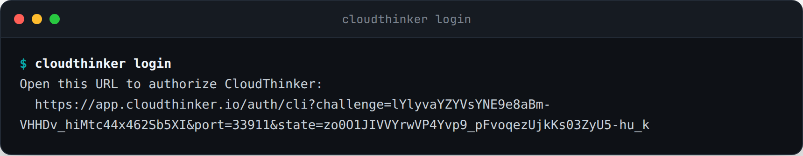

CloudThinker CLI는 브라우저를 통해 로그인하고 워크스페이스마다 자격 증명 하나를 저장하므로, API 키를 붙여넣을 필요가 없습니다. 이 페이지에서는 노트북이나 원격 머신에서의 로그인, 워크스페이스 전환, 스크립트와 CI 작업 인증을 다룹니다.

## 사전 요구 사항

- CLI가 설치되어 있어야 합니다. [CLI 개요](/ko/guide/cli/overview)를 참고하세요.
- 최소 하나의 워크스페이스에 접근할 수 있는 CloudThinker 계정. 워크스페이스는 연결과 대화를 담는 프로젝트입니다.

## 로그인

<Steps>
  <Step title="로그인 시작">
    ```bash
    cloudthinker login
    ```

    대화형 터미널에서 CLI가 **How would you like to log in?**이라고 묻습니다.

    | 옵션 | 사용 시점 |
    | --- | --- |
    | **Log in with browser** | 브라우저가 있는 자신의 머신에 있을 때. 대부분의 사용자에게 권장 |
    | **Log in with a code** | 브라우저가 없는 SSH 또는 원격 세션에 있을 때 |

    화살표 키를 사용하거나 `1` 또는 `2`를 누른 다음 Enter를 누르세요.
  </Step>

  <Step title="브라우저에서 승인">
    CLI가 링크와 함께 `Open this URL to authorize CloudThinker:`를 출력하고 링크를 엽니다. 브라우저가 열리지 않으면 `c`를 눌러 링크를 복사하세요. 로그인하고 워크스페이스를 선택한 뒤 5분 안에 요청을 승인합니다.

    <Frame>
      
    </Frame>

    **성공 상태:** 터미널에 `Logged in to <workspace>.`가 출력됩니다.

    **Log in with a code**를 선택했다면 대신 [원격 머신에서 로그인](#원격-머신에서-로그인)을 따르세요.
  </Step>

  <Step title="자격 증명 확인">
    ```bash
    cloudthinker whoami
    ```

    `whoami`는 로컬 파일이 아니라 API에 묻기 때문에 자격 증명이 작동하는지 증명합니다.

    **성공 상태:** `host=`, `email=`, `workspace=` 값이 있는 한 줄이 출력됩니다. 기계가 읽을 수 있는 출력은 `--json`을 추가하세요.
  </Step>
</Steps>

### 원격 머신에서 로그인

SSH에서나 디스플레이가 없는 Linux에서는 CLI가 스스로 코드 방식을 선택하고 `No local browser detected (SSH session). Using device-code login.`이라고 알립니다. 코드가 미리 채워진 URL, 코드 자체, 코드 유효 시간을 출력합니다. 어떤 기기의 어떤 브라우저에서든 URL을 열고, 승인하기 전에 페이지에 같은 코드가 표시되는지 확인하세요.

```text
Open this URL to authorize CloudThinker:
  <verification URL with the code>

Confirm that it shows this code:
  <code>
(or enter it at <verification URL>)

The code expires in <m:ss>.
```

기다리는 동안 터미널에 `Waiting for approval: … elapsed, code expires in …`이 표시됩니다.

| 목적 | 실행 |
| --- | --- |
| 코드 방식 강제 | `cloudthinker login --device-auth` |
| 브라우저를 열지 않고 URL만 출력 | `cloudthinker login --no-browser` |
| 이 머신에서 항상 한 방식 사용 | `CLOUDTHINKER_LOGIN=browser` 또는 `CLOUDTHINKER_LOGIN=device` 설정 |

## 여러 워크스페이스 사용

워크스페이스마다 한 번씩 로그인합니다. 각 로그인은 호스트와 워크스페이스별로 저장되므로, 두 번째 워크스페이스에 로그인해도 첫 번째가 유지됩니다.

| 목적 | 실행 |
| --- | --- |
| 저장된 워크스페이스 로그인 목록과 활성 로그인 확인 | `cloudthinker auth status` |
| 다른 저장된 로그인을 활성으로 전환 | `cloudthinker auth switch Production` |
| 명령 하나에만 워크스페이스 사용 | `cloudthinker --workspace Production whoami` |
| 셸 세션 전체에 워크스페이스 사용 | `export CLOUDTHINKER_WORKSPACE=Production` |

`--workspace`, `auth switch`, `CLOUDTHINKER_WORKSPACE`는 워크스페이스 ID 또는 정확한 워크스페이스 이름을 받습니다. 공백이 있는 이름은 따옴표로 감싸세요. `--workspace`는 명령 이름 앞에 옵니다.

```bash
cloudthinker --workspace 11111111-1111-4111-8111-111111111111 chat -p "Check the error budget"
```

### 사용자 지정 호스트 사용

`https://app.cloudthinker.io`가 아닌 호스트를 사용하려면 `cloudthinker login --url <origin>`을 한 번 실행합니다. 이후 명령은 이를 기억합니다. `CLOUDTHINKER_URL`을 설정할 수도 있습니다. [CLI 레퍼런스](/ko/guide/cli/reference#환경-변수)를 참고하세요.

## 스크립트 또는 CI 작업 인증

파이프라인에는 브라우저가 없어 로그인을 승인할 수 없습니다. 대신 `CLOUDTHINKER_TOKEN`에 [서비스 계정](/guide/api/tokens#service-accounts) 토큰이나 [개인 API 토큰](/guide/api/tokens)을 제공하세요. [CI/CD에서 CloudThinker 사용](/guide/api/ci-cd)을 참고하세요.

| 방법 | 사용 시점 |
| --- | --- |
| `CLOUDTHINKER_TOKEN`에 서비스 계정 토큰(권장) | CI 작업. `ct_sat_` 토큰은 사람이 아닌 서비스 계정으로 동작하며, 만료되거나 Admin이 폐기할 때까지 유지됩니다 |
| `CLOUDTHINKER_TOKEN`에 개인 API 토큰 | 직접 작성한 스크립트. `ct_pat_` 토큰은 본인으로 동작하며, 선택한 스코프와 본인 역할로 제한됩니다 |
| `cloudthinker login --token < token.txt` | 저장된 로그인을 유지해야 하는 작업. 개인 API 토큰(`ct_pat_`)을 명령줄이 아닌 stdin에서 읽고, 서버로 확인한 뒤, 토큰이 다루는 각 워크스페이스에 저장합니다. `Logged in with an access token. Active workspace: …`, 토큰의 스코프, 만료일을 출력합니다 |
| 러너에서 로그인 | 작업이 직접 관리하는 러너에서 실행될 때. 러너에서 `cloudthinker login --device-auth`를 한 번 실행합니다. 저장된 로그인은 스스로 갱신됩니다 |
| `CLOUDTHINKER_TOKEN`에 `auth token`의 단기 토큰 | 짧은 작업이 래퍼에서 30분짜리 토큰을 받을 때. CLI는 이 토큰을 갱신하지 않으므로, 만료되면 작업이 [종료 코드 3](/ko/guide/cli/reference#종료-코드)으로 실패합니다 |
| `cloudthinker auth token` (다른 도구용) | 다른 도구에 bearer가 필요할 때. 이 명령은 현재 액세스 토큰만 stdout에 출력하며, 만료가 가까우면 먼저 갱신합니다 |

<Warning>
러너 로그인은 로그인한 사람으로 동작하므로, 그 러너의 모든 작업이 그 사람의 권한으로 실행됩니다. 서비스 계정 토큰을 권장합니다. 폐기하려면 러너에서 `cloudthinker logout`을 실행하세요.
</Warning>

```bash
# Short job: a wrapper hands the CLI a fresh token
export CLOUDTHINKER_TOKEN="$(cloudthinker auth token)"
cloudthinker chat -p "Summarize last night's failed runs" --json
```

`cloudthinker auth token`의 토큰은 만료될 때까지 본인으로 인증됩니다. 비밀번호처럼 다루세요. 로그에 남기거나, 커밋하거나, 채팅에 붙여넣지 마세요.

토큰에는 이미 워크스페이스가 지정되어 있으므로, `CLOUDTHINKER_TOKEN`과 함께 `--workspace` 또는 `CLOUDTHINKER_WORKSPACE`가 설정되면 `review setup`과 `doctor`를 제외한 모든 명령(`cloudthinker api` 포함)이 [코드 2](/ko/guide/cli/reference#종료-코드)로 종료됩니다. 토큰을 export하기 전에 `CLOUDTHINKER_WORKSPACE`를 해제하세요. API 토큰(`ct_pat_` 또는 `ct_sat_`)은 `cloudthinker chat`, `cloudthinker incident ls`와 `incident status`, Public API 명령, [`cloudthinker api`](/guide/cli/api#pick-the-workspace)에서 작동합니다. 대부분의 다른 명령에는 로그인이나 `auth token`의 토큰이 필요합니다.

## 자격 증명 저장 위치

CLI는 자격 증명을 본인 사용자만 읽을 수 있는(모드 0600) 파일 하나에 일반 JSON으로 씁니다. OS 키체인은 사용하지 않습니다. 0.5.3 이전 릴리스는 키체인을 사용했으며, 업그레이드하면 그 로그인이 파일로 옮겨집니다.

| OS | 경로 |
| --- | --- |
| macOS | `~/Library/Application Support/cloudthinker/credentials.json` |
| Linux | `$XDG_CONFIG_HOME/cloudthinker/credentials.json`, 또는 해당 변수가 설정되지 않은 경우 `~/.config/cloudthinker/credentials.json` |
| `CLOUDTHINKER_CONFIG_DIR`이 설정된 모든 OS | `$CLOUDTHINKER_CONFIG_DIR/credentials.json`. 이 경우 `whoami`가 자격 증명 경로를 출력합니다 |

이 파일은 호스트와 워크스페이스를 키로 모든 워크스페이스 로그인을 담습니다.

## 로그아웃

```bash
cloudthinker logout          # the selected or active workspace
cloudthinker logout --all    # every workspace stored for this host
```

로그아웃은 서버에 자격 증명 폐기를 요청한 뒤 로컬 파일에서 삭제합니다. 서버에 연결할 수 없어도 로컬 사본은 제거됩니다.

**성공 상태:** 터미널에 `Logged out.` 또는 `Logged out of all workspaces for this host.`가 출력됩니다.

## 문제 해결

<AccordionGroup>
  <Accordion title="명령이 로그인되지 않았다고 합니다 (종료 코드 3)">
    자격 증명이 없거나 만료되었거나, 서버가 접근을 거부했습니다. `cloudthinker login`을 다시 실행하세요. 비대화형 셸에서는 CLI가 브라우저를 열지 않고, 실행할 로그인 명령을 출력한 뒤 멈춥니다.
  </Accordion>
  <Accordion title="CLOUDTHINKER_TOKEN이 거부되거나 auth switch가 효과가 없습니다">
    환경 변수 토큰이 저장된 자격 증명보다 우선하므로, 다시 로그인하거나 `auth switch`를 실행해도 아무것도 바뀌지 않습니다. 토큰을 교체하거나 `unset CLOUDTHINKER_TOKEN`을 실행하고 저장된 로그인을 사용하세요.
  </Accordion>
  <Accordion title="브라우저 동의 시간이 초과되었습니다">
    동의 링크는 5분 동안 유효합니다. `cloudthinker login`을 다시 실행하거나, 다른 기기에서 승인하려면 `cloudthinker login --device-auth`를 사용하세요.
  </Accordion>
  <Accordion title="워크스페이스 이름이 받아들여지지 않습니다">
    `--workspace`는 정확한 이름 또는 워크스페이스 ID와 일치합니다. `cloudthinker auth status`를 실행하여 저장된 워크스페이스를 확인하고, 공백이 있는 이름은 따옴표로 감싸세요.
  </Accordion>
</AccordionGroup>

## 다음 단계

<CardGroup cols={2}>
  <Card title="Headless Chat" icon="terminal" href="/ko/guide/cli/headless-chat">
    방금 설정한 자격 증명으로 스크립트와 CI에서 프롬프트를 보냅니다.
  </Card>
  <Card title="CLI 레퍼런스" icon="book" href="/ko/guide/cli/reference">
    모든 플래그, 환경 변수, 종료 코드.
  </Card>
</CardGroup>
