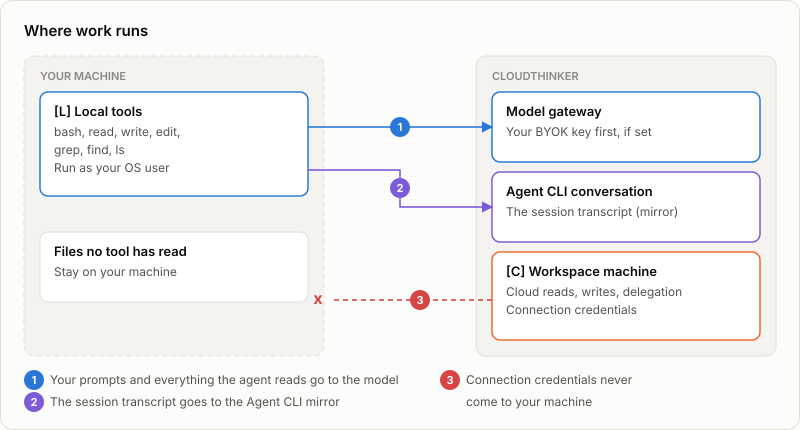
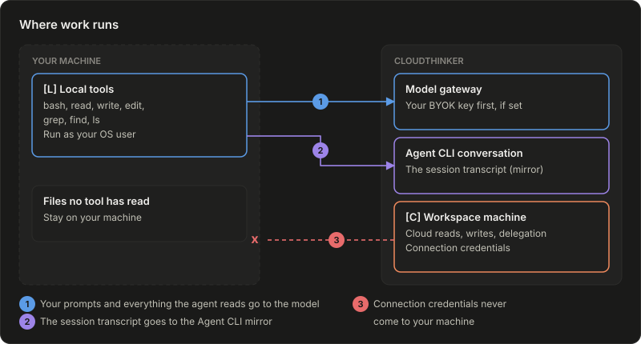
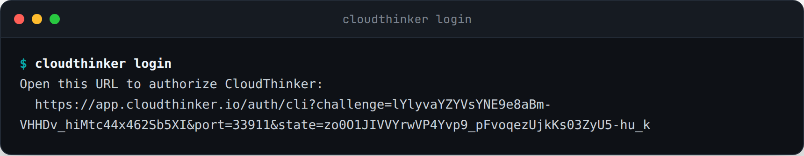

CloudThinker CLI(`cloudthinker`)는 CloudThinker 워크스페이스를 터미널로 가져옵니다. `cloudthinker`를 입력하고 작업을 평이한 말로 설명하면 에이전트가 현재 디렉터리에서 작업합니다. 스크립트는 `cloudthinker chat -p`로 stdout에서 답변을 받습니다.

<Note>
**베타.** CLI는 베타 단계입니다. 정식 출시 전에 명령 이름과 플래그가 바뀔 수 있습니다. CLI는 [환경](/guide/workers)을 **outpost**라고 부르므로 명령에서 `--outpost`를 보게 됩니다. `cloudthinker --version`을 실행하여 버전을 확인하고, 변경 사항은 [릴리스 페이지](https://github.com/cloudthinker-ai/cloudthinker-cli/releases)에서 확인하세요.
</Note>

## 할 수 있는 일

| 작업 | 명령 |
| --- | --- |
| 현재 디렉터리에서 에이전트 세션 시작 | `cloudthinker` 실행 후 작업 설명 |
| 개발 중인 앱의 로컬 보안 테스트 실행. Pentest는 제한된 기능이므로 CloudThinker 담당자에게 워크스페이스에서 켜 달라고 요청하세요. 소유하거나 테스트 권한이 있는 앱만 테스트하세요. [보안 테스트 실행](/ko/guide/security/security-testing)을 참고하세요 | `cloudthinker` 실행 후 "Test http://localhost:3000 for security issues" 입력 |
| 질문 하나를 하고 답변을 파이프로 전달 | `cloudthinker chat -p "Check production health"` |
| 푸시하기 전에 로컬 Git 변경 사항 리뷰 | `cloudthinker review` |
| 머지 리퀘스트 또는 풀 리퀘스트의 [Review](/ko/guide/code-review/overview) 따라가기 | `cloudthinker review watch <MR_URL>` |
| CloudThinker 대화가 이 머신의 폴더에서 작업하게 하기 | `cloudthinker worker start --outpost <name> --workdir "$PWD"`. [환경](/guide/workers)을 참고하세요 |

## 어디서 무엇이 실행되는가

<Frame caption="로컬 도구는 사용자의 머신에서 실행되며, 에이전트가 읽은 내용은 모델로 전송되고, 연결 자격 증명은 워크스페이스 머신에 남습니다.">
  
  
</Frame>

<Warning>
사용자의 머신에서 에이전트는 OS 사용자로 파일을 읽고 편집하며 셸 명령을 실행합니다. **Auto** Approval mode에서는 먼저 묻지 않으며, **Manual**에서는 파일 편집이나 무언가를 바꿀 수 있는 명령 전에 터미널에서 묻습니다. 신뢰하지 않는 저장소라면 컨테이너나 일회용 체크아웃에서 에이전트를 실행하세요.
</Warning>

| 위치 | 일어나는 일 | 네트워크를 넘는 것 |
| --- | --- | --- |
| 사용자의 머신 | 에이전트가 OS 사용자로 파일을 읽고 편집하며 셸 명령을 실행합니다. **Manual**에서는 파일 편집이나 무언가를 바꿀 수 있는 명령 전에 먼저 묻습니다 | 에이전트가 읽은 파일 내용과 명령 출력 같은 도구 결과가 클라우드의 모델로 전송됩니다 |
| 클라우드 | 모델이 실행되고, 워크스페이스 [연결](/ko/guide/connections/overview)(연결한 클라우드 계정과 도구)이 그곳에서 사용됩니다 | 연결 자격 증명은 사용자의 머신에 도달하지 않습니다. 클라우드 쓰기는 [승인](/guide/approvals/overview) 설정을 따릅니다 |

모델로 보내도 괜찮은 내용이 있는 폴더에서만 에이전트를 실행하세요. 자세한 내용은 [작업이 실행되는 위치](/ko/guide/cli/agent#작업이-실행되는-위치)를 참고하세요.

## 사전 요구 사항

- macOS(Apple Silicon 또는 Intel), Linux(x86_64 또는 arm64), 또는 Windows(x86_64). Windows에서는 헤드리스 채팅과 다른 명령은 작동하지만, 대화형 에이전트(`cloudthinker`)와 `cloudthinker remote`는 작동하지 않습니다. 에이전트의 Windows 빌드가 없습니다.
- 최소 하나의 워크스페이스에 접근할 수 있는 CloudThinker 계정. 헤드리스 채팅(`cloudthinker chat`)은 Free를 포함한 모든 플랜에서 작동합니다. 대화형 에이전트(`cloudthinker`)에는 Team, Scale 또는 Enterprise가 필요하며, Free에서는 업그레이드 안내와 함께 시작을 거부합니다. [가격](/ko/guide/billing/pricing)을 참고하세요.
- `cloudthinker.io`(설치 프로그램), `github.com`(CLI 및 에이전트 다운로드), `app.cloudthinker.io`(API)로의 아웃바운드 HTTPS. 프록시 뒤에 있다면 `HTTPS_PROXY`를 설정하세요. 프록시가 HTTPS를 재서명한다면 `SSL_CERT_FILE`을 회사 CA 번들로 설정하세요.

## 설치하고 첫 세션 실행

<Steps>
  <Step title="CLI 설치">
    ```bash
    curl -fsSL https://cloudthinker.io/install.sh | sh
    ```

    설치 프로그램은 `cloudthinker` 바이너리를 `~/.local/bin`에 넣고 셸 프로필의 `PATH`에 그 폴더를 추가합니다. 터미널에서는 이미 로그인되어 있지 않다면 로그인을 시작해 줍니다. CI에서나 `CLOUDTHINKER_CLI_NO_LOGIN=1`을 설정한 경우에는 로그인을 건너뜁니다. 완료되면 새 셸을 여세요.

    Windows에서는 대신 PowerShell 설치 프로그램을 실행합니다.

    ```powershell
    powershell -ExecutionPolicy Bypass -c "irm https://github.com/cloudthinker-ai/cloudthinker-cli/releases/latest/download/cloudthinker-cli-installer.ps1 | iex"
    ```

    머신에서 스크립트를 `sh`로 파이프하는 것이 차단되거나 특정 버전이 필요하다면, 대신 [릴리스 페이지](https://github.com/cloudthinker-ai/cloudthinker-cli/releases)에서 플랫폼에 맞는 아카이브와 `.sha256` 파일을 다운로드하세요.

    ```bash
    shasum -a 256 -c <archive>.sha256   # prints "<archive>: OK"
    tar xf <archive>
    mkdir -p ~/.local/bin && mv <extracted-folder>/cloudthinker ~/.local/bin/
    ```

    **성공 상태:** `cloudthinker --version`이 버전 번호를 출력합니다.
  </Step>

  <Step title="로그인">
    설치 프로그램이 이미 `Logged in to <workspace>.`를 출력했다면 이 단계를 건너뛰세요.

    ```bash
    cloudthinker login
    ```

    CLI가 **How would you like to log in?**이라고 묻습니다. 자신의 머신에서는 **Log in with browser**를, SSH에서는 **Log in with a code**를 고르세요. 브라우저에서 요청을 승인하고, 워크스페이스가 둘 이상이면 하나를 선택하세요.

    <Frame>
      
    </Frame>

    **성공 상태:** 터미널에 `Logged in to <workspace>.`가 출력됩니다. 원격 머신, 여러 워크스페이스, CI는 [CLI 인증](/ko/guide/cli/authentication)을 참고하세요.
  </Step>

  <Step title="계정 확인">
    ```bash
    cloudthinker whoami
    ```

    **성공 상태:** `host=https://app.cloudthinker.io email=you@example.com workspace=Production (<workspace-id>)` 같은 한 줄이 출력됩니다.
  </Step>

  <Step title="에이전트 시작 또는 질문 하나 하기">
    ```bash
    cloudthinker                                    # interactive agent in this folder
    cloudthinker chat -p "Check production health"  # one headless prompt, answer on stdout
    ```

    첫 `cloudthinker` 실행은 CLI 버전에 맞는 에이전트 빌드를 `~/.cloudthinker/agent/bin/<version>/`에 다운로드하고 릴리스의 SHA-256 체크섬으로 확인합니다. 이후 실행은 이를 재사용합니다.

    **성공 상태:** 에이전트 헤더에 워크스페이스, 사용자, 워크스페이스 Approval mode(`· Auto` 또는 `· Manual`)가 표시되고, 프롬프트가 요청을 받을 준비가 됩니다. [Agent CLI](/ko/guide/cli/agent)를 참고하세요.
  </Step>
</Steps>

## 사용자 지정 도메인 사용

CloudThinker가 셀프 호스팅 설치처럼 자체 도메인에서 실행된다면 그 도메인에 한 번 로그인하세요. 경로 없이 origin만 전달합니다.

```bash
cloudthinker login --url https://cloudthinker.example.com
```

CLI가 도메인을 기억하므로 이후 명령에는 `--url`이 필요 없습니다. 머신에는 `app.cloudthinker.io` 대신 해당 도메인으로의 아웃바운드 HTTPS가 필요합니다.

| 목적 | 실행 |
| --- | --- |
| CLI가 사용하는 도메인 확인 | `cloudthinker whoami`를 실행하고 `host=` 확인 |
| 명령 하나 또는 CI 작업에 다른 도메인 사용 | `CLOUDTHINKER_URL=https://cloudthinker.example.com` 설정 |
| CloudThinker 클라우드로 돌아가기 | `cloudthinker login --url https://app.cloudthinker.io` |

**성공 상태:** `cloudthinker whoami`가 `host=https://cloudthinker.example.com`을 출력합니다. `CLOUDTHINKER_URL`은 [CLI 레퍼런스](/ko/guide/cli/reference#환경-변수)를 참고하세요.

## 명령

| 명령 | 하는 일 |
| --- | --- |
| `cloudthinker` 또는 `cloudthinker agent` | 이 폴더에서 대화형 에이전트를 시작합니다. [Agent CLI](/ko/guide/cli/agent)를 참고하세요 |
| `cloudthinker chat` | 헤드리스 프롬프트를 보내거나, 실행을 확인하거나, 최근 실행을 나열합니다. [Headless chat](/ko/guide/cli/headless-chat)을 참고하세요 |
| `cloudthinker review` | 로컬 변경 사항을 리뷰하거나, 머지 리퀘스트 URL로 추적 중인 리뷰를 읽습니다. [Review 명령](/ko/guide/cli/reference#review)을 참고하세요 |
| `cloudthinker incident` | 온콜 스크립트와 CI를 위해 인시던트를 나열하거나 해결될 때까지 기다립니다. [인시던트와 권장 사항](/ko/guide/cli/reference#인시던트와-권장-사항)을 참고하세요 |
| `cloudthinker recommendations` | 월간 절감액과 함께 비용 및 효율 권장 사항을 나열합니다. [인시던트와 권장 사항](/ko/guide/cli/reference#인시던트와-권장-사항)을 참고하세요 |
| `cloudthinker cyber` | Cyber 앱, 도메인, 실행, 발견 사항을 나열합니다. [Cyber 명령](/ko/guide/cli/reference#cyber)을 참고하세요 |
| `cloudthinker worker` | 이 머신에서 워커를 실행하고 환경을 관리합니다 |
| `cloudthinker remote` | SSH로 원격 머신에서 에이전트를 실행합니다. 연결이 끊겨도 계속 실행됩니다. 두 머신 모두 CLI가 필요하며, CLI가 없는 Linux 머신이라면 노트북이 복사해 주겠다고 제안합니다. [원격 에이전트](/ko/guide/cli/reference#원격-에이전트)를 참고하세요 |
| `cloudthinker login` / `logout` / `whoami` | 로그인, 로그아웃, 현재 계정과 워크스페이스 확인 |
| `cloudthinker auth` | 액세스 토큰 출력, 저장된 워크스페이스 로그인 나열, 활성 로그인 전환 |
| `cloudthinker update` | 최신 릴리스 설치 |
| `cloudthinker completion <shell>` | bash, zsh 또는 fish용 자동 완성 스크립트 출력 |

모든 플래그, 환경 변수, 종료 코드는 [CLI 레퍼런스](/ko/guide/cli/reference)에 있습니다.

## CLI를 최신 상태로 유지

언제든 `cloudthinker update`를 실행하세요. 대화형 터미널에서는 더 새로운 릴리스가 있을 때 CLI가 업데이트를 제안하며, 확인은 최대 20시간마다 한 번입니다. `Install it now? [y/N] (s skips this version)`이라고 묻습니다.

| 답변 | 결과 |
| --- | --- |
| `y` | 새 릴리스를 지금 설치합니다 |
| Enter 또는 그 밖의 입력 | 지금은 하지 않습니다. CLI가 나중에 다시 제안합니다 |
| `s` | 해당 버전을 건너뜁니다. 다음 버전이 제안됩니다 |

CI 등에서 제안을 끄려면 `CLOUDTHINKER_NO_UPDATE_CHECK=1`을 설정하세요. 버전을 고정하거나 롤백하려면 `cloudthinker update --version <version>`을 실행합니다. 예: `cloudthinker update --version 0.12.2`.

## 다른 코딩 에이전트에서 CLI 사용

바이너리에는 AI 코딩 에이전트가 CLI 사용법(채팅, 대화 따라가기, 코드 리뷰 읽기, 로컬 Cyber 테스트 실행)을 배우는 운영 가이드가 들어 있습니다. 출력하는 데 로그인이나 네트워크가 필요 없습니다. 코딩 에이전트가 스킬을 읽는 위치에 저장하세요. 예:

```bash
mkdir -p .agents/skills/cloudthinker-cli
cloudthinker --skill > .agents/skills/cloudthinker-cli/SKILL.md
```

## 제거

```bash
cloudthinker logout --all
rm ~/.local/bin/cloudthinker
rm -rf ~/.cloudthinker   # agent builds, agent settings, session transcripts, Cyber tools
```

그런 다음 설정 디렉터리의 `cloudthinker` 폴더(macOS는 `~/Library/Application Support/cloudthinker`, Linux는 `$XDG_CONFIG_HOME/cloudthinker` 또는 `~/.config/cloudthinker`)를 삭제하고, 설치 프로그램이 셸 프로필에 추가한 `PATH` 줄을 제거하세요. CLI가 쓰는 모든 경로는 [파일](/ko/guide/cli/reference#파일)을 참고하세요.

## 문제 해결

<AccordionGroup>
  <Accordion title="cloudthinker: command not found">
    설치 프로그램이 `PATH`에 `~/.local/bin`을 추가했지만, 현재 셸은 그 전에 시작되었습니다. 새 셸을 열거나 `~/.local/bin/cloudthinker --version`을 직접 실행하세요.
  </Accordion>
  <Accordion title="명령이 로그인되지 않았다고 합니다 (종료 코드 3)">
    자격 증명이 없거나 만료되었거나, 서버가 접근을 거부했습니다. `cloudthinker login`을 실행한 뒤 `cloudthinker whoami`로 확인하세요. [CLI 인증](/ko/guide/cli/authentication)을 참고하세요.
  </Accordion>
  <Accordion title="답변이 오기 전에 Ctrl-C로 채팅이 멈췄습니다">
    대기만 멈췄습니다. 실행은 서버에서 계속되며, CLI가 대기를 재개하는 명령을 출력합니다.
  </Accordion>
</AccordionGroup>

## 다음 단계

<CardGroup cols={2}>
  <Card title="CLI 인증" icon="key" href="/ko/guide/cli/authentication">
    SSH로 로그인하고, 워크스페이스를 전환하고, CI 작업을 인증합니다
  </Card>
  <Card title="Agent CLI" icon="laptop-code" href="/ko/guide/cli/agent">
    자신의 저장소에서 에이전트 세션을 실행합니다
  </Card>
  <Card title="Headless chat" icon="terminal" href="/ko/guide/cli/headless-chat">
    CloudThinker의 답변을 스크립트와 파이프라인으로 전달합니다
  </Card>
  <Card title="CLI 레퍼런스" icon="book" href="/ko/guide/cli/reference">
    모든 명령, 플래그, 변수, 종료 코드
  </Card>
</CardGroup>
