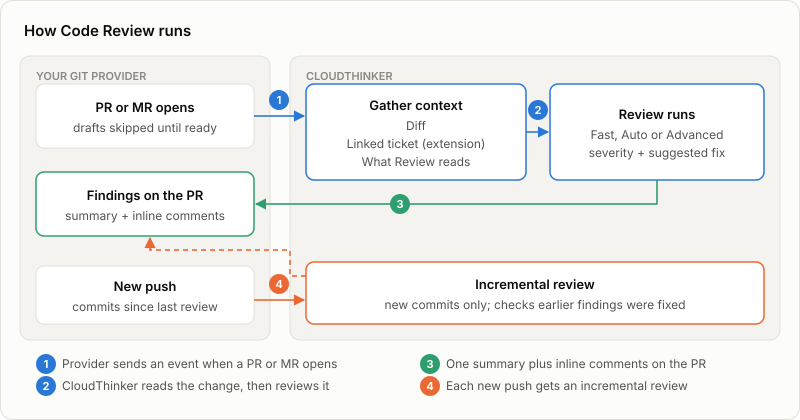
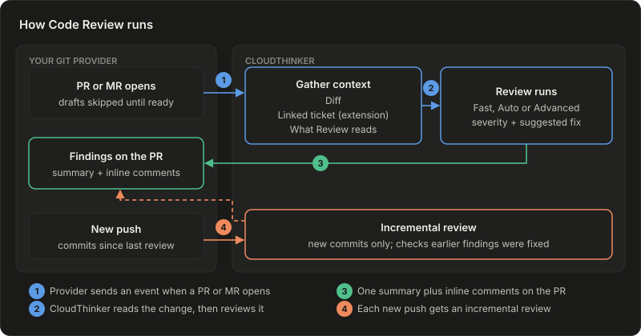

import { ReviewLoopScene } from '/snippets/iso/review-loop.jsx';

**프로덕션에서 아무것도 깨지지 않습니다.**

Review는 코드 변경을 위한 Frontier Investigation Agent로, 풀 리퀘스트(PR)와 머지 리퀘스트(MR)를 위한 AI 리뷰어입니다. 누군가 PR이나 MR을 열면 CloudThinker가 변경을 읽고, 요약 댓글과 인라인 발견 사항을 게시하며, 다시 푸시하면 수정 여부를 확인합니다.

<ReviewLoopScene />

린터는 패턴을 대조합니다. Review는 변경이 무엇을 하려는지 읽습니다. diff, 연결된 티켓, 팀의 규칙 파일, 그리고 있다면 제품이 지켜야 하는 규칙을 설명하는 `BUSINESS.md`를 읽습니다. 그래서 스타일 실수뿐 아니라 깨진 비즈니스 규칙이나 위험한 마이그레이션도 지적할 수 있습니다.

## 작동 방식

<Frame caption="모든 PR 또는 MR에 리뷰가 게시되며, 새 푸시마다 증분 리뷰가 실행됩니다.">
  
  
</Frame>

1. **PR 또는 MR이 열립니다.** Git 공급자를 연결하고 저장소를 한 번 고르면, 이후 PR이나 MR이 열릴 때마다 공급자가 CloudThinker에 이벤트를 보내므로 아무도 리뷰를 시작할 필요가 없습니다. 초안 PR과 MR은 리뷰 준비 완료로 표시될 때까지 건너뜁니다.
2. **CloudThinker가 컨텍스트를 모읍니다.** 변경을 체크아웃하고 diff, 설명에 연결된 티켓([확장](/ko/guide/code-review/extensions)을 추가하면 Jira, Linear, Backlog 또는 공급자 이슈), 그리고 [Review가 읽는 것](#review가-읽는-것)에 나열된 파일을 읽습니다.
3. **리뷰가 실행됩니다.** 깊이는 워크스페이스 [리뷰 모드](/ko/guide/code-review/setup#리뷰-모드-선택)인 **Fast**, **Auto** 또는 **Advanced**에 따라 다릅니다. 각 리뷰는 크레딧을 사용합니다. [사용량과 크레딧](/ko/guide/billing/usage)을 참고하세요.
4. **발견 사항이 PR에 게시됩니다.** 요약 댓글 하나와 인라인 댓글을 받습니다. 각 발견 사항에는 심각도(Critical, High, Medium 또는 Low)와 제안된 수정이 있습니다.
5. **새 푸시에는 증분 리뷰가 실행됩니다.** 마지막 리뷰 이후 푸시된 커밋만 읽으며, 이전 발견 사항이 수정되었는지 확인합니다.

해결되지 않은 가장 심각한 발견 사항이 리뷰의 판정을 정하며, 끝나지 않았거나 건너뛴 실행은 대신 자체 상태를 받습니다. 판정은 CloudThinker가 변경에 붙이는 라벨이며, 머지 가능 여부는 여전히 공급자의 브랜치 규칙이 결정합니다. 일곱 가지 판정과 각각이 요구하는 것은 [판정](/guide/code-review/review-workspace#triage-the-changes-list)을 참고하세요.

<Note>
  CloudThinker는 선택된 각 저장소를 읽기 위해 자체 사본을 보관하며, **Remove setup**을 클릭하면 그 사본을 삭제합니다. 도구 출력의 시크릿은 모델이 보기 전에 자리 표시자로 대체됩니다. [데이터 보호](/guide/security/data-protection)를 참고하세요.
</Note>

변경된 테스트 파일, 픽스처와 테스트 데이터, 스냅샷, 생성된 코드, Storybook 스토리, 프로토타입, `docs/` 아래의 HTML, 벤더링된 Jsonnet은 리뷰하지 않습니다. 이런 파일에는 발견 사항이 절대 달리지 않습니다.

<Accordion title="건너뛰는 경로 패턴 전체 목록">
  ```text
  **/test_*.py              **/conftest.py              **/*_test.go
  **/src/test/java/**/*.java                            **/src/test/**/*.{kt,kts}
  **/*.test.{js,jsx,ts,tsx} **/*.spec.{js,jsx,ts,tsx}   **/__tests__/**
  **/test/**/*_test.py      **/tests/**/*_test.py       **/*_test.py
  **/*_spec.rb              **/spec/**/*_spec.rb        **/*Test.java
  **/*Tests.java            **/*_test.rs                **/oh_modules/**
  **/*.test.ets             **/test/**/*.jl             **/test/**/*.hs
  **/*Spec.hs               **/test/**/*.lhs            **/*Spec.lhs
  **/tests/**/*.nim         **/tests/**/*.R             **/__snapshots__/**
  **/*.snap                 **/testdata/**              **/fixtures/**
  **/.ipynb_checkpoints/**  **/*.generated.*            **/*.gen.go
  **/*.pb.go                **/*.pb.cc                  **/*.pb.h
  **/*Test.swift            **/*Tests.swift             **/Tests/**/*.swift
  **/tests/**/*.elm         **/vendor/**/*.{jsonnet,libsonnet}
  **/test/**/*.zig          **/*_test.zig               **/kitex_gen/**/*.go
  **/*.capnp.h              **/*.capnp.go               **/*.capnp.ts
  **/*_capnp.rs             **/*_capnp.py               **/test/**/*.ml
  **/tb_*.{v,sv,vhd,vhdl}   **/*_tb.{v,sv,vhd,vhdl}     lib/**/*.sol
  **/*.t.sol                **/test/**/*.sol            **/tests/**/*.sol
  **/test/**/*.vy           **/tests/**/*.vy            **/*.stories.{js,jsx,ts,tsx,mdx}
  **/prototypes/**          **/docs/**/*.html
  ```
</Accordion>

일치 여부는 파일 경로로만 판단하며, 추가할 수 없는 이 내장 목록과 대조합니다. 예상치 못하게 걸리는 경로는 [발견 사항이 틀리거나 시끄러울 때](/guide/code-review/troubleshooting#findings-are-wrong-or-noisy)를 참고하세요.

## Review가 읽는 것

diff 외에도 Review는 팀 고유의 지식을 읽습니다. 모두 선택 사항이며, 시간이 지날수록 모든 리뷰를 더 날카롭게 만듭니다.

| 파일 | 위치 | 역할 |
|---|---|---|
| [`BUSINESS.md`](/guide/code-review/business-flow) | 대상 브랜치의 저장소 루트 | 제품의 모듈과 그 모듈이 지켜야 하는 규칙(불변 조건)을 설명합니다. 비즈니스 흐름 발견 사항은 여기서 나옵니다. 파일이 있으면 항상 읽습니다 |
| 규칙 파일 | 저장소 루트나 아무 폴더의 `AGENTS.md`, `CLAUDE.md`, `CONVENTIONS.md`, 그리고 Cursor나 Copilot 같은 코딩 에이전트의 규칙 파일 | Review가 따르는 코딩 규칙. [인식하는 모든 경로](/ko/guide/code-review/learnings#자체-규칙-파일-추가) |
| [Learnings](/ko/guide/code-review/learnings) | CloudThinker가 저장소별로 보관하며 파일이 필요 없음 | 팀이 해결한 발견 사항에서 CloudThinker가 학습한 규칙. Review가 모든 새 리뷰에 적용하므로 같은 실수를 다음에 잡아냅니다 |

`BUSINESS.md`는 짧고 정해진 형식으로 직접 작성합니다. [Business flow checks](/guide/code-review/business-flow)를 참고하세요. 파일을 파싱할 수 없어도 리뷰는 파일 없이 계속 실행됩니다.

## 확인하는 것

각 발견 사항에는 카테고리 하나가 붙습니다.

| 카테고리 | 잡아내는 것 | 예시 |
|---|---|---|
| Security | 인젝션, 노출된 시크릿, 안전하지 않은 인증 또는 권한 | 매개변수 없이 요청 입력으로 만든 쿼리 |
| Correctness | 로직 오류, null 처리, 경쟁 조건 | 두 요청이 같은 행을 쓸 때의 업데이트 손실 |
| Performance | 느린 쿼리, N+1 루프, 블로킹 호출 | 요청 핸들러 안의 전체 테이블 스캔 |
| Pattern | 저장소가 이미 따르는 규칙 위반 | 공용 오류 래퍼를 건너뛰는 새 핸들러 |
| Deploy, migration, backward compatibility | 롤아웃이나 기존 클라이언트를 깨는 변경 | 현재 릴리스가 아직 읽는 열을 삭제하는 마이그레이션 |
| Test gap | 어떤 테스트도 다루지 않는 변경된 동작 | 테스트를 추가하지 않는 PR의 테스트 없는 새 오류 경로 |
| Business flow | `BUSINESS.md`의 규칙을 깨는 변경 | 불변 조건이 유료 플랜에만 허용한 기능을 체험 계정이 쓰게 하는 코드 |

## 할 수 있는 일

| 기능 | 얻는 것 | 자세히 보기 |
|---|---|---|
| 자동 리뷰 | 모든 새 PR 또는 MR에 요약과 인라인 발견 사항 | [Review 설정](/ko/guide/code-review/setup) |
| 따라 해 보기 | 프로덕션을 깨뜨릴 PR 하나: 발견 사항, 확인 방법, 머지 전 수정 | [Review로 위험한 풀 리퀘스트 잡기](/guide/use-cases/review-risky-pull-request) |
| 개요 대시보드 | 나를 기다리는 변경을 찾고 리뷰 활동 확인 | [Review Dashboard](/guide/code-review/dashboard) |
| Codebase Atlas | 팀이 무엇을 머지했는지, 어디에 들어갔는지, 무엇에 주의가 필요한지 확인 | [Codebase Atlas](/guide/code-review/codebase-atlas) |
| UI Review: Loupe | 머지 전에 실행 중인 앱에서 확인한, 변경이 건드리는 페이지의 스크린샷 | [UI Review: Loupe](/guide/code-review/loupe) |
| Business flow checks | 설명한 가격, 권한 또는 금액 규칙을 변경이 깨뜨릴 때의 발견 사항 | [Business flow checks](/guide/code-review/business-flow) |
| 개인화 | 팀을 위한 요약 섹션, 어조, 언어 설정 | [Review Personalization](/guide/code-review/customizations) |
| 저장소 관리 | 저장소별 Review, Atlas 매핑, Learnings 제어 | [Manage Review Repositories](/guide/code-review/repository-management) |
| Review 워크스페이스 | CloudThinker에서 리뷰된 모든 변경과 발견 사항, 상태 | [Review 워크스페이스](/guide/code-review/review-workspace) |
| 멘션 명령 | PR 댓글에서 `@cloudthinker-ai`로 질문, 리뷰 재실행, 발견 사항 수정 | [멘션 명령](/ko/guide/code-review/mention-commands) |
| Learnings | 해결된 발견 사항의 반복 패턴을 향후 리뷰에 적용 | [Learnings](/ko/guide/code-review/learnings) |
| 파이프라인 분석 | 실패한 각 CI 실행에 대한 설명과 제안된 수정 | [Pipeline Analysis](/guide/code-review/pipelines) |
| 충돌 자동 해결 | 열린 MR/PR의 머지 충돌을 해결하는 후속 MR/PR. Azure DevOps에서는 사용할 수 없음 | [Auto-resolve conflicts](/guide/code-review/conflict-resolution) |
| Release Risk | 모든 차단 요인의 이유와 함께 릴리스에 대한 출시 또는 차단 판정 하나 | [Release Risk](/guide/code-review/releases) |
| Insights | 어떤 발견 사항 카테고리가 팀에 영향을 주고 얼마나 빨리 수정되는지 | [Insights](/ko/guide/code-review/analytics) |
| 문제 해결 | 리뷰가 게시되지 않았거나 멈췄거나 건너뛴 이유와 원인, 확인 방법, 수정 | [Review 문제 해결](/guide/code-review/troubleshooting) |

## 지원 공급자

GitHub, GitLab(GitLab.com 또는 셀프 호스팅), Bitbucket Cloud, Azure DevOps, AWS CodeCommit. 각 공급자에 필요한 것은 [공급자 인증](/guide/code-review/provider-auth)을 참고하세요. 롤아웃을 계획하기 전에 다음 한도를 확인하세요.

- **워크스페이스당 공급자 하나와 Azure DevOps 프로젝트 하나.** 두 번째 공급자나 두 번째 Azure DevOps 프로젝트의 저장소에는 별도 워크스페이스가 필요합니다.
- **입력할 수 있는 인스턴스 URL은 셀프 호스팅 GitLab뿐입니다.** GitHub Enterprise Server와 Bitbucket Data Center는 선택할 수 없으며, CodeCommit 연결은 AWS 계정 하나와 리전 하나를 다룹니다.

자동 리뷰는 다섯 공급자 모두에서 실행됩니다. 그 위의 작업은 그렇지 않습니다.

- `@cloudthinker-ai` 댓글 명령은 공급자마다 다르며, AWS CodeCommit은 최상위 질문만 받습니다. [공급자 지원](/ko/guide/code-review/mention-commands#제공자-지원)을 참고하세요.
- **Apply fix**는 [발견 사항 처리](/guide/code-review/review-workspace#work-the-findings)에, **Fix all findings**와 **Merge**는 [재실행, 수정, 머지](/guide/code-review/review-workspace#re-run-fix-and-merge)에 공급자별로 나와 있습니다.
- [Auto-resolve conflicts](/guide/code-review/conflict-resolution)는 Azure DevOps를 제외한 모든 공급자에서 작동합니다.

비슷해 보이지만 쓰는 곳이 다른 텍스트가 두 가지 있습니다. 댓글의 `@cloudthinker-ai`는 질문, 재리뷰 또는 수정을 요청하고, 설명의 `@cloudthinker:ignore`는 해당 변경 하나의 [리뷰를 건너뜁니다](/ko/guide/code-review/mention-commands#리뷰-건너뛰기). [멘션 명령](/ko/guide/code-review/mention-commands)을 참고하세요.

## 시작하기

<CardGroup cols={2}>
  <Card title="Review 설정" icon="gear" href="/ko/guide/code-review/setup">
    공급자를 연결하고, 저장소를 고르고, 첫 리뷰를 받습니다.
  </Card>
  <Card title="공급자 인증" icon="key" href="/guide/code-review/provider-auth">
    각 Git 공급자의 토큰, 스코프, 웹훅.
  </Card>
</CardGroup>
