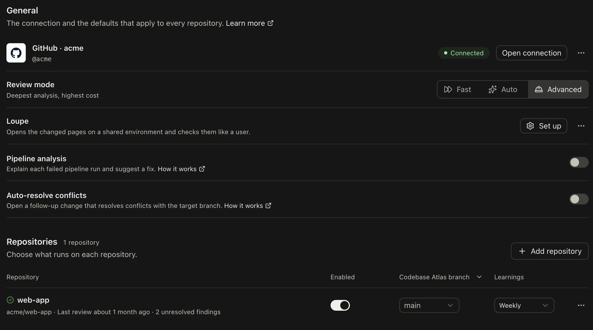

Git 제공자를 한 번 연결하고 감시할 저장소를 고르면, 그 저장소의 모든 새 풀 리퀘스트(PR) 또는 머지 리퀘스트(MR)가 수동 트리거 없이 리뷰를 받습니다. Review가 처음이라면 먼저 [개요](/ko/guide/code-review/overview)를 읽으세요.

## 사전 요구 사항

- 워크스페이스 **Admin**인 CloudThinker 워크스페이스. Developer와 Viewer는 리뷰를 볼 수 있지만 설정을 실행할 수는 없습니다. [역할](/guide/security/roles)을 참고하세요.
- 리뷰할 저장소에 앱을 설치하거나 액세스 토큰을 만들 수 있는 GitHub, GitLab, Bitbucket Cloud, Azure DevOps 계정.
- 약 10분. GitLab과 Azure DevOps는 webhook 단계가 하나 더 필요합니다.
- 자체 호스팅 GitLab 전용: CloudThinker가 HTTPS로 GitLab URL에 접근할 수 있어야 하고, GitLab 인스턴스가 마법사에 표시되는 webhook URL에 접근할 수 있어야 합니다.

<Note>
  각 워크스페이스는 Git 제공자 하나를 연결합니다. 팀이 두 제공자를 쓴다면 각각 별도 워크스페이스에서 Review를 설정하세요.
</Note>

## 제공자와 저장소 연결

<Steps>
  <Step title="Review 열기">
    왼쪽 탐색에서 **Review**를 클릭하세요. 설정 전에는 페이지에 **AI reviews every pull request and analyzes failed pipelines.**가 표시됩니다.
  </Step>
  <Step title="설정 시작하기">
    **Connect repository**를 클릭하거나, 같은 페이지의 **Where is your code hosted?**에서 제공자를 고르세요. **Provider**, **Connect**, **Finish** 세 단계가 있는 설정 시트가 열립니다.
  </Step>
  <Step title="제공자 선택하기">
    **Where is your code hosted?**에서 **GitHub**, **GitLab**, **Bitbucket**, **Azure DevOps** 중 하나를 선택하세요. 시트가 **Connect**로 넘어갑니다.
  </Step>
  <Step title="계정 연결하기">
    제공자가 허용하는 방식으로 인증하세요:

    | 제공자 | 연결 방법 |
    |---|---|
    | GitHub | **Install GitHub App** |
    | GitLab | **OAuth** 탭(**Connect to GitLab**, GitLab.com 전용) 또는 **Access Token** 탭 |
    | Bitbucket | **OAuth** 탭(**Connect to Bitbucket**) 또는 **Access Token** 탭 |
    | Azure DevOps | Personal access token 입력 후 **Check token**과 **Connect** |

    무엇을 골라야 할지 모르겠다면, 팀 설정에는 프로젝트, 그룹, 워크스페이스, 저장소 액세스 토큰을 사용해 코멘트가 봇 사용자로 달리게 하세요. GitLab.com이나 Bitbucket에서 빠르게 체험하려면 OAuth를 사용하세요. 각 방법의 정확한 범위와 단계는 [제공자 인증](/guide/code-review/provider-auth#pick-an-auth-method)에 있습니다.

    <Tip>
      액세스 토큰과 PAT는 만료됩니다. 만들 때 만료일을 기록해 두고, 그 전에 [Update token](/guide/code-review/provider-auth#token-expiry)으로 교체하세요.
    </Tip>

    **성공 상태:** 시트가 **Finish**로 넘어갑니다.
  </Step>
  <Step title="저장소 선택하기">
    **Select Repositories**에서 리뷰할 각 저장소를 체크하세요. 연결이 볼 수 있는 저장소만 나열됩니다. GitHub에서는 먼저 앱의 저장소 접근 권한에 해당 저장소가 부여되어 있어야 합니다([GitHub](/guide/code-review/provider-auth#github) 참고).

    나중에 제공자에서 만드는 저장소는 자동으로 나타나지 않습니다: **Review → Settings → Repositories**에서 **Add repository**로 추가하세요.
  </Step>
  <Step title="webhook 추가하기(GitLab, Azure DevOps)">
    GitLab과 Azure DevOps에서는 **Finish**에 webhook **URL**과 **Secret token**도 표시됩니다. 단계에 나열된 트리거와 함께 제공자에 추가한 다음 **Mark as Configured**를 클릭하세요. GitHub와 Bitbucket은 webhook이 자동으로 등록되므로 이 단계를 건너뜁니다. 각 제공자의 단계는 [webhook 구성](/guide/code-review/provider-auth#configure-webhooks)에 있습니다.

    <Warning>
      이 webhook이 없으면 CloudThinker가 새 MR이나 PR을 알 수 없어 리뷰가 실행되지 않습니다.
    </Warning>

    나중에 URL과 secret token을 다시 보려면 **Review → Settings**를 열고 **General** 섹션의 **Connection** 행에서 **Webhook**을 클릭하세요.
  </Step>
  <Step title="리뷰 시작하기">
    **Start reviewing**을 클릭하세요(버튼에 고른 저장소 수가 표시됩니다).

    **성공 상태:** 시트에 **Connect your Git provider**와 **Save the Review setup**이 완료로 표시되고, 준비된 저장소 수가 나옵니다. CloudThinker가 저장소를 클론하는 동안 **Review → Settings → Repositories**의 해당 행에 **Setting up**이 표시됩니다. 클론이 실패하면 행에 **Setup failed**가 표시됩니다. [저장소 문제](/guide/code-review/troubleshooting#repository-problems)를 참고하세요. 열린 PR이 대기 중이면 시트가 최신 PR을 리뷰하겠다고 제안합니다. 그렇지 않으면 **Close**를 클릭하고 새 PR을 여세요.
  </Step>
</Steps>

## 첫 리뷰 받기

<Steps>
  <Step title="풀 리퀘스트 또는 머지 리퀘스트 열기">
    선택한 저장소에 브랜치를 푸시하고 그 저장소에 PR 또는 MR을 여세요. 초안으로 열지 마세요: 초안은 리뷰 준비 완료로 표시할 때까지 건너뜁니다.

    저장소가 아직 클론 중일 때 도착한 PR에는 "setting up" 메모가 달리며, 클론이 끝나면 리뷰됩니다.
  </Step>
  <Step title="PR에서 발견 항목 읽기">
    CloudThinker는 먼저 진행 상황 코멘트를 게시한 다음 요약으로 교체합니다. 인라인 코멘트는 정확한 줄에 달리며, 각각 심각도(Critical, High, Medium, Low), 설명, 제안된 수정을 포함합니다.

    **성공 상태:** PR에 CloudThinker의 해당 변경으로 돌아가는 링크가 포함된 요약 코멘트가 나타납니다.

    코멘트는 연결에 사용한 신원으로 달립니다:

    | 연결 방법 | 코멘트 작성자로 표시되는 것 |
    |---|---|
    | GitHub App | CloudThinker GitHub App |
    | GitLab 또는 Bitbucket 액세스 토큰 | 토큰의 봇 사용자 |
    | GitLab 또는 Bitbucket OAuth | 연결한 사람 |
    | Azure DevOps PAT | PAT를 소유한 사람 |
    | CodeCommit | 설정 스크립트가 만든 IAM 역할 또는 사용자 |
  </Step>
  <Step title="PR에서 후속 작업하기">
    발견 항목의 스레드에 답글을 달아 반론하거나, PR 코멘트에서 봇을 멘션하세요:

    ```text
    @cloudthinker-ai why is this query a problem?
    @cloudthinker-ai review
    @cloudthinker-ai autofix
    ```

    AWS CodeCommit에서는 질문과 `@cloudthinker-ai help`만 작동합니다. CodeCommit은 `review`, `autofix`, 발견 항목 스레드의 답글을 무시합니다. CodeCommit PR을 다시 리뷰하려면 소스 브랜치에 새 커밋을 푸시하세요.

    PR 하나의 리뷰를 건너뛰려면 PR 설명 어디든 `@cloudthinker:ignore`를 넣으세요. 전체 목록은 [멘션 명령](/ko/guide/code-review/mention-commands)을 참고하세요.
  </Step>
</Steps>

**Review → Changes**에서 리뷰된 모든 변경을 발견 항목, 상태와 함께 열 수도 있습니다. [리뷰 워크스페이스](/guide/code-review/review-workspace)를 참고하세요.

## 리뷰 모드 선택

리뷰 모드는 워크스페이스의 모든 저장소에 적용됩니다. **Review → Settings → General → Review mode**에서 변경하세요. 새 워크스페이스는 **Fast**로 시작합니다.

<Frame caption="Review Settings: 연결된 제공자, 리뷰 모드, Add repository">
  
</Frame>

| 모드 | 동작 | 사용할 때 |
|---|---|---|
| **Fast** | 리뷰어 한 명이 변경을 읽습니다. 빠른 분석, 낮은 비용 | 대부분의 저장소, 작은 PR, 빠른 피드백 |
| **Auto** | 작은 변경에는 Fast를, 복잡한 변경에는 Advanced를 고릅니다 | 작은 변경과 큰 변경이 섞인 저장소 |
| **Advanced** | 변경을 병렬 리뷰어에게 나누어 가장 깊이 분석하며, 비용이 가장 높습니다 | 결함을 놓치면 비용이 큰 핵심 서비스 |

## 기타 워크스페이스 설정

이 설정은 **Review → Settings**의 같은 **General** 섹션에 있으며, 켜기 전까지 **꺼져** 있습니다.

| 설정 | 동작 |
|---|---|
| **Pipeline analysis** | 실패한 각 파이프라인 실행을 설명하고 수정 방안을 제안합니다. 각 분석은 에이전트 실행이므로 크레딧을 사용합니다. [파이프라인](/guide/code-review/pipelines)을 참고하세요 |
| **Auto-resolve conflicts** | 머지 충돌을 해결하는 후속 MR/PR을 엽니다. Azure DevOps에서는 표시되지 않습니다. 각 해결은 에이전트 실행이므로 크레딧을 사용합니다. [충돌 자동 해결](/guide/code-review/conflict-resolution)을 참고하세요 |

저장소 스위치, Atlas 브랜치, 일괄 변경은 [Review 저장소 관리](/guide/code-review/repository-management)를 참고하세요. 요약 섹션, 어조, 언어를 바꾸려면 [Review 개인화](/guide/code-review/customizations)를 참고하세요.

## 리뷰할 PR 필터링

각 저장소에 필터를 둘 수 있으므로, CloudThinker가 봇 의존성 업데이트처럼 리뷰하지 않을 PR을 건너뛸 수 있습니다.

<Steps>
  <Step title="저장소 필터 열기">
    **Review → Settings → Repositories**로 이동해 저장소의 작업 메뉴(⋯)를 열고 **Configure filters**를 클릭하세요.
  </Step>
  <Step title="규칙 추가하기">
    **Add Filter Rule**을 클릭하고 필터 유형, **Include** 또는 **Exclude**, 값을 고르세요. 그다음 **Save Filters**를 클릭하세요.
  </Step>
</Steps>

| 필터 | 일치 대상 |
|---|---|
| **Authors** | PR 작성자의 사용자 이름. 정확히 일치, 대소문자 구분 안 함. 와일드카드 없음. 예: `dependabot[bot]` |
| **Branches** | 대상 브랜치(머지되는 브랜치). Glob 패턴 사용 가능, 예: `release/*`. 대소문자 구분 |
| **Labels** | PR 또는 MR 라벨. 정확히 일치, 대소문자 구분 안 함. 예: `needs-review` |

규칙이 결합되는 방식:

- Exclude 규칙이 먼저 확인됩니다. 어떤 exclude 규칙에든 일치하는 PR은 건너뜁니다.
- 그다음 모든 include 규칙을 통과해야 합니다. 한 규칙 안에서는 값 중 하나만 일치하면 됩니다.

<Note>
  여러 브랜치는 **하나의** Branches 규칙에 넣으세요. 별도의 **Branches** include 규칙 두 개는 같은 대상 브랜치에 모두 일치해야 하므로 거의 모든 PR이 건너뛰어집니다.
</Note>

| 규칙 | 리뷰됨 | 건너뜀 |
|---|---|---|
| **Include** Branches `main`, `release/*`(규칙 하나) | `main` 또는 `release/` 브랜치로 가는 PR | 다른 브랜치로 가는 PR |
| **Include** Branches `main`과 **Include** Branches `release/*`(규칙 두 개) | 없음 | 모든 PR: `main`이면서 `release/` 브랜치인 대상 브랜치는 없습니다 |
| **Include** Branches `main`과 **Include** Labels `needs-review` | `needs-review`가 붙은 `main`으로 가는 PR | 라벨이 없는 `main`으로 가는 PR, 그리고 다른 브랜치로 가는 모든 PR |

필터는 새 이벤트마다 확인되므로, CloudThinker가 이미 추적 중인 MR/PR에도 다음 푸시부터 적용됩니다. 필터링된 MR/PR 하나를 그래도 리뷰하려면 그곳에 `@cloudthinker-ai review`를 코멘트로 다세요. CodeCommit에는 `review` 명령이 없으므로, 필터링된 CodeCommit PR은 필터를 바꾸고 새 커밋을 푸시할 때까지 리뷰되지 않습니다.

예를 들어 **Exclude** Authors `dependabot[bot]`과 **Include** Branches `main`을 함께 쓰면 Dependabot의 PR을 제외하고 `main`으로 가는 모든 PR을 리뷰합니다. 건너뛴 PR은 추적되지만 리뷰되지 않습니다: **Review → Changes**의 **All** 탭에 **Skipped** 판정과 함께 표시됩니다. [판정](/guide/code-review/review-workspace#triage-the-changes-list)을 참고하세요.

## 문제 해결

<AccordionGroup>
  <Accordion title="새 PR에 코멘트가 나타나지 않습니다">
    **원인:** PR이 초안이거나, 저장소가 선택되지 않았거나 아직 클론 중이거나, 필터가 제외했거나, webhook이 없습니다.

    **확인:** **Review → Settings → Repositories**를 열고 저장소의 **Enabled** 스위치가 켜져 있는지 확인하세요. 그다음 제공자를 확인하세요:

    - **GitHub:** 조직 또는 계정 설정에서 **GitHub Apps**를 열고 CloudThinker 앱 옆의 **Configure**를 클릭해 저장소에 접근 권한이 있는지 확인하세요.
    - **Bitbucket:** **Repository settings → Webhooks**에서 CloudThinker webhook이 있고 최근 요청이 성공했는지 확인하세요.
    - **GitLab:** **Settings → Webhooks**에서 CloudThinker webhook을 편집하고 **Recent events**에서 실패한 요청을 확인하세요.
    - **Azure DevOps:** **Project Settings → Service hooks**에서 각 CloudThinker 구독을 열고 **History**를 확인하세요.
    - **CodeCommit:** webhook 로그가 없습니다. 저장소 리전의 Amazon EventBridge에서 `CloudThinker-CodeCommit-*` 규칙이 있는지 확인하세요. 없다면 CodeCommit webhook 설정 스크립트를 다시 실행하세요.

    **해결:** PR을 리뷰 준비 완료로 표시하거나, 저장소를 활성화하거나, [webhook을 다시 추가](/guide/code-review/provider-auth#configure-webhooks)하세요. 그다음 PR에 `@cloudthinker-ai review`를 코멘트로 달아 푸시 없이 리뷰를 시작하세요. CodeCommit에서는 대신 PR의 소스 브랜치에 새 커밋을 푸시하세요.
  </Accordion>
  <Accordion title="Review에 Reconnect your Git provider가 표시됩니다">
    **원인:** 토큰이 만료되었거나 취소되었거나, OAuth 권한이 제거되었습니다.

    **해결:** Review 페이지에 **Connection needs attention** 알림이 표시됩니다. OAuth로 연결했다면 **Reconnect with GitLab**(또는 **Bitbucket**)을 클릭하고 다시 접근을 승인하세요. 토큰을 사용했다면 **Update Token**(CodeCommit에서는 **Update Credentials**)을 클릭하고 새 토큰을 붙여 넣어 검증하세요. 저장소와 설정은 유지됩니다.

    연결이 끊긴 동안 열린 PR에는 리뷰가 없을 수 있습니다. 그곳에 `@cloudthinker-ai review`를 코멘트로 달아 리뷰를 시작하거나, CodeCommit에서는 소스 브랜치에 새 커밋을 푸시하세요.

    토큰이 만료되기 전에 교체하려면 **Review → Settings**를 열고 **General** 섹션의 **Connection** 행에서 작업 메뉴(⋯)를 연 뒤 **Update token**을 클릭하세요.
  </Accordion>
  <Accordion title="리뷰가 요약을 게시하기 전에 멈췄습니다">
    **확인:** PR의 진행 상황 코멘트가 이제 **CloudThinker Review Did Not Finish**로 표시되며, CloudThinker가 저장소를 열 수 없었다는 식으로 이유가 나올 수 있습니다. CloudThinker에서 리뷰를 열고 **More actions (⋯) → View review conversation**으로 실행을 확인하세요.

    **해결:** 저장소를 열 수 없었다면 **Review → Settings**에서 다시 연결하세요. 그다음 PR에 `@cloudthinker-ai review`를 코멘트로 달아 마지막으로 리뷰한 커밋부터 이어가세요. CodeCommit에서는 대신 PR의 소스 브랜치에 새 커밋을 푸시하세요.
  </Accordion>
  <Accordion title="PR에 워크스페이스의 크레딧이 부족하다고 표시됩니다">
    **원인:** 진행 상황 코멘트가 "this workspace is out of credits. Add credits or upgrade the plan in CloudThinker, then run the review again." 원인과 함께 **CloudThinker Review Did Not Finish**로 표시됩니다.

    **확인:** **Settings → Organization → Usage**에 조직에 남은 크레딧이 표시됩니다(Owner와 Admin이 열 수 있습니다). 워크스페이스가 자체 [크레딧 한도](/guide/billing/credit-limits)에 도달했을 수도 있습니다.

    **해결:** 크레딧을 추가하거나, 플랜을 업그레이드하거나, 크레딧이 갱신될 때까지 기다린 다음(각 크레딧 유형의 초기화 시점은 [사용량과 크레딧](/ko/guide/billing/usage) 참고) PR에 `@cloudthinker-ai review`를 코멘트로 다세요. CodeCommit에서는 대신 PR의 소스 브랜치에 새 커밋을 푸시하세요.
  </Accordion>
  <Accordion title="저장소에 Setup failed가 표시되거나 Setting up에 머물러 있습니다">
    **확인:** **Review → Settings → Repositories**에서 해당 행에 **Setup failed**가 표시되고, 있다면 클론 오류가 이어서 나옵니다. 만료된 토큰이나 해당 저장소에 대한 접근 권한 누락인 경우가 많습니다.

    **해결:** 접근 문제를 해결한 다음 행에서 **Retry**를 클릭하세요. 저장소가 **Setting up**에 머물러 있으면 **Cancel**을 클릭하고 **Cancel clone**을 확인하세요. 행에 **Setup cancelled**가 표시되면 **Retry**를 클릭하세요.
  </Accordion>
</AccordionGroup>

## 다음 단계

**실습:** [Review로 위험한 풀 리퀘스트 잡아내기](/guide/use-cases/review-risky-pull-request)에서 Review가 프로덕션을 망가뜨릴 변경을 막는 과정을 확인하세요.

<CardGroup cols={2}>
  <Card title="제공자 인증" icon="key" href="/guide/code-review/provider-auth">
    각 Git 제공자의 토큰 범위와 webhook 단계.
  </Card>
  <Card title="멘션 명령" icon="at" href="/ko/guide/code-review/mention-commands">
    PR 코멘트에서 질문하고, 다시 리뷰하고, 발견 항목을 수정하세요.
  </Card>
  <Card title="리뷰 워크스페이스" icon="table-list" href="/guide/code-review/review-workspace">
    CloudThinker에서 리뷰된 모든 변경과 발견 항목을 추적하세요.
  </Card>
  <Card title="Learnings" icon="scroll" href="/ko/guide/code-review/learnings">
    팀이 계속 고치는 패턴을 리뷰에 가르치세요.
  </Card>
</CardGroup>
