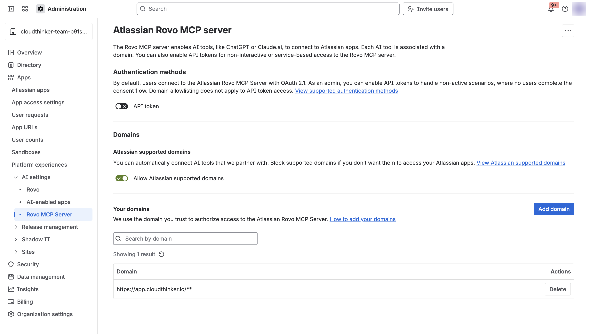

import ApprovalDefault from '/snippets/approval-default.mdx';
import ConnectionSecurity from '/snippets/ko/connection-security.mdx';

Atlassian Cloud 사이트를 연결하면 CloudThinker 에이전트가 Jira 이슈와 Confluence 페이지를 검색하고, 코드 변경 뒤에 있는 티켓을 읽고, 승인을 거쳐 이슈와 페이지를 만들거나 업데이트할 수 있습니다. 연결 하나로 Jira와 Confluence를 모두 다룹니다. Atlassian MCP 서버(이전 이름 Rovo MCP Server)를 통해 **OAuth**로 로그인하며, 권한을 부여한 사람의 권한으로 동작합니다.

## 사전 요구 사항

- **Scale** 플랜 이상의 CloudThinker 워크스페이스. 낮은 플랜에서는 버튼이 **Upgrade to Connect**로 표시됩니다.
- Jira, Confluence 또는 둘 다 있는 Atlassian Cloud 사이트.
- 조직에서 아직 하지 않았다면, 일회성 도메인 단계를 위한 Atlassian **조직 관리자**.
- 조직에서 사용할 수 있는 **Atlassian MCP server**(이전 이름 Rovo MCP Server). Atlassian Administration에 **Connectors → Atlassian MCP server**가 보이지 않으면 먼저 Atlassian과 해결하세요.
- CloudThinker 워크스페이스에서 연결을 관리할 수 있는 권한.

<Info>
이 연결은 Jira Service Management 경보나 온콜 일정에 접근하지 않습니다. Atlassian은 이를 API 토큰으로만 제공하므로, 별도의 [Jira Service Management](/guide/connections/jsm) 연결이 있습니다.
</Info>

## 설정

<Steps>
  <Step title="Atlassian에서 CloudThinker 도메인 허용">
    조직 관리자가 [admin.atlassian.com](https://admin.atlassian.com)으로 이동하여 **Connectors → Atlassian MCP server**를 열고 **Add domain**을 클릭합니다. 다음을 입력합니다.

    ```text
    https://app.cloudthinker.io/**
    ```

    정확히 입력하세요. `/**` 와일드카드는 해당 도메인 아래의 모든 CloudThinker 콜백 경로를 허용합니다.

    <Frame>
      
    </Frame>

    **성공 상태:** 허용된 도메인 목록에 도메인이 나타납니다. Atlassian 조직당 한 번만 하면 됩니다.
  </Step>
  <Step title="CloudThinker에서 연결 시작">
    **Settings → Workspace → Connections**를 열고 **Discover** 탭에서 **Atlassian**을 선택한 뒤 **Connect**를 클릭합니다. Atlassian이 새 창에서 열립니다. 브라우저가 이를 차단하면 CloudThinker에 **Popup blocked. Please allow popups for this site.**가 표시됩니다. CloudThinker의 팝업을 허용하고 **Connect**를 다시 클릭하세요.
  </Step>
  <Step title="접근 권한 부여">
    에이전트가 대신 동작할 Atlassian 계정으로 로그인하고, 사이트를 고르고, 접근을 승인합니다. 창은 스스로 닫힙니다.

    **성공 상태:** CloudThinker에서 Atlassian에 **Connected** 상태가 표시됩니다.
  </Step>
</Steps>

## 연결 세부 정보

채울 필드가 없습니다. Atlassian이 OAuth 토큰을 발급하고 CloudThinker가 이를 저장합니다.

| 항목 | 값 |
|------|-------|
| **로그인** | 권한을 부여하는 Atlassian 계정으로 OAuth |
| **허용 도메인** (Atlassian 측) | `https://app.cloudthinker.io/**` |
| **접근하는 제품** | 권한 부여 중 승인한 사이트의 Jira와 Confluence |

워크스페이스에는 Atlassian 연결이 하나만 있습니다. 계정을 바꾸려면 연결을 끊고 다른 계정으로 다시 연결하세요.

## 필수 권한

- CloudThinker 도메인을 추가하기 위해 한 번 필요한 **조직 관리자**.
- 그 이후 에이전트는 Jira와 Confluence에서 **권한을 부여한 계정**이 할 수 있는 것만 보고 변경합니다. 그 사람이 프로젝트나 스페이스를 열 수 없다면 에이전트도 열 수 없습니다.

<Tip>
에이전트에게 필요한 프로젝트와 스페이스에만 속한 전용 Atlassian 계정으로 권한을 부여하세요. 개인 계정으로 연결하면 연결이 그 사람의 접근 권한과 직무에 묶입니다. 전용 계정에는 Jira와 Confluence 제품 접근 권한이 필요하므로 Atlassian 플랜에서 사용자 한 명으로 집계됩니다.
</Tip>

## 에이전트 기능

| 기능 | 에이전트가 할 수 있는 일 | 승인 |
|------------|--------------------|----------|
| **Jira search** | JQL이나 평이한 말로 이슈를 찾고, 이슈 세부 정보, 댓글, 링크 읽기 | 아니요 |
| **Jira projects** | 보이는 프로젝트와 이슈 유형 나열 | 아니요 |
| **Confluence search** | 페이지와 스페이스 검색 및 읽기 | 아니요 |
| **Jira updates** | 이슈 생성, 편집, 상태 전환 또는 댓글 작성 | 예 |
| **Confluence updates** | 페이지 생성 또는 업데이트, 댓글 추가 | 예 |

변경은 [승인](/guide/approvals/overview)을 거칩니다. Atlassian MCP 서버는 Jira 자동화 규칙, 보드 설정, Confluence 스페이스 권한을 제공하지 않으므로 에이전트가 이를 검토할 수 없습니다.

CloudThinker의 다른 부분도 같은 연결을 사용합니다.

| 위치 | 하는 일 |
|-------|--------------|
| [Resolve Triggers & Outcomes](/guide/incident/triggers-and-outcomes#outcomes) | Jira 프로젝트에서 **Create follow-up tickets**와 **Keep tickets updated**(`ENG` 같은 **Jira project key** 설정). Confluence 스페이스에 **Publish postmortems**(`OPS` 같은 **Confluence space key** 설정). |
| [런북](/ko/guide/incident/runbooks) | 근본 원인 분석 중 Confluence 스페이스에서 수정 절차를 읽습니다. |
| [Review 확장](/ko/guide/code-review/extensions) | **Jira / Confluence** 확장이 풀 리퀘스트 설명에 연결된 티켓이나 사양 페이지를 읽고 변경을 그에 비추어 확인합니다. |

### 연결 확인

```text
List the Jira projects the connected account can see, and the five most recently updated issues in the first three
```

키별 프로젝트와 최근 이슈 몇 개가 나와야 합니다. 프로젝트가 빠져 있다면 권한을 부여한 계정이 그 프로젝트를 열 수 없는 것입니다. 프롬프트에서 "me"와 "I"는 채팅하는 사람이 아니라 그 계정을 의미합니다.

### 예시 프롬프트

```text
Find open Jira bugs in the PAY project labeled production, grouped by assignee
Search Confluence for our database failover runbook and summarize the steps
Create a Jira task in OPS to rotate the expiring TLS certificate on api.example.com
```

마지막 프롬프트는 이슈를 만들며, 이는 Jira에서의 변경으로 집계됩니다.

<ApprovalDefault />

## 문제 해결

<Accordion title="버튼에 Upgrade to Connect가 표시됩니다">
CloudThinker 플랜에 Atlassian 연결이 포함되어 있지 않습니다. Scale 플랜 이상이 필요합니다. [가격](/ko/guide/billing/pricing)을 참고하세요.
</Accordion>

<Accordion title="Atlassian이 권한 부여를 거부합니다">
조직에서 CloudThinker 도메인이 허용되지 않았습니다. 조직 관리자에게 **Connectors → Atlassian MCP server**를 확인하여 `https://app.cloudthinker.io/**`가 허용 도메인 목록에 있는지 확인해 달라고 요청한 뒤 **Connect**를 다시 클릭하세요.
</Accordion>

<Accordion title="도메인이 허용되었는데도 권한 오류가 발생합니다">
조직이 IP 허용 목록을 적용하고 있습니다. 이 규칙은 MCP 서버 설정과 별도로 Atlassian Administration에서 관리되며, 이 요청에도 적용됩니다. 관리자에게 CloudThinker의 egress IP 주소를 허용 목록에 추가해 달라고 요청하세요. 이 문서에는 CloudThinker의 egress IP 목록을 게시하지 않습니다. CloudThinker 담당자에게 문의하거나 [문의하기](https://cloudthinker.io/contact)를 이용하세요.
</Accordion>

<Accordion title="전에는 작동했는데 이제 요청이 401로 실패합니다">
OAuth 권한이 만료되었거나 폐기되었거나, 권한을 부여한 계정이 비활성화되었습니다(예: 그 사람이 퇴사한 경우). **Settings → Workspace → Connections**에서 Atlassian을 다시 연결하세요. 가능하면 전용 계정을 사용하세요. 계정 소유자는 Atlassian 프로필의 **Connected apps**에서도 권한을 폐기할 수 있습니다.
</Accordion>

<Accordion title="프로젝트나 스페이스가 빠져 있습니다">
에이전트는 권한을 부여한 계정으로 동작합니다. Atlassian에서 그 계정에 프로젝트나 스페이스 접근 권한을 준 뒤 다시 요청하세요. 다시 연결할 필요는 없습니다.
</Accordion>

<Accordion title="에이전트가 JSM 경보나 온콜 담당자를 볼 수 없습니다">
정상입니다. 경보와 일정에는 별도의 [Jira Service Management](/guide/connections/jsm) 연결이 필요합니다.
</Accordion>

## 보안

<ConnectionSecurity />

- **사용자 범위의 접근**: 모든 읽기와 쓰기가 권한을 부여한 계정으로 실행되므로, 그 계정의 Jira 및 Confluence 권한이 실제 한계입니다.
- **도메인 제어는 사용자에게 있음**: 조직 관리자는 언제든 **Atlassian MCP server** 페이지에서 CloudThinker 도메인을 제거하여 접근을 끊을 수 있습니다.

## 관련 항목

<CardGroup cols={2}>
  <Card title="Jira Service Management" icon="/images/icons/jsm.svg" href="/guide/connections/jsm">
    별도의 API 토큰 연결로 경보와 온콜을 추가합니다.
  </Card>
  <Card title="Resolve Triggers & Outcomes" icon="arrow-right-from-bracket" href="/guide/incident/triggers-and-outcomes#outcomes">
    Jira 후속 티켓과 Confluence 포스트모템을 켭니다.
  </Card>
</CardGroup>
