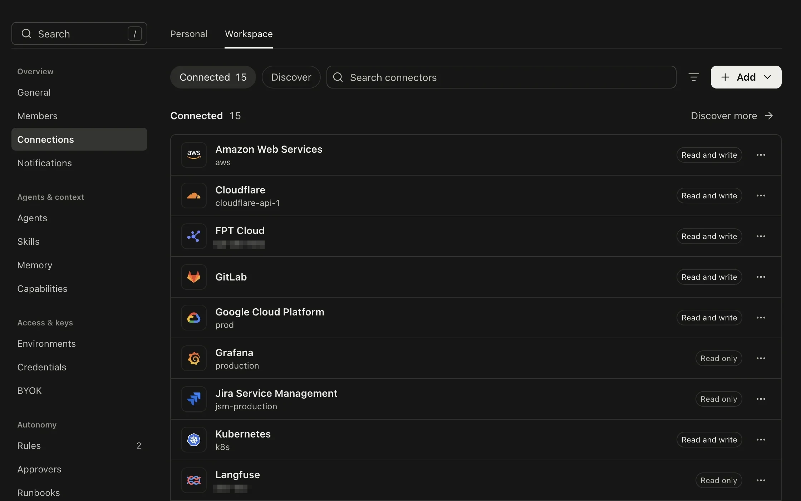
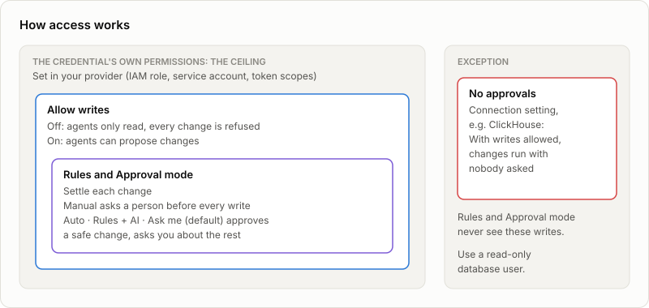
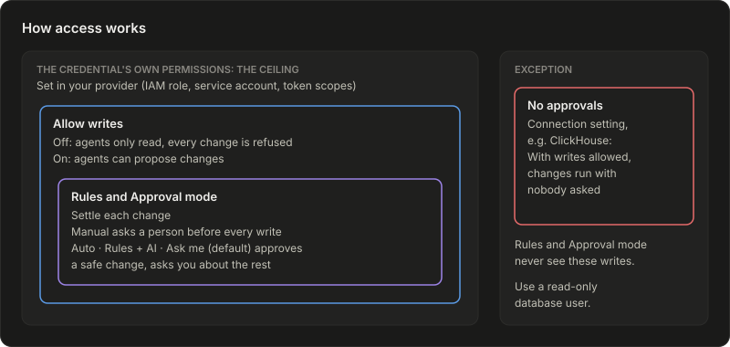

import ConnectionSecurity from '/snippets/ko/connection-security.mdx';

연결은 AWS 계정, Kubernetes 클러스터, GitHub 조직처럼 하나의 외부 서비스를 위해 저장한 자격 증명입니다. 에이전트는 연결이 허용하는 것만 보고 할 수 있으므로, 이 페이지에서는 연결을 추가하고, 범위를 정하고, 확인하고, 건강하게 유지하는 방법을 다룹니다. 전체 서비스 목록은 [연결 카탈로그](#연결-카탈로그)에 있습니다.

## 연결 추가

<Steps>
  <Step title="Connections 열기">
    **Settings → Workspace → Connections**를 엽니다. **Discover** 탭에는 지원되는 모든 서비스가, **Connected** 탭에는 연결한 서비스가 표시됩니다. 카테고리로 필터링하거나 이름으로 검색하세요. 설정 가이드에서 "Connections를 엽니다"라고 하면 이 화면을 뜻합니다.

    <Frame caption="workspace Settings의 Connections: Connected 및 Discover 탭, 검색, Add 메뉴">
      
    </Frame>
  </Step>
  <Step title="설정 가이드를 열고 순서를 따르기">
    [카탈로그](#연결-카탈로그)에서 서비스의 설정 가이드를 열거나, 서비스 상세 패널에서 **Setup guide**를 클릭합니다. 각 가이드에는 자격 증명에 필요한 최소 권한이 나와 있습니다. 순서는 서비스에 따라 다릅니다.

    | 서비스 | 먼저 할 일 |
    |---|---|
    | AWS | 연결 대화상자를 엽니다. 역할에 필요한 External ID가 생성됩니다. |
    | GitHub, Linear, Sentry 같은 OAuth 서비스 | 보통 없습니다. **Connect**를 클릭하고 로그인합니다. 일부는 먼저 일회성 설정이 필요합니다. Asana는 사용자 자신의 Asana 앱 Client ID와 시크릿이 필요하고, Atlassian은 조직 관리자가 CloudThinker 도메인을 허용해야 하며, Bitbucket은 워크스페이스 슬러그를 묻습니다. 각 가이드를 참조하세요. |
    | Google Cloud, Azure, Firebase, Cloudflare 등 그 밖의 모든 서비스 | 공급자에서 자격 증명을 만든 다음 대화상자를 엽니다. |
  </Step>
  <Step title="연결">
    서비스를 선택하고 **Connect**를 클릭합니다. 자격 증명을 입력하거나 업로드하고 대화상자에서 **Connect**를 클릭합니다.

    AWS, Google Cloud, SSH처럼 여러 계정을 지원하는 서비스는 **Alias**(`production` 같은 짧은 이름)와 **Description**도 묻습니다. 에이전트는 설명을 읽고 올바른 계정을 고르므로 구체적으로 작성하세요: `Production AWS account, us-east-1 workloads`.

    <Note>
    AWS, Google Cloud, SSH처럼 일부 서비스만 여러 연결을 허용하며, 이런 서비스의 연결 대화상자는 **Alias**를 묻습니다. Microsoft Azure, Kubernetes, VMware vCenter, 그리고 OAuth 로그인으로 연결하는 모든 서비스는 워크스페이스당 연결을 하나만 허용합니다. 두 번째 Azure 테넌트나 두 번째 클러스터를 연결하려면 별도의 워크스페이스를 사용하세요.
    </Note>
  </Step>
  <Step title="테스트 기다리기">
    CloudThinker는 연결을 저장하기 전에 테스트합니다. 대부분의 서비스에서는 테스트가 자격 증명으로 서비스를 호출합니다. Argo CD, Buildkite, CircleCI, Clarity, Databricks, [Notion](/guide/connections/notion), [Prowler](/guide/connections/prowler), [Render](/guide/connections/render), [Rollbar](/ko/guide/connections/rollbar) 같은 일부 서비스에서는 연결의 도구가 시작되는지만 확인하므로, 잘못된 토큰이어도 **Connected**가 표시될 수 있습니다. 이런 서비스에서는 설정 가이드의 확인 프롬프트가 실제 테스트입니다.

    | 상태 | 의미 | 할 일 |
    |---|---|---|
    | **Connecting** | 테스트를 시작하는 중 | 기다립니다 |
    | **Verifying** | CloudThinker가 자격 증명으로 서비스를 호출하는 중 | 기다립니다 |
    | **Connected** | 테스트가 통과했고 연결이 저장되었습니다. 테스트가 자격 증명을 확인하지 않는 서비스에서는 도구가 시작되었다는 뜻일 뿐입니다. | 가이드의 확인 프롬프트를 실행한 다음, 연결을 대상으로 질문합니다 |
    | **Failed** | 서비스가 자격 증명을 거부했습니다. 공급자의 오류가 표시됩니다. | 자격 증명이나 권한을 수정한 다음 다시 연결합니다 |
    | **Timed out** | 테스트가 제시간에 끝나지 않았습니다 | CloudThinker Cloud에서 서비스에 접근할 수 있는지 확인합니다. [비공개 서비스 접근](#비공개-서비스-접근)을 참조하세요. |
    | **Error** | 이전에는 작동했지만 백그라운드에서 실패했습니다 | [연결이 끊어졌을 때](#연결이-끊어졌을-때)를 참조하세요 |

    **성공 상태:** Connections 목록에서 서비스에 **Connected**가 표시됩니다.
  </Step>
  <Step title="연결을 대상으로 질문하기">
    채팅을 열고 그 서비스만 답할 수 있는 질문을 합니다. 각 설정 가이드에 확인 프롬프트가 있습니다.

    ```text
    Which AWS account and regions can you reach through my connection?
    ```

    **성공 상태:** 일반적인 설명이 아니라 실제 계정 ID나 프로젝트가 답에 나옵니다.
  </Step>
</Steps>

## Environment 설정

각 연결에는 **Environment**가 있습니다: **Production**, **Staging**, **Development**, **Not set** 중 하나입니다. 이는 연결을 읽는 사람과 에이전트를 위한 레이블입니다. 에이전트의 변경을 실행할지, 사람을 기다릴지, 거부할지 결정하는 조건인 [Rules](/guide/approvals/rules)는 이 값을 읽지 않습니다.

<Note>
연결 대화상자는 environment를 묻지 않으므로 연결한 직후에 설정하세요. Microsoft Azure처럼 연결을 하나만 가질 수 있는 서비스와 GitHub, Linear, Sentry처럼 모든 OAuth 서비스는 **Not set**에서 변경할 수 없습니다. 한 연결을 다른 연결과 다르게 다루려면 해당 연결을 지정하는 [Rule](/guide/approvals/rules#what-a-rule-contains)을 작성하세요.
</Note>

여러 연결을 지원하는 서비스에서는 각 계정이 서비스 상세 패널의 행으로 표시됩니다. environment를 설정하려면 계정 행의 연필 아이콘을 클릭하고 **Edit Instance** 대화상자에서 **Environment**를 업데이트하세요.

## 연결한 다음에 일어나는 일

연결이 처음 **Connected**가 되면 CloudThinker가 `Take a deep look at my <service> connection` 메시지로 채팅을 엽니다. 에이전트는 방금 연결한 서비스를 살펴보고 접근할 수 있는 것을 보고합니다. 보통 약 15분이 걸리며, 실행되는 동안 채팅을 떠나도 됩니다. 테스트가 통과할 때 다른 대화상자에서 작업 중이면 대신 알림이 표시되며, 그 알림의 **Deep look** 버튼으로 채팅을 시작할 수 있습니다. 단, Optimize가 아직 스캔하지 않는 AWS, Azure, Google Cloud 연결은 예외입니다. 이 경우 CloudThinker는 대신 **Turn on Optimize?**를 묻고, deep look은 **Try in chat**으로 직접 시작합니다.

deep look은 가장 먼저 얻는 유용한 답이 되는 경우가 많으므로 첫 프롬프트를 작성하기 전에 읽어 보세요. 자격 증명의 권한을 넓힌 뒤처럼 다시 실행하려면 연결 카드의 **More** 메뉴를 열고 **Try in chat**을 클릭합니다. 커스텀 MCP 서버는 상세 패널에서 **Deep look**을 클릭합니다.

deep look은 다른 채팅과 마찬가지로 크레딧을 사용합니다. 워크스페이스에 크레딧이 없으면 CloudThinker는 채팅을 시작하는 대신 **View plans** 버튼과 함께 **A deep look needs credits.**를 표시합니다. 다른 채팅과 같은 도구와 [Approvals](/guide/approvals/overview)를 사용합니다.

## 접근 권한이 작동하는 방식

모든 연결은 하나의 [워크스페이스](/ko/guide/workspaces)에 속합니다. 해당 워크스페이스에서 작업하는 사람은 누구나, 기본 제공 [CloudThinker 에이전트](/ko/guide/agents/overview)와 커스텀 에이전트까지 포함해, 다시 설정하지 않고 사용할 수 있습니다.

| 워크스페이스 역할 | 연결 보기 | 추가, 편집, 교체, 삭제 |
|---|---|---|
| Admin | 가능 | 가능 |
| Developer, Viewer | 가능 | 불가 |

조직 Owner와 Admin은 모든 워크스페이스에서 워크스페이스 Admin 권한을 가집니다. [워크스페이스 역할](/ko/guide/workspace-users#워크스페이스-역할)을 참조하세요.

<Warning>
이 설정이 있는 대부분의 연결에서 **Allow writes**는 켜진 상태로 시작합니다. AWS, Google Cloud, Azure, Kubernetes, GitHub, GitLab, Bitbucket, Azure DevOps, AWS CodeCommit, Cassandra, Drata, FortiGate, Okta가 여기에 해당합니다. Docker Hub, FireHydrant, Snowflake처럼 일부는 꺼진 상태로 시작합니다. Argo CD에는 토글이 없으며, 연결 양식의 **READ_ONLY** 필드가 **Full access**로 시작합니다. 연결한 자격 증명에 쓰기 권한이 조금이라도 있으면 에이전트는 연결한 순간부터 변경을 제안할 수 있고, Rules와 Approval mode가 각 변경을 결정합니다. 이를 꺼진 상태로 시작하게 하는 워크스페이스나 조직 설정은 없으므로, 통제 수단은 읽기 전용 자격 증명과 연결마다 **Allow writes**를 끄는 것입니다. 각 설정 가이드의 **Write access** 또는 **Agent capabilities** 섹션에 해당 연결이 어떤 상태로 시작하는지 적혀 있습니다.
</Warning>

에이전트가 연결로 무엇을 할 수 있는지는 두 가지 통제가 결정합니다.

<Frame caption="자격 증명이 상한이고, Allow writes가 변경을 열며, Rules와 Approval mode가 각 변경을 결정합니다. 단, Connection setting, no approvals 연결은 예외입니다.">
  
  
</Frame>

| 통제 | 위치 | 결정하는 것 |
|---|---|---|
| 자격 증명 자체의 권한 | 공급자 (IAM 역할, 서비스 계정, API 토큰 범위) | 상한입니다. 에이전트는 자격 증명이 허용하는 것 이상을 할 수 없습니다. |
| **Allow writes** | CloudThinker의 연결 상세 패널 | 꺼짐: 에이전트는 읽기만 할 수 있고 모든 변경은 거부됩니다. 켜짐: 에이전트가 변경을 제안할 수 있고, [Rules](/guide/approvals/rules)와 [Approval mode](/guide/approvals/approval-mode)가 각 변경을 결정합니다. **Manual**은 모든 쓰기 전에 사람에게 묻습니다. 기본값인 **Auto · Rules + AI · Ask me**는 Allow Rule이나 AI 판단이 안전한 변경을 승인하게 하고 나머지는 사용자에게 묻습니다. |

쓰기를 통제하는 방식은 연결에 따라 다릅니다. 각 설정 가이드의 **Agent capabilities** 섹션에 어떤 모델이 적용되는지 나와 있습니다.

| 쓰기 모델 | 작동 방식 | 기본값 | 예시 |
|---|---|---|---|
| **Allow writes** 토글 | 에이전트가 서비스에 대해 명령줄 도구나 스크립트를 실행하는 연결입니다. 클라우드뿐 아니라 Bitbucket, Azure DevOps, Cassandra, Drata, Docker Hub 같은 스크립트 기반 연결도 포함됩니다. 토글은 연결 상세 패널에 있습니다. 읽기는 묻지 않고 실행됩니다. 토글이 켜져 있으면 모든 쓰기가 Rules와 Approval mode로 확인됩니다. | AWS, Google Cloud, Azure, Azure DevOps, Bitbucket, Cassandra, Drata 등 대부분은 켜짐. Docker Hub, FireHydrant, Snowflake 등 일부는 꺼짐. | [AWS](/ko/guide/connections/aws), [Google Cloud](/ko/guide/connections/gcp), [Azure](/ko/guide/connections/azure), [Cassandra](/guide/connections/cassandra) |
| 연결 양식의 쓰기 설정 | 상세 패널의 토글 대신 연결할 때 설정하는 필드입니다. 쓰기가 허용되어도 모든 변경은 [Approvals](/guide/approvals/overview)를 거칩니다. | 가이드별로 설정. RabbitMQ의 **RABBITMQ_ALLOW_MUTATIONS**는 **Allow writes**로 시작합니다. Argo CD의 **READ_ONLY**는 **Full access**로 시작합니다. | [RabbitMQ](/ko/guide/connections/rabbitmq), [Argo CD](/ko/guide/connections/argocd) |
| 변경마다 Approvals | 토글이 없습니다. 자격 증명의 범위가 가능한 것을 정하고, 모든 변경은 [Approvals](/guide/approvals/overview)를 거칩니다. 일부 읽기도 승인을 거칩니다: 모든 Cloudflare 및 PostHog API 호출, Neon 및 Databricks SQL 문(`SELECT` 포함), Firebase 프로젝트 전환과 배포 상태 확인. | 해당 없음 | [Neon](/ko/guide/connections/neon), [Firebase](/ko/guide/connections/firebase), [Cloudflare](/ko/guide/connections/cloudflare) |
| Connection setting, no approvals | 연결 양식의 쓰기 설정이 모든 것을 결정합니다. 쓰기가 허용되면 변경은 아무에게도 묻지 않고 실행되며, Rules와 Approval mode는 이를 보지 못합니다. | 읽기 전용. ClickHouse의 **Write access**는 **Read-only (default)**로 시작합니다. | [ClickHouse](/ko/guide/connections/clickhouse) |
| 읽기 전용 | 에이전트에게 쓰기 작업이 전혀 없으므로, 어떤 토글이나 Rule로도 허용할 수 없습니다. | 해당 없음 | [Rancher](/guide/connections/rancher), [UptimeRobot](/guide/connections/uptimerobot) |
| [VictoriaMetrics](/guide/connections/victoriametrics) | MetricsQL을 실행하고 카디널리티와 알림을 확인한 다음 스냅샷을 만듭니다. |
| MCP 도구, 토글 없음 | 커스텀 MCP 연결에는 **Allow writes** 스위치가 없습니다. CloudThinker는 서버가 제공하는 각 도구를 읽기 또는 쓰기로 분류합니다. 읽기는 묻지 않고 실행되고, 쓰기는 Rules와 Approval mode를 거칩니다. 이름에 `get`이나 `check` 같은 읽기 단어가 포함된 도구는 읽기로 간주되어 승인 없이 실행됩니다. `get_and_delete_user`도 마찬가지이며, 서버가 파괴적(destructive)이라고 표시한 경우만 예외입니다. | 서버 자체의 힌트와 도구 이름으로 도구별로 결정됩니다. | [Custom MCP](/ko/guide/connections/mcp) |

<Warning>
ClickHouse 같은 **Connection setting, no approvals** 연결에서 쓰기를 켜면, 에이전트가 Rule이나 승인의 제지 없이 데이터를 변경할 수 있습니다. 그것을 원하지 않는다면 읽기 전용 데이터베이스 사용자를 사용하세요.
</Warning>

자격 증명이 상한이기 때문에 대부분의 연결에서 **Allow writes**가 켜진 상태로 시작합니다. 읽기 전용 자격 증명은 이미 모든 변경을 차단합니다. 읽기 전용으로 시작하고, 에이전트에게 맡길 구체적인 변경이 있을 때만 자격 증명을 넓히세요.

연결은 두 가지 방식 중 하나로 로그인합니다.

| 방식 | 연결 방법 | 예시 |
|---|---|---|
| 붙여 넣거나 업로드하는 자격 증명 | IAM 역할 ARN, 액세스 키, 서비스 계정 JSON 파일 또는 API 토큰 | AWS, Google Cloud, Datadog, PostgreSQL |
| OAuth 로그인 | 팝업에서 공급자에 로그인하고 접근을 승인합니다 | GitHub, GitLab, Linear, Sentry |

## 비공개 서비스 접근

연결은 CloudThinker Cloud에서 실행되므로 서비스가 인터넷에서 오는 연결을 받을 수 있어야 합니다. 내부 vCenter, PostgreSQL, Prometheus, Argo CD처럼 사설 네트워크에 있는 서비스에서는 이 점이 중요합니다.

| 방법 | 사용 시점 |
|---|---|
| 엔드포인트를 공개하고 CloudThinker의 egress IP를 허용 목록에 추가 | 서비스를 방화벽 규칙 뒤에 둘 수 있는 경우. 이 문서는 CloudThinker의 egress IP 목록을 공개하지 않습니다. CloudThinker 담당자에게 문의하거나 [문의하기](https://cloudthinker.io/contact)를 이용하세요. 인증이 없는 서비스는 절대 공개하지 마세요. |
| 네트워크 안에서 [Environment](/guide/workers) 실행 | 서비스를 비공개로 유지해야 하는 경우. Environment는 직접 운영하는 머신의 폴더로, 에이전트가 그곳에서 명령을 실행할 수 있습니다. Environment가 연결을 비공개로 만들어 주지는 않습니다. 워크스페이스 연결은 environment 채팅에서도 여전히 CloudThinker Cloud에서 실행됩니다. 대신 서비스의 명령줄 도구(예: `psql`)와 자격 증명을 environment 머신에 설치하면, 에이전트의 셸이 그곳에서 이를 사용합니다. 해당 서비스는 **Settings → Workspace → Connections**에 나타나지 않습니다. [Environment가 접근할 수 있는 범위](/guide/workers#what-a-worker-can-reach)를 참조하세요. 셀프 호스팅 environment는 베타입니다. |

## 자격 증명 교체

저장된 자격 증명은 연결을 끊지 않고 교체할 수 있습니다. 연결은 별칭, 설정, 이력을 그대로 유지합니다. AWS 역할 연결은 수명이 짧은 STS 자격 증명을 사용하므로 교체할 것이 없으며, External ID도 그대로입니다. 액세스 키, 클라이언트 시크릿, JSON 키, API 토큰은 교체가 필요합니다.

<Steps>
  <Step title="공급자에서 새 자격 증명 생성">
    새 키나 토큰을 먼저 만듭니다. 교체가 끝날 때까지 기존 것은 활성 상태로 둡니다.
  </Step>
  <Step title="CloudThinker에서 교체">
    **Settings → Workspace → Connections**에서 서비스를 열고 계정 행의 연필 아이콘을 클릭한 다음, **Edit Instance**에서 저장된 자격 증명 옆의 **Replace…**를 클릭합니다. 새 값을 입력하고 **Save and test**를 클릭합니다.

    **성공 상태:** 테스트가 통과하고 연결이 **Connected** 상태를 유지합니다. 테스트가 실패하면 CloudThinker는 이전 자격 증명을 유지하고 오류를 표시합니다.
  </Step>
  <Step title="기존 자격 증명 폐기">
    공급자에서 기존 키를 삭제하거나 비활성화합니다.
  </Step>
</Steps>

Microsoft Azure, Backstage처럼 연결을 하나만 가질 수 있는 서비스에는 연필 아이콘이 없습니다. 이들의 **Replace credentials** 버튼은 연결이 **Error**일 때만 나타나므로, 미리 교체하려면 연결을 끊고 새 값으로 다시 연결하세요. 예외는 토큰 기반 Git 공급자(GitLab, Bitbucket, Azure DevOps, AWS CodeCommit)입니다. 이들에 Review를 설정했다면 연결을 끊지 않고 **Review → Settings → Connection actions → Update token**에서 토큰을 교체합니다. [Azure DevOps](/guide/connections/azure-devops)와 [Bitbucket](/guide/connections/bitbucket)을 참조하세요.

연결을 끊고 다시 연결하면 새 연결이 시작되므로 한가한 시간대로 계획하세요.

- 끊은 시점부터 다시 연결할 때까지 에이전트, 예약된 automation, Optimize 갱신은 해당 서비스를 사용할 수 없습니다.
- deep look 채팅이 다시 시작되고 크레딧을 사용합니다.
- **Allow writes**가 기본값으로 돌아가며, 대부분의 연결에서 기본값은 켜짐입니다. 꺼 두었다면 다시 끄세요.
- 해당 연결을 지정한 [Rules](/guide/approvals/rules)가 여전히 그 연결을 나열하는지 확인하세요.

대부분의 OAuth 연결에는 교체할 자격 증명이 없습니다. 로그인된 계정을 바꾸려면 연결을 끊고 다시 연결하세요. Asana는 예외입니다. Asana 앱의 Client secret을 저장하므로, 다시 연결할 때마다 이를 다시 입력합니다.

## 연결이 끊어졌을 때

백그라운드에서 자격 증명이 작동을 멈추면(토큰 만료, 키 폐기, 역할 삭제) 연결이 **Error**로 바뀝니다. AWS에서는 백그라운드 실패가 연속 세 번 발생해야 바뀌므로 한 번의 일시적 오류로는 바뀌지 않습니다. 다른 연결은 백그라운드 토큰 갱신이나 실행이 인증 실패에 부딪히면 바뀝니다. 워크스페이스 admin은 재시도 실패마다가 아니라 장애 1건당 하나의 [알림](/ko/guide/notifications)을 받습니다. 직접 실행한 테스트는 누구에게도 알리지 않습니다.

연결이 **Error**인 동안에는 그 연결에 의존하는 예약 작업이 건너뛰어집니다. [Optimize](/ko/guide/cost-optimization/overview) 비용 갱신, 예약된 [automation](/guide/automation/automations), [Resolve → Signals](/ko/guide/pulse/overview)의 알림 수집이 여기에 포함됩니다.

복구 방법:

1. 공급자에서 원인을 해결합니다. 예를 들어 역할을 복원하거나 새 키를 발급합니다.
2. 연결을 엽니다. 상세 패널에 오류가 표시됩니다. **Retry**를 클릭해 저장된 자격 증명을 다시 테스트하거나, **Replace credentials**를 클릭해 새 값을 입력합니다. **Replace credentials**는 **Replace…**와 같은 **Edit Instance** 대화상자를 엽니다. OAuth 연결은 **Connect**를 클릭해 다시 로그인합니다.
3. 상태가 **Connected**로 돌아오면 예약 작업은 다음 주기부터 재개됩니다.

## 연결 해제

**Settings → Workspace → Connections**에서 서비스를 엽니다. 계정 행이 있는 서비스에서는 계정 행의 휴지통 아이콘을 클릭합니다. 연결을 하나만 가질 수 있는 서비스에서는 상세 패널의 **Disconnect**를 클릭합니다. **Disconnect** 대화상자에서 확인합니다. 이 작업은 취소할 수 없습니다.

해제가 끝나는 즉시 에이전트는 해당 서비스에 대한 접근을 잃습니다. 연결을 해제해도 공급자 쪽에서는 삭제되지 않으므로, 그다음 공급자에서 역할, 키, 토큰을 삭제하세요.

서비스를 다시 연결하면 새 연결이 됩니다.

- deep look 채팅이 다시 시작되고 크레딧을 사용합니다.
- **Allow writes**는 기본값으로, **Environment**는 **Not set**으로 돌아갑니다.
- [Rules](/guide/approvals/rules)는 **Alias**로 연결을 일치시킵니다. 다시 연결할 때 같은 Alias를 사용하면 그 연결을 지정한 Rule이 계속 일치합니다.

## 보안

<ConnectionSecurity />

연결 자체가 읽기 전용인 것은 아닙니다. 많은 연결이 **Allow writes**가 켜진 상태로 시작하므로([접근 권한이 작동하는 방식](#접근-권한이-작동하는-방식) 참조), 연결을 읽기 전용으로 유지하는 것은 읽기 전용 자격 증명입니다.

CloudThinker가 연결한 항목을 다루는 방식:

| 질문 | 답 |
|---|---|
| 자격 증명은 어디에 저장되나요? | 저장 시 암호화됩니다. 명령이 실행될 때만 CloudThinker가 관리하는 샌드박스에 주입되며, environment로 전송되지 않고, 채팅에 다시 표시되지 않습니다. |
| 데이터가 모델에 도달할 수 있나요? | 예. 명령 출력이 대화의 일부이므로, 자격 증명이 읽을 수 있는 모든 것이 모델에 도달할 수 있습니다. 자격 증명의 범위를 에이전트에게 필요한 것으로 제한하세요. |
| 데이터가 학습에 사용되나요? 얼마나 보관되나요? | 이 문서는 모델 공급자의 데이터 조건을 다루지 않습니다. 문서가 다루는 내용은 [Security](/ko/guide/security/overview#한눈에-보기)를 참조하고, 나머지는 벤더 검토에서 요청하세요. |
| 무엇이 기록되나요? | [Audit Logs](/guide/security/audit-logs)(**Settings → Organization → Audit log**)는 Scale 및 Enterprise 플랜에서 연결 생성, 편집, 재시도, 삭제, 자격 증명 교체, 승인 결정을 기록합니다. 연결의 **Allow writes** 스위치 전환은 여기에 기록되지 않습니다. |
| 에이전트 명령이 기록되나요? | 에이전트가 실행하는 각 명령과 그 출력은 채팅 기록에 남습니다. 호출은 AWS CloudTrail이나 Google Cloud Audit Logs 같은 공급자 자체의 감사 로그에도 기록됩니다. |

암호화 세부 정보, 보존 기간, 모델 공급자에 대해서는 [Security](/ko/guide/security/overview)를 참조하세요.

## 연결 카탈로그

### Cloud

| 서비스 | 에이전트가 할 수 있는 작업 |
|---|---|
| [Amazon Web Services](/ko/guide/connections/aws) | 컴퓨팅, 스토리지, ID, 비용, 모니터링을 확인합니다. |
| [Cloudflare](/ko/guide/connections/cloudflare) | 영역, 트래픽 분석, 방화벽 이벤트, Workers를 검토합니다. |
| [DigitalOcean](/guide/connections/digitalocean) | 드롭릿, 데이터베이스, Kubernetes, 네트워킹, 비용을 확인합니다. |
| [FPT Cloud](/guide/connections/fptcloud) | VM, 네트워크, 활동, 리소스 태그를 검사합니다. |
| [Google Cloud Platform](/ko/guide/connections/gcp) | 컴퓨팅, GKE, BigQuery, 스토리지, ID, 비용을 확인합니다. |
| [GreenNode](/guide/connections/greennode) | CLI로 컴퓨팅, Kubernetes, 데이터베이스, 스토리지를 운영합니다. |
| [Microsoft Azure](/ko/guide/connections/azure) | 가상 머신, AKS, 데이터베이스, ID, 비용을 확인합니다. |
| [OpenStack](/guide/connections/openstack) | 컴퓨팅, 네트워크, 스토리지, 이미지, 할당량을 확인합니다. |
| [VMware vCenter](/guide/connections/vmware) | 가상 머신, 호스트, 클러스터, 데이터스토어를 확인합니다. |
| [Oracle Cloud Infrastructure](/guide/connections/oracle) | 구획, 리소스, Cloud Guard 문제를 탐색합니다. |

### Infrastructure

| 서비스 | 에이전트가 할 수 있는 작업 |
|---|---|
| [AWX](/ko/guide/connections/awx) | Ansible 인벤토리를 검사한 다음 작업 템플릿을 실행합니다. |
| [HCP Terraform](/guide/connections/terraform) | 워크스페이스와 실행 상태를 검토한 다음 빈 워크스페이스를 정리합니다. |
| [NetBox](/guide/connections/netbox) | 장치와 IP 주소를 조회한 다음 IP를 예약하거나 상태를 설정합니다. |
| [Pulumi](/ko/guide/connections/pulumi) | 스택, 관리 리소스, 정책 위반을 검토한 다음 AWS에 배포합니다. |
| [SSH](/ko/guide/connections/ssh) | 서버 상태, 로그, 디스크 용량, 프로세스를 검사합니다. |

### Containers

| 서비스 | 에이전트가 할 수 있는 작업 |
|---|---|
| [ArgoCD](/ko/guide/connections/argocd) | 배포, 동기화 상태, 관리 리소스를 검사합니다. |
| [Docker Hub](/guide/connections/dockerhub) | 리포지토리, 태그, 크기, 오래된 이미지를 검토합니다. |
| [Kubernetes](/ko/guide/connections/kubernetes) | 워크로드, 롤아웃, 로그, 노드 압박을 검사합니다. |
| [Red Hat OpenShift](/guide/connections/openshift) | 클러스터 버전, 오퍼레이터, 노드, 실패한 파드, 라우트를 확인합니다. |
| [Rancher](/guide/connections/rancher) | 클러스터, 프로젝트, 노드, 역할 바인딩을 검사합니다. |

### App Platforms

| 서비스 | 에이전트가 할 수 있는 작업 |
|---|---|
| [Firebase](/ko/guide/connections/firebase) | 프로젝트, 앱, 보안 규칙, 배포 상태를 검토합니다. |
| [Heroku](/guide/connections/heroku) | 앱, dyno, 로그, 애드온, 배포를 검토합니다. |
| [IBM API Connect](/guide/connections/ibm-api-connect) | 카탈로그, 게시된 API, 분석, 거버넌스 규칙 세트를 검토합니다. |
| [MuleSoft Anypoint Platform](/guide/connections/mulesoft) | Mule 앱, 배포, 로그, API 정책을 검사한 다음 재시작하거나 확장합니다. |
| [Netlify](/guide/connections/netlify) | 프로젝트, 배포, 양식을 검토한 다음 변경을 배포합니다. |
| [Render](/guide/connections/render) | 서비스, 배포, 로그, Postgres를 검토한 다음 배포합니다. |
| [Supabase](/guide/connections/supabase) | 프로젝트, 스키마, 마이그레이션을 검토한 다음 변경을 실행합니다. |
| [Vercel](/ko/guide/connections/vercel) | 프로젝트, 배포, 로그를 검토한 다음 배포를 취소하거나 프로젝트를 일시 중지합니다. |

### Databases

| 서비스 | 에이전트가 할 수 있는 작업 |
|---|---|
| [Cassandra](/guide/connections/cassandra) | 키스페이스, 테이블, 복제, 노드 상태를 검사합니다. |
| [ClickHouse](/ko/guide/connections/clickhouse) | 클러스터 전반의 데이터베이스, 테이블, 스키마를 쿼리합니다. |
| [CockroachDB](/guide/connections/cockroachdb) | 데이터베이스, 스키마, 쿼리 성능을 검사합니다. |
| [Databricks](/guide/connections/databricks) | 클러스터, 작업, 노트북, 카탈로그 자산을 검사합니다. |
| [dbt](/ko/guide/connections/dbt) | 실패한 실행을 설명하고, 리니지를 추적하고, 모델을 미리 봅니다. |
| [InfluxDB](/guide/connections/influxdb) | 버킷, 데이터베이스, 보존, 시리즈 증가를 쿼리합니다. |
| [Microsoft SQL Server](/guide/connections/mssql) | 스키마를 찾고 승인된 테이블을 읽거나 편집합니다. |
| [MongoDB](/ko/guide/connections/mongodb) | 데이터베이스, 컬렉션, 인덱스, 쿼리 계획을 검사합니다. |
| [MySQL](/ko/guide/connections/mysql) | 스키마, 인덱스, 테이블 상태, 느린 쿼리를 검사합니다. |
| [Neon](/ko/guide/connections/neon) | 프로젝트, 브랜치, 스키마, 마이그레이션을 검사합니다. |
| [Oracle Database](/guide/connections/oracle) | 스키마, 테이블 통계, 세션, 느린 SQL을 검사하고, 승인된 단일 행 변경을 수행합니다. |
| [PostgreSQL](/ko/guide/connections/postgresql) | 테이블, 인덱스, 잠금, 느린 쿼리 성능을 검사합니다. |
| [Redis](/ko/guide/connections/redis) | 메모리, 용량, 만료, 느린 명령을 검사합니다. |
| [Snowflake](/ko/guide/connections/snowflake) | 크레딧 지출, 쿼리 기록, 느린 쿼리, 역할을 추적합니다. |

### AI & Vectors

| 서비스 | 에이전트가 할 수 있는 작업 |
|---|---|
| [Braintrust](/guide/connections/braintrust) | 프로젝트 전반의 실험, 점수, 데이터 세트를 비교합니다. |
| [Langfuse](/ko/guide/connections/langfuse) | LLM 트레이스, 프롬프트, 비용, 평가를 조사합니다. |
| [LangSmith](/guide/connections/langsmith) | 실행 트리, 프로젝트, 데이터 세트, 실험을 탐색합니다. |
| [Pinecone](/guide/connections/pinecone) | 벡터 인덱스와 네임스페이스를 검사한 다음 레코드를 업데이트합니다. |

### Monitoring

| 서비스 | 에이전트가 할 수 있는 작업 |
|---|---|
| [AppDynamics](/ko/guide/connections/appdynamics) | APM 트랜잭션, 티어, 노드, 상태 규칙을 추적합니다. |
| [Axiom](/guide/connections/axiom) | 로그, 트레이스, 메트릭을 조회한 다음 모니터와 대시보드를 수정합니다. |
| [Centreon](/guide/connections/centreon) | 문제와 다운타임을 검토한 다음 확인, 재검사 또는 다운타임을 설정합니다. |
| [Checkmk](/guide/connections/checkmk) | 호스트와 서비스를 확인한 다음 문제를 확인하거나 다운타임을 설정합니다. |
| [Coralogix](/ko/guide/connections/coralogix) | 로그 파이프라인, 메트릭, 알림, 인시던트를 탐색합니다. |
| [Datadog](/ko/guide/connections/datadog) | 로그, 메트릭, 트레이스, 모니터, 대시보드를 검색합니다. |
| [Dynatrace](/ko/guide/connections/dynatrace) | 로그, 트레이스, 메트릭 전반의 APM 문제를 추적합니다. |
| [Grafana](/ko/guide/connections/grafana) | 대시보드, 메트릭, 로그, 알림 규칙을 탐색합니다. |
| [Honeycomb](/ko/guide/connections/honeycomb) | 트레이스, 데이터 세트, 워터폴, 트리거, SLO를 탐색합니다. |
| [Icinga](/guide/connections/icinga) | 호스트와 서비스를 확인한 다음 확인, 재검사 또는 다운타임을 설정합니다. |
| [Juniper Junos](/guide/connections/juniper) | 인터페이스, BGP 피어, 알람을 확인한 다음 인터페이스를 변경합니다. |
| [LibreNMS](/guide/connections/librenms) | 장치와 알림을 확인한 다음 알림을 확인하거나 유지보수를 설정합니다. |
| [New Relic](/ko/guide/connections/newrelic) | APM 엔터티, 대시보드, 알림, 인시던트를 쿼리합니다. |
| [Prometheus](/ko/guide/connections/prometheus) | 실시간 및 과거 메트릭, 레이블, 알림을 쿼리합니다. |
| [PRTG Network Monitor](/guide/connections/prtg) | 센서와 알람을 조사하고, 기록을 읽고, 모니터링 객체에 조치합니다. |
| [Rollbar](/ko/guide/connections/rollbar) | 상위 이슈, 배포, 리플레이를 검토한 다음 하나를 업데이트합니다. |
| [Sentry](/guide/connections/sentry) | 이슈, 트레이스, 이벤트, 근본 원인 신호를 검색합니다. |
| [SigNoz](/ko/guide/connections/signoz) | 서비스, 대시보드, 알림, 로그, 메트릭을 추적합니다. |
| [Splunk Observability](/guide/connections/splunkobservability) | 서비스 상태, 종속성, 지연 시간, 오류를 추적합니다. |
| [UptimeRobot](/guide/connections/uptimerobot) | 모니터 상태, 업타임 기록, 최근 인시던트를 추적합니다. |
| [Zabbix](/ko/guide/connections/zabbix) | 호스트, 템플릿, 트리거, 이벤트, 대시보드를 검토합니다. |

### Logs & Search

| 서비스 | 에이전트가 할 수 있는 작업 |
|---|---|
| [Elasticsearch](/ko/guide/connections/elasticsearch) | 인덱스, 매핑, 샤드, 클러스터 상태를 검사합니다. |
| [Graylog](/guide/connections/graylog) | 읽기 전용 API 토큰으로 메시지와 스트림을 검색합니다. |
| [OpenSearch](/guide/connections/opensearch) | 인덱스, 샤드, 문서, 검색 관련성을 검사합니다. |
| [Splunk Platform](/guide/connections/splunkplatform) | 시간 범위에 걸쳐 로그를 검색하고 인덱스 볼륨을 검토합니다. |
| [Sumo Logic](/guide/connections/sumologic) | 로그, 모니터, 수집기, Cloud SIEM 인사이트를 검색합니다. |
| [VictoriaLogs](/guide/connections/victorialogs) | 로그 줄을 검색하고 시간별 오류를 세며 스트림을 파악합니다. |
| [Wazuh](/guide/connections/wazuh) | 알림과 에이전트를 조사하고 탐지 규칙을 관리합니다. |

### Incidents

| 서비스 | 에이전트가 할 수 있는 작업 |
|---|---|
| [Better Stack](/ko/guide/connections/betterstack) | 인시던트, 온콜 범위, 업타임, 하트비트를 검토합니다. |
| [BMC Helix ITSM](/guide/connections/bmc-helix) | 인시던트, 작업 로그, 변경, 문제를 조사합니다. |
| [FireHydrant](/guide/connections/firehydrant) | 인시던트, 심각도, 알림, 서비스 카탈로그를 검토합니다. |
| [Freshservice](/guide/connections/freshservice) | 티켓, 변경, 문제와 그 SLA 상태를 검토합니다. |
| [Jira Service Management](/guide/connections/jsm) | 알림과 온콜을 검토한 다음 확인하거나 에스컬레이션합니다. |
| [PagerDuty](/ko/guide/connections/pagerduty) | 인시던트를 [Resolve](/ko/guide/incident/overview)로 보냅니다. |
| [ServiceNow](/ko/guide/connections/servicenow) | 인시던트, 변경, 문제를 검토하고 업데이트합니다. |
| [KeepHQ](/guide/connections/keephq) | 셀프 호스팅 KeepHQ를 API 키로 연결하여 저장된 알림, 인시던트, 워크플로, 토폴로지를 검토합니다. |

Opsgenie는 연결이 아닙니다. **Resolve → Triggers & Outcomes**에서 Opsgenie 알림을 [웹훅 신호](/ko/guide/incident/webhook-integrations/overview)로 Resolve에 보내세요.

### Code & CI/CD

| 서비스 | 에이전트가 할 수 있는 작업 |
|---|---|
| [AWS CodeCommit](/guide/connections/aws-codecommit) | 리포지토리, 풀 리퀘스트, 리뷰 댓글을 탐색합니다. |
| [Azure DevOps](/guide/connections/azure-devops) | 풀 리퀘스트, 파이프라인, 작업 항목을 검토합니다. |
| [Bitbucket](/guide/connections/bitbucket) | 리포지토리, 풀 리퀘스트, 파이프라인, 이슈를 검토합니다. |
| [Buildkite](/ko/guide/connections/buildkite) | 작업과 로그를 통해 빌드 실패를 추적한 다음 재시도합니다. |
| [CircleCI](/ko/guide/connections/circleci) | 파이프라인 실패와 불안정한 테스트를 검토한 다음 재실행합니다. |
| [GitHub](/guide/connections/github) | 리포지토리, 풀 리퀘스트, Actions 실행을 검토합니다. |
| [GitLab](/guide/connections/gitlab) | 리포지토리, 머지 리퀘스트, 이슈, 파이프라인을 검토합니다. |
| [Harness](/guide/connections/harness) | 파이프라인, 배포, 서비스, 비용을 검토합니다. |
| [Jenkins](/ko/guide/connections/jenkins) | 작업, 빌드, 로그, 테스트를 검토한 다음 하나를 실행합니다. |
| [Sonatype Nexus Repository](/guide/connections/nexus) | 읽기 전용 계정으로 Nexus Repository를 연결하여 리포지토리, 스토리지, 작업, 컴포넌트 버전을 검사합니다. |

### Security

| 서비스 | 에이전트가 할 수 있는 작업 |
|---|---|
| [Cortex XDR](/guide/connections/cortex-xdr) | 인시던트, 알림, 엔드포인트를 분류한 다음 인시던트를 업데이트합니다. 셀프 호스팅 배포 전용입니다. |
| [F5 BIG-IP](/guide/connections/f5) | 애플리케이션, 방화벽 정책, DNS를 검토한 다음 구성을 편집합니다. |
| [FortiGate](/guide/connections/fortigate) | 장치 상태와 트래픽을 확인한 다음 구성을 편집합니다. |
| [GitGuardian](/ko/guide/connections/gitguardian) | 노출된 시크릿을 찾기 위해 코드를 스캔하고 각 발생 위치를 추적합니다. |
| [HashiCorp Vault](/ko/guide/connections/vault) | KV 시크릿을 읽고 임시 자격 증명을 생성합니다. |
| [IBM QRadar SIEM](/guide/connections/qradar) | 오펜스를 분류하고, AQL로 이벤트를 검색하고, 오펜스를 업데이트합니다. 셀프 호스팅 배포 전용입니다. |
| [Keycloak](/ko/guide/connections/keycloak) | 렐름, 사용자, 클라이언트, 역할, 인증 흐름을 검사합니다. |
| [Okta](/guide/connections/okta) | 사용자, 그룹, 앱, 한 사람의 접근 권한을 검토합니다. |
| [Palo Alto PAN-OS](/guide/connections/pan-os) | 방화벽 상태, 보안 규칙, 로그, 실시간 세션을 확인합니다. 셀프 호스팅 배포 전용입니다. |
| [Prowler](/guide/connections/prowler) | 보안 결과, 검사, 클라우드 컴플라이언스를 검토합니다. |
| [Semgrep](/guide/connections/semgrep) | 리포지토리 전반에서 보안 결과를 찾기 위해 코드를 스캔합니다. |
| [SonarQube](/ko/guide/connections/sonarqube) | 이슈, 품질 게이트, 핫스팟, 중복을 검토합니다. |
| [Sonatype Nexus IQ Server](/guide/connections/nexus-iq) | 애플리케이션, 정책 위반, 위험한 컴포넌트를 검토합니다. |

### Compliance

| 서비스 | 에이전트가 할 수 있는 작업 |
|---|---|
| [Drata](/guide/connections/drata) | 실패한 테스트, 통제 준비 상태, 인력을 추적합니다. |
| [Secureframe](/guide/connections/secureframe) | 실패한 테스트, 프레임워크 진행률, 공급업체 위험을 추적합니다. |

### Productivity

| 서비스 | 에이전트가 할 수 있는 작업 |
|---|---|
| [Asana](/guide/connections/asana) | 프로젝트, 작업, 워크로드를 검토한 다음 작업을 업데이트합니다. |
| [Atlassian](/ko/guide/connections/atlassian) | Jira 이슈와 Confluence 페이지를 검색한 다음 하나를 업데이트합니다. |
| [Backlog](/ko/guide/connections/backlog) | 티켓, 마일스톤, 위키를 검토한 다음 티켓을 업데이트합니다. |
| [Backstage](/guide/connections/backstage) | 카탈로그에서 서비스, 소유자, API, 문서를 검색합니다. |
| [Linear](/guide/connections/linear) | 이슈, 프로젝트, 사이클을 검색한 다음 하나를 업데이트합니다. |
| [monday.com](/ko/guide/connections/monday) | 워크스페이스, 보드, 아이템을 검토한 다음 보드를 업데이트합니다. |
| [Notion](/guide/connections/notion) | 페이지와 데이터베이스를 검색한 다음 콘텐츠를 업데이트합니다. |

### Analytics

| 서비스 | 에이전트가 할 수 있는 작업 |
|---|---|
| [HubSpot](/guide/connections/hubspot) | 연락처, 회사, 거래, 티켓, 견적을 검색합니다. |
| [Microsoft Clarity](/guide/connections/clarity) | 트래픽, 참여도, 세션 녹화를 살펴봅니다. |
| [PostHog](/guide/connections/posthog) | 기능 플래그, 인사이트, 사용자 추세를 탐색합니다. |

### Messaging

| 서비스 | 에이전트가 할 수 있는 작업 |
|---|---|
| [Apache Kafka](/ko/guide/connections/kafka) | 토픽, 파티션, 컨슈머 지연, 클러스터 상태를 살펴봅니다. |
| [Flespi](/ko/guide/connections/flespi) | 장치, 채널, 메시지, 스트림을 탐색합니다. |
| [RabbitMQ](/ko/guide/connections/rabbitmq) | 큐 깊이, 컨슈머 지연, 데드 레터, 알람을 살펴봅니다. |

### Custom MCP

| 서비스 | 에이전트가 할 수 있는 작업 |
|---|---|
| [Custom MCP](/ko/guide/connections/mcp) | MCP 서버를 실행하는 모든 도구나 API를 추가합니다. **Add → Custom MCP server**에서 설정합니다. |

서비스가 목록에 없으면 [커스텀 MCP 연결](/ko/guide/connections/mcp)로 연결하세요. MCP(Model Context Protocol)는 AI 에이전트에게 도구를 제공하기 위한 개방형 표준입니다.

채팅 플랫폼은 연결이 아니라 워크스페이스 통합으로 설정합니다. [Slack](/ko/guide/slack-integration), [Microsoft Teams](/ko/guide/teams-integration), [Google Chat](/guide/google-chat-integration)을 참조하세요. GitHub, GitLab, Bitbucket 또는 Azure DevOps를 연결하면 [Review](/ko/guide/code-review/setup)도 사용할 수 있습니다.

## 다음 단계

<CardGroup cols={2}>
  <Card title="AWS 연결" icon="/images/icons/aws.svg" href="/ko/guide/connections/aws">
    CloudShell에서 스크립트 하나로 읽기 전용 IAM 역할을 만듭니다.
  </Card>
  <Card title="Google Cloud 연결" icon="/images/icons/gcp.svg" href="/ko/guide/connections/gcp">
    뷰어 서비스 계정을 만들고 JSON 키를 업로드합니다.
  </Card>
  <Card title="Approvals" icon="shield-check" href="/guide/approvals/overview">
    에이전트가 스스로 할 수 있는 변경과 사람이 필요한 변경을 정합니다.
  </Card>
  <Card title="커스텀 MCP 연결" icon="/images/icons/mcp.svg" href="/ko/guide/connections/mcp">
    카탈로그에 없는 서비스를 연결합니다.
  </Card>
</CardGroup>
