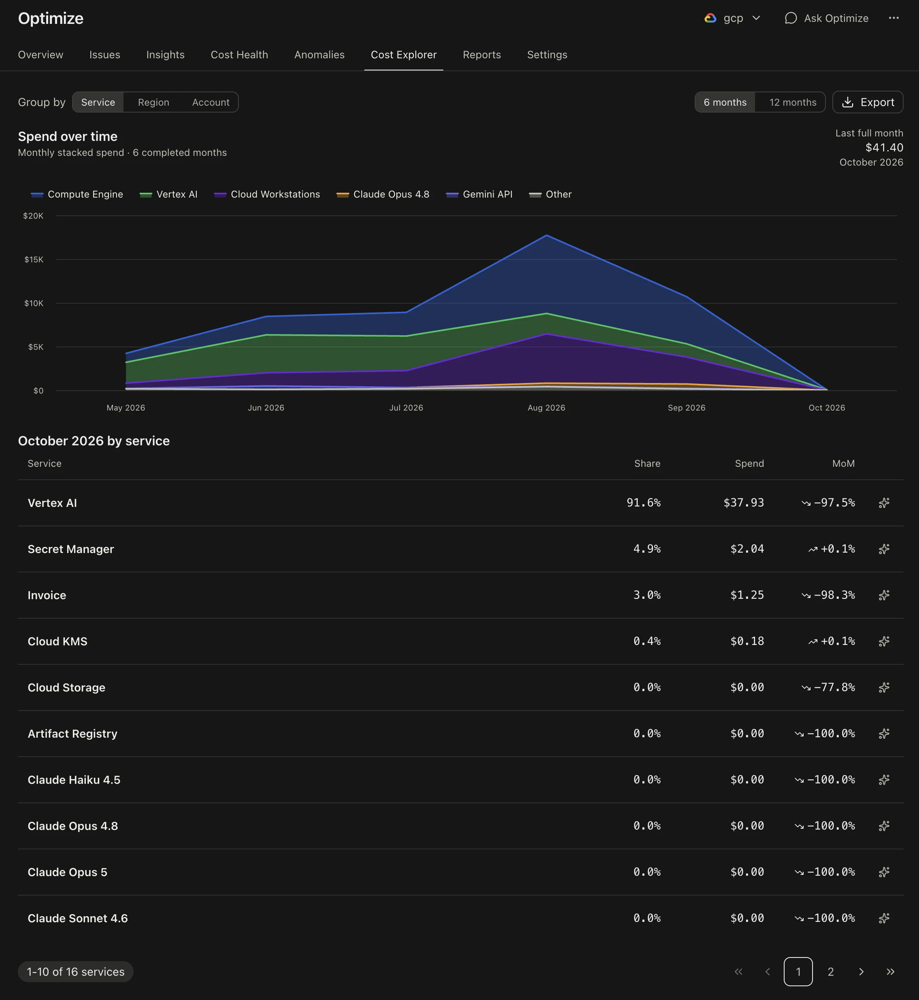
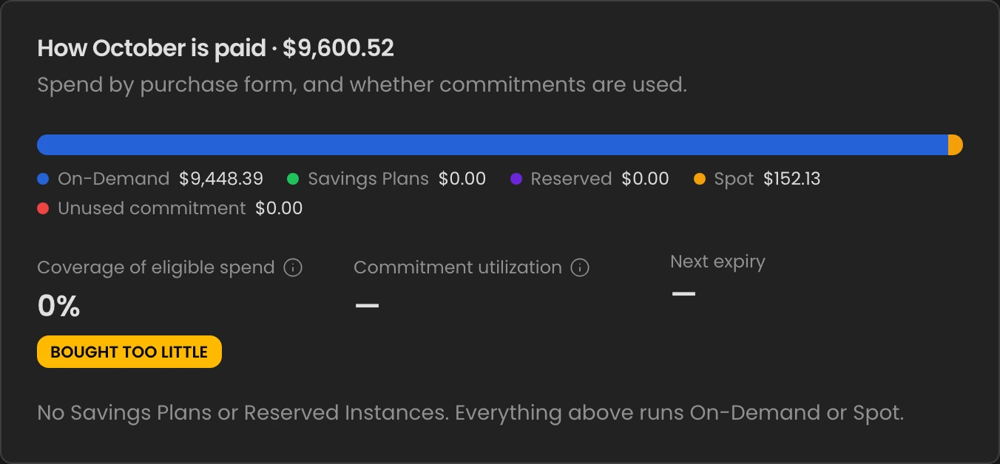
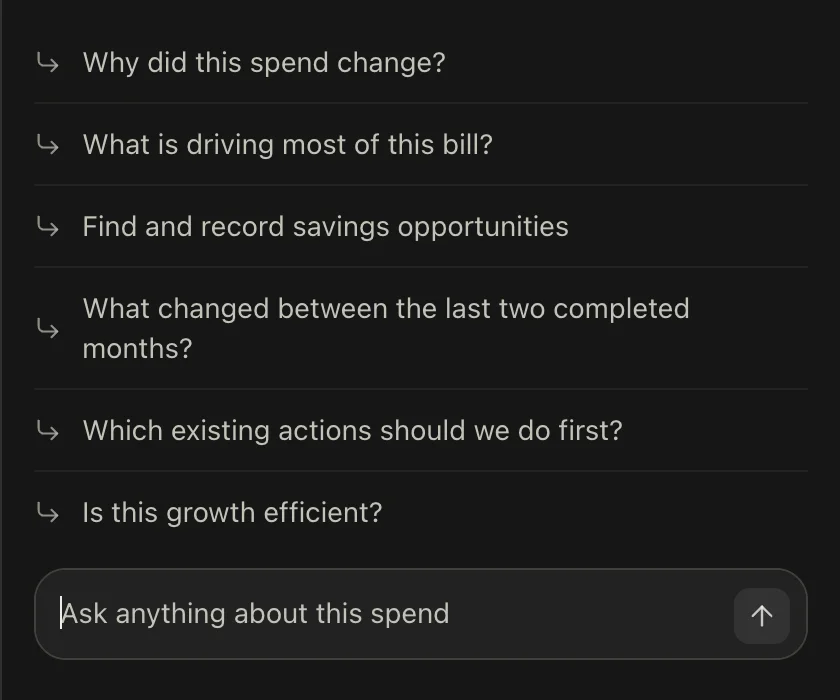

Cost Explorer는 클라우드 계정 하나의 지출이 최근 6개월 또는 12개월의 완료 월 동안 어떻게 바뀌었는지 보여주고, 그 이유를 CloudThinker에게 물어볼 수 있게 합니다. 이는 **Optimize** 아래에 있는 CloudThinker 자체 페이지이며, AWS 청구 데이터를 읽어오는 AWS Cost Explorer 서비스와는 별개입니다.

## 사전 요구사항

- 완료된 청구 월이 하나 이상 있고 Optimize에 연결된 클라우드 계정. [Optimize quickstart](/guide/cost-optimization/quickstart)를 참고하세요.
- Viewer를 포함한 모든 워크스페이스 역할이 Cost Explorer를 볼 수 있습니다. CloudThinker에게 질문하려면 Developer 이상이 필요합니다.

## 기간별 지출 읽기

<Steps>
  <Step title="Cost Explorer 열기">
    **Optimize → Cost Explorer**를 클릭한 뒤 페이지 제목 옆 선택기에서 계정을 고릅니다.

    **성공 상태:** **Spend over time** 차트와, 월과 그룹 기준으로 제목이 붙은 분석 표(예: **October by service**)가 보입니다.

    <Frame caption="완료된 6개월 동안 서비스별로 그룹화한 Google Cloud 계정의 Cost Explorer">
      
    </Frame>
  </Step>

  <Step title="기간 선택">
    **6 months** 또는 **12 months**를 선택합니다. 누적 차트는 해당 개수만큼의 완료 월에 대한 월간 지출을 보여줍니다. 차트 헤더의 **Last full month**는 가장 최근 완료 월의 합계를 보여줍니다. Optimize는 기간보다 한 달 앞선 달도 읽으므로, 표의 가장 오래된 달에도 MoM 수치가 표시됩니다.
  </Step>

  <Step title="그룹 기준 선택">
    **Group by** 옆에서 **Service**, **Region**, **Account** 중 하나를 선택합니다. 차트와 표가 함께 다시 그룹화되고, 표 제목도 바뀝니다(예: **October by region**). **Account**는 연결 이름으로 그룹화하므로, 계정 하나를 선택한 상태에서는 한 행만 나옵니다.
  </Step>
</Steps>

Cost Explorer는 진행 중인 현재 월을 제외합니다. 이번 달 누적 지출과 월말 예측은 [Overview](/ko/guide/cost-optimization/overview)를 사용하세요.

## 분석 표 읽기

차트는 기간 전체에서 가장 큰 다섯 그룹을 쌓아 보여주고, 나머지는 **Other**로 합칩니다. 표는 기간 내 가장 최근 완료 월의 모든 그룹을 페이지당 10행으로 나열합니다.

| 열 | 의미 |
|---|---|
| **Service**, **Region**, 또는 **Account** | 공급자의 청구 데이터에 따라 이름이 붙은 그룹 |
| **Share** | 해당 월 총지출에서 차지하는 비율 |
| **Spend** | 해당 월의 확정 지출 |
| **MoM** | 이전 달 대비 변화율. 부호와 위/아래 화살표가 함께 표시됩니다(예: **+12.4%**). 증가는 빨간색, 감소는 초록색으로도 표시됩니다. 대시는 비교할 이전 달이 없다는 뜻입니다 |

차트와 표는 항상 계정 하나를 다룹니다. 여러 계정을 한 문서에서 비교하려면 [Reports](/ko/guide/cost-optimization/reports)에서 **All accounts** 범위로 보고서를 생성하세요.

## 이번 달 결제 방식 보기 (AWS)

AWS 계정에서는 분석 표 아래 카드가 이번 달이 어떻게 결제되는지 보여줍니다(예: **How October is paid · $9,600.52**). GCP와 Azure 계정에는 표시되지 않습니다.

<Frame caption="모든 것을 On-Demand 또는 Spot으로 실행해 커버리지가 Under-committed로 표시되는 계정">
  
</Frame>

막대는 해당 월 지출을 **On-Demand**, **Savings Plans**, **Reserved**, **Spot**, **Unused commitment**로 나눕니다. 그 아래 세 수치에는 각각 배지가 붙습니다.

| 수치 | 측정 대상 | 배지 |
|---|---|---|
| **Coverage of eligible spend** | Savings Plans와 Reserved Instances가 커버할 수 있는 지출 중 실제로 커버하는 비율 | 70% 미만이면 **Under-committed**, 그 외 **Covered** |
| **Commitment utilization** | 구매한 약정 중 사용하는 비율 | 95% 미만이면 **Unused**, 그 외 **Healthy** |
| **Next expiry** | 가장 가까운 약정 종료일 | 60일 이내면 **No decision yet**, 그 외 **Healthy** |

Savings Plan이나 Reserved Instance마다 별도의 행이 있습니다. 사용률이 80% 미만이면 행에 **Unused**가, 30일 이내에 종료되면 **Renew?**가 표시됩니다. 약정이 없으면 카드에 모든 것이 On-Demand 또는 Spot으로 실행된다고 표시됩니다. 약정은 일일 새로 고침 때 읽으므로, 새 계정에서는 처음에 **Commitments are read on the next daily refresh**가 표시될 수 있습니다.

[Cost Health](/guide/cost-optimization/cost-health)는 같은 약정을 **Rate optimization** 아래에서 점수화합니다.

## 지출이 바뀐 이유를 CloudThinker에게 묻기

<Steps>
  <Step title="질문 드로어 열기">
    계정 선택기 옆의 **Ask Optimize**를 클릭합니다. 서비스 하나에 대해 물으려면 **Service**로 그룹화하고 해당 행의 반짝이 아이콘(휴대폰에서는 **Ask why**)을 클릭합니다.

    드로어가 페이지 옆에 열리며, 선택한 계정과 기간으로 범위가 지정됩니다. Cost Explorer 페이지는 그대로 유지됩니다.
  </Step>

  <Step title="질문 선택 또는 작성">
    제안된 질문을 고르거나 **Ask anything about this spend**에 직접 입력합니다. **Ask why**로 만든 질문은 자동으로 채워지지만, 직접 보내기 전까지는 전송되지 않습니다.

    <Frame caption="Ask Optimize 드로어의 여섯 가지 제안 질문">
      
    </Frame>

    **Find and record savings opportunities**는 새로운 결과를 [Issues](/ko/guide/cost-optimization/recommendations)에 저장할 수 있습니다. 나머지 제안은 답변만 합니다.

    ```text
    Why did Amazon EC2 spend go up last month, and which resources drove it?
    Which services grew the most over the last 6 months?
    ```
  </Step>

  <Step title="보내고 답변 읽기">
    Enter를 누르거나 화살표를 클릭합니다. CloudThinker가 드로어에서 질문한 계정, 기간, 서비스로 범위가 지정된 새 대화를 시작합니다.

    **성공 상태:** 드로어에 CloudThinker의 답변이 나타납니다. 새 대화를 시작하려면 **Ask another question**(연필 아이콘)을 클릭하세요.
  </Step>
</Steps>

드로어를 닫아도 작성 중인 초안과 페이지는 그대로 유지됩니다.

## 분석 결과 내보내기

**Export**를 클릭하면 현재 그룹 기준의 분석 표를 CSV로 다운로드합니다. 그룹, **Last full month spend**, **Share of total**, **MoM change**의 네 열이 있습니다. 내보낼 데이터가 있을 때까지 **Export**는 회색으로 비활성화됩니다.

CSV는 차트의 월별 시계열이 아니라 가장 최근 완료 월만 다룹니다. 월별 수치가 필요하면 **Ask Optimize**를 사용하세요. 예: "Give me a table of monthly spend by service for the last 12 months".

## 통화

AWS와 GCP는 USD로 표시됩니다. Azure는 청구 범위 자체의 통화로 표시됩니다([공급자별 차이](/ko/guide/cost-optimization/overview#공급자별-차이) 참고). Optimize는 Azure 금액을 다른 통화로 변환하지 않으므로, Azure 계정은 같은 통화의 계정끼리만 비교하세요.

## 문제 해결

<AccordionGroup>
  <Accordion title="No cost history yet">
    **원인:** 계정에 아직 Optimize에서 완료된 청구 월이 없습니다. 최소 한 달 전체의 청구 데이터를 가져오면 이력이 나타납니다.

    **해결:** **Overview**에서 첫 스캔이 끝났는지 확인하세요. 새로 만든 클라우드 계정은 첫 한 달이 지난 뒤에야 이력이 표시됩니다.
  </Accordion>

  <Accordion title="Couldn't load Cost Explorer">
    **원인:** 요청이 실패했습니다. 저장된 데이터에는 영향이 없습니다.

    **해결:** **Retry**를 클릭하세요. 계속 실패하면 **Settings → Workspace → Connections**에서 연결 상태를 확인하세요([Connections](/ko/guide/connections/overview) 참고).
  </Accordion>

  <Accordion title="최근 월이 낮게 보이거나 없음">
    **원인:** 공급자는 사용이 발생한 뒤에 청구를 확정합니다. AWS Cost Explorer는 24~48시간 지연될 수 있습니다.

    **해결:** 페이지 헤더의 **More Optimize actions**(⋯) 메뉴에서 **Updated** 시간을 확인하세요. Optimize가 늦게 들어오는 청구 데이터를 스스로 가져오도록 **Daily refresh**를 켜 두세요.
  </Accordion>

  <Accordion title="반짝이 아이콘이나 Ask why가 나타나지 않음">
    **원인:** 행별 질문은 **Service**로 그룹화했을 때만 동작합니다.

    **해결:** **Group by**를 **Service**로 바꾸거나, 계정 선택기 옆의 **Ask Optimize**를 사용하세요.

    아이콘은 보이지만 패널에 **Chat access is required to ask CloudThinker**가 표시되면 역할이 Viewer입니다. 질문하려면 Developer 이상이 필요하므로 워크스페이스 Admin에게 역할 변경을 요청하세요.
  </Accordion>

  <Accordion title="Couldn't open the investigation">
    **원인:** 대화가 시작되지 않았습니다.

    **해결:** 질문은 보존됩니다. **Retry**를 클릭해 다시 보내세요. 계속 실패하면 **Settings → Workspace → Connections**에서 연결 상태를 확인하세요([Connections](/ko/guide/connections/overview) 참고).
  </Accordion>
</AccordionGroup>

## 다음 단계

<CardGroup cols={2}>
  <Card title="결과 처리하기" icon="lightbulb" href="/ko/guide/cost-optimization/recommendations">
    가장 큰 비용 요인을 완료까지 추적하는 절감으로 바꿉니다
  </Card>
  <Card title="이상 비용 검토" icon="wave-pulse" href="/ko/guide/cost-optimization/anomalies">
    어떤 날 서비스가 예상보다 많이 지출했는지 확인합니다
  </Card>
</CardGroup>
