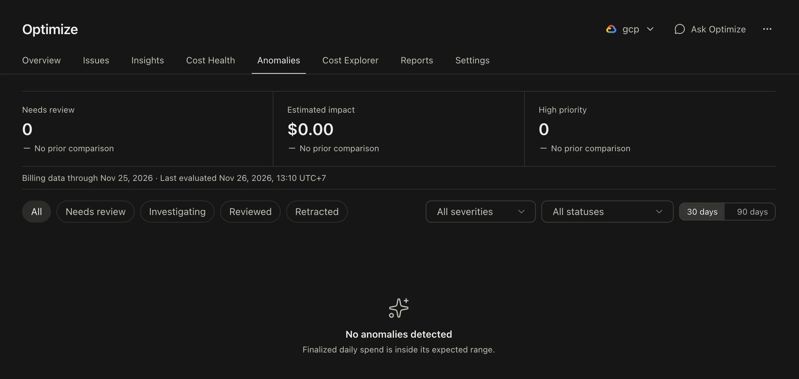

비용 이상 징후(cost anomaly)는 확정된 청구 데이터를 기준으로 한 서비스의 비용이 최근 평소보다 눈에 띄게 높았던 날입니다. **Optimize → Anomalies**는 한 클라우드 계정의 이상 징후를 나열하므로, 각 급증을 확인하고, 그 의미를 기록하고, 원인 분석을 CloudThinker에게 맡길 수 있습니다.

## 사전 요구 사항

- 청구 데이터가 있는 Optimize 연결. [Optimize quickstart](/guide/cost-optimization/quickstart)를 참조하세요.
- 서비스마다 최소 14일의 확정된 일일 청구 내역. 그 전까지 페이지는 이상 징후가 없다고 표시하지 않고 **Baseline preparing**과 확정된 일수를 표시합니다. 나중에 사용하기 시작한 서비스도 오래된 계정이라 해도 표시되려면 자체적으로 14일이 필요합니다.
- 검토하거나 조사하려면 Developer 이상의 워크스페이스 역할. Viewer는 목록과 증거를 읽을 수 있습니다. [역할](/guide/security/roles)을 참조하세요.

## 탐지 방식

Optimize는 각 서비스의 일일 비용을 이전 14일의 중앙값과 비교합니다. 그 날이 중앙값보다 얼마나 높은지를 스케일된 중앙값 절대 편차(MAD)로 측정하여 점수를 매깁니다. 두 조건을 모두 통과할 때만 그 날이 표시됩니다.

- **Unusual:** 점수가 3.5를 초과합니다.
- **Large enough:** 증가분이 20 또는 기준선의 15% 중 더 큰 값 이상입니다.

증가만 표시됩니다. 장애나 고장 난 워크로드를 의미할 수 있는 감소를 찾으려면 [Cost Explorer](/ko/guide/cost-optimization/analytics)에서 월별로 비교하거나 CloudThinker에게 해당 서비스에 대해 물어보세요.

심각도는 증가 규모와 점수로 결정됩니다.

| 심각도 | 규칙 |
|---|---|
| High | 증가분 500 초과, 또는 점수 6 초과 |
| Medium | 증가분 100 초과, 또는 점수 4.5 초과 |
| Low | 탐지를 통과한 그 밖의 모든 것 |

<Note>
금액(20, 100, 500)은 계정의 청구 통화로 된 단순한 숫자이며 USD에서 환산되지 않습니다. JPY나 VND 같은 통화로 청구되는 Azure 범위에서는 이 값이 작기 때문에 15% 조건이 대부분의 필터링을 하며, 더 많은 이상 징후가 Medium이나 High로 나옵니다.
</Note>

이상 징후의 수치(실제 비용, 기준선, 예상 영향, 심각도)는 항상 저장된 청구 데이터에서 나오며, 에이전트의 판단에서 나오지 않습니다. 청구 데이터는 늦게 도착하므로 이 기능은 실시간 알림이 아닌 일일 검토 도구입니다.

## 이상 징후 검토

<Steps>
  <Step title="Anomalies 열기">
    사이드바에서 **Optimize → Anomalies**를 선택하고 페이지 헤더에서 클라우드 계정을 고릅니다.

    **성공 상태:** 요약 카드에 해당 기간의 **Needs review** 수, 총 **Estimated impact**, **High priority** 수가 표시됩니다.

    <Frame caption="최근 30일 동안 열린 이상 징후가 없는 Google Cloud 계정의 Anomalies">
      
    </Frame>
  </Step>
  <Step title="기간 선택">
    **30 days** 또는 **90 days**를 선택합니다. 탭(**All**, **Needs review**, **Investigating**, **Reviewed**, **Retracted**)과 심각도 및 상태 필터로 목록을 좁힙니다.

    **Needs review** 탭은 아직 아무도 이 급증의 의미를 기록하지 않았다는 뜻입니다. **Issues**의 **Needs review** [finding class](/ko/guide/cost-optimization/recommendations#결과-읽는-방법)와는 관련이 없습니다.
  </Step>
  <Step title="증거 열기">
    이상 징후를 선택합니다. 세부 정보 패널에 다음이 표시됩니다.

    | 필드 | 의미 |
    |---|---|
    | Actual cost | 표시된 날의 서비스 비용 |
    | Rolling baseline | 비교 대상인 14일 중앙값 |
    | Estimated impact | 실제 비용에서 기준선을 뺀 값. 절감 추정액이나 청구서 크레딧이 아닙니다. |
    | Deviation | 기준선보다 얼마나 높은지를 나타내는 백분율 |
    | Detector score | [탐지 방식](#탐지-방식)의 MAD 점수. 3.5를 초과하면 첫 번째 조건을 통과합니다 |
    | Billing data through | 탐지에 사용된 마지막 확정 청구 날짜 |
    | Top contributors | 비용의 대부분을 차지한 리전. 리전만 표시됩니다. 리소스나 사용 유형은 **Investigate with CloudThinker**를 사용하세요 |

    차트는 실제 일일 비용을 기준선 및 **Expected upper bound**와 비교하여 표시합니다.
  </Step>
  <Step title="연결된 결과 확인">
    에이전트가 급증을 절감 결과(finding)와 연결했다면 **Explained by** 목록이 나타납니다. 결과를 선택하면 해당 레코드가 열립니다. [Optimize Issues](/ko/guide/cost-optimization/recommendations)를 참조하세요.
  </Step>
</Steps>

하나의 이상 징후는 최대 31일까지 여러 날에 걸친 에피소드를 다룰 수 있습니다. 증가가 계속되는 동안 일일 새로 고침이 같은 레코드를 연장합니다. 탐지는 새로 가져온 청구 데이터에서 실행되므로 **Daily refresh**를 끄면 새 이상 징후도 더 이상 발견되지 않습니다.

## 변화의 의미 기록

세부 정보 패널의 버튼을 사용합니다.

| 버튼 | 사용하는 경우 | 결과 |
|---|---|---|
| **Mark as expected** | 출시나 마이그레이션 같은 계획된 변경과 일치할 때 | 이상 징후가 **Expected change** 처리 결과와 함께 **Reviewed** 탭으로 이동하고 **Needs review** 수에서 빠집니다. **Marked Expected change** 메시지에 **Undo**가 표시됩니다 |
| **Mark as wrong** | 실제 비용 급증이 아니었을 때. 예: 청구 정정으로 요금이 취소됨 | 이유를 입력합니다. 이상 징후는 대기열과 합계에서 빠지고, 입력한 이유와 함께 **Retracted** 탭에 남습니다 |
| **Reopen review** | 다시 대기열로 되돌리고 싶을 때 | 이상 징후에 처리 결과가 있으면 표시됩니다. **Review reopened** 메시지에 **Undo**가 표시됩니다. 다시 열어도 내역은 유지됩니다 |

**All statuses** 필터는 여전히 처리 결과별로 이상 징후를 분류합니다: **Unexpected change**, **Expected change**, **Insignificant**.

## CloudThinker로 조사

세부 정보 패널에서 **Investigate with CloudThinker**를 선택합니다. 이상 징후는 즉시 **Investigating**으로 이동하고, 기본 제공 어시스턴트인 CloudThinker가 이상 징후 증거와 정확한 클라우드 연결이 이미 담긴 새 대화를 엽니다. 그런 다음 해당 계정의 실시간 비용 분석과 변경 내역을 읽습니다. 조사는 읽기를 요청하며, CloudThinker가 제안하는 모든 변경은 [Approvals](/guide/approvals/overview) 규칙을 거칩니다.

**성공 상태:** 대화는 가능성 높은 원인과 그 증거로 끝나거나, 사용 가능한 접근 권한이나 데이터로는 원인을 확정할 수 없다는 명확한 설명으로 끝납니다. CloudThinker는 원인을 추측하지 않습니다.

같은 대화에서 후속 질문을 하세요.

```text
Which resources inside this service drove the increase, and when were they created or changed?
Is the increase still going on today, or did it stop after the flagged days?
```

같은 이상 징후에 대한 이후 조사는 이전 대화에서 찾은 내용을 재사용할 수 있습니다. **Open in Cost Explorer**를 사용하면 급증을 [완료된 월의 지출](/ko/guide/cost-optimization/analytics)과 비교할 수 있습니다.

## 철회된 이상 징후

청구 데이터가 수정되어 더 이상 이상 징후를 뒷받침하지 않으면 에이전트가 기록된 이유와 함께 이를 철회합니다. **Mark as wrong**으로 직접 철회할 수도 있습니다. 철회된 레코드는 삭제되지 않습니다. **Retracted** 탭에서 찾을 수 있으며, 각 레코드에는 이유와 철회된 시간이 표시됩니다. 에이전트는 **Investigating** 또는 **Reviewed** 상태의 이상 징후는 이미 사람이 작업 중이므로 철회하지 않습니다.

## 알림 받기

이상 징후가 High 심각도에 도달하면 워크스페이스 소유자가 앱에서 **High cost anomalies** 알림을 받습니다(이메일은 기본적으로 꺼져 있음). 두 가지 Optimize 다이제스트는 아직 아무도 검토하지 않은 새 이상 징후와 검토를 기다리는 오래된 이상 징후 수를 나열합니다. 각 다이제스트는 [Notifications](/ko/guide/notifications)에서 켜거나 끌 수 있습니다.

| 다이제스트 | 받는 사람 | 시기 | 기본 이메일 |
|---|---|---|---|
| **Optimize weekly digest** | 한 사람: [워크스페이스 소유자](/guide/security/roles) | 월요일, 변경이 있을 때만 | 꺼짐 |
| **Optimize monthly digest** | 워크스페이스 Admin만 | 매월 2일, 지난달 내용 | 켜짐 |

조직이 소유한 워크스페이스에는 소유자가 없을 수 있습니다. 기본 설정에서는 소유자가 직접 켜기 전까지 주간 이메일을 받지 않으며, Developer와 Viewer는 두 다이제스트 모두 받지 않습니다. 그 밖의 모든 사람은 **Optimize → Anomalies** 또는 **Insights**의 **Running anomalies** 섹션을 확인해야 합니다.

## 문제 해결

<AccordionGroup>
  <Accordion title="새 계정에 이상 징후가 표시되지 않음">
    **원인:** 탐지에는 서비스마다 14일의 확정된 내역이 필요합니다. **확인:** 페이지에 사용 가능한 확정 일수와 함께 **Baseline preparing**이 표시됩니다. **해결:** 청구 내역이 쌓일 때까지 기다리세요. 오래된 계정이라면 Optimize 페이지 헤더에서 일일 새로 고침이 켜져 있는지 확인하세요.
  </Accordion>
  <Accordion title="클라우드 콘솔에서 보이는 급증이 목록에 없음">
    **원인:** 공급자가 그날의 청구를 아직 확정하지 않았거나, 증가분이 크기 임계값보다 작거나, 감소입니다. **확인:** 날짜를 **Billing data through**와 비교하세요.
  </Accordion>
  <Accordion title="Mark as expected 또는 Investigate with CloudThinker가 없음">
    **원인:** 역할이 Viewer이거나 이상 징후가 철회되었습니다. **해결:** Viewer라면 워크스페이스 Admin에게 Developer 역할을 요청하세요. 철회된 레코드는 읽기 전용입니다. **Retracted** 탭에서 이유를 확인하세요.
  </Accordion>
  <Accordion title="Optimize 새로 고침이 일시 중지되었거나 데이터가 오래되었을 수 있다는 알림이 표시됨">
    **원인:** 권한 누락이나 읽을 수 없는 청구 소스 등으로 마지막 청구 새로 고침이 실패했습니다. 마지막으로 정상적인 증거는 계속 읽을 수 있으며, 클라우드 연결도 연결된 상태로 유지됩니다. **해결:** 알림을 따르세요. 권한 누락이 표시되면 **Copy policy**를, 자격 증명을 검토하려면 **Check connection**을 사용한 다음 **Retry refresh**를 클릭하세요.
  </Accordion>
</AccordionGroup>

## 다음 단계

<CardGroup cols={2}>
  <Card title="Optimize 결과" icon="lightbulb" href="/ko/guide/cost-optimization/recommendations">
    급증을 설명하거나 이에 대응하는 절감 결과에 조치합니다
  </Card>
  <Card title="Optimize 보고서" icon="file-chart-column" href="/ko/guide/cost-optimization/reports">
    최근 30일의 이상 징후 검토 로그를 생성합니다
  </Card>
</CardGroup>
