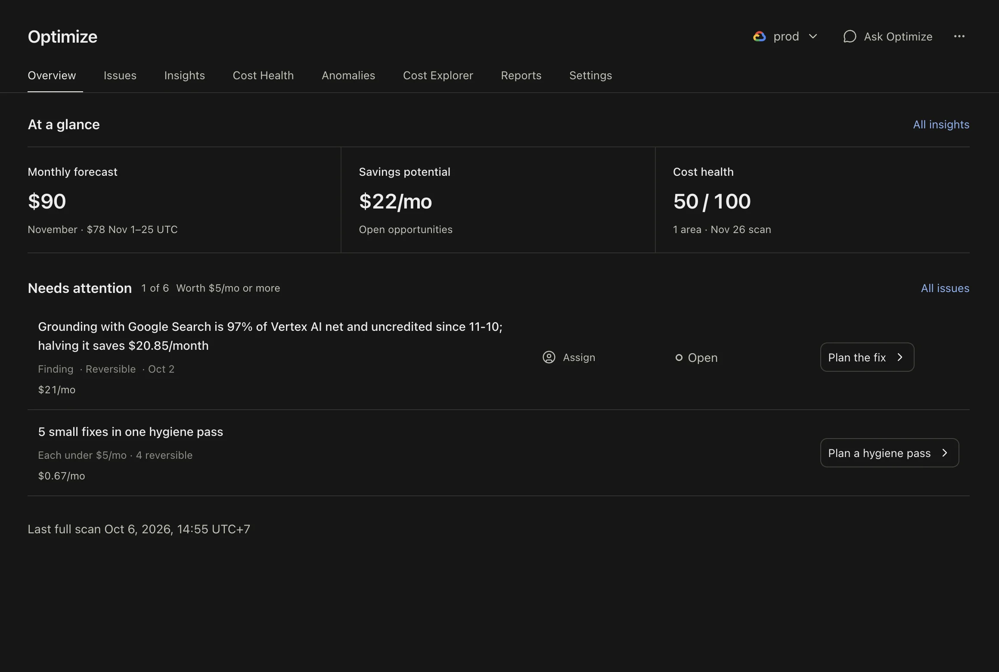

import { OptimizeScene } from '/snippets/iso/optimize.jsx';
import ApprovalDefault from '/snippets/approval-default.mdx';

**사용한 만큼만 지불합니다.**

Optimize는 클라우드 비용을 위한 Frontier Investigation Agent입니다. 한 번에 클라우드 계정 하나의 청구 데이터를 읽어 지출 스냅샷, 상태 점수, 실행할 수 있는 절감 항목의 순위 목록으로 바꿉니다. [AWS](/ko/guide/connections/aws), [GCP](/ko/guide/connections/gcp), [Azure](/ko/guide/connections/azure)와 함께 동작하며, 절감 기회를 찾는 스캔은 읽기 전용입니다.

<OptimizeScene />

## 동작 방식

1. **클라우드 계정을 연결합니다.** CloudThinker에는 청구 데이터에 대한 읽기 권한이 필요합니다. GCP와 Azure는 처음에 청구 소스(BigQuery 청구 내보내기 테이블 또는 Azure 청구 범위)도 선택하도록 요청합니다.
2. **CloudThinker가 첫 스캔을 실행합니다.** 최대 13개월의 청구 이력을 가져온 뒤, 청구된 각 서비스를 읽기 전용 명령으로 확인합니다. 스캔은 백그라운드에서 실행되므로 페이지를 떠나도 됩니다.
3. **Optimize가 점수를 매기고 순위를 정합니다.** Cost Health 점수, 각각 추정치가 있는 결과(절감 기회) 목록, 비정상적인 비용 변화를 표시하는 일일 기준선을 받습니다.
4. **다음에 할 일은 사용자가 결정합니다.** 각 결과를 검토하고, CloudThinker에게 분석이나 구현을 요청하거나, 조치가 필요 없는 이유를 기록합니다. 스캔 중에는 클라우드 계정에서 아무것도 바뀌지 않습니다.
5. **일일 새로 고침으로 수치를 최신 상태로 유지합니다.** 비용 데이터가 생기면 CloudThinker는 하루에 한 번 새 청구 데이터를 가져옵니다. Developer 또는 Admin은 페이지 헤더의 **More Optimize actions**(⋯) 메뉴에 있는 **Daily refresh** 스위치로 이를 끌 수 있으며, 이 메뉴에는 마지막 업데이트 시간도 표시됩니다.

<Frame caption="Google Cloud 계정의 Optimize 개요: 이번 달 예측, 잠재 절감액, Cost health 점수, 먼저 처리할 문제">
  
</Frame>

## 할 수 있는 일

Optimize에는 **Overview**, **Issues**, **Insights**, **Cost Health**, **Anomalies**, **Cost Explorer**, **Reports**, **Settings**의 여덟 탭이 있습니다. 각 페이지는 페이지 제목 옆 선택기에서 고른 계정으로 범위가 유지됩니다.

| 페이지 | 답하는 질문 | 가이드 |
|---|---|---|
| **Overview** | 이번 달은 어디서 끝날까? 어떤 이슈를 먼저 결정해야 할까? | [Quickstart, 4단계](/guide/cost-optimization/quickstart) |
| **Issues** | 어떤 절감 기회가 열려 있고, 각각 얼마의 가치가 있으며, 누가 작업 중인가? | [Issues](/ko/guide/cost-optimization/recommendations) |
| **Insights** | Optimize가 지금까지 얼마를 절감했고, 어떤 서비스가 지출을 이끌며, 어떤 이상 징후가 아직 진행 중인가? | [절감 추정치](/ko/guide/cost-optimization/savings) |
| **Cost Health** | 이 계정이 잘하고 있는 비용 관행은 무엇이고, 어떤 검사가 실패하며, 무엇이 점수를 올리는가? | [Cost Health](/guide/cost-optimization/cost-health) |
| **Anomalies** | 특정 날짜에 어떤 서비스가 예상보다 많이 지출했고, 왜 그랬는가? | [Anomalies](/ko/guide/cost-optimization/anomalies) |
| **Cost Explorer** | 한 계정에서 서비스나 리전별 지출이 최근 6개월 또는 12개월의 완료 월 동안 어떻게 바뀌었는가? (계정을 비교하려면 **All accounts** 보고서를 사용하세요.) | [Cost Explorer](/ko/guide/cost-optimization/analytics) |
| **Reports** | 지금 바로, 또는 일정에 따라 서면 비용 보고서를 보낼 수 있는가? | [Reports](/ko/guide/cost-optimization/reports) |
| **Settings** | 이 계정은 어떤 청구 소스를 읽고, 새로 고침은 정상인가? | [Optimize settings](/guide/cost-optimization/settings) |

**Overview** 페이지에는 두 섹션이 있습니다. **At a glance**는 **Monthly forecast**, **Savings potential**, **Cost health**를 보여주며, 비용 이상 징후가 진행 중일 때는 **Extra spend**도 표시합니다. **Needs attention**은 먼저 조치할 가치가 있는 열린 이슈를 나열하며, 각 이슈에 **Plan the fix**가 있습니다. 지출 및 절감 분석은 **Insights**에 있습니다.

## 절감 제안과 승인 방식

스캔은 제안만 합니다. 각 결과를 증거, 예상 월간 절감액, 노력, 위험과 함께 저장하며, 누군가 결과에서 **Implement**를 선택하기 전까지 클라우드 계정에서는 아무것도 바뀌지 않습니다. 그 사이에 팀은 **Issues**에서 결과를 분류하고 CloudThinker가 할 일을 고릅니다. 영향 분석, 구현 계획 작성, 결과에 대한 질문 답변, 또는 변경 실행입니다. 분류, 네 가지 상태, 각 작업은 [Issues](/ko/guide/cost-optimization/recommendations)에서 다룹니다.

**Implement**는 클라우드에 대한 에이전트 작업이므로, 다른 작업과 같은 [Approvals](/guide/approvals/overview) 규칙과 모드를 거칩니다. 모든 **Implement**가 사람을 기다려야 한다면 Approvals를 **Manual**로 바꾸세요.

<ApprovalDefault />

<Note>
**Potential monthly savings**는 상한이지 보장이 아닙니다. 결과가 서로 겹칠 수 있으므로 열린 결과를 모두 처리해도 합계보다 적게 절감됩니다. [절감 추정치](/ko/guide/cost-optimization/savings)를 참고하세요.
</Note>

## 핵심 개념

| 용어 | 의미 |
|---|---|
| Finding(결과) | 한 계정의 절감 기회 하나. 증거와 예상 월간 절감액을 포함합니다 |
| Cost Health | 다섯 가지 FinOps 역량(**Rate optimization**, **Workload optimization**, **Allocation**, **Anomaly management**, **Forecasting**)에 걸친 100점 만점의 일일 점수. 단계는 FinOps Framework를 따릅니다. 50 미만은 **Crawl**(**Needs work**), 50 이상은 **Walk**(**On track**), 80 이상이고 지출의 80%가 측정되면 **Run**(**Strong**)입니다. CloudThinker의 첫 측정 전에는 카드에 공급자의 세 가지 축 점수가 표시됩니다. [Cost Health](/guide/cost-optimization/cost-health)를 참고하세요 |
| Anomaly(이상 징후) | 서비스의 확정 지출이 롤링 기준선(이전 14일의 중앙값) 대비 예상 범위를 넘은 날. [탐지 방식](/ko/guide/cost-optimization/anomalies#탐지-방식)을 참고하세요 |
| 청구 소스 | Optimize가 비용 데이터를 읽는 곳: AWS Cost Explorer, GCP BigQuery 청구 내보내기, 또는 Azure Cost Management |

## 공급자별 차이

| 공급자 | 청구 소스 | 통화 |
|---|---|---|
| AWS | AWS Cost Explorer. 사용량 대비 24~48시간 지연될 수 있습니다 | USD |
| GCP | BigQuery의 Cloud Billing Standard export | 가져올 때 내보내기 자체의 `currency_conversion_rate`를 사용해 행 단위로 USD로 변환 |
| Azure | Cost Management 구독 또는 청구 범위 | 청구 범위의 통화 |

늦게 도착한 청구 데이터가 지출 0으로 표시되는 일은 없습니다. Optimize는 마지막으로 정상이었던 데이터를 유지하고, 업데이트된 시점을 표시합니다.

## 다중 계정 구성

각 클라우드 계정은 별도의 연결이며, 모든 Optimize 페이지는 한 번에 계정 하나를 보여줍니다.

- **AWS Organizations:** 연결된 계정이 관리(payer) 계정이더라도 Optimize는 해당 계정 자체의 지출만 읽습니다. 다루고 싶은 각 멤버 계정을 연결하세요. [여러 AWS 계정에서 작업하기](/ko/guide/use-cases/multi-aws-accounts)를 참고하세요.
- **계정 간 보기:** **Optimize → Reports**에서 **All accounts** 범위로 보고서를 생성하세요. 계정마다 별도의 섹션이 생기며, 서로 다른 통화는 절대 합산되지 않습니다. 계정 전체에 걸친 단일 절감 합계는 없습니다.

## Optimize가 다루는 범위

**다루는 것:**

- 청구된 각 서비스에 대한 절감 결과. 리소스 수준(유휴, 과다 프로비저닝, 미사용 리소스)까지
- 약정 커버리지: AWS의 RI와 Savings Plans, GCP의 약정 사용 할인, Azure의 예약
- Cost Health의 태깅 및 비용 할당 검사
- 서비스별 일일 이상 징후 탐지

**다루지 않는 것:**

- AWS, GCP, Azure 이외의 클라우드
- Kubernetes 네임스페이스나 워크로드별 비용 분할. 클러스터는 청구된 노드와 서비스로 표시됩니다
- 변경 후 실현된 절감액이나 ROI
- 비용 감소. 이상 징후 탐지는 증가만 표시합니다

## 데이터와 접근

- **저장되는 것:** Optimize가 가져온 청구 행과 결과, Cost Health 결과, 이상 징후 기록. 워크스페이스에 보관되므로 공급자를 다시 호출하지 않고도 페이지와 보고서가 로드됩니다.
- **볼 수 있는 사람:** 모든 워크스페이스 멤버가 모든 Optimize 페이지를 읽을 수 있습니다. 스캔 실행과 결과 처리에는 Developer가, 계정 연결이나 결과 표시에는 Admin이 필요합니다. [Roles](/guide/security/roles)를 참고하세요.

CloudThinker가 데이터를 어디에 호스팅하고 어떻게 보호하는지는 [Security](/ko/guide/security/overview)를 참고하세요. 스캔, 청구 소스, 권한이 실패할 때는 [Optimize troubleshooting](/guide/cost-optimization/troubleshooting)을 참고하세요.

## 시작하기

<CardGroup cols={2}>
  <Card title="Optimize quickstart" icon="bolt" href="/guide/cost-optimization/quickstart">
    계정을 연결하고, 첫 스캔을 실행하고, 보고서를 공유합니다
  </Card>
  <Card title="결과 처리하기" icon="lightbulb" href="/ko/guide/cost-optimization/recommendations">
    절감 항목의 우선순위를 정하고 각각의 결과를 기록합니다
  </Card>
  <Card title="이상 비용 검토" icon="wave-pulse" href="/ko/guide/cost-optimization/anomalies">
    비정상적인 일일 비용 변화를 확인하고 조사합니다
  </Card>
  <Card title="비용 보고서 보내기" icon="file-chart-column" href="/ko/guide/cost-optimization/reports">
    지금 보고서를 생성하거나 일정에 등록합니다
  </Card>
</CardGroup>
