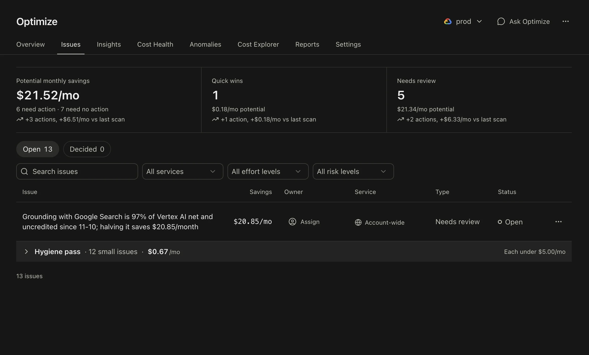
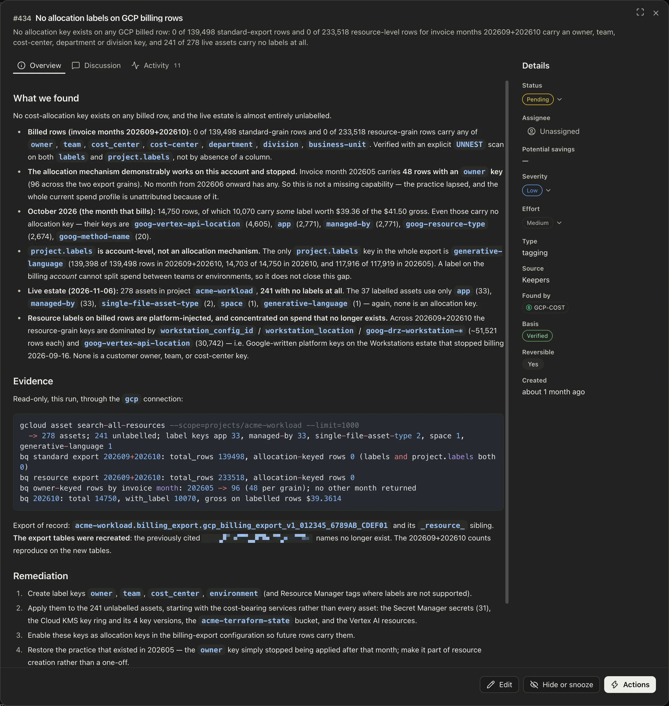
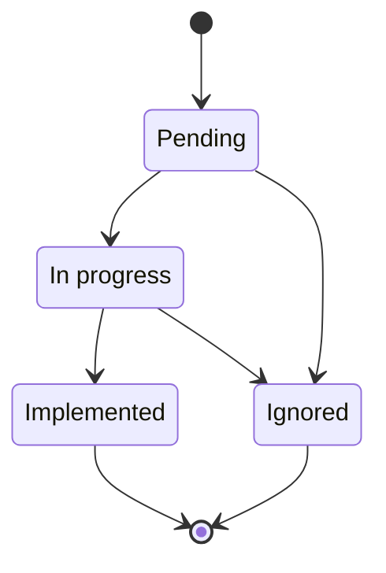
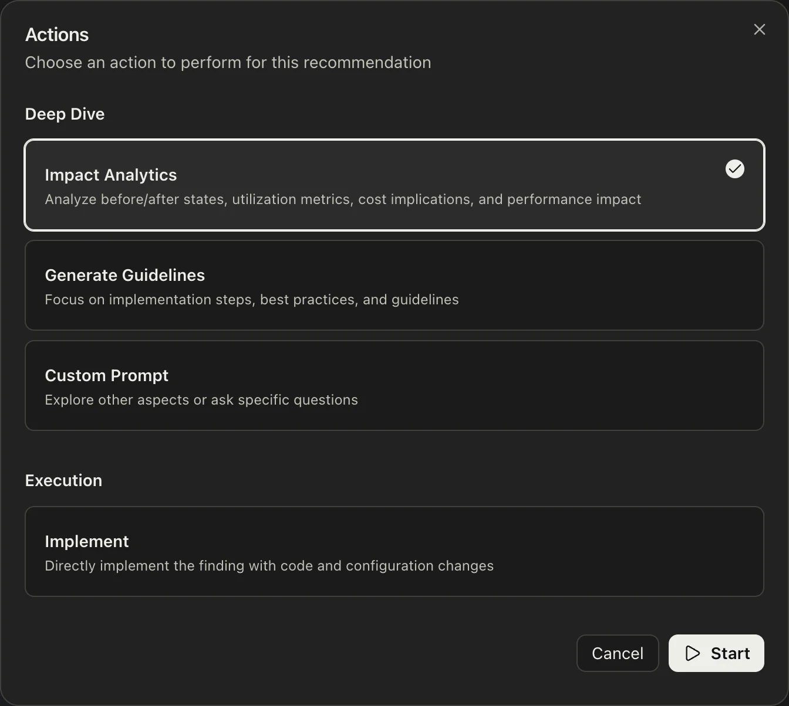
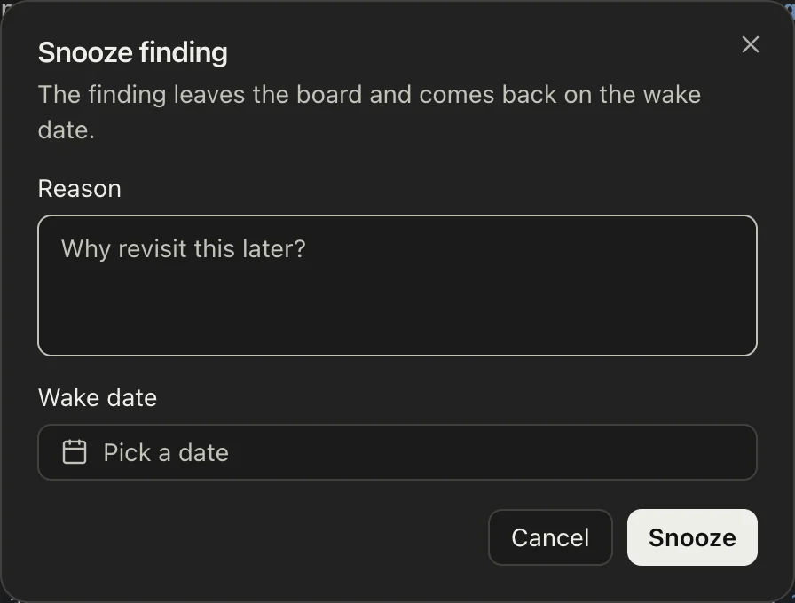
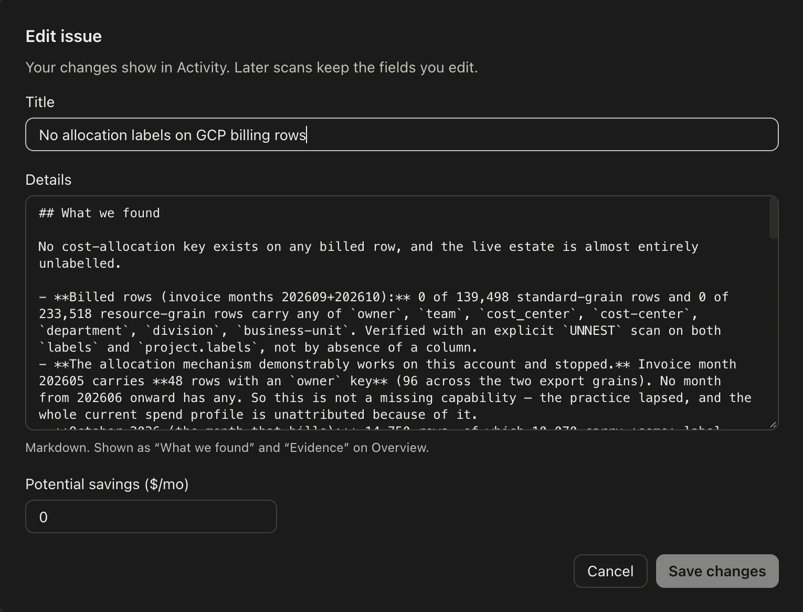

import ApprovalDefault from '/snippets/approval-default.mdx';

결과(finding)는 Optimize 스캔이 클라우드 계정에서 찾은 하나의 절감 기회로, 예상 월간 절감액과 그 근거가 되는 증거를 포함합니다. **Optimize → Issues**는 처음 발견부터 구현 또는 무시까지 팀이 각 결과를 어떻게 처리할지 결정하는 곳입니다.

## 사전 요구 사항

- 첫 스캔을 마친 Optimize 연결. [Optimize quickstart](/guide/cost-optimization/quickstart)를 참조하세요.
- 하려는 작업에 맞는 워크스페이스 역할. [역할](/guide/security/roles)을 참조하세요.

| 작업 | 최소 워크스페이스 역할 |
|---|---|
| 결과 보기 및 증거 읽기 | Viewer |
| 결과 이동, 편집, 할당, 스캔 실행, **Implement** 같은 작업 시작 | Developer |
| 결과를 expected, snoozed, disputed로 표시 | Admin |

표시(mark)에 Admin이 필요한 이유는 Optimize가 이후에 제기하고 집계하는 내용이 바뀌기 때문입니다. expected로 표시된 결과는 만료일을 설정하지 않는 한 다시 제기되지 않으며, 모든 표시는 결과를 절감 합계에서 제외합니다.

## 결과 읽는 방법

모든 결과에는 분류(class)와 증거 배지가 있습니다. 조치하기 전에 둘 다 읽으세요.

| 분류 | 의미 | 잠재 절감액에 포함 |
|---|---|---|
| Quick win | 검증된 증거, 낮은 노력, 되돌릴 수 있음. 세 가지 모두 충족해야 합니다. | 예 |
| Needs review | 실제 기회이지만 quick win 조건 중 하나 이상을 충족하지 못하므로 더 많은 맥락이나 주의가 필요함 | 예 |
| No action | 스캔이 확인한 결과 정당하다고 판단한 지출 | 아니요 |

| 증거 배지 | 에이전트가 결과를 확정한 방법 |
|---|---|
| Verified | 실제 리소스를 읽고 값을 확인함 |
| Inferred | 리소스를 읽지 않고 청구 및 구성 데이터에서 결과를 도출함 |
| Assumed | 결과의 일부를 확인할 수 없었음. 조치하기 전에 그 부분을 직접 확인하세요. |

여기서 **Needs review**는 결과 분류일 뿐 다른 의미는 없습니다. 같은 단어가 [Anomalies](/ko/guide/cost-optimization/anomalies#이상-징후-검토)의 이상 징후 상태와 [Code Audit](/ko/guide/security/cyber-libraries)의 라이브러리 심각도를 가리키기도 하지만, 세 가지는 서로 영향을 주지 않습니다.

배지는 결과의 성격을 설명할 뿐 순위를 매기지 않습니다. inferred 결과도 계정에서 가장 큰 절감액일 수 있습니다.

**Effort**와 **Risk**는 각각 **Low**, **Medium**, **High** 세 수준 중 하나입니다. 결과의 세부 정보와 편집 양식에서는 Risk를 **Severity**라고 부릅니다. Effort가 Low인 결과만 quick win이 될 수 있습니다.

**No action**은 스캔의 판정입니다. 표시는 스캔이 조치가 필요하다고 한 결과에 대한 여러분의 판정입니다.

## 결과의 우선순위 정하기

<Steps>
  <Step title="Issues 열기">
    사이드바에서 **Optimize → Issues**를 선택한 다음 페이지 헤더에서 클라우드 계정을 고릅니다.

    **성공 상태:** 세 개의 요약 카드에 **Potential monthly savings**, **Quick wins**, **Needs review**가 표시되고 그 아래에 결과가 표시됩니다.

    <Frame caption="예상 절감액순으로 정렬되고 작은 문제는 Hygiene pass 행으로 묶인 Issues 탭">
      
    </Frame>
  </Step>
  <Step title="quick win부터 시작">
    **Quick wins** 또는 **Needs review** 카드를 선택하면 목록이 해당 분류로 필터링됩니다. 다시 선택하거나 **Potential monthly savings**를 선택하면 필터가 해제됩니다.
  </Step>
  <Step title="목록 좁히기">
    **Search issues**에 입력하여 제목과 설명을 검색하거나 **Service**, **Effort**, **Risk**로 필터링합니다. 페이지 URL에 필터가 유지되므로 링크를 팀원에게 붙여 넣으면 같은 목록을 볼 수 있습니다.
  </Step>
  <Step title="열림 또는 결정됨 선택">
    **Open** 탭에는 아직 결정이 필요한 결과가 나열됩니다. **Decided** 탭에는 **Implemented** 또는 **Ignored**로 표시된 결과가 나열됩니다. 표에는 **Issue**, **Savings**, **Owner**, **Service**, **Type**(분류), **Status** 열과 각 행의 **⋯** 메뉴가 있습니다. 작은 문제(각각의 절감액이 **Each under …/mo**에 표시된 금액보다 적은 문제)는 개수와 합산 절감액과 함께 맨 아래의 **Hygiene pass** 행 하나로 묶입니다. 행을 펼치면 볼 수 있습니다.
  </Step>
  <Step title="결과 열기">
    행을 선택하면 결과가 열립니다. **Overview** 탭에는 **What we found**, **Evidence**, **Remediation**, **Savings math**가 표시됩니다. **Details** 패널에는 상태, 담당자, 추정치, 심각도, 노력, 증거 근거, 변경을 되돌릴 수 있는지가 표시됩니다.

    <Frame caption="결과의 Overview 탭과 Details 패널">
      
    </Frame>
  </Step>
</Steps>

## 워크플로에 따라 결과 이동

Optimize 결과는 CloudThinker의 다른 곳에서 쓰는 상태와 별개인 자체 상태 네 가지를 사용합니다. 결과는 **Pending**으로 되돌리는 것을 포함하여 어떤 상태에서든 다른 어떤 상태로든 이동할 수 있습니다. 다이어그램은 일반적인 경로를 보여 줍니다.

| 상태 | 용도 |
|---|---|
| Pending | 아무도 시작하지 않은 새 작업 |
| In progress | 팀이 평가 중이거나 구현 중 |
| Implemented | 팀이 변경을 완료함 |
| Ignored | 팀이 진행하지 않기로 함 |



상태를 바꾸려면 행의 **⋯** 메뉴를 열고 **Move to** 아래에서 상태를 고릅니다. 표에서 **Pending** 결과는 **Open** 상태로 표시됩니다.

**성공 상태:** 행에 새 상태가 표시되고, **Implemented** 또는 **Ignored** 결과는 **Decided** 탭으로 이동합니다. **Pending**과 **In progress** 결과만 **Potential monthly savings**에 포함되므로, 결과를 **Implemented**나 **Ignored**로 옮기면 합계가 줄고, Pending과 In progress 사이에서 옮기면 합계가 바뀌지 않습니다.

## 결과에 조치하기

<Steps>
  <Step title="Actions 열기">
    결과를 열고 오른쪽 아래의 **Actions**를 선택합니다.

    <Frame caption="The Actions dialog. Impact Analytics is selected by default">
      
    </Frame>
  </Step>
  <Step title="작업 선택">
    | 작업 | CloudThinker가 하는 일 |
    |---|---|
    | **Impact Analytics** | 변경 전후 상태, 사용률, 현재 요금 기준 비용, 성능 영향, 위험을 비교합니다. 기본값입니다 |
    | **Generate Guidelines** | 테스트, 롤백 계획, 성공 기준을 포함한 단계별 구현 가이드를 작성합니다 |
    | **Custom Prompt** | 결과에 대한 사용자의 질문에 답합니다 |
    | **Implement** | 클라우드 계정에서 변경을 수행합니다. 연결에 쓰기 권한이 필요합니다(아래 참조) |

    **Custom Prompt**에는 알고 싶은 내용을 입력합니다. 예:

    ```text
    Would moving this instance to the next smaller size break the nightly batch job? Check its peak CPU and memory over the last 30 days.
    ```
  </Step>
  <Step title="대화 시작">
    **Start**를 선택합니다. CloudThinker가 결과가 첨부된 새 대화를 엽니다. 모든 작업은 먼저 리소스가 아직 존재하고 결과와 여전히 일치하는지 확인합니다. 일치하지 않으면 CloudThinker가 무엇이 바뀌었는지 알리고 중단합니다.

    **Implement**는 의존성이 깨지거나 롤백할 방법이 없는 경우에도 중단합니다.

    <ApprovalDefault />
  </Step>
</Steps>

<Note>
**Implement**에는 쓰기 권한이 필요합니다. [Optimize quickstart](/guide/cost-optimization/quickstart)는 읽기 전용 권한을 부여하므로, 그 설정에서는 CloudThinker가 결과를 분석할 수는 있지만 변경할 수는 없습니다. 변경에 필요한 쓰기 권한을 역할, 서비스 계정, 또는 서비스 주체에 추가하고, 연결의 **Allow writes**를 켜 두세요. [AWS](/ko/guide/connections/aws#쓰기-권한), [GCP](/ko/guide/connections/gcp#쓰기-권한), [Azure](/ko/guide/connections/azure#쓰기-권한)의 쓰기 권한을 참조하세요.
</Note>

**성공 상태:** 대화는 요청한 분석이나 가이드로 끝나며, **Implement**의 경우 무엇이 바뀌었고 무엇을 모니터링해야 하는지에 대한 기록으로 끝납니다. 변경이 적용되면 결과를 직접 **Implemented**로 옮기세요.

## 조치가 필요 없는 결과 표시

결과를 활성 대기열에서 빼되 레코드와 이유는 남기고 싶을 때 표시를 사용합니다.

<Steps>
  <Step title="표시 선택">
    결과 페이지에서 **Hide or snooze**를 선택합니다. 표에서는 행의 **⋯** 메뉴를 대신 사용합니다.
  </Step>
  <Step title="이유 입력">
    아래 표에서 옵션을 고르고, 이유를 입력하고, 옵션이 날짜를 요구하면 날짜를 추가한 다음 확인합니다. 모든 표시에는 최소한 짧은 문장의 이유가 필요하며, **Snooze until…** 날짜는 내일 이후여야 합니다. CloudThinker는 이의가 제기된 결과를 다시 확인할 때 입력한 이유를 읽습니다.

    <Frame caption="Snooze until… asks for a reason and a wake date">
      
    </Frame>

    **성공 상태:** expected와 snoozed 결과는 목록에서 사라지고 도구 모음에 **hidden** 토글(예: **3 hidden**)이 나타납니다. 이의가 제기된 결과는 **Disputed** 레이블과 함께 목록에 남습니다. 모든 표시는 결과를 **Potential monthly savings**에서 제외합니다.
  </Step>
</Steps>

| 표시 | 사용하는 경우 | 이후 동작 |
|---|---|---|
| Hide as expected | 의도된 지출일 때 | 에이전트는 증거를 최신으로 유지하지만, 선택 사항인 만료일을 설정하지 않는 한 결과를 다시 제기하지 않습니다. 만료일이 지나면 표시가 해제됩니다. 결과가 목록으로 돌아오고 다시 합계에 포함되며, 끝난 snooze와 같습니다. |
| Snooze until… | 나중에 중요해질 수 있을 때 | 결과가 목록에서 빠지고 설정한 재개 날짜(필수)에 돌아옵니다. |
| Dispute… | 증거나 결론이 잘못된 것 같을 때 | 결과가 계속 표시되며, 에이전트가 다음 스캔에서 다시 확인합니다. |

숨겨진 결과를 검토하려면 도구 모음의 **hidden** 토글을 선택하세요. 열린 결과가 모두 숨겨져 있으면 페이지에 대신 **Show hidden findings** 버튼이 표시됩니다. 표시를 취소하려면 결과를 열고 **Clear mark**(행 메뉴) 또는 **Change mark**를 선택하세요.

## 결과 편집

실제 절감액이나 더 명확한 제목처럼 팀이 더 잘 아는 내용이 있으면 결과를 열고 아래쪽의 **Edit**를 선택합니다. **Edit issue** 대화 상자에서 다음을 변경할 수 있습니다.

| 필드 | 변경되는 내용 |
|---|---|
| **Title** | 목록과 보고서에 표시되는 이름 |
| **Details** | **Overview** 탭에 **What we found**와 **Evidence**로 표시되는 Markdown |
| **Potential savings ($/mo)** | 절감 합계에 포함되는 추정치 |

**Severity**나 **Effort**를 바꾸려면 결과의 **Details** 패널에서 해당 드롭다운을 사용하세요. 이 값들은 **Risk**와 **Effort** 필터가 일치시키는 수준이며, Low effort만 quick win이 될 수 있습니다.

<Frame caption="Edit issue. 이후 스캔에서도 편집한 필드는 유지됩니다">
  
</Frame>

**Save changes**를 선택합니다. **성공 상태:** 결과에 새 값이 표시되고, 절감 합계에 새 추정치가 반영되며, 변경 사항이 **Activity** 탭에 표시됩니다.

이후 스캔은 편집한 모든 필드를 유지합니다. 스캔이 다른 수치를 측정하면 CloudThinker는 대신 스캔의 대화에 이를 보고하며, 이 대화는 **Open analysis**로 열 수 있습니다. 스캔된 값을 복원하는 버튼은 없습니다. 되돌리려면 그 대화의 수치를 사용하여 다시 편집하세요. 리소스가 바뀌면 편집 내용을 직접 다시 확인하세요. 그렇지 않으면 합계에 이전 숫자가 남습니다.

양식을 연 후에 팀원이 결과를 저장했다면 **This finding changed**가 표시됩니다. **Load latest**를 선택하면 팀원의 변경 사항을 볼 수 있습니다. 직접 편집한 내용은 양식에 그대로 남습니다.

## 논의 및 할당

결과를 열고 **Discussion** 탭을 선택하면 결정을 증거 옆에 둘 수 있습니다. `@`를 입력하여 팀원을 멘션하고, 스레드로 답글을 달고, 결론이 나면 스레드를 해결됨으로 표시하세요. 결과의 세부 정보에서 **Assignee**를 설정하면 한 사람이 후속 조치를 맡습니다. 담당자는 알림을 받으며, 할당이 해제된 사람도 알림을 받습니다. 알림 환경설정의 **Recommendation assignments**에서 이 알림을 끌 수 있습니다.

## 절감 합계 읽기

**Potential monthly savings**는 선택한 계정에서 **Pending** 또는 **In progress** 상태인 Quick win과 Needs review 결과의 추정치를 더하며, 표시된 결과는 제외합니다. 두 결과가 같은 지출에 대한 절감을 추정할 수 있으므로 상한으로 취급하세요. 합계는 **Service** 필터만 따릅니다. 검색, 분류 카드, **Effort**와 **Risk** 필터는 목록에 표시되는 내용만 바꾸고 합계는 바꾸지 않습니다. [숫자가 표시되는 곳](/ko/guide/cost-optimization/savings#숫자가-표시되는-곳)을 참조하세요. 이 숫자를 예측에 넣기 전에 [Savings Estimates](/ko/guide/cost-optimization/savings)를 읽으세요.

## 결과 새로 고침

페이지 헤더의 **More Optimize actions**(⋯) 메뉴를 열고 **Re-scan**을 선택하면 새 스캔이 실행됩니다. 계정 스캔은 수십 분이 걸릴 수 있으며, 실행되는 동안 도구 모음 아래에 진행 상황이 표시됩니다. 같은 메뉴에서 **Open analysis**를 선택하면 실행한 읽기 전용 명령을 포함하여 최신 스캔의 에이전트 대화를 읽을 수 있습니다. 직접 시작한 스캔이 실행 중일 때는 메뉴에 **Re-scan** 대신 **Open CloudThinker's conversation**이 표시됩니다.

재스캔은 작업 내용을 유지합니다. **Pending**과 **In progress** 결과의 증거를 그 자리에서 새로 고치고, 상태를 바꾸지 않으며, 담당자, 논의, expected 또는 snoozed 표시를 그대로 둡니다. **Implemented** 또는 **Ignored**로 설정한 문제가 다시 나타나면 스캔은 그 문제에 대해 새 **Pending** 결과를 엽니다.

한 번도 스캔하지 않은 계정에서는 페이지 헤더에 대신 **Run scan** 버튼이 표시됩니다.

<Note>
일부 서비스가 실패하면 페이지는 완료된 결과를 유지하고 스캔할 수 없었던 서비스 수와 함께 **Scan finished with errors**를 표시합니다. 페이지 알림에 표시된 권한 또는 청구 문제를 해결한 다음 재스캔하세요.
</Note>

## 문제 해결

<AccordionGroup>
  <Accordion title="표시 옵션이 회색으로 비활성화됨">
    **원인:** 결과를 표시하려면 워크스페이스 Admin 역할이 필요합니다. **해결:** 워크스페이스 Admin에게 표시를 적용하거나 [Workspace users](/ko/guide/workspace-users)에서 역할을 변경해 달라고 요청하세요.
  </Accordion>
  <Accordion title="결과를 이동할 수 없거나 Re-scan이 보이지 않음">
    **원인:** 역할이 Viewer입니다. 결과 이동과 스캔에는 Developer 이상이 필요합니다. **해결:** 워크스페이스 Admin에게 Developer 역할을 요청하세요.
  </Accordion>
  <Accordion title="Implement가 변경할 수 없다고 표시함">
    **원인:** 연결이 읽기 전용입니다. 역할, 서비스 계정, 또는 서비스 주체에 쓰기 권한이 없거나, 연결의 **Allow writes**가 꺼져 있습니다. **확인:** 대화에서 거부된 변경이나 공급자의 access-denied 오류를 확인하세요. **해결:** 이 변경에 필요한 쓰기 권한만 부여하고 **Allow writes**를 켜세요. [AWS](/ko/guide/connections/aws#쓰기-권한), [GCP](/ko/guide/connections/gcp#쓰기-권한), [Azure](/ko/guide/connections/azure#쓰기-권한)의 쓰기 권한을 참조하세요. 그런 다음 **Implement**를 다시 시작하세요.
  </Accordion>
  <Accordion title="결과가 있는데 목록이 비어 있음">
    **확인:** 페이지에 결과가 expected 또는 snoozed로 표시되었다고 나오면 열린 결과가 모두 표시된 것입니다. **해결:** **Show hidden findings**를 선택하여 검토하세요. 필터가 켜져 있다면 검색과 **Service**, **Effort**, **Risk** 필터를 해제하세요.
  </Accordion>
  <Accordion title="이 계정에서 아직 스캔이 실행되지 않았다고 표시됨">
    **원인:** 이 계정은 한 번도 스캔되지 않았습니다. **해결:** **Run scan**을 선택하세요.
  </Accordion>
</AccordionGroup>

## 다음 단계

<CardGroup cols={2}>
  <Card title="Savings estimates" icon="chart-pie" href="/ko/guide/cost-optimization/savings">
    어떤 결과가 합계에 포함되는지, 왜 상한인지 알아봅니다
  </Card>
  <Card title="Cost anomalies" icon="wave-pulse" href="/ko/guide/cost-optimization/anomalies">
    일일 비용 급증을 검토하고 어떤 결과가 이를 설명하는지 확인합니다
  </Card>
  <Card title="Optimize reports" icon="file-chart-column" href="/ko/guide/cost-optimization/reports">
    열린 결과를 순위가 매겨진 절감 기회 보고서로 만듭니다
  </Card>
  <Card title="Optimize troubleshooting" icon="wrench" href="/guide/cost-optimization/troubleshooting">
    원인, 확인, 해결 방법과 함께 모든 Optimize 문제를 한곳에서 봅니다
  </Card>
</CardGroup>
