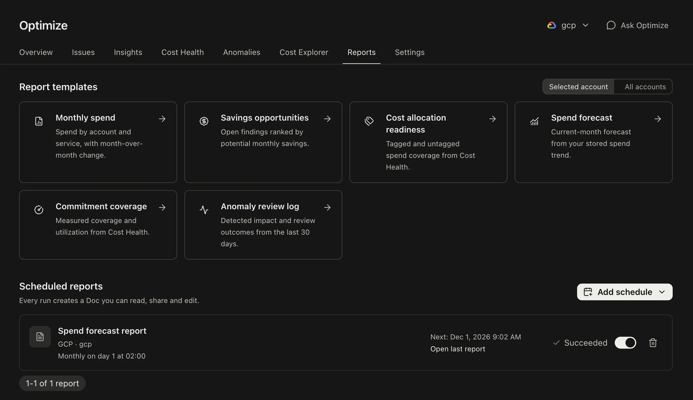
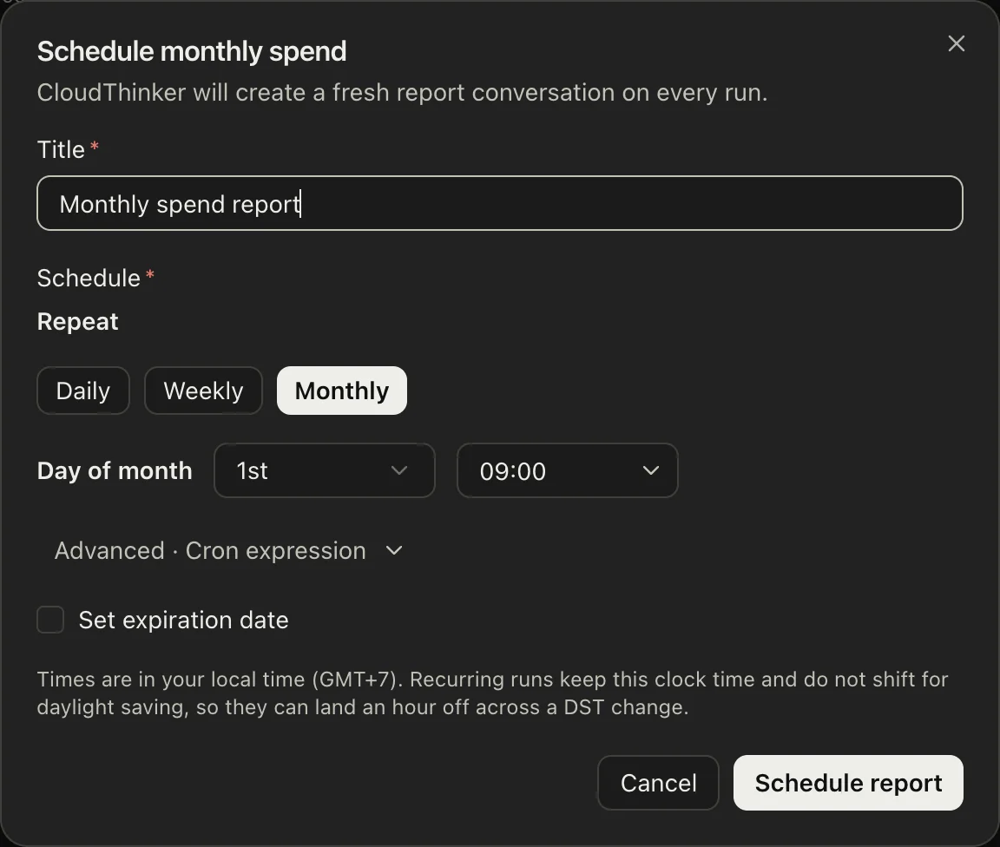

**Optimize → Reports**는 Optimize가 이미 저장한 비용 데이터를 월간 지출이나 절감 순위 같은 서면 보고서로 만듭니다. 내장 어시스턴트인 CloudThinker가 각 보고서를 새 대화에서 작성하고, 다시 열고 공유할 수 있는 보고서 [artifact](/ko/guide/artifacts/overview)로 저장합니다.

## 사전 요구사항

- 청구 데이터가 있는 Optimize 연결 하나 이상. [Optimize quickstart](/guide/cost-optimization/quickstart)를 참고하세요.
- 보고서를 생성하고 일정을 관리하려면 Developer 이상의 워크스페이스 역할. Viewer는 일정 목록과 **Open last report** 링크를 보고 **Library**에서 저장된 보고서를 읽을 수 있지만, 보고서를 생성하거나 일정을 변경할 수는 없습니다. [Roles](/guide/security/roles)를 참고하세요.
- 각 보고서는 CloudThinker 실행이므로 다른 에이전트 실행과 마찬가지로 [크레딧](/ko/guide/billing/usage)을 사용합니다. **All accounts**에 대한 일일 일정은 매일 실행되므로, 그 주기를 고르기 전에 잔액을 확인하세요.

## 보고서 선택

| 보고서 | 요약하는 내용 | 용도 |
|---|---|---|
| Monthly spend | 계정 및 서비스별 지출과 전월 대비 변화 | 월간 재무 또는 엔지니어링 검토 |
| Savings opportunities | 잠재 월간 절감액 순으로 정렬한 열린 결과 | 다음에 처리할 [결과](/ko/guide/cost-optimization/recommendations) 계획 |
| Cost allocation readiness | Cost Health의 태그된/태그되지 않은 지출 커버리지 | 지출을 팀에 차지백할 수 있는지 확인 |
| Spend forecast | 저장된 지출 추세에 기반한 이번 달 예측 | 계획을 초과해 끝날 달 파악 |
| Commitment coverage | Cost Health에서 측정한 커버리지와 사용률 | Savings Plans, 예약, 약정 사용 검토 |
| Anomaly review log | 최근 30일 동안 탐지된 영향과 검토 결과 | [비용 급증](/ko/guide/cost-optimization/anomalies)이 검토되었음을 보여주기 |

보고서는 Optimize가 이미 저장한 증거만 사용합니다. 보고서를 생성해도 새 데이터를 위해 클라우드 공급자를 호출하지 않으며, 없는 데이터는 0이 아니라 항상 공백으로 보고됩니다.

## 범위 선택

보고서 카드 위 오른쪽 상단의 **Selected account**와 **All accounts** 스위치를 사용하세요.

| 범위 | 포함하는 것 |
|---|---|
| Selected account | Optimize 페이지 헤더에서 현재 선택된 클라우드 계정 |
| All accounts | 보고서를 생성하거나 일정을 만드는 시점에 연결된 모든 Optimize 계정 |

계정마다 별도의 섹션이 생기며, Optimize는 서로 다른 통화를 절대 합산하지 않습니다. 일정은 생성 시 포함한 계정을 유지합니다. 나중에 연결한 계정은 추가되지 않으며, 포함된 계정의 연결이 나중에 해제되면 보고서에 공백으로 나타납니다.

## 지금 보고서 생성

<Steps>
  <Step title="Reports 열기">
    사이드바에서 **Optimize → Reports**를 선택합니다.

    <Frame caption="Reports: 여섯 개의 보고서 카드, 범위 스위치, Scheduled reports">
      
    </Frame>
  </Step>
  <Step title="범위 설정">
    **Selected account** 또는 **All accounts**를 선택합니다.
  </Step>
  <Step title="보고서 카드 선택">
    원하는 보고서의 카드를 선택합니다. 예: **Savings opportunities**.

    **성공 상태:** 새 대화가 열리고 CloudThinker가 작성을 시작합니다. 완료되면 보고서가 대화에 artifact로 나타납니다.
  </Step>
  <Step title="대화에서 다듬기">
    같은 대화에서 후속 질문을 하세요. CloudThinker는 같은 저장 데이터로 답합니다.

    ```text
    Turn the top five savings opportunities into a checklist with an owner column for the platform team.
    Which account changed the most month over month, and which services drove it?
    ```
  </Step>
</Steps>

일회성 보고서는 이미 대화 안에 있으므로 알림을 보내지 않습니다.

## 반복 보고서 예약

<Steps>
  <Step title="먼저 범위 설정">
    **Optimize → Reports**에서 **Selected account** 또는 **All accounts**를 선택합니다. 일정은 이 범위를 저장합니다.
  </Step>
  <Step title="일정 추가">
    **Scheduled reports** 아래에서 **Add schedule**을 선택하고 보고서 유형을 고릅니다.
  </Step>
  <Step title="이름 지정 및 주기 선택">
    원하면 **Title**을 편집한 뒤 **Repeat**에서 **Daily**, **Weekly**, **Monthly** 중 하나를 고릅니다. 그 밖의 일정은 **Advanced · Cron expression**을 열고 `0 9 * * 1-5` 같은 cron 표현식을 입력합니다. Daily는 시간을, Weekly는 요일과 시간을, Monthly는 날짜와 시간을 묻습니다. 기본값은 Monthly, 매월 1일 09:00입니다. **Monthly spend**에는 3일처럼 더 늦은 날을 고르세요. 공급자는 청구를 늦게 확정하고(AWS Cost Explorer는 24~48시간 지연될 수 있음), 보고서는 Optimize가 이미 저장한 청구 데이터만 사용하므로 1일에 실행하면 지난달이 실제보다 적게 나올 수 있습니다. 필요하면 **Set expiration date**를 체크해 특정 날짜 이후 일정이 멈추도록 합니다.

    시간은 대화 상자에 표시되는 브라우저의 로컬 시간대(예: **GMT+7**) 기준입니다. 반복 실행은 같은 시각을 유지하고 일광 절약 시간제에 맞춰 이동하지 않으므로, 일광 절약 시간제 전환 시점에는 한 시간 어긋날 수 있습니다.

    <Frame caption="Monthly spend 보고서 예약: 매월 1일 로컬 시간 09:00">
      
    </Frame>
  </Step>
  <Step title="저장">
    **Schedule report**를 선택합니다.

    **성공 상태:** 일정이 계정, 주기, **Next** 실행 시간과 함께 **Scheduled reports** 아래에 나타납니다. 첫 실행 전까지 상태는 **Not run**입니다.
  </Step>
</Steps>

예약된 실행마다 새 대화가 열립니다. 보고서가 저장되면 실행은 **Succeeded**, 그렇지 않으면 **Failed**입니다.

실행이 성공하면 일정 소유자만 앱에서 대화 링크가 포함된 **Optimize report ready** 알림을 받습니다. 이 알림의 이메일은 기본적으로 꺼져 있으며, **Settings → Personal → Notifications**에서 켤 수 있습니다. 실패한 실행은 아무것도 보내지 않으므로 목록에서 상태를 확인하세요. 일정은 보고서를 배포 목록으로 이메일 발송하지 않습니다. 재무팀이나 다른 팀에 전달하려면 **Library**에 대한 워크스페이스 접근 권한을 주거나 공개 링크를 보내세요(아래 참고).

## 일정 관리

**Scheduled reports** 아래 각 행에는 마지막 실행 상태(**Running**, **Succeeded**, **Failed**)가 표시되며 다음 제어를 제공합니다.

| 제어 | 동작 |
|---|---|
| 스위치 | 삭제하지 않고 일정을 켜거나 끕니다 |
| **Open last report** | 최근 실행의 대화를 엽니다 |
| 휴지통 아이콘 | 확인 후 일정을 삭제합니다. 이전 보고서 대화는 남습니다. |

편집 기능은 없습니다. 일정의 범위나 주기를 바꾸려면 삭제하고 새로 만드세요. 이전 일정의 보고서는 **Library**와 해당 대화에 남지만, 새 일정의 **Open last report**는 자신의 실행만 가리킵니다.

## 보고서 공유 또는 내보내기

모든 보고서는 [Library](/ko/guide/artifacts/overview)(사이드바의 **More → Library**)에 저장되며, 워크스페이스 멤버가 열고 다운로드할 수 있습니다.

워크스페이스 밖의 사람에게는 **Library**의 보고서 카드나 artifact 페이지 상단에서 **Share**를 선택한 뒤, **Public link** 아래 **Anyone with the link can view**를 켜세요. URL이 있는 누구나 로그인 없이 열 수 있으며, 링크를 끌 때까지 유효합니다. 공개 링크는 Developer와 Admin만 만들 수 있습니다. [Sharing](/guide/sharing)을 참고하세요.

<Note>
보고서에는 계정 ID, 지출 수치, 리소스 이름, 아키텍처 세부 정보가 표시됩니다. 공개 링크를 만들기 전에 외부인의 시선으로 읽어 보세요.
</Note>

현재 결과나 Cost Health의 PDF가 필요하면 **Issues** 또는 **Cost Health** 페이지의 **More Optimize actions**(⋯) 메뉴에서 **Download PDF**를 사용하세요.

## 보고서가 주장하지 않는 것

CloudThinker는 보고서마다 저장된 Optimize 데이터의 고정 스냅샷 하나를 받습니다. 보고서는 데이터가 얼마나 최신인지 밝히고, 부분적인 커버리지나 누락된 계정을 명시합니다. 실현된 절감액이나 ROI, 예산 차이, 구매 조언, 또는 데이터가 뒷받침할 수 없는 근본 원인은 주장하지 않습니다.

## 문제 해결

<AccordionGroup>
  <Accordion title="Add schedule이 잠겨 있거나 보고서 카드가 동작하지 않음">
    **원인:** 보고서 생성과 예약에는 Developer 이상의 워크스페이스 역할이 필요합니다. 툴팁에 "You don't have permission to schedule reports."가 표시됩니다. **해결:** 워크스페이스 Admin에게 [Workspace users](/ko/guide/workspace-users)에서 역할을 변경해 달라고 요청하세요.
  </Accordion>
  <Accordion title="보고서에 데이터가 없거나 오래되었다고 표시됨">
    **원인:** 계정의 청구 새로 고침이 실패했거나 아직 실행되지 않았습니다. **해결:** 해당 계정의 **Optimize → Overview**를 열고 새로 고침 알림을 따른 뒤 보고서를 다시 생성하세요.
  </Accordion>
  <Accordion title="예약된 실행이 Failed로 표시됨">
    **원인:** 실행이 보고서를 저장하지 못하고 끝났습니다. **해결:** 해당 카드에서 같은 보고서를 지금 생성해 대화에서 오류를 확인하세요. 성공하면 다음 예약 실행도 성공할 것입니다.
  </Accordion>
  <Accordion title="새 계정이 All accounts 일정에 없음">
    **원인:** 일정은 생성 시 포함한 계정을 유지합니다. **해결:** 일정을 삭제하고 **All accounts**를 선택한 상태에서 다시 만드세요.
  </Accordion>
</AccordionGroup>

## 다음 단계

<CardGroup cols={2}>
  <Card title="Optimize 결과" icon="lightbulb" href="/ko/guide/cost-optimization/recommendations">
    절감 기회 보고서의 바탕이 되는 결과를 처리합니다
  </Card>
  <Card title="Notifications" icon="bell" href="/ko/guide/notifications">
    보고서 준비 알림을 받을 위치를 선택합니다
  </Card>
</CardGroup>
