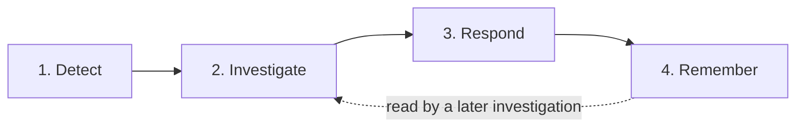

import { ResolveScene } from '/snippets/iso/resolve.jsx';

**근본 원인을 찾습니다. 몇 분 만에.**

Resolve는 프로덕션 인시던트를 위한 Frontier Investigation Agent입니다. 사용 중인 도구가 이미 보내는 알림을 받아 노이즈를 걸러 내고, 남은 것을 근본 원인까지 조사하며, 인시던트에 사람이 필요할 때만 사람을 부릅니다. 시작하려면 알림 소스 하나가 필요합니다. CloudThinker가 검증할 수 있는 근본 원인을 얻으려면 알림의 대상인 클라우드 또는 옵저버빌리티 계정도 연결하세요.

<ResolveScene />

## 작동 방식

Resolve 안에서 알림은 네 단계를 거칩니다. 이 단계들은 [AgenticOps field guide](/ko/learn/aio/chapter-4-architecture)에서 설명하는 플랫폼 루프를 Resolve에 맞게 구현한 것입니다.

| 단계 | 일어나는 일 | 확인하는 곳 |
|---|---|---|
| 1. Detect | 탐지 계층인 [Signals](/ko/guide/pulse/overview)가 알려진 노이즈를 억제하고 관련 알림을 클러스터로 묶어, 장애 하나가 항목 하나가 되도록 합니다. | **Resolve → Signals** |
| 2. Investigate | CloudThinker가 조치 가능한 각 클러스터를 분류(triage)하고, 인시던트를 열거나 다시 열고, 연결된 시스템 전반에서 근본 원인 분석(RCA)을 실행합니다. | **Resolve → Issues** |
| 3. Respond | [On-call](/guide/incident/oncall)을 켜면 사람이 필요할 때 대응자를 위한 Incident Room을 엽니다. 기본적으로 꺼져 있습니다. CloudThinker가 실행하는 모든 수정은 runbook 명령을 포함하여 [Approvals](/guide/approvals/overview)를 거칩니다. 새 워크스페이스는 **Auto · Rules + AI · Ask me**로 시작합니다. 어떤 Rule도 허용하지 않는 쓰기는 AI가 안전하다고 판단할 때만 실행되고, 그렇지 않으면 사람을 기다립니다. runbook의 **Require Approval** 효과는 runbook 명령 효과가 활성화된 곳에서만 적용됩니다([Runbooks](/ko/guide/incident/runbooks#명령-효과-제어) 참조). 모든 변경을 직접 승인하려면 **Manual**을 선택하세요. [what you get out of the box](/guide/approvals/overview#what-you-get-out-of-the-box)를 참조하세요. | Incident Room, Slack war room |
| 4. Remember | CloudThinker가 이후 조사가 시작할 때 읽는 [인시던트 메모리](/ko/guide/incident/incident-memory)를 작성합니다. 이를 보거나 편집하는 화면은 없으며, 새 증거가 들어오면 CloudThinker가 직접 항목을 수정합니다. | 과거 인시던트를 인용하는 이후 RCA 결과 |

모든 인시던트가 모든 단계에 도달하는 것은 아닙니다. 조사가 근본 원인 없이 끝날 수 있으며, **Track only** 인시던트(실제이지만 긴급하지 않아 아무도 호출되지 않음)는 사람이 올리지 않는 한 대기열에 남습니다.

## 이 순서로 설정

Resolve 설정과 통합을 변경하려면 워크스페이스 **Admin** 역할이 필요합니다. [역할](/guide/security/roles)을 참조하세요.

1. **알림 소스 연결.** 모니터링 도구가 Resolve로 보내도록 설정하거나, 먼저 [quickstart](/guide/incident/quickstart)로 테스트 소스를 사용해 보세요. [Connect alert sources](/guide/incident/connect-alert-sources)에서 도구가 사용하는 경로를 찾고, [Connect Pulse sources](/ko/guide/pulse/setup)에서 단계를 확인하세요.
2. **AI auto-investigate 결정.** 새 워크스페이스에서는 켜져 있으므로 CloudThinker가 스스로 분류하고 조사합니다. 첫 실제 소스를 연결하고 조정하는 동안 끈 다음 다시 켜세요. [아래](#조사를-시작할-주체-선택)를 참조하세요.
3. **On-call 설정.** 대응자와 선택적으로 Slack war room을 고르세요. [On-call](/guide/incident/oncall)을 참조하세요.
4. **Approvals 정책 검토.** 어떤 수정이 스스로 실행되고 어떤 수정이 사람을 기다릴지 결정합니다. [Approvals](/guide/approvals/overview)를 참조하세요.

## Overview에서 시작

**Resolve → Overview**를 열면 지금 사용자가 처리해야 할 것과 Resolve가 혼자 처리한 것을 볼 수 있습니다. 페이지는 **At a glance** 아래의 숫자 네 개로 시작합니다.

| 타일 | 표시 내용 |
|---|---|
| **Time to resolve** | 최근 7일간 인시던트 해결까지의 평균 시간 |
| **Time to root cause** | CloudThinker가 근본 원인에 도달한 속도 |
| **Causes confirmed** | 30일 동안 사람이 검토한 근본 원인 중 확인한 비율 |
| **Events filtered** | 30일 동안 인시던트가 되지 않은 원시 이벤트의 비율 |

타일 아래의 **Needs attention**에는 사람을 기다리는 인시던트가, **In progress**에는 CloudThinker가 지금 작업 중인 인시던트가 나열됩니다. **All insights**를 누르면 추세, 서비스별 행, 이벤트에서 인시던트까지의 퍼널이 있는 [Insights](/guide/incident/insights)가 열립니다.

| 퍼널 단계 | 의미 |
|---|---|
| **Event** | CloudWatch 알람 같은 소스의 원시 알림 하나 |
| **Signal** | 노이즈 억제를 통과한 이벤트 |
| **Cluster** | 하나의 문제로 취급되는 관련 신호 묶음 |
| **Incident** | 조치 가능한 클러스터가 등록되는 레코드이자 사람이 직접 기록하는 레코드. CloudThinker가 이를 조사합니다. |

[Signals](/ko/guide/pulse/overview)는 처음 세 단계를 자세히 다룹니다.

## 조사를 시작할 주체 선택

CloudThinker의 자율성 스위치인 **AI auto-investigate**는 **Resolve → Issues**의 제목 행에 있습니다. 이는 사람의 on-call 순번이 아닙니다. 새 워크스페이스에서는 켜져 있으며, 워크스페이스 Admin만 변경할 수 있습니다. [Resolve settings](/guide/incident/settings)에 다른 모든 Resolve 제어의 위치가 나열되어 있습니다.

| 스위치 상태 | 동작 |
|---|---|
| On | CloudThinker가 탐지하고, 조치 가능한 각 클러스터를 분류하고, 스스로 조사합니다. 각 분류와 조사는 [credits](/ko/guide/billing/usage)를 사용하는 실행이므로, 노이즈가 많은 소스일수록 비용이 더 듭니다. |
| Off | CloudThinker는 계속 알림을 탐지하고 묶으며, 조치 가능한 클러스터는 여전히 검토용으로 **Open** 상태의 인시던트로 등록됩니다. CloudThinker는 스스로 분류하거나 조사하지 않으며, 각 인시던트는 누군가 **Investigate**를 클릭할 때까지 기다립니다. 사람이 기록하거나 에스컬레이션한 인시던트는 여전히 즉시 조사됩니다. |

웹훅별 옵션, 기록된 인시던트, 수동 시작은 이 동작을 바꿉니다. [What starts an investigation](/guide/incident/settings#what-starts-an-investigation)에 전체 규칙이 표 하나로 정리되어 있습니다.

**Send to triage**, **Investigate**, **Log Incident**는 스위치 설정과 관계없이 항상 작동합니다.

## 할 수 있는 일

| 작업 | 다루는 내용 | 읽을 문서 |
|---|---|---|
| 처음부터 끝까지 사용해 보기 | 테스트 알림을 보내고 Signals에서 인시던트까지 따라가기 | [Resolve quickstart](/guide/incident/quickstart) |
| 따라 하기 안내 | 첫 알림부터 검증된 근본 원인, 승인된 수정, 종료된 인시던트까지 하나의 프로덕션 인시던트 | [Investigate a checkout incident end to end](/guide/use-cases/resolve-checkout-incident) |
| 알림 소스 연결 | 도구가 Resolve로 들어오는 경로: 웹훅, AWS 폴링, 또는 채팅 채널 | [Connect alert sources](/guide/incident/connect-alert-sources) |
| Resolve가 다시 게시할 내용 선택 | 후속 티켓, 포스트모템, 채팅 업데이트, 플랫폼별 준비 상태 배지 | [Triggers & Outcomes](/guide/incident/triggers-and-outcomes#outcomes) |
| 알림 피드 처리 | 레인, 클러스터, Escalate, Link to incident, snooze | [Signals](/ko/guide/pulse/overview) |
| 근본 원인 읽기 | 판정, 신뢰도, 증거, 타임라인, 수정 제안 | [Investigation and RCA](/ko/guide/incident/root-cause-analysis) |
| 사람 참여시키기 | 대응자, 호출, Incident Room, Slack war room | [On-call](/guide/incident/oncall) |
| Signals가 보지 못한 것 기록 | 고객 보고나 운영자의 직감 | [Log an incident](/ko/guide/incident/manual-logging) |
| 수정 관리 | 어떤 작업이 스스로 실행되고 어떤 작업이 사람을 기다리는지 | [Approvals](/guide/approvals/overview) |
| 수정 절차 추가 | RCA 중에 읽는 Confluence, GitHub, GitLab, 또는 Markdown의 작성된 절차. Runbooks는 계속 작동하며, 사이드바에서 **Legacy**로 표시됩니다. | [Runbooks](/ko/guide/incident/runbooks) |
| 알림이 놓친 것 잡기 | 어떤 알림 규칙도 잡지 못한 인시던트를 위해 CloudThinker가 작성하고 백테스트하는 모니터로, 기존 알림과 함께 실행됩니다 | [Detectors](/guide/incident/detectors) |
| 결과 측정 | 추세, 정확도, 서비스별 안정성 | [Insights](/guide/incident/insights) |
| 동작 조정 | 모든 Resolve 제어와 그 위치 | [Settings](/guide/incident/settings) |

## 시작하기

<CardGroup cols={2}>
  <Card title="Resolve quickstart" icon="rocket" href="/guide/incident/quickstart">
    테스트 알림을 보내고 약 10분 안에 Signals가 이를 인시던트로 바꾸는 과정을 지켜봅니다.
  </Card>
  <Card title="소스 연결" icon="plug" href="/guide/incident/triggers-and-outcomes#triggers">
    기존 모니터링 도구가 Resolve로 보내도록 설정합니다.
  </Card>
  <Card title="On-call 설정" icon="users" href="/guide/incident/oncall">
    인시던트에 사람이 필요할 때 Incident Room에 참여할 사람을 선택합니다.
  </Card>
  <Card title="조사 읽기" icon="magnifying-glass" href="/ko/guide/incident/root-cause-analysis">
    RCA 결과의 각 부분이 무엇을 의미하는지와 이에 따라 조치하는 방법을 알아봅니다.
  </Card>
</CardGroup>
