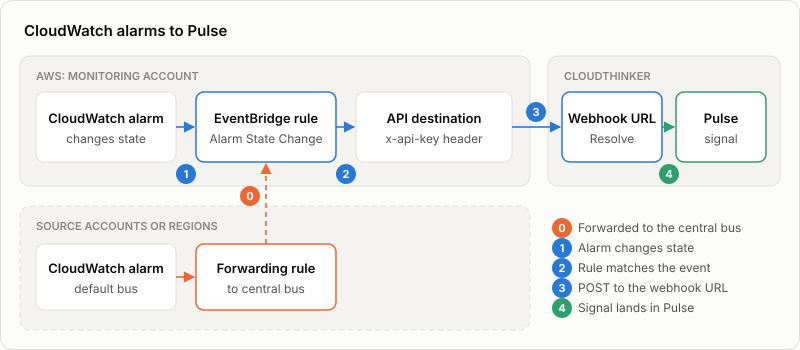
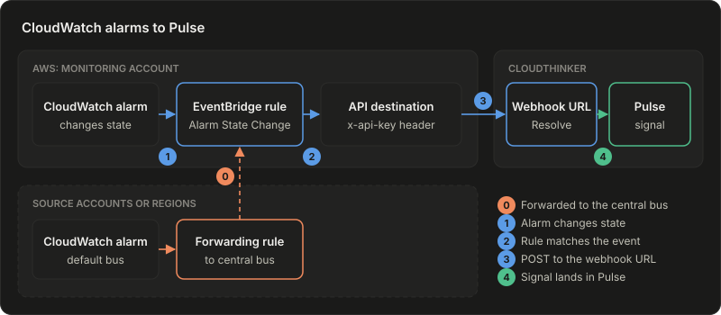

이 가이드는 모든 CloudWatch 알람 상태 변경을 Resolve로 보내, CloudThinker가 몇 초 안에 알람을 보고 인시던트를 열어 근본 원인 분석(RCA)을 시작할 수 있게 합니다. 전달은 Amazon EventBridge가 담당하므로 Lambda 함수도, 유지 관리할 코드도 없습니다.

## 동작 방식

<Frame caption="알람 상태 변경은 하나의 EventBridge 규칙과 API destination을 통해 Pulse에 도달하며, 다른 계정은 중앙 버스로 전달할 수 있습니다.">
  
  
</Frame>

알람 상태가 바뀌면 EventBridge가 이벤트를 CloudThinker 웹훅 URL로 전달합니다. Resolve는 이를 [Pulse](/ko/guide/pulse/overview)의 **signal**(노이즈 억제를 통과한 이벤트)로 바꿉니다. Pulse는 관련 signal을 하나의 문제인 **cluster**로 묶고, triage가 조치할 만한 cluster를 인시던트로 만들지 결정합니다.

## 사전 요구사항

- 워크스페이스 **Admin** 역할. Developer와 Viewer는 Resolve Triggers & Outcomes를 볼 수 있지만 추가하거나 변경할 수 없습니다. [Roles](/guide/security/roles)를 참고하세요.
- EventBridge connection, API destination, 규칙을 만들 수 있는 AWS 계정.
- 설정하는 리전에 CloudWatch 알람 하나 이상.
- 시뮬레이션 알람으로 테스트하려면(권장) AWS CLI. 호출자에게 IAM 권한 `cloudwatch:SetAlarmState`가 필요합니다.

## CloudThinker에서 웹훅 만들기

<Steps>
  <Step title="AWS 플랫폼 열기">
    **Resolve → Triggers & Outcomes**로 이동해 **Amazon Web Services**를 선택합니다. **Signals to Resolve** 아래에서 **Add signal**을 클릭합니다. AWS CloudWatch 프리셋으로 **Create Webhook** 대화 상자가 열립니다.

    AWS 연결이 먼저 있을 필요는 없습니다. 연결이 없으면 플랫폼에 **Not configured** 또는 **Needs setup**이 표시되며(**Needs connection**은 표시되지 않음), **Add signal**은 여전히 동작합니다. [AWS 연결](/ko/guide/connections/aws)은 RCA 중에 CloudThinker가 영향받는 리소스를 조회하게 하려는 경우에만 필요합니다.
  </Step>
  <Step title="Basic Info">
    기본 **Webhook Name**을 유지하거나 이름을 바꿉니다. 예: `Production CloudWatch`. **Next**를 클릭합니다.
  </Step>
  <Step title="Configure">
    **Field Mapping**과 **Severity Mapping**은 EventBridge 이벤트에 맞게 미리 채워져 있습니다(아래 표 참고). 첫 설정에서는 그대로 두세요. 프로덕션 계정이라면 지금 `INSUFFICIENT_DATA`를 낮추는 것을 고려하세요([필드 및 심각도 매핑](#필드-및-심각도-매핑) 참고). **Next**를 클릭합니다.
  </Step>
  <Step title="Advanced">
    **Auth Method**는 그대로 두세요. EventBridge가 보내는 방식인 헤더 `x-api-key`의 **API Key**입니다. 그런 다음 두 가지 옵션을 결정합니다.

    | 옵션 | 기본값 | 변경할 때 |
    |---|---|---|
    | **Auto-investigate** | 켜짐 | 알람이 Pulse에서 묶이기만 하고 사람이 조치할 때까지 아무것도 시작하지 않기를 원할 때. 끄세요. |
    | **Only from a minimum severity** | 꺼짐 | 일부 알람만 조사를 시작하게 하고 싶을 때. 켜고 수준을 고르세요. 예: **High and above**. |

    둘 다 기본값이면 인시던트가 되는 모든 알람이 조사를 시작합니다. [Webhook options](/ko/guide/pulse/setup#동작을-바꾸는-웹훅-옵션)를 참고하세요. **Create**를 클릭합니다.
  </Step>
  <Step title="URL과 시크릿 복사">
    열리는 대화 상자에서 **Webhook URL**과 **API Secret**을 복사합니다. URL은 EventBridge API destination에, **API Secret**은 connection의 API key **Value**에 들어갑니다.
  </Step>
  <Step title="속도 제한 올리기 (프로덕션)">
    **Signals to Resolve** 아래에서 웹훅의 **...** 메뉴를 열고 **Edit**를 선택한 뒤, **Rate limit (requests per hour)**를 최소 `3600`으로 설정합니다. 기본값 1,000은 초당 1개 이벤트를 보내는 API destination이 알람 폭주 시 도달할 수 있는 양보다 낮으며, 한도를 넘는 이벤트는 오류 없이 버려집니다. **Create Webhook** 대화 상자에는 이 필드가 없습니다.
  </Step>
</Steps>

**성공 상태:** Amazon Web Services 플랫폼의 **Signals to Resolve** 아래에 웹훅이 나타나고, 플랫폼의 [readiness badge](/guide/incident/triggers-and-outcomes#read-readiness)에 **Ready**가 표시됩니다. **Ready**는 웹훅이 설정되고 활성화되었다는 뜻일 뿐, 알람이 도착했다는 증거는 아니므로 아래 [테스트](#통합-테스트)를 실행하세요.

<Warning>
**API Secret**은 한 번만 표시됩니다. 복사하지 않고 대화 상자를 닫았다면 **Signals to Resolve** 아래에서 웹훅의 **...** 메뉴를 열고 **Regenerate credentials**를 선택하세요. 그러면 시크릿과 **Webhook URL**이 모두 교체되고, 이전 쌍은 즉시 동작을 멈춥니다. 바로 이어서 EventBridge connection의 **Value**와 API destination의 엔드포인트를 업데이트하세요.
</Warning>

## AWS에서 EventBridge 설정

알람과 같은 리전의 AWS 콘솔에서 다음 단계를 수행합니다.

<Steps>
  <Step title="Connection 만들기">
    **Amazon EventBridge → Integration → Connections**를 열고 **Create connection**을 클릭합니다. 다음과 같이 설정합니다.

    | 필드 | 값 |
    |---|---|
    | Name | `cloudthinker-webhook` |
    | Authorization type | API Key |
    | API key name | `x-api-key` |
    | Value | CloudThinker의 **API Secret** |
  </Step>
  <Step title="API destination 만들기">
    **Integration → API destinations**를 열고 **Create API destination**을 클릭합니다. 다음과 같이 설정합니다.

    | 필드 | 값 |
    |---|---|
    | Name | `cloudthinker-resolve` |
    | API destination endpoint | CloudThinker의 **Webhook URL** |
    | HTTP method | `POST` |
    | Connection | `cloudthinker-webhook` |

    **Invocation rate limit per second**를 `1`로 설정합니다. 위에서 [웹훅의 속도 제한을 올렸는지](#cloudthinker에서-웹훅-만들기) 확인하세요.
  </Step>
  <Step title="규칙 만들기">
    **Rules**를 열고 **default** event bus를 선택한 뒤 **Create rule**을 클릭합니다. **Rule with an event pattern**을 선택하고 다음 패턴을 붙여넣습니다.

    ```json
    {
      "source": ["aws.cloudwatch"],
      "detail-type": ["CloudWatch Alarm State Change"]
    }
    ```

    대상으로 **EventBridge API destination**을 선택하고 `cloudthinker-resolve`를 고른 뒤, **Execution role**에서 **Create a new role for this specific resource**를 선택합니다(`events:InvokeApiDestination` 권한을 받음).

    선택 사항이지만 프로덕션에 권장: 대상의 **Additional settings**에서 재시도 정책과 dead-letter queue를 설정해, 장애 중 전달에 실패한 알람이 사라지지 않고 보관되게 하세요. **Maximum age of event** 1시간, **Retry attempts** 10이 좋은 출발점입니다. 한 시간이 지난 알람은 새로 조사할 가치가 거의 없습니다. SQS 큐를 dead-letter queue로 연결합니다. **Create rule**을 클릭합니다.
  </Step>
</Steps>

**성공 상태:** 규칙이 API destination을 대상으로 **Enabled** 상태로 표시됩니다.

## 통합 테스트

테스트 알람은 실제 알람처럼 처리됩니다. **Auto-investigate**가 켜져 있으면 인시던트가 열리고 CloudThinker가 조사를 시작합니다. 전달만 테스트하려면 먼저 이 웹훅의 **Auto-investigate**를 끄고(**...** 메뉴 → **Edit**), 끝난 뒤 다시 켜세요. 운영 중인 워크스페이스에서 이 목적으로 **AI auto-investigate**를 끄지 마세요. 이 소스만이 아니라 모든 소스의 자동 triage와 조사가 멈춥니다([What starts an investigation](/guide/incident/settings#what-starts-an-investigation) 참고).

<Steps>
  <Step title="알람 강제 발생">
    `YourAlarmName`을 현재 `OK` 상태인 실제 알람으로, `us-east-1`을 알람의 리전으로 바꾸세요. 리전이 틀리면 alarm-not-found 오류로 실패합니다. CloudWatch는 상태가 실제로 바뀔 때만 이벤트를 보내므로, 이미 `ALARM` 상태인 알람은 아무것도 보내지 않습니다. 그렇다면 먼저 `OK`로 설정한 뒤 `ALARM`으로 바꾸세요.

    ```bash
    aws cloudwatch set-alarm-state \
      --alarm-name "YourAlarmName" \
      --region us-east-1 \
      --state-value ALARM \
      --state-reason "Testing CloudThinker integration"
    ```
  </Step>
  <Step title="Pulse 확인">
    **Resolve → Signals**를 엽니다. 몇 초 안에 알람 이름을 제목으로 하고 **High** 심각도로 표시된 signal이 나타납니다.
  </Step>
  <Step title="알람 재설정">
    같은 명령을 `--state-value OK`로 실행합니다. 그러면 CloudWatch가 다시 정상적으로 알람을 평가합니다. 다음 평가 때 알람이 스스로 `OK`로 돌아갈 수도 있으므로, 재설정하기 전에 `OK` signal이 도착할 수 있습니다.

    `OK` 이벤트는 **Info** signal로 도착합니다. Pulse의 분류기는 복구를 조치 대상이 아닌 것으로 보므로 보통 두 번째 인시던트를 열지 않습니다. 이 판단은 모델의 판단이므로 복구가 triage까지 갈 수도 있습니다. 또한 `ALARM`이 연 인시던트를 해결하지 않습니다. 그 인시던트는 누군가 종료할 때까지 열려 있습니다.
  </Step>
</Steps>

**성공 상태:** signal의 제목에 알람 이름, 설명에 상태 사유, 서비스에 지표 네임스페이스(예: `AWS/EC2`)가 표시됩니다.

## 필드 및 심각도 매핑

프리셋은 EventBridge 이벤트에서 다음 필드를 읽습니다.

| 필드 | 경로 | 예시 값 |
|---|---|---|
| **Title Path** | `detail.alarmName` | `HighCPUUtilization` |
| **Description Path** | `detail.state.reason` | `Threshold Crossed: 1 out of the last 1 datapoints [85.0] was greater than the threshold (80.0)` |
| **Severity Path** | `detail.state.value` | `ALARM` |
| **Service Path** | `detail.configuration.metrics[0].metricStat.metric.namespace` | `AWS/EC2` |

| CloudWatch 상태 | CloudThinker 심각도 |
|---|---|
| `ALARM` | High |
| `INSUFFICIENT_DATA` | Medium |
| `OK` | Info |

기본값에서는 `INSUFFICIENT_DATA` 깜빡임(예: 배포 후 지표 공백)이 조사를 시작할 수 있습니다. 이를 막으려면 **Severity Mapping**에서 `INSUFFICIENT_DATA` 행을 찾아 **Maps To** 드롭다운을 열고 **Low** 또는 **Info**를 고르세요. 또는 **Only from a minimum severity**를 켜고 **High and above**를 고르세요.

Pulse의 노이즈 한도(분당 알림 100개)는 Critical과 High는 항상 통과시키지만 폭주 시 나머지는 버릴 수 있습니다. 잃으면 안 되는 상태는 **High** 이상으로 매핑하세요.

알람을 critical로 만들고 싶나요? 웹훅을 편집해 **Severity Mapping**의 `ALARM` 행을 바꾸세요. 매핑은 웹훅이 받는 모든 알람에 적용됩니다. 프로덕션과 비프로덕션을 다르게 다루려면 웹훅 두 개와 EventBridge 규칙 두 개를 만들고, 각각 알람 이름 접두사로 필터링하세요([필요한 알람만 보내기](#필요한-알람만-보내기) 참고). 매핑 행이 없는 상태는 Medium으로 처리됩니다.

Composite 알람과 metric-math 알람에는 `metricStat` 블록이 없으므로 **Service**가 `unknown`으로 나옵니다. 이런 알람에 의존한다면 **Service Path**를 `detail.alarmName`처럼 해당 알람에 있는 필드로 지정하고, 알람 이름을 서비스 이름을 따라 지으세요. 한 알람의 반복은 **Service** 값과 관계없이 알람의 ARN으로 묶입니다. 그래도 **Service**는 중요합니다. 6시간 안에 같은 **Service** 값을 공유하는 알람은 하나의 cluster로 합쳐질 수 있으므로, 함께 울린 서로 다른 두 `AWS/EC2` 알람이 같은 cluster에 들어갈 수 있습니다. [How signals join a cluster](/ko/guide/pulse/clusters#신호가-클러스터에-합류하는-방식)를 참고하세요.

## 필요한 알람만 보내기

CloudThinker에서 필터링하지 말고 EventBridge 규칙의 이벤트 패턴을 좁히세요. 기본 패턴에 `detail` 블록을 추가합니다.

| 목표 | 패턴에 추가 |
|---|---|
| `prod-*`라는 이름의 알람만 | `"detail": { "alarmName": [{ "prefix": "prod-" }] }` |
| 복구 건너뛰기 | `"detail": { "state": { "value": ["ALARM", "INSUFFICIENT_DATA"] } }`. `OK` signal이 사라지므로 Pulse에 알람이 해제된 시점이 더 이상 표시되지 않습니다. |

## 둘 이상의 리전 또는 계정

CloudWatch는 알람 자체의 리전과 계정에 있는 EventBridge로만 알람 이벤트를 보냅니다. 다음 구성 중 하나를 고르세요.

| 구성 | 만드는 것 | 적합한 경우 |
|---|---|---|
| 리전별 규칙 | 모든 리전과 계정에 connection, API destination, 규칙을 만들고 모두 같은 웹훅 URL을 가리킴 | 한 계정의 몇 개 리전 |
| 중앙 event bus | 각 소스 리전 또는 계정에 알람 이벤트를 하나의 모니터링 계정의 event bus로 전달하는 규칙. connection과 API destination은 그 계정에만 존재 | AWS Organizations 또는 많은 계정 |

### CloudFormation으로 배포

이 템플릿은 connection, API destination, 규칙, dead-letter queue를 만들고, 모니터링할 수 있도록 큐 URL을 출력합니다. 리전별 구성에서는 각 계정과 리전에 배포하고(예: StackSets 사용), 중앙 버스 구성에서는 `EventBusName`을 그 버스로 설정해 모니터링 계정에 한 번 배포합니다.

각 계정과 리전에서 웹훅마다 스택 하나를 배포하세요. 같은 리전에서 prod와 non-prod 알람을 두 웹훅으로 보내려면 서로 다른 `NamePrefix` 값으로 두 번 배포하고, 각 규칙의 패턴을 좁히세요([필요한 알람만 보내기](#필요한-알람만-보내기) 참고).

```yaml
AWSTemplateFormatVersion: "2010-09-09"
Parameters:
  NamePrefix:
    Type: String
    Default: cloudthinker
    Description: Prefix for the connection and API destination names. Unique per stack in a region.
  EventBusName:
    Type: String
    Default: default
    Description: The bus that receives the alarm events. Use your central bus name for the central layout.
  WebhookUrl:
    Type: String
    Description: The Webhook URL from the CloudThinker webhook dialog
  ApiSecret:
    Type: String
    NoEcho: true
    Description: The API Secret from the CloudThinker webhook dialog
Resources:
  DeadLetterQueue:
    Type: AWS::SQS::Queue
    Properties:
      MessageRetentionPeriod: 1209600
  DeadLetterQueuePolicy:
    Type: AWS::SQS::QueuePolicy
    Properties:
      Queues: [!Ref DeadLetterQueue]
      PolicyDocument:
        Version: "2012-10-17"
        Statement:
          - Effect: Allow
            Principal: { Service: events.amazonaws.com }
            Action: sqs:SendMessage
            Resource: !GetAtt DeadLetterQueue.Arn
            Condition:
              ArnEquals: { "aws:SourceArn": !GetAtt AlarmRule.Arn }
  Connection:
    Type: AWS::Events::Connection
    Properties:
      Name: !Sub "${NamePrefix}-webhook"
      AuthorizationType: API_KEY
      AuthParameters:
        ApiKeyAuthParameters:
          ApiKeyName: x-api-key
          ApiKeyValue: !Ref ApiSecret
  Destination:
    Type: AWS::Events::ApiDestination
    Properties:
      Name: !Sub "${NamePrefix}-resolve"
      ConnectionArn: !GetAtt Connection.Arn
      InvocationEndpoint: !Ref WebhookUrl
      HttpMethod: POST
      InvocationRateLimitPerSecond: 1
  InvokeRole:
    Type: AWS::IAM::Role
    Properties:
      AssumeRolePolicyDocument:
        Version: "2012-10-17"
        Statement:
          - Effect: Allow
            Principal: { Service: events.amazonaws.com }
            Action: sts:AssumeRole
      Policies:
        - PolicyName: invoke-cloudthinker
          PolicyDocument:
            Version: "2012-10-17"
            Statement:
              - Effect: Allow
                Action: events:InvokeApiDestination
                Resource: !GetAtt Destination.Arn
  AlarmRule:
    Type: AWS::Events::Rule
    Properties:
      EventBusName: !Ref EventBusName
      EventPattern:
        source: ["aws.cloudwatch"]
        detail-type: ["CloudWatch Alarm State Change"]
      Targets:
        - Id: cloudthinker
          Arn: !GetAtt Destination.Arn
          RoleArn: !GetAtt InvokeRole.Arn
          RetryPolicy:
            MaximumEventAgeInSeconds: 3600
            MaximumRetryAttempts: 10
          DeadLetterConfig:
            Arn: !GetAtt DeadLetterQueue.Arn
Outputs:
  DeadLetterQueueUrl:
    Value: !Ref DeadLetterQueue
```

AWS CLI로 배포합니다. 먼저 시크릿을 환경 변수로 읽으세요(`read -rs`는 값을 화면에 표시하지 않고 셸 기록에도 남기지 않습니다).

```bash
read -rs CT_API_SECRET   # paste the API Secret, then press Enter
aws cloudformation deploy \
  --stack-name cloudthinker-cloudwatch \
  --template-file cloudthinker-cloudwatch.yaml \
  --capabilities CAPABILITY_IAM \
  --parameter-overrides \
    WebhookUrl="https://your-webhook-url" \
    ApiSecret="$CT_API_SECRET"
```

connection은 EventBridge가 대신 만들고 관리하는 AWS Secrets Manager 시크릿에 API key를 저장하므로, 시크릿이 템플릿이나 규칙에 남지 않습니다. 재시도 후에도 실패한 알람은 SQS dead-letter queue에 들어가 14일 동안 보관됩니다.

### 중앙 버스로 알람 전달

중앙 구성에서는 위 템플릿을 `EventBusName`을 버스로 설정해 모니터링 계정에 배포합니다. 그런 다음 두 가지를 추가합니다.

모니터링 계정에서 조직이 이벤트를 넣을 수 있도록 중앙 버스에 리소스 정책을 부여합니다. 버스 이름, 리전, 계정 ID, 조직 ID를 바꾸세요.

```json
{
  "Version": "2012-10-17",
  "Statement": [{
    "Sid": "AllowOrgPutEvents",
    "Effect": "Allow",
    "Principal": "*",
    "Action": "events:PutEvents",
    "Resource": "arn:aws:events:us-east-1:111111111111:event-bus/central-alarms",
    "Condition": { "StringEquals": { "aws:PrincipalOrgID": "o-exampleorgid" } }
  }]
}
```

각 소스 계정과 리전에서 **default** 버스에 전달 규칙을 배포합니다.

```yaml
AWSTemplateFormatVersion: "2010-09-09"
Parameters:
  CentralBusArn:
    Type: String
    Description: ARN of the central bus in the monitoring account
Resources:
  ForwardRole:
    Type: AWS::IAM::Role
    Properties:
      AssumeRolePolicyDocument:
        Version: "2012-10-17"
        Statement:
          - Effect: Allow
            Principal: { Service: events.amazonaws.com }
            Action: sts:AssumeRole
      Policies:
        - PolicyName: put-central-bus
          PolicyDocument:
            Version: "2012-10-17"
            Statement:
              - Effect: Allow
                Action: events:PutEvents
                Resource: !Ref CentralBusArn
  ForwardRule:
    Type: AWS::Events::Rule
    Properties:
      EventBusName: default
      EventPattern:
        source: ["aws.cloudwatch"]
        detail-type: ["CloudWatch Alarm State Change"]
      Targets:
        - Id: central-bus
          Arn: !Ref CentralBusArn
          RoleArn: !GetAtt ForwardRole.Arn
```

전달된 이벤트는 `source`와 `detail-type`을 유지하므로, 중앙 버스의 규칙이 그대로 매칭합니다. 더 많은 옵션은 [cross-account](https://docs.aws.amazon.com/eventbridge/latest/userguide/eb-cross-account.html) 및 [cross-region](https://docs.aws.amazon.com/eventbridge/latest/userguide/eb-cross-region.html) 전달에 관한 AWS 가이드를 참고하세요.

<Note>
Amazon SNS도 동작하지만 권장하지 않습니다. SNS는 `x-api-key` 헤더를 보낼 수 없으므로 웹훅의 **Auth Method**를 **No Authentication**으로 설정해야 하고, URL이 유일한 자격 증명이 됩니다. 그래도 사용한다면 HTTPS 프로토콜로 **Webhook URL**을 토픽에 구독하세요. CloudThinker가 구독을 대신 확인합니다.
</Note>

## 문제 해결

<AccordionGroup>
  <Accordion title="Pulse에 signal이 나타나지 않음">
    - **규칙 확인:** EventBridge에서 규칙의 **Monitoring** 탭을 엽니다. `Invocations`가 0에 머물면 패턴이 매칭되지 않는 것입니다(다음 항목 참고).
    - **대상 확인:** API destination 엔드포인트는 CloudThinker의 **Webhook URL**과 정확히 같아야 합니다. **Regenerate credentials** 후에는 URL도 바뀝니다.
    - **전달 실패 확인:** 규칙의 **Monitoring** 탭에서 `FailedInvocations`를 본 뒤 SQS dead-letter queue를 확인하세요. 그곳의 메시지에는 돌아온 HTTP 오류가 담겨 있습니다.
    - **Signals 확인:** **Resolve → Signals**에서 **History** 레인을 고르고 페이지 헤더의 기간 선택기를 확인하세요(기본값 **Last 7 days**). Pulse가 알림을 노이즈로 버릴 수도 있습니다. [noise suppression](/ko/guide/pulse/clusters#노이즈-억제)을 참고하세요.
  </Accordion>
  <Accordion title="규칙이 매칭되지 않음">
    규칙은 알람 이벤트를 받는 버스에 있어야 합니다. 알람 리전의 **default** 버스 또는 중앙 버스입니다. `detail-type` 값은 대소문자를 구분합니다: `CloudWatch Alarm State Change`.
  </Accordion>
  <Accordion title="EventBridge가 401 또는 403을 보고함">
    `401`은 `x-api-key` 헤더가 없거나 엔드포인트가 현재 **Webhook URL**이 아니라는 뜻입니다. `403`은 키 값이 틀렸다는 뜻입니다. connection의 API key 이름은 `x-api-key`, 값은 **API Secret**이어야 합니다. 시크릿을 잃어버렸다면 **Resolve → Triggers & Outcomes → Amazon Web Services**를 열고 **Signals to Resolve** 아래 웹훅의 **...** 메뉴에서 **Regenerate credentials**를 선택하세요. URL도 바뀌므로 connection의 **Value**와 API destination의 엔드포인트를 모두 업데이트하세요.
  </Accordion>
  <Accordion title="Signal은 도착하지만 제목이나 심각도가 비어 있음">
    EventBridge가 알람을 넣는 위치가 `detail.`이므로 필드 경로는 `detail.`로 시작해야 합니다. CloudThinker는 SNS 알람 메시지를 같은 형태로 변환하므로, SNS라도 `AlarmName`이나 `NewStateValue` 같은 경로는 매칭되지 않습니다. composite 또는 metric-math 알람에서 서비스가 비어 있는 것은 정상입니다. [필드 및 심각도 매핑](#필드-및-심각도-매핑)을 참고하세요.
  </Accordion>
  <Accordion title="폭주 중 알람이 사라지거나 EventBridge가 429를 보고함">
    웹훅에는 시간당 **Rate limit (requests per hour)**가 있습니다. 기본값은 1,000, 최대 10,000이며 `0`은 제한 없음입니다. 한도를 넘는 이벤트도 성공 응답을 받은 뒤 심각도와 관계없이 Pulse에 도달하기 전에 버려지므로, EventBridge에는 오류가 표시되지 않습니다. 이는 Critical과 High를 항상 통과시키는 Pulse의 분당 100개 노이즈 한도와는 다른 한도입니다.

    `429`는 시간당 한도의 10배에서만 반환됩니다. 기본값 1,000이면 같은 시간 안에 10,000개 요청 이후입니다. 15분 안에 인증 실패가 10번 있었거나, CloudThinker가 잠시 바쁠 때도(`Retry-After` 헤더와 함께) 반환됩니다. EventBridge는 규칙의 재시도 정책 안에서 `429`를 재시도합니다.

    **확인:** 버려진 이벤트는 오류를 남기지 않으므로 개수를 비교하세요. 폭주 직후 **Resolve → Signals**의 기간을 **Last 1 hour**로 설정하고 헤더의 **Events in** 개수를 읽으세요. 같은 시간 동안의 규칙 `Invocations` 지표(**Monitoring** 탭)와 비교합니다. **Events in**은 워크스페이스의 모든 소스를 세므로, EventBridge가 보낸 것보다 숫자가 낮다면 이벤트가 버려진 것입니다.

    **해결:** 웹훅의 **...** 메뉴를 열고 **Edit**를 선택해 **Rate limit (requests per hour)**를 올리세요. 또는 규칙의 이벤트 패턴을 좁히세요. `401`이나 `403`이 먼저 있었다면 시크릿을 수정하세요.
  </Accordion>
  <Accordion title="알람이 Pulse에 도달했지만 RCA가 시작되지 않음">
    **Auto-investigate**가 꺼져 있거나, 심각도가 최소 수준보다 낮거나, **AI auto-investigate**가 꺼져 있습니다. [What starts an investigation](/guide/incident/settings#what-starts-an-investigation)을 참고하세요.
  </Accordion>
</AccordionGroup>

## 다음 단계

<CardGroup cols={2}>
  <Card title="조사 지켜보기" icon="magnifying-glass" href="/ko/guide/incident/root-cause-analysis">
    CloudWatch 인시던트가 RCA를 트리거할 때 CloudThinker가 무엇을 확인하는지 봅니다.
  </Card>
  <Card title="Pulse 조정" icon="filter" href="/ko/guide/pulse/setup">
    어떤 signal을 묶고, 억제하고, 라우팅할지 제어합니다.
  </Card>
</CardGroup>
