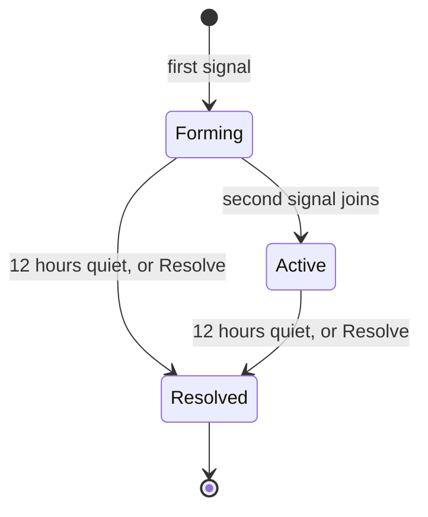

**클러스터(cluster)**는 앱에서 **Signals**로 표시되는 Pulse가 하나의 문제로 취급하는 관련 신호의 묶음입니다(**신호(signal)**는 노이즈 억제를 통과한 이벤트입니다). 따라서 18번 울리는 플래핑 알람은 멤버가 18개인 하나의 항목이 됩니다. 이 페이지에서는 클러스터가 열리고 닫히는 방식, Pulse가 클러스터링 전에 버리는 것, 그리고 각 작업이 하는 일을 설명합니다. **Snooze**를 포함한 모든 클러스터 작업에는 워크스페이스 **Admin** 역할이 필요합니다. Developer와 Viewer는 클러스터를 읽을 수 있지만 작업은 보이지 않습니다. [Roles](/guide/security/roles)를 참조하세요.

## 클러스터 라이프사이클

클러스터에는 세 가지 상태가 있습니다. 클러스터 자신의 신호 또는 사람만 상태를 바꿉니다.

해결된 클러스터는 다시 열리지 않습니다. 다음으로 일치하는 신호는 새 클러스터를 시작합니다. 12시간 규칙은 클러스터 자신의 신호만 읽으므로, 라우팅된 클러스터도 닫습니다.

| 상태 | 의미 |
|---|---|
| **Forming** | 지금까지 신호가 하나입니다. |
| **Active** | 신호가 두 개 이상입니다. |
| **Resolved** | 12시간 동안 신호가 없었거나, 사람이 해결했습니다. 유일한 닫힌 상태입니다. |

**라우팅(routed)은 상태가 아닙니다.** 열린 인시던트가 클러스터를 보유하면 그 클러스터는 라우팅된 것이며, 내부적으로는 Forming 또는 Active 상태를 유지합니다. 라우팅된 클러스터는 **Handled** 레인에 표시됩니다. 다음 세 가지 규칙이 적용됩니다.

- 새로 일치하는 신호는 라우팅된 클러스터에 합류하고 인시던트를 업데이트합니다. 두 번째 조사를 시작하지 않습니다.
- 인시던트를 닫아도 클러스터는 닫히지 않습니다. 같은 장애가 다시 발생하면, 트리아지가 그 인시던트를 다시 열지 새 인시던트를 열지 결정합니다.
- 인시던트가 닫히면 클러스터를 다시 에스컬레이션할 수 있습니다.

## 신호가 클러스터에 합류하는 방식

Pulse는 각 새 신호를 클러스터가 아직 열려 있는 최근 6시간의 신호와 비교합니다. 처음 일치하는 규칙이 신호가 갈 곳을 결정합니다.

1. **같은 리소스 또는 같은 제목.** 신호들이 리소스 ID를 공유하거나 제목을 공유합니다(대소문자 무시). 두 신호가 서로 다른 리소스 ID를 가지고 있으면 같은 제목은 인정되지 않습니다. 두 리소스에 대한 하나의 알림 이름은 두 개의 장애입니다.
2. **같은 서비스.** 신호들이 **Service** 값을 공유합니다. 서비스가 없는 신호(`unknown`으로 표시됨)와 채팅 메시지는 이 규칙을 건너뜁니다. 이 규칙은 리소스 ID를 무시하므로, 서로 다른 리소스의 두 장애라도 같은 서비스를 가리키면 합류합니다.

두 규칙 모두 일치하지 않으면, 신호는 **Forming** 상태의 새 클러스터를 엽니다. 해결된 클러스터는 새 신호를 받지 않습니다.

리소스 ID는 **Resource ID Path**에서 가져오며, 경로가 설정되지 않은 경우 최상위 `resource_id` 키에서 가져옵니다. 둘 다 값을 찾지 못하면 CloudWatch 알람은 알람 ARN을 사용합니다. **Resource** 필드(표시 이름)는 사용되지 않습니다. 따라서 웹훅 소스의 경우:

- **Resource ID Path**를 매핑하여, 제목이 달라도 한 장애의 반복이 묶이고 두 리소스의 같은 알림은 분리되도록 합니다.
- **Service Path**는 `checkout-api`처럼 하나의 서비스를 가리키는 값에만 매핑합니다. `prod` 같은 넓은 값은 관련 없는 장애를 하나의 클러스터로 합칩니다.

## 노이즈 억제

원시 이벤트가 신호가 되기 전에 Pulse는 네 가지 검사를 순서대로 실행합니다. 처음 일치하는 검사가 이벤트를 버립니다.

| 검사 | 버리는 것 | 예외 |
|---|---|---|
| Dedup | 정확한 반복: 같은 소스, 이벤트 유형, 리소스, 제목, 심각도를 가지고 이전 이벤트와 같은 분(minute)의 타임스탬프를 가진 이벤트. Pulse는 반복을 잡기 위해 각 이벤트를 1시간 동안 기억합니다. | 없음. |
| Rate limit | 한 소스에서 분당 100개를 넘는 이벤트. 이 한도는 고정이며 설정이 아닙니다. | Critical과 high 이벤트는 항상 통과합니다. |
| Snooze | 누군가 설정한 스누즈와 일치하는 이벤트. | 없음. |
| Verdict | CloudThinker가 조사 중에 노이즈라고 학습한 패턴의 반복. 조용한 기간은 6시간에서 24시간, 7일로 늘어납니다. | Critical과 high 이벤트는 항상 통과합니다. |

타임스탬프는 이벤트 자신의 시간입니다. 웹훅의 경우 **Timestamp Path**가 가리키는 필드이며, 경로가 설정되지 않은 경우 최상위 `timestamp` 키입니다. 해당 필드가 없거나 Pulse가 읽을 수 있는 날짜가 아니면, Pulse는 이벤트를 받은 시간을 사용합니다. 예를 들어, 20분 후에 원래 타임스탬프로 알림을 재시도하는 도구는 중복으로 버려집니다. 1분 간격으로 타임스탬프 없이 두 번 보낸 것은 그렇지 않습니다.

Dedup은 버린 반복을 원래 신호에 집계합니다. Rate limit, Snooze, Verdict는 이벤트를 삭제하지 않고 억제됨으로 표시해 보관합니다. 억제된 이벤트는 클러스터에 합류하지 않습니다. 개수를 보려면 **Resolve → Signals** 상단의 퍼널에 마우스를 올리세요. 퍼널은 도착한 모든 원시 이벤트를 셉니다. 또는 **Resolve → Insights → Signal quality**에서 **Noise suppressed**와 **Top noisy sources**를 확인합니다. [Pulse Analytics](/ko/guide/pulse/analytics)를 참조하세요.

학습된 Verdict 패턴은 편집할 수 있는 곳에 나열되지 않습니다. 다음 세 가지가 패턴을 일찍 끝냅니다. 같은 패턴의 critical 또는 high 이벤트(통과하면서 패턴을 지움), 일치하는 스누즈된 신호의 **Unsnooze**(역시 패턴을 지움), 또는 조용한 기간 만료(최대 7일 후)입니다.

신호가 클러스터에 합류하면 CloudThinker가 신호를 분류합니다. **Not actionable**로 판단된 신호는 클러스터를 트리아지로 보내지 않습니다. 단, IAM, SSO, KMS 키 라이프사이클 이벤트는 이 방식으로 절대 버려지지 않습니다.

## 클러스터 트리아지

<Steps>
  <Step title="클러스터 열기">
    **Resolve → Signals**에서 **Needs you** 레인부터 시작합니다. 클러스터를 클릭하여 상세 패널을 엽니다. 패널에는 **AI summary**(또는 **Likely cause**), **Next steps**, **Volume**, **Affected resources**가 표시됩니다. 신호 자체의 패널에는 원시 페이로드와 거쳐 온 억제 및 보강 단계가 표시됩니다.
  </Step>
  <Step title="직접 맡거나 할당하기">
    **Take it**을 클릭하면 클러스터가 자신에게 할당되고 확인(acknowledge)됩니다. 확인 표시만 하려면 **⋯** 메뉴를 열고 **Acknowledge**를 클릭합니다. 되돌리려면 **Undo acknowledge**를 클릭합니다. 어느 쪽이든 클러스터는 열린 상태로 유지되며 새 신호가 계속 합류합니다. 다른 담당자를 지정하려면 **⋯** 메뉴를 열고 **Assign to…**를 클릭한 다음 팀원을 선택합니다. 할당은 팀원에게 알림을 보내지 않으므로 직접 알려 주세요.

    **성공 상태:** 클러스터가 **Needs you**에서 빠지고 **Handled**에 표시됩니다.
  </Step>
  <Step title="인시던트로 넘기기">
    **Open incident**(또는 **⋯** 메뉴의 **Escalate**)를 클릭한 다음 **Send to triage**를 클릭합니다. 트리아지는 클러스터를 열린 인시던트, 다시 발생한 닫힌 인시던트, 또는 새 인시던트에 매칭합니다. 인시던트를 직접 고르려면 **⋯** 메뉴의 **Link to incident**를 사용합니다. 열린 인시던트가 먼저 나열되며, 닫힌 인시던트를 고르면 다시 열립니다.

    **성공 상태:** 클러스터가 **Handled** 레인으로 이동합니다.
  </Step>
  <Step title="해결되면 닫기">
    **⋯** 메뉴를 열고 **Resolve**를 클릭한 다음 **Resolve Cluster**에서 확인합니다. 이 작업은 되돌릴 수 없습니다. 장애가 다시 발생하면 새로 일치하는 신호가 새 클러스터를 엽니다. 라우팅된 클러스터는 인시던트가 소유하므로 **Open incident**, **Escalate**, **Resolve**가 숨겨집니다.
  </Step>
</Steps>

## 작업 참조

| 작업 | 위치 | 결과 |
|---|---|---|
| **Open incident** | 클러스터 패널, 기본 버튼 | **Send to triage**를 엽니다. 열린 인시던트가 클러스터를 보유하는 동안 숨겨집니다. 트리아지가 실패한 후에는 버튼이 **Retry triage**로 표시됩니다. |
| **Take it** | 클러스터 패널 | 클러스터를 자신에게 할당하고 확인합니다. 자신이 보유하면 숨겨집니다. |
| **Escalate** | 클러스터 패널, **⋯** 메뉴 | **Open incident**와 같습니다. 클러스터를 트리아지로 보냅니다. 라우팅된 동안 숨겨집니다. |
| **Link to incident** | 클러스터 패널, **⋯** 메뉴 | 선택한 인시던트에 클러스터를 연결합니다. 클러스터가 해결될 때까지 사용할 수 있습니다. 이미 라우팅된 클러스터에서는 두 번째 링크를 추가하며, 클러스터는 첫 번째 인시던트에도 그대로 남습니다. |
| **Resolve** | 클러스터 패널, **⋯** 메뉴 | 클러스터를 영구히 닫습니다. 라우팅된 동안 숨겨집니다. |
| **Assign to…** | 클러스터 패널, **⋯** 메뉴 | 클러스터에 담당자를 지정합니다. |
| **Acknowledge** | 클러스터 패널, **⋯** 메뉴 | 클러스터를 확인됨으로 표시하고 **Needs you**에서 뺍니다. 열린 상태로 유지됩니다. **Undo acknowledge**로 되돌립니다. |
| **Snooze** | 목록에서 클러스터를 열었을 때 클러스터 패널의 **⋯** 메뉴, 또는 신호 패널의 **Snooze** 버튼 | 클러스터의 대표 신호와 비슷한 알림을 **1 hour**, **4 hours**, **1 day** 또는 **Forever** 동안 음소거합니다. 되돌리려면 **Unsnooze**를 클릭합니다. |

리소스를 지정하는 신호의 스누즈는 해당 리소스의 비슷한 알림만 음소거합니다. 그렇지 않으면 같은 소스와 이벤트 유형의 모든 알림을 음소거하므로, 기간을 고르기 전에 메뉴의 안내를 확인하세요. **Forever** 스누즈는 만료되지 않습니다. 누군가 그 신호에서 **Unsnooze**를 클릭할 때까지 일치하는 알림은 음소거된 상태로 남습니다.

## 문제 해결

<AccordionGroup>
  <Accordion title="Open incident, Escalate, Resolve가 보이지 않음">
    클러스터가 라우팅된 상태입니다. 열린 인시던트가 클러스터를 보유하고 있습니다. 인시던트에서 작업하거나 먼저 인시던트를 닫으세요.
  </Accordion>
  <Accordion title="Send to triage 후 트리아지가 시작되지 않음">
    클러스터 패널에 **Queued for triage** 또는 **Triage could not run**이 표시됩니다. 실행되지 않았다면 해당 메시지 옆의 **Retry**를 클릭합니다. 트리아지가 실패하면 critical과 high 클러스터도 **Needs you**로 돌아갑니다.
  </Accordion>
  <Accordion title="중요한 알림이 나타나지 않음">
    각 원인을 차례로 확인하세요.

    - **Snooze:** 누군가 해당 소스나 리소스를 음소거했습니다. 일치하는 신호를 열고 **Unsnooze**를 클릭합니다.
    - **Rate limit:** 버스트 중에는 한 소스에서 분당 100개를 넘는 low와 medium 알림이 버려집니다.
    - **Verdict:** CloudThinker가 그 패턴을 노이즈로 학습했습니다. Low와 medium 반복은 최대 7일 동안 조용합니다. 지우는 방법은 [노이즈 억제](#노이즈-억제)를 참조하세요.
    - **Not actionable:** 알림이 도착해 클러스터링되었지만 분류에서 실행 불가로 판단되어 트리아지로 가지 않았습니다. **History** 레인에서 해당 클러스터를 찾아 열고 **Open incident**를 클릭합니다.

    **Resolve → Signals** 상단의 퍼널에 마우스를 올려 이벤트가 억제되고 있는지 확인하세요.
  </Accordion>
</AccordionGroup>

## 다음 단계

<CardGroup cols={2}>
  <Card title="근본 원인 분석" icon="magnifying-glass" href="/ko/guide/incident/root-cause-analysis">
    라우팅된 클러스터를 따라 조사로 이동합니다.
  </Card>
  <Card title="Pulse Analytics" icon="chart-line" href="/ko/guide/pulse/analytics">
    Signals가 얼마나 많은 노이즈를 제거하는지, 클러스터가 얼마나 빨리 닫히는지 확인합니다.
  </Card>
  <Card title="Pulse 소스 연결" icon="plug" href="/ko/guide/pulse/setup">
    웹훅, 폴링 또는 채팅 소스를 더 추가합니다.
  </Card>
  <Card title="On-call" icon="users" href="/guide/incident/oncall">
    인시던트가 조건을 충족할 때 누구를 호출할지 선택합니다.
  </Card>
</CardGroup>
