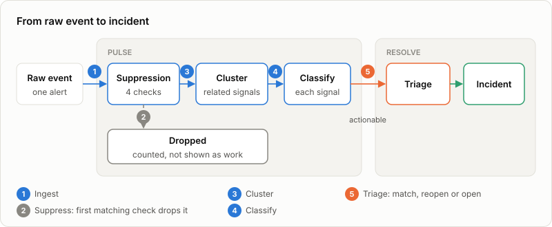

Pulse는 CloudThinker의 인시던트 대응 모듈인 [Resolve](/ko/guide/incident/overview)의 탐지 계층이며, 앱에서는 **Signals**로 표시됩니다. 도구가 보내는 모든 알림을 받아 노이즈를 걸러 내고, 남은 것을 클러스터로 묶고, 조치 가능한 것만 분류(triage)로 넘기므로, 장애 하나가 수백 건의 호출이 아닌 항목 하나로 나타납니다.

## 작동 방식

**raw event**는 CloudWatch 알람이나 Datadog 모니터 같은 소스의 알림 하나입니다. **signal**은 노이즈 억제를 통과한 이벤트입니다. **cluster**는 하나의 문제로 취급되는 관련 신호 묶음입니다.

<Frame caption="Pulse drops noise and groups signals into clusters; only a cluster with an actionable signal reaches triage.">
  
  
</Frame>

1. **Ingest.** 이벤트는 웹훅, 폴링되는 AWS 서비스, 선택한 Slack 또는 Microsoft Teams 채널에서 도착합니다. 웹훅은 보내지는 즉시 도착합니다. 폴링되는 AWS 서비스는 일정에 따라 도착하며, [Connect Pulse sources](/ko/guide/pulse/setup)에 간격이 나와 있습니다.
2. **Suppress.** 네 가지 점검이 순서대로 실행되며, 처음 일치하는 점검이 이벤트를 버립니다. [noise suppression](/ko/guide/pulse/clusters#노이즈-억제)을 참조하세요.
3. **Cluster.** Pulse는 신호를 같은 리소스 ID나 제목을 가진 신호가 있는 최근의 열린 클러스터에 합치고, 그렇지 않으면 같은 서비스의 클러스터에 합칩니다. 전체 규칙은 [How signals join a cluster](/ko/guide/pulse/clusters#신호가-클러스터에-합류하는-방식)에 있습니다.
4. **Classify.** 신호가 클러스터에 합쳐진 후 CloudThinker가 그 신호를 분류합니다: 카테고리(compute, network, security, deploy, communication, cost 또는 data로, 카테고리 필터와 같은 값), 심각도, 조치 가능 여부.
5. **Triage.** 조치 가능한 신호를 담은 클러스터는 분류로 넘어갑니다. CloudThinker가 이를 열린 인시던트와 연결하거나, 같은 장애가 다시 나타나면 닫힌 인시던트를 다시 열거나, 새 인시던트를 엽니다.

Pulse 자체는 수집, 억제, 그룹화만 합니다. 분류부터의 모든 것은 [Resolve](/ko/guide/incident/overview)에 속합니다.

Pulse는 **Resolve → Issues** 제목 행의 **AI auto-investigate** 스위치가 켜져 있든 꺼져 있든 계속 알림을 탐지하고 묶습니다. 꺼져 있는 동안에도 조치 가능한 클러스터는 **Open** 상태의 인시던트로 등록되지만, CloudThinker가 스스로 분류하거나 조사하지 않습니다. **Send to triage**는 사람이 클릭하면 여전히 실행됩니다. 전체 규칙은 [What starts an investigation](/guide/incident/settings#what-starts-an-investigation)에 있습니다.

## Signals 페이지에서 작업하기

**Resolve → Signals**를 엽니다. 헤더에는 원시 이벤트에서 클러스터까지의 실시간 퍼널과 시간 창 선택기(**Last 1 hour**부터 **Last 30 days**까지)가 표시됩니다. 창은 **Needs you**를 포함한 모든 레인에 적용됩니다. 클러스터는 창 안에 신호가 있을 때만 표시되므로, 아무도 처리하지 않은 오래된 클러스터를 찾으려면 창을 넓히세요. 세 레인이 표시할 클러스터를 고릅니다.

| 레인 | 표시 내용 | 용도 |
|---|---|---|
| **Needs you**(기본값) | 사람을 기다리는 critical 또는 high 클러스터(아래 참조). | 근무를 여기서 시작합니다. |
| **Handled** | 인시던트가 맡고 있거나, 사람이 확인했거나 맡았거나, 에이전트가 작업 중인 열린 클러스터. | 이미 담당자가 있는 것을 확인합니다. |
| **History** | 해결된 것을 포함하여 시간 창 안의 모든 클러스터. | 과거 클러스터를 검색합니다. |

critical 또는 high 클러스터는 다음 중 하나에 해당할 때 **Needs you**에 있습니다.

- **Forming** 또는 **Active** 상태이고, 아무도 확인하거나 맡지 않았고, 작업 중인 에이전트가 없고, 이를 맡은 열린 인시던트가 없을 때.
- 분류가 실패하여 **Retry triage**를 기다릴 때.

필터는 **History**에만 있습니다. 심각도, 소스, 카테고리, 상태 필터나 **Search signals...**로 좁히세요. 클러스터를 클릭하면 세부 정보 패널이 열리며, 거기서 **Open incident** 또는 **Take it**을 클릭하거나, **⋯** 메뉴를 열어 **Escalate**, **Link to incident**, **Resolve**, **Assign to…**, **Acknowledge**, **Snooze**를 할 수 있습니다. 각 작업은 [Clusters](/ko/guide/pulse/clusters)에서 설명합니다.

새 소스가 작동하는지 확인하려면 설정 페이지의 [Send a test alert](/ko/guide/pulse/setup#소스-연결)를 따르세요.

## Signals가 비어 있거나 조용할 때

| 보이는 것 | 의미 | 할 일 |
|---|---|---|
| **Connect a source** 버튼과 함께 **No signals yet** | 이 워크스페이스에 아무것도 도달하지 않았습니다. | [Connect Pulse sources](/ko/guide/pulse/setup)를 따르세요. |
| **Manage sources** 버튼과 함께 **No signals yet** | 웹훅은 있지만 도착한 이벤트가 없습니다. | 소스 도구에서 테스트 알림을 발생시키세요. |
| 소스가 다운되었을 수 있다는 **No new signals in 2h** 같은 배너 | 한 시간 넘게 아무것도 도착하지 않았습니다. 배너에 경과 시간이 표시됩니다. | **Check sources**를 클릭하고 **Needs attention**으로 표시된 플랫폼을 찾으세요. |
| **Nothing needs you** | 사람을 기다리는 critical 또는 high 클러스터가 없습니다. | **Go to Handled**를 클릭하거나 **History**로 전환하세요. 주로 low나 info 알림을 내보내는 소스는 **Needs you**를 채우지 않습니다. |

## 다음 단계

<CardGroup cols={2}>
  <Card title="Connect Pulse sources" icon="plug" href="/ko/guide/pulse/setup">
    첫 알림을 Signals로 보내고 도착하는지 확인합니다.
  </Card>
  <Card title="클러스터 다루기" icon="layer-group" href="/ko/guide/pulse/clusters">
    클러스터 수명 주기, 억제, 모든 클러스터 작업을 알아봅니다.
  </Card>
  <Card title="Pulse Analytics" icon="chart-line" href="/ko/guide/pulse/analytics">
    Signals가 노이즈를 얼마나 제거하고 클러스터가 얼마나 빨리 닫히는지 측정합니다.
  </Card>
  <Card title="Root cause analysis" icon="magnifying-glass" href="/ko/guide/incident/root-cause-analysis">
    분류가 인시던트를 연 뒤에 일어나는 일을 확인합니다.
  </Card>
</CardGroup>
