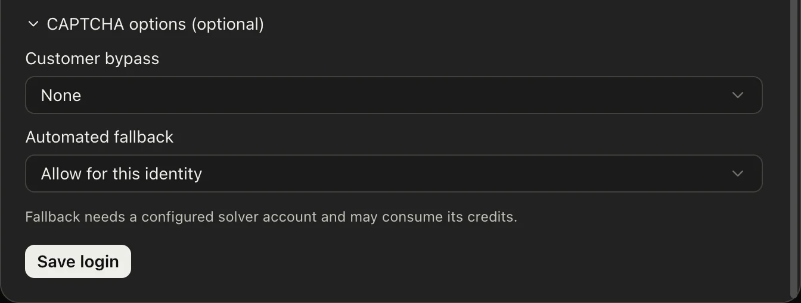
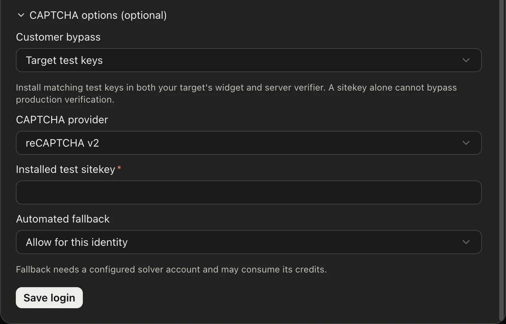

앱의 로그인 페이지에 CAPTCHA(reCAPTCHA, hCaptcha 또는 Cloudflare Turnstile)가 표시되면, CloudThinker에 이를 통과하는 방법을 알려 줄 때까지 [테스트 실행](/ko/guide/security/security-testing)은 저장된 비밀번호로 로그인할 수 없습니다. 테스트 키, 우회(bypass), 자동 대체(fallback)가 없으면 로그인이 실패하고 실행은 **Incomplete**로 끝납니다. 이 페이지는 이를 처리하는 네 가지 방법과 로그인이 실제로 작동했는지 확인하는 방법을 다룹니다.

## 방법 선택

| 방법 | 사용하는 경우 | 양식에서 설정하는 값 | 필요한 것 |
| --- | --- | --- | --- |
| **Target test keys** | 직접 관리하는 스테이징 또는 테스트 환경을 테스트할 때 | **Customer bypass** = **Target test keys** | 로그인 위젯과 서버 측 검증기 양쪽에 설치된 CAPTCHA 공급자의 테스트 키 |
| **Bypass header** | 특정 헤더와 시크릿이 있으면 앱이 이미 CAPTCHA를 건너뛸 때 | 양식에서 **Customer bypass** = **None**, 그런 다음 채팅으로 헤더 설정 | 헤더 이름, 그리고 시크릿을 `CAPTCHA_BYPASS_` 자격 증명으로 저장할 워크스페이스 Admin |
| **Automated fallback**(대상 변경 없음) | 대상을 변경할 수 없을 때 | **Customer bypass** = **None**, **Automated fallback** = **Allow for this identity** | CloudThinker 전체에 켜진 **CAPTCHA solver enabled**. 여전히 실패할 수 있습니다 |
| 비밀번호 대신 **[Session token](/ko/guide/security/security-testing#테스트-사용자-추가)** | 위의 어떤 방법도 작동하지 않거나, 로그인에 MFA가 필요하거나, 로그인 페이지가 다른 도메인에 있을 때 | 비밀번호 양식이 아닌 별도의 **Session token** 테스트 사용자 | 브라우저의 Network 패널에서 cURL로 복사한 로그인 상태의 `GET` 요청 |

Target test keys가 가장 안정적인 방법입니다. Automated fallback은 최선의 노력(best effort)이며 테스트 사용자별로 설정되므로, 백업으로 우회와 함께 허용할 수 있습니다.

### Automated fallback이 처리할 수 있는 것

Fallback은 CAPTCHA 풀이 서비스를 사용하지 않습니다. 로그인과 같은 브라우저 세션 안에서, 로그인 기한 안에 있는 풀이 기한 내에 작동합니다.

| 공급자 | Fallback |
| --- | --- |
| **reCAPTCHA v2**, **hCaptcha** | 최선의 노력. 이미지 타일과 드래그 챌린지는 CloudThinker에 구성된 AI 비전 모델로 전송됩니다 |
| **reCAPTCHA v3** | 최선의 노력, 브라우저에서, 페이지가 reCAPTCHA action을 제공할 때만. 그 밖에는 지원되지 않습니다 |
| **Cloudflare Turnstile** | 최선의 노력, 브라우저에서. 이미지는 전송되지 않습니다 |

Fallback은 **CAPTCHA solver enabled**가 켜질 때까지 꺼져 있습니다. 이 설정은 워크스페이스나 조직 하나가 아닌 CloudThinker 전체에 적용되므로, CloudThinker 지원팀이나 회사에서 CloudThinker를 운영하는 담당자에게 요청하세요. Target test keys와 bypass header는 챌린지 이미지를 어디에도 보내지 않습니다.

## 시작하기 전에

- 등록된 Cyber 앱과 그 테스트 사용자를 편집할 권한. [Run a security test](/ko/guide/security/security-testing)를 참조하세요.
- **테스트 사용자**: 테스트 실행이 사용자 이름과 비밀번호로 로그인하는 앱의 전용 계정. 테스트용으로 만든 계정을 사용하고, 실제 사용자의 계정은 절대 사용하지 마세요. 추가하는 버튼의 이름은 현재 위치에 따라 다릅니다. [Add test users](/ko/guide/security/security-testing#테스트-사용자-추가)를 참조하세요.
- 테스트 키나 bypass header의 경우: 대상 앱의 CAPTCHA 구성에 대한 접근 권한.
- bypass header의 경우: 키가 `CAPTCHA_BYPASS_`로 시작하는(예: `CAPTCHA_BYPASS_STAGING`) [credential](/guide/credentials)을 우회 시크릿을 값으로 하여 추가할 수 있는 워크스페이스 Admin.

## 로그인 구성

<Steps>
  <Step title="비밀번호 양식 열기">
    **Cyber**를 열고 **Pentest apps**에서 앱을 고르고 **Settings** 탭을 연 다음, **Test identities** 행에서 **Add** 또는 **Manage**를 클릭합니다. 테스트 ID를 추가하고 **Authentication method**로 **Password**를 선택합니다.

    사용자 이름과 비밀번호를 입력합니다. 로그인 양식이 있는 페이지가 앱의 시작 페이지가 아니라면 **Login URL (optional)**을 그 페이지로 설정합니다. 앱 대상과 같은 origin을 사용해야 하며 [scope](/ko/guide/security/security-testing#범위-및-컨텍스트-설정)에 맞아야 합니다. 별도의 SSO나 ID 공급자 도메인에 호스팅된 로그인은 거부되므로, 그런 앱에는 **Session token**을 사용하세요. 예를 들어 대상이 `https://staging.shop.com`이면 `https://staging.shop.com/login`은 작동하고 `https://auth.shop.com/login`은 거부됩니다.

    **CAPTCHA options (optional)**을 펼칩니다.

    <Frame>
      
    </Frame>
  </Step>
  <Step title="Customer bypass 설정">
    **Customer bypass**에서 값 하나를 선택합니다.

    - **None**: 대상 측 예외가 없습니다. 허용된 경우 실행은 automated fallback에 의존합니다.
    - **Target test keys**: **CAPTCHA provider**(reCAPTCHA v2, reCAPTCHA v3, hCaptcha 또는 Cloudflare Turnstile)를 고르고 로그인 위젯의 공개 sitekey를 **Installed test sitekey**에 붙여 넣습니다. 짝이 되는 테스트 시크릿은 서버에 남으며, CloudThinker는 이를 필요로 하지 않습니다. reCAPTCHA v3에는 항상 통과하는 테스트 키가 없으므로, v3의 경우 스테이징 sitekey를 입력하고 스테이징 검증기의 점수 임계값을 낮추거나, 대신 **Bypass header**를 사용하세요.

    <Frame>
      
    </Frame>

    - **Bypass header**: 양식에 **Header name**과 **Bypass secret** 필드가 표시되지만, 양식에서 헤더 우회를 저장하면 항상 거부됩니다. 대신 **None**으로 테스트 사용자를 저장하고, [시작하기 전에](#시작하기-전에)의 `CAPTCHA_BYPASS_` 자격 증명이 있는지 확인한 다음, 채팅에서 CloudThinker에게 설정을 요청하세요. 예: "Set a header bypass for the qa-member test user on the Shop staging app, header `X-QA-Bypass`, using credential CAPTCHA_BYPASS_STAGING." 워크스페이스 Admin이어야 합니다. CloudThinker는 해당 테스트 사용자의 업데이트된 CAPTCHA 정책으로 답하며, 정책에는 우회 유형은 표시되지만 시크릿은 표시되지 않습니다. 대상이 이미 헤더를 받아들여야 하며, 비밀번호로 여전히 로그인할 수 있어야 합니다.
  </Step>
  <Step title="Automated fallback 설정">
    **Automated fallback**에서 **Allow for this identity** 또는 **Disable for this identity**를 선택합니다. 기본값: **Allow for this identity**.

    Allow는 CloudThinker에 **CAPTCHA solver enabled**가 켜져 있을 때만 적용됩니다. 이 옵션이 solver를 켤 수는 없습니다. 이 사용자의 챌린지 이미지가 AI 모델로 전송되지 않기를 원한다면 **Disable for this identity**를 고르세요.
  </Step>
  <Step title="저장 및 실행">
    **Save login**을 클릭합니다. CloudThinker는 로그인하지 않고 비밀번호 테스트 사용자를 저장하므로, 저장이 로그인 작동을 증명하지는 않습니다.

    비밀번호 테스트 사용자에 대한 로그인 전용 테스트는 없습니다. 확인은 pentest 실행이 시작될 때 이루어집니다. **Run pentest**를 클릭하고 실행을 시작하세요. 로그인 단계에는 기본적으로 60초 기한이 있으므로 약 1분 안에 작동 여부를 알 수 있습니다. CloudThinker 지원팀이나 회사에서 CloudThinker를 운영하는 담당자는 이 기한을 20초에서 120초 사이로 바꿀 수 있습니다.

    **성공 상태:** 실행이 로그인 상태에서 보호된 페이지를 불러올 수 있음을 증명한 다음, run workbench에서 계속 테스트합니다. 로그인을 증명할 수 없으면 실행이 일찍 멈추고 **Incomplete**로 끝나므로, 실패한 로그인이 익명 전용 테스트로 통과되는 일은 없습니다. 실행이 로그인을 통과한 경우에만 보호된 경로가 테스트된 것으로 간주하세요.
  </Step>
</Steps>

## 공급자 테스트 키

reCAPTCHA v2, hCaptcha, Turnstile은 항상 통과하는 테스트 키를 공개합니다. 로그인 위젯에 sitekey를, 서버 측 검증에 짝이 되는 테스트 시크릿을 설치한 다음, **Installed test sitekey**에 sitekey를 입력하세요.

| 공급자 | 알아 둘 점 | 참고 |
| --- | --- | --- |
| **reCAPTCHA v2** | Google의 테스트 키 쌍은 챌린지를 건너뛰고 검증을 통과합니다 | [reCAPTCHA FAQ](https://developers.google.com/recaptcha/docs/faq#id-like-to-run-automated-tests-with-recaptcha.-what-should-i-do) |
| **reCAPTCHA v3** | Google은 v3용 항상 통과 테스트 키를 공개하지 않으며, 테스트용 별도 키를 사용하라는 권장 사항만 있습니다. 점수가 실제 트래픽과 다를 수 있으므로 서버가 여전히 로그인을 거부할 수 있습니다. v3에는 **Bypass header**나 스테이징 검증기의 낮은 점수 임계값을 권장합니다 | [reCAPTCHA FAQ](https://developers.google.com/recaptcha/docs/faq) |
| **hCaptcha** | 테스트 sitekey는 짝이 되는 테스트 시크릿과만 작동합니다 | [hCaptcha test keys](https://docs.hcaptcha.com/#integration-testing-test-keys) |
| **Cloudflare Turnstile** | 더미 sitekey에는 짝이 되는 더미 시크릿이 필요합니다. 프로덕션 시크릿은 더미 응답을 거부합니다 | [Turnstile testing](https://developers.cloudflare.com/turnstile/troubleshooting/testing/) |

<Warning>
  테스트 키는 봇 보호를 제거합니다. 테스트 환경에서만 사용하고, 프로덕션에서는 절대 사용하지 마세요.
</Warning>

## 로그인 실행이 CAPTCHA를 처리하는 방식

1. 실행이 로그인 페이지를 열고 저장된 사용자 이름과 비밀번호를 입력합니다.
2. customer bypass를 설정했다면 먼저 이를 적용합니다.
3. 그래도 CAPTCHA가 나타나고 CloudThinker와 해당 테스트 사용자 모두에 fallback이 허용되어 있다면, 실행이 같은 브라우저 세션에서 이를 풀려고 시도합니다.
4. 실행이 로그인 상태에서 보호된 페이지가 로드되는지 확인합니다. 이를 증명할 수 없으면 익명 방문자로 테스트하는 대신 **Incomplete**로 끝납니다.

Fallback은 이미지 챌린지나 공급자 점검에서 실패할 수 있으며, 공급자를 선택한다고 통과가 보장되지는 않습니다. 로그인에 MFA나 비밀번호 이후의 다른 단계가 필요하다면 CAPTCHA 옵션은 도움이 되지 않습니다. 대신 **Session token**을 사용하세요.

## 문제 해결

모든 Cyber 문제를 한곳에서 보려면 [Cyber troubleshooting](/guide/security/cyber-troubleshooting)을 참조하세요.

비밀번호 테스트 사용자를 저장할 때는 로그인하지 않으므로, **Save login**을 클릭할 때는 양식 문제(거부된 헤더 이름이나 헤더 우회, 대상 밖의 Login URL)만 나타납니다. CAPTCHA, 시간 초과, MFA 메시지는 테스트 실행의 로그인 단계에서 나옵니다.

<AccordionGroup>
  <Accordion title="CAPTCHA blocked this login">
    챌린지가 풀리지 않았습니다. 테스트 키나 bypass header가 대상에 설치되어 있는지 확인하거나, CloudThinker에 solver가 켜져 있다면 automated fallback을 허용하세요. 아무것도 작동하지 않으면 **Session token**을 첨부하세요.
  </Accordion>
  <Accordion title="CAPTCHA fallback is unavailable">
    CloudThinker에 **CAPTCHA solver enabled**가 꺼져 있거나, 호출할 AI 비전 모델이 없습니다. **Allow for this identity**로는 이를 무시할 수 없습니다. CloudThinker 지원팀이나 회사에서 CloudThinker를 운영하는 담당자에게 켜 달라고 요청하거나, **Target test keys** 또는 **Bypass header**로 전환하세요.
  </Accordion>
  <Accordion title="This CAPTCHA flow is not supported">
    실행이 처리할 수 없는 챌린지 유형입니다. 대상 우회나 **Session token**을 사용하세요.
  </Accordion>
  <Accordion title="Login could not stay within its safety boundary">
    로그인이 앱의 대상이나 범위 밖으로 리디렉션되었습니다. **Login URL (optional)**과 앱의 대상 설정을 확인하세요.
  </Accordion>
  <Accordion title="The test sitekey does not work">
    위젯과 서버는 선택한 공급자의 짝이 맞는 테스트 키를 사용해야 합니다. CloudThinker에 sitekey를 입력해도 서버의 검증기는 바뀌지 않으며, 테스트 sitekey는 프로덕션 검증을 통과할 수 없습니다.
  </Accordion>
  <Accordion title="Use a dedicated CAPTCHA bypass header">
    헤더 이름이 예약되어 있거나 유효한 헤더 이름이 아닙니다. `Authorization`, `Proxy-Authorization`, `Cookie`, `Host`, `Content-Length`, `Transfer-Encoding`, `Connection`, `Upgrade`, `TE`, `Trailer`, `Origin`, `Referer`는 양식과 채팅 모두에서 거부됩니다. `X-QA-Bypass`처럼 우회에만 쓰는 이름을 고르세요.

    유효한 이름이라도 로그인 양식은 헤더 우회를 거부합니다. [로그인 구성](#로그인-구성)의 **Customer bypass 설정** 단계처럼 **None**으로 저장하고 채팅으로 헤더를 설정하세요.
  </Accordion>
  <Accordion title="Login did not finish in time">
    CAPTCHA 시도를 포함한 로그인이 로그인 기한을 넘겼습니다. 다시 시도하거나, CloudThinker 지원팀이나 회사에서 CloudThinker를 운영하는 담당자에게 기한을 늘려 달라고 요청하세요. 테스트 키나 bypass header를 사용하면 solver 시간이 전혀 들지 않습니다.
  </Accordion>
  <Accordion title="This login requires MFA or another authentication step">
    비밀번호 양식이 마지막 단계가 아닙니다. 로그인된 브라우저에서 복사한 **Session token**을 첨부하세요.
  </Accordion>
</AccordionGroup>

## 다음 단계

실행이 로그인 상태의 접근을 증명하면, 로그인 뒤에서 무엇을 찾았는지 검토하세요.

<CardGroup cols={2}>
  <Card title="Run a security test" icon="crosshairs" href="/ko/guide/security/security-testing">
    범위를 설정하고, 다른 로그인 방법을 첨부하고, 강도를 고릅니다
  </Card>
  <Card title="Triage issues" icon="list-check" href="/guide/security/cyber-findings">
    수정의 우선순위를 정하기 전에 증거와 커버리지 공백을 읽습니다
  </Card>
</CardGroup>
