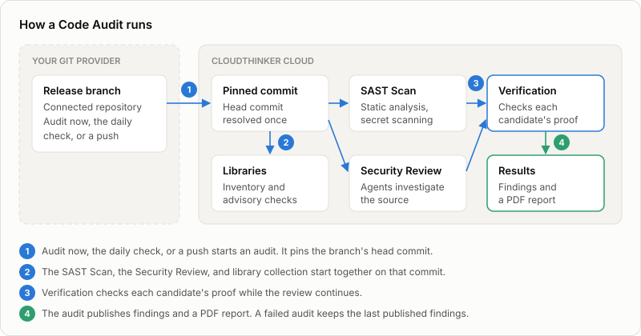
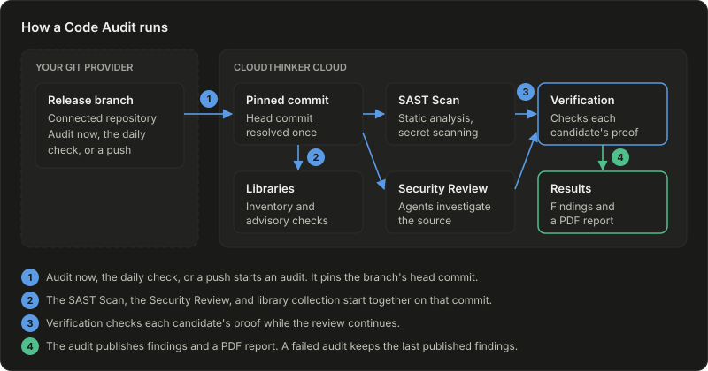
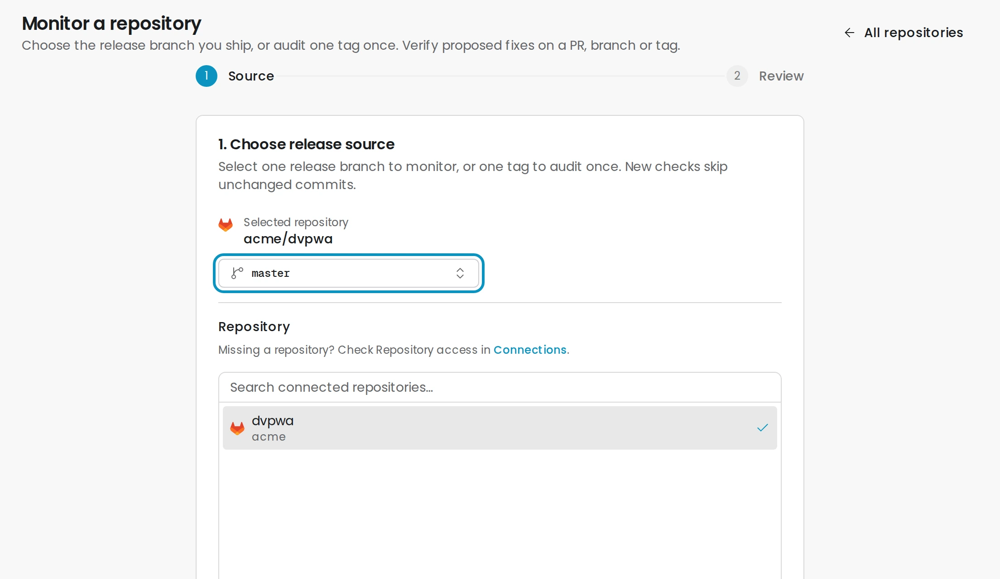
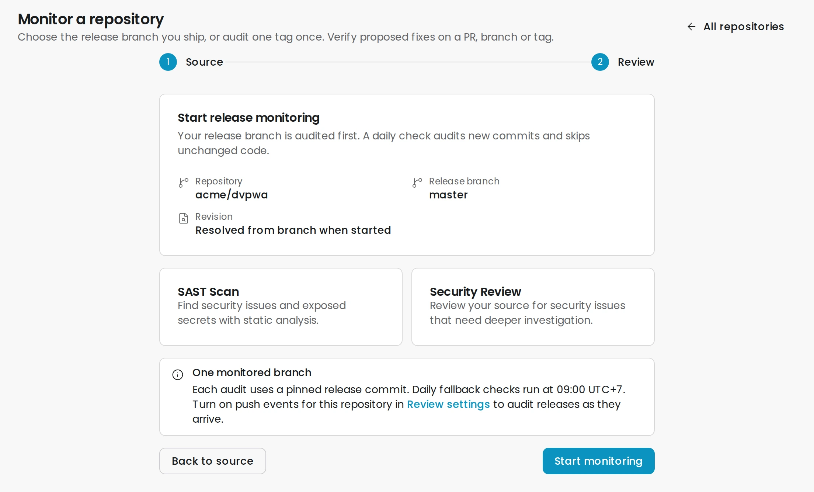
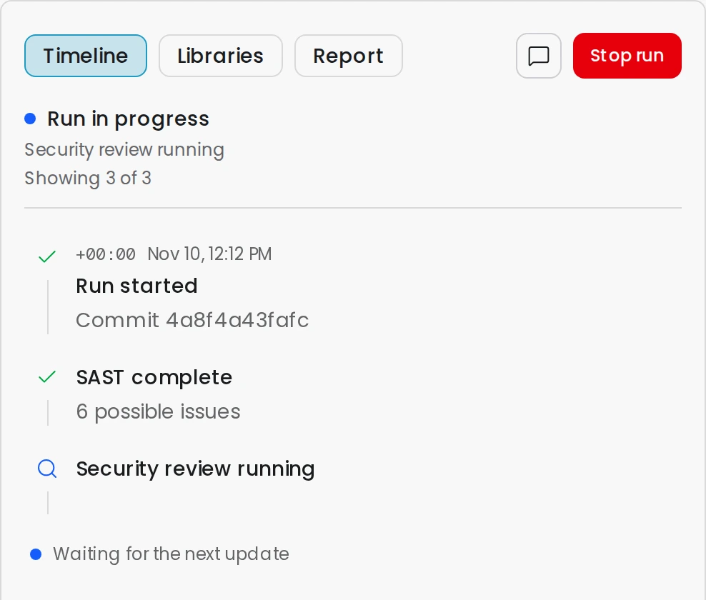
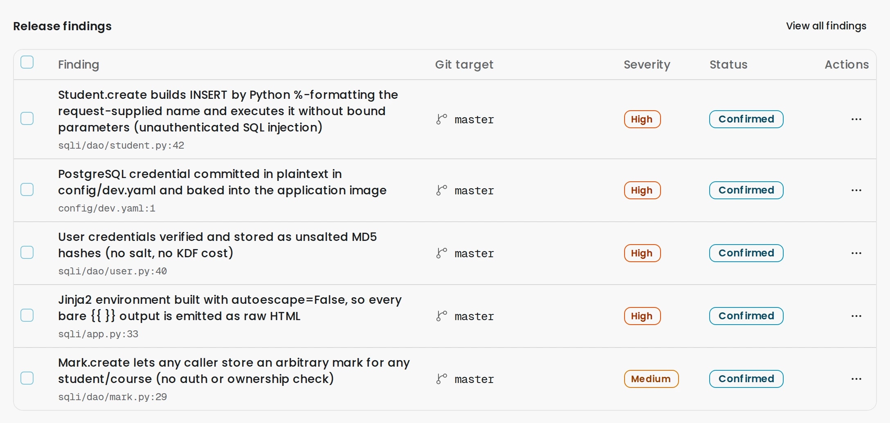
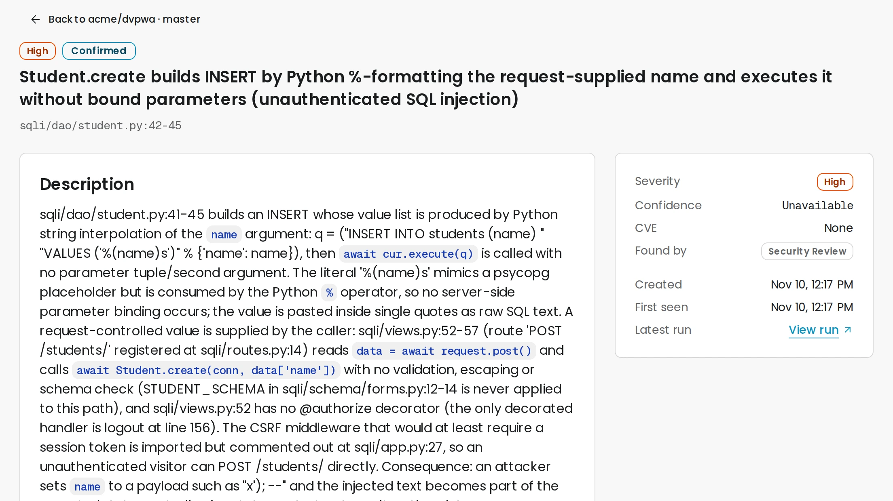
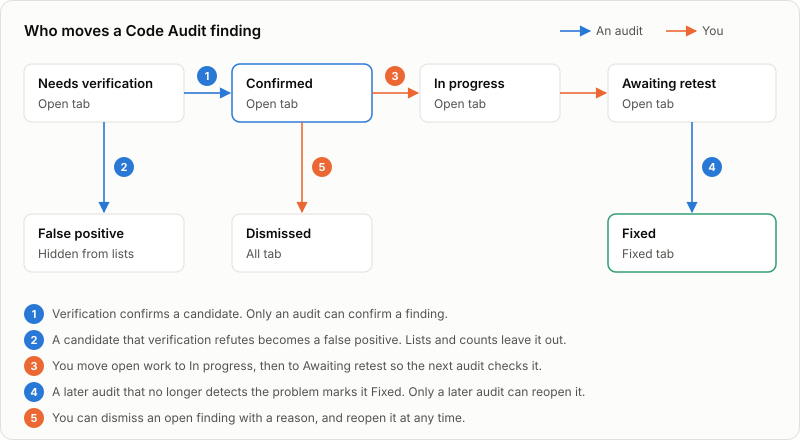
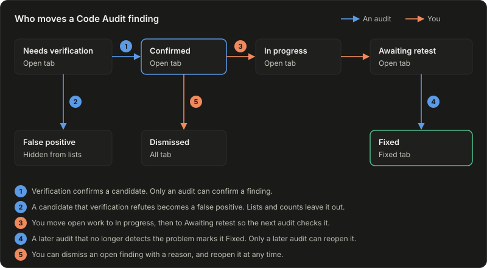
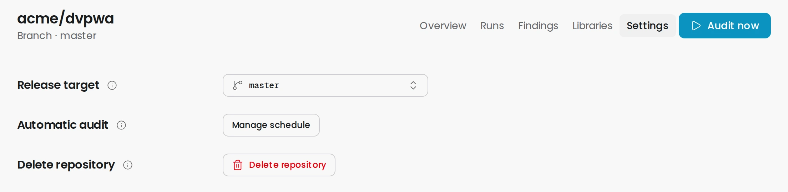

Code Audit은 저장소 브랜치 또는 태그 하나의 소스 코드를 읽고, 의심스러운 코드를 표시하고, 조사한 다음, 이슈를 보고하기 전에 각 후보를 검증합니다. Code Audit의 이슈는 [Pentest 앱과 그 이슈](/ko/guide/security/security-testing)와 별개로 유지되지만, 둘 다 Cyber의 **Issues** 탭에 표시됩니다.

## 사전 요구사항

- 저장소에 접근할 수 있는 [연결된 Git 제공자](/ko/guide/connections/overview): GitHub, GitLab, Bitbucket, Azure DevOps 또는 AWS CodeCommit.
- 해당 소스를 감사할 권한. 앱, URL, DNS 증명, 테스트 로그인은 필요하지 않습니다.
- 적절한 워크스페이스 역할. [Roles](/guide/security/roles)를 참조하세요.

| 작업 | Admin | Developer | Viewer |
| --- | --- | --- | --- |
| 브랜치 모니터링, 일정 설정, 저장소 제거 | ✓ | | |
| 태그 1회 감사, **Audit now**, 실행 중지 또는 재개, 수정 검증 | ✓ | ✓ | |
| 이슈 트리아지, **Open PR** | ✓ | ✓ | |
| 감사, 이슈, 라이브러리, 보고서 읽기 | ✓ | ✓ | ✓ |

## 감사가 동작하는 방식

<Frame caption="하나의 감사는 커밋을 고정하고, 스캔과 리뷰를 병렬로 실행하고, 검증한 다음, 게시합니다">
  
  
</Frame>

1. **Audit now**, 일일 점검 또는 푸시가 감사를 시작합니다. 감사는 브랜치의 헤드 커밋을 고정하므로, 실행 중에 푸시가 있어도 읽는 내용은 바뀌지 않습니다.
2. **SAST Scan**은 정적 분석으로 의심스러운 코드와 노출된 시크릿을 찾습니다. **Security Review**에서는 에이전트가 소스를 깊이 조사합니다. Code Audit은 브랜치의 [라이브러리](/ko/guide/security/cyber-libraries)도 수집합니다.
3. 리뷰가 계속되는 동안 검증이 각 후보의 증거를 확인합니다.
4. 감사는 이슈와 PDF 보고서를 게시합니다. 실패한 감사는 마지막으로 게시된 이슈를 유지합니다.

## 저장소 모니터링 시작

<Steps>
  <Step title="저장소와 브랜치 선택">
    **Cyber**를 열고 **Code audit** 탭을 클릭한 다음 **New audit**을 클릭합니다.

    **1. Choose release source**에서 저장소를 선택한 다음, 배포하는 브랜치를 고릅니다. 하나의 릴리스를 한 번만 감사하려면 태그를 고릅니다.

    <Frame caption="저장소와 릴리스 브랜치가 선택된 Source 단계">
      
    </Frame>

    **Review → Settings → Repositories**를 열고 저장소의 작업 메뉴에서 **Run Code Audit**을 선택할 수도 있습니다. 저장소와 기본 브랜치가 미리 선택됩니다.
  </Step>
  <Step title="검토 후 시작">
    **Review audit**을 클릭합니다. 저장소, 릴리스 브랜치, 일일 점검 시간을 확인한 다음 **Start monitoring**을 클릭합니다. 태그의 경우 버튼은 **Audit tag**입니다.

    <Frame caption="릴리스 브랜치의 Review 단계">
      
    </Frame>

    **성공 상태:** 저장소의 **Runs** 탭이 새 실행에서 열립니다. 각 저장소는 하나의 릴리스 브랜치를 모니터링합니다.
  </Step>
</Steps>

브랜치를 모니터링하면 UTC+7 09:00의 일일 감사도 생성됩니다. 푸시 감사는 [Review](/ko/guide/code-review/setup)에서 저장소를 설정하면 켜집니다. Developer는 태그를 감사할 수 있지만 브랜치 모니터링은 시작할 수 없습니다.

## 실행 따라가기

**Runs** 탭은 **Run history** 아래에 모든 실행을 나열합니다. 실행을 선택하면 **Timeline**, **Libraries**, **Report**를 볼 수 있습니다.

<Frame caption="진행 중인 실행: SAST 완료, Security Review 실행 중">
  
</Frame>

- **Stop audit**은 확인 후 실행을 끝냅니다.
- 미완료되거나 실패한 실행에는 **Restart audit**, **Resume saved work** 또는 **Resume audit**이 표시됩니다. 각각 같은 커밋에서 이어지며 완료된 작업을 유지합니다. **Resume audit**은 먼저 해당 실행의 추가 시도 횟수와 더 높은 크레딧 한도를 묻습니다. 워크스페이스 크레딧은 그대로 적용됩니다.
- 대화 아이콘은 실행 뒤의 에이전트 대화를 엽니다.

실행이 끝나면 실행을 시작한 사람에게 감사가 완료되었는지, 부분 결과로 중지되었는지, 완료되지 않았는지 알리는 알림이 갑니다.

## 결과 읽기

저장소의 **Overview** 탭에는 심각도별 열린 이슈, 주요 릴리스 이슈, 최근 실행이 표시됩니다. 저장소 탭은 **Overview**, **Runs**, **Issues**, **Settings**입니다.

<Frame caption="저장소 Overview 탭의 릴리스 발견 항목(샘플 데이터)">
  
</Frame>

모든 이슈에는 하나의 상태가 있습니다.

| 상태 | 의미 |
| --- | --- |
| **Confirmed** | 검증이 감사한 커밋에서 문제의 증거를 찾았습니다 |
| **To verify** | 검증이 대기 중이거나, 차단되었거나, 결론이 나지 않았습니다. 해결되지 않은 것으로 취급하세요 |
| **Fixed** | 이후 감사에서 더 이상 감지되지 않거나, 수정 점검이 수정을 증명했습니다 |
| **Snoozed** | 누군가 **Remind me later…**를 선택해 정한 날짜 이후에 수정하기로 했습니다 |
| **Dismissed** | 누군가 사유와 함께 무시했습니다 |
| **False positive** | 검증이 후보를 반박했습니다 |

목록, 개수, PDF 보고서에서는 오탐(false positive)이 제외됩니다.

이슈를 열면 설명, 에이전트의 평가, **Source trace**, **Source evidence**, **Verification** 기록을 읽을 수 있습니다. **Confidence**는 평가에 대한 감사 에이전트의 확신도이며, 문제가 악용될 수 있는 확률이 아닙니다.

<Frame caption="설명과 요약이 있는 확인된 발견 항목(샘플 데이터)">
  
</Frame>

소스 코드의 증거는 실행 중인 앱에서 문제에 도달할 수 있다는 것을 증명하지 않습니다. 그것은 [Pentest](/ko/guide/security/security-testing)가 테스트합니다.

## 이슈 트리아지

**Issues** 탭에는 **All**, **Open**, **Fixed**, **Snoozed** 탭이 있습니다. **Search issues…**, **Type**(**Code** 또는 **Libraries**), **Severity**, **Source**, **Status**로 필터링합니다. 목록에는 저장소가 **Settings**에서 추적하는 참조가 표시됩니다.

<Frame caption="누가 발견 항목의 상태를 바꾸는지">
  
  
</Frame>

1. 검증만 이슈를 확인(confirm)합니다.
2. 반박된 후보는 오탐이 되어 목록에서 빠집니다.
3. 이슈 페이지에서 진행 중인 작업을 스테퍼를 따라 **In progress**로, 이어서 **Awaiting retest**로 옮기면 다음 감사가 확인합니다.
4. 이후 감사에서 문제가 더 이상 감지되지 않으면 **Fixed**로 표시됩니다. **Issues** 목록에서 이슈의 상태에서 **Fixed…**를 선택할 수도 있습니다.
5. 이슈의 상태를 클릭하여 **Remind me later…** 또는 **Dismiss…**를 선택합니다. Dismiss는 사유를 묻습니다. 무시되거나 스누즈된 이슈는 같은 메뉴에서, 또는 이슈 페이지의 **Reopen issue**로 다시 열 수 있습니다.

Cyber 전체에서 공유하는 워크플로는 [보안 이슈 트리아지](/guide/security/cyber-findings)를 참조하세요.

## 수정 및 검증

확인된 이슈에서 **Open PR**을 클릭합니다. CloudThinker가 브랜치의 현재 코드에서 작업하는 채팅을 열고, 수정을 커밋하고, 검토할 풀 리퀘스트를 엽니다. **Open conversation**으로 그 채팅으로 돌아갑니다.

수정 풀 리퀘스트는 이슈를 바꾸지 않습니다. 병합한 다음 다음 감사가 확인하게 하거나, 먼저 수정을 검증하세요.

<Steps>
  <Step title="이슈 선택">
    **Overview** 또는 **Issues** 탭에서 릴리스 이슈를 최대 20개 선택하고 **Verify fixes**를 클릭합니다. 이슈 하나의 경우 이슈 페이지에서 **Verify fix**를 선택합니다.
  </Step>
  <Step title="대상 선택">
    **Verify against**에서 수정이 담긴 풀 리퀘스트, 브랜치 또는 태그를 고른 다음 **Verify fixes**를 클릭합니다.

    **성공 상태:** 각 이슈에 **Fix verified**, **Still detected** 또는 **Unable to verify**가 표시됩니다.
  </Step>
</Steps>

수정 점검은 크레딧을 사용합니다. 수정 점검은 릴리스 이슈를 닫지 않으며, 다음 릴리스 감사가 닫습니다.

## 브랜치를 계속 감사하기

저장소의 **Settings** 탭을 엽니다. 이 탭에는 **General**, **Auditing**, **Schedule**, **Reports**, **Remove** 섹션이 있습니다. **Schedule**에서 **Add schedule**을 클릭하거나, 저장된 일정에서 **Manage schedule**을 클릭합니다.

<Frame caption="저장소 Settings 탭">
  
</Frame>

- 일정은 브라우저 시간대 기준으로 반복 시간을 설정합니다. 저장된 일정은 [Automation](/guide/automation/automations)으로 열립니다.
- **Also audit after commits are pushed to this branch**는 브랜치가 조용해지면 연속된 푸시 묶음마다 감사를 한 번 실행합니다.
- 이미 감사한 커밋은 건너뜁니다.

저장소 헤더 또는 **Code audit** 목록의 행에 있는 **Audit now**는 **Incremental** 또는 **Full**을 선택하는 확인 대화상자를 엽니다. Incremental은 마지막 감사 이후 바뀐 부분만 감사하고, Full은 브랜치 전체를 다시 스캔하며 시간과 크레딧이 더 듭니다.

Code Audit은 첫 감사, 7일 경과 후, 스캐너 설정이나 브랜치 기록이 바뀐 경우에 스스로 전체 스캔을 실행합니다.

## 보고서 다운로드

완료된 실행을 열고 **Report**를 선택합니다. 각 실행은 확인됨, 검증 대기, 수정됨 이슈의 PDF를 저장합니다. 큰 보고서가 분할된 경우 **Part**를 선택한 다음 **Download report**를 클릭합니다. PDF 생성이 실패했다면 **Retry PDF**를 클릭합니다.

## 저장소 제거

**Settings** 탭의 **Remove**에서 **Remove repository**를 클릭하고 확인합니다. Code Audit은 저장소의 브랜치, 감사, 이슈, 증거, 라이브러리 결과, 감사 대화를 영구적으로 삭제합니다. 소스 저장소, Review 설정, 별도의 수정 채팅은 남습니다. 저장소를 다시 추가하면 기록 없이 시작합니다.

감사가 실행 중인 동안에는 저장소를 제거할 수 없습니다.

## 문제 해결

모든 Cyber 문제를 한곳에서 보려면 [Cyber 문제 해결](/guide/security/cyber-troubleshooting)을 참조하세요.

<AccordionGroup>
  <Accordion title="Source 단계에 저장소가 없음">
    Connections에서 저장소 접근 권한을 확인하세요. Source 단계에서 그곳으로 연결됩니다. Review용으로 설정한 저장소라도 여기서 선택하기 전까지는 Code Audit에 추가되지 않습니다.
  </Accordion>
  <Accordion title="브랜치 모니터링에 일정 편집 권한이 필요함">
    브랜치를 모니터링하면 일정도 생성되는데, 여기에는 Admin 역할이 필요합니다. Admin에게 시작을 요청하거나, 태그를 선택해 한 번만 감사하세요.
  </Accordion>
  <Accordion title="감사가 실패했지만 이전 이슈가 여전히 보임">
    실패한 감사는 마지막으로 게시된 이슈를 절대 대체하지 않습니다. 실행 타임라인에서 원인을 읽은 다음, 실행의 재시작 또는 재개 버튼을 사용하거나 **Audit now**를 클릭하세요.
  </Accordion>
  <Accordion title="Audit may be stuck">
    실행이 한동안 진행 상황을 보고하지 않았습니다. 대화를 열어 에이전트가 무엇을 하는지 확인하거나, **Stop audit**을 클릭하고 새 감사를 시작하세요.
  </Accordion>
  <Accordion title="병합한 수정이 이슈를 바꾸지 않음">
    이슈는 이후 감사가 수정을 확인할 때만 바뀝니다. **Audit now**를 클릭하거나, 브랜치를 대상으로 **Verify fix**를 사용하세요.
  </Accordion>
</AccordionGroup>

## 다음 단계

<CardGroup cols={2}>
  <Card title="라이브러리 취약점 모니터링" icon="cubes" href="/ko/guide/security/cyber-libraries">
    의존성 권고와 코드에 미치는 영향을 확인합니다
  </Card>
  <Card title="보안 테스트 실행" icon="crosshairs" href="/ko/guide/security/security-testing">
    실행 중인 애플리케이션을 테스트하고 런타임 증거를 수집합니다
  </Card>
  <Card title="Connections" icon="plug" href="/ko/guide/connections/overview">
    Code Audit이 사용하는 저장소 접근 권한을 관리합니다
  </Card>
</CardGroup>
