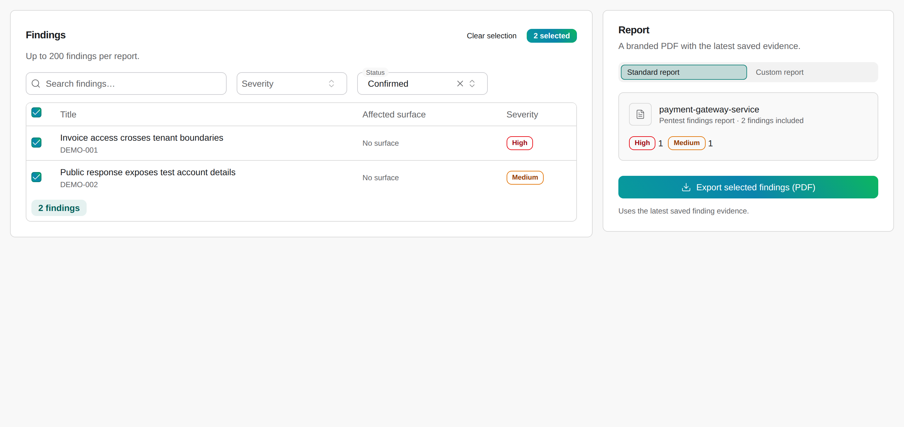

Cyber는 두 종류의 보고서를 제공합니다. 하나는 티켓, 수정 검토, 고객용으로 고른 이슈를 내보내는 것이고, 다른 하나는 각 [pentest 실행](/ko/guide/security/security-testing)이 끝날 때 작성하는 전체 보고서입니다. 내보내기는 새 스캔을 시작하지 않으므로 필요한 만큼 자주 내보낼 수 있습니다.

## 사전 요구사항

- Cyber 앱에 대한 보기 권한. Viewer도 이슈를 내보내고 실행 보고서를 다운로드할 수 있습니다.
- 내보내기의 경우: 앱에 이슈가 하나 이상 있어야 합니다. [보안 이슈 트리아지](/guide/security/cyber-findings)를 참조하세요.
- 맞춤 보고서의 경우: 워크스페이스의 Chat 접근 권한.

## 보고서 선택

| 보고서 | 포함 내용 | 받는 곳 |
| --- | --- | --- |
| **CSV** | 필터나 선택과 일치하는 이슈당 한 행 | **Issues** 목록의 **Export** |
| **PDF report** | 내보낸 이슈의 브랜드 PDF: 표지, 심각도 요약, 내보내기 범위, 색인, 그리고 이슈별로 세부 정보와 증거가 담긴 섹션 | **Issues** 목록의 **Export** |
| **Custom report…** | 내보낸 이슈를 CloudThinker가 브리프에 따라 작성한 보고서. 선택적으로 참조 보고서의 구조와 스타일을 따릅니다 | **Issues** 목록의 **Export**, Chat으로 전달 |
| 실행 보고서 | 테스트하지 못한 부분을 포함한 한 실행의 전체 평가 | 실행의 **Report** 탭 |

## 이슈 내보내기

<Steps>
  <Step title="Issues 열기">
    **Pentest apps**에서 앱을 열고 **Issues** 탭을 클릭합니다. Cyber 상단의 **Issues** 탭에서 **Target** 필터를 하나의 앱으로 설정해 사용할 수도 있습니다.
  </Step>
  <Step title="이슈 고르기">
    목록을 필터링하거나 원하는 행을 체크합니다. 체크한 행은 목록의 페이지를 넘기는 동안 선택된 상태로 유지되며, 필터를 바꾸면 해제됩니다.
  </Step>
  <Step title="내보내기">
    툴바 오른쪽의 **Export**를 클릭합니다. **Issues**에서 **All matching filters** 또는 **Selected rows**를 선택한 다음 **CSV** 또는 **PDF report**를 고릅니다.

    **성공 상태:** **Issues exported as CSV** 또는 **PDF report ready**가 표시되고 파일이 다운로드됩니다.
  </Step>
</Steps>

<Frame>
  
</Frame>

**PDF report**와 **Custom report…**는 하나의 pentest 앱에서 최대 200개 이슈를 받습니다. Cyber 전체 **Issues** 목록에서는 먼저 하나의 앱으로 필터링하거나 하나의 앱에서 행을 선택하세요. 비활성화된 경우 메뉴에 이유가 표시됩니다. 내보내기가 실패해도 선택은 유지되므로 다시 시도할 수 있습니다.

## 원하는 형식으로 맞춤 보고서 작성

내부 보안 검토 형식처럼 팀이나 고객이 이미 사용하는 템플릿에 이슈를 맞춰야 할 때 맞춤 보고서를 사용합니다.

<Steps>
  <Step title="Custom report 열기">
    **Issues**에서 **Export**를 클릭하고 범위를 선택한 다음 **Custom report…**를 클릭합니다.
  </Step>
  <Step title="브리프 작성">
    **Brief**에 보고서가 해야 할 일을 적습니다. 예:

    ```text
    Write an executive summary for leadership, then group issues by risk with clear fix steps.
    ```

    템플릿의 구조와 스타일을 따르려면 **Upload a reference report**를 클릭하고 최대 5 MB의 PDF 또는 DOCX를 선택합니다.
  </Step>
  <Step title="생성">
    **Generate report**를 클릭합니다.

    **성공 상태:** 이슈와 참조 문서가 로드된 채팅이 열리고, CloudThinker가 그곳에서 보고서를 작성합니다. 같은 채팅에서 후속 요청을 하여 다듬을 수 있습니다.
  </Step>
</Steps>

CloudThinker는 참조 문서의 사실이 아닌 구조와 스타일을 복사합니다. 참조 문서의 예시 발견 항목은 결과로 나타나지 않습니다.

## 향후 실행의 보고서 작성 방식 설정

보고서 설정은 워크스페이스가 아니라 앱에 속합니다. 각 실행은 시작할 때 저장된 설정으로 보고서를 작성하므로, 다음 실행 전에 바꾸세요.

<Steps>
  <Step title="Reports 섹션 열기">
    앱의 **Settings** 탭을 열고 **Reports**로 이동합니다.
  </Step>
  <Step title="스타일과 형식 선택">
    **Style**에서 **Standard** 또는 **Custom**을 고릅니다. Custom의 경우 브리프를 작성하고 선택적으로 참조 보고서(PDF 또는 DOCX, 최대 5 MB)를 추가합니다. **Format**에서 **PDF** 또는 **DOCX**를 선택합니다. **Delivery**는 알림 설정으로 연결됩니다.
  </Step>
  <Step title="저장">
    나타나는 바에서 **Save changes**를 클릭합니다.

    **성공 상태:** 바가 닫힙니다. 다음 실행이 이 설정을 사용합니다. 이미 시작된 실행과 **Issues**의 내보내기는 영향을 받지 않습니다.
  </Step>
</Steps>

## 실행 보고서 다운로드

<Steps>
  <Step title="실행 보고서 열기">
    앱의 **Runs** 탭을 열고 실행을 선택한 다음 **Report** 탭을 클릭합니다.
  </Step>
  <Step title="다운로드">
    **Download report**를 클릭합니다. 먼저 크게 읽으려면 **Expand preview**를 클릭합니다.

    **성공 상태:** 해당 실행이 시작될 때 앱의 보고서 설정에서 선택한 형식으로 파일이 다운로드됩니다.
  </Step>
</Steps>

결론을 공유하기 전에 보고서의 커버리지와 인증 제한 사항을 읽으세요. 수정 후 새 판정을 받으려면 pentest를 다시 실행하세요.

## 보고서에 포함되는 내용

- **증거:** 실행 중에 저장된 캡처된 요청, 응답, 스크린샷. 내보내기는 새 증거를 캡처하지 않습니다.
- **마스킹:** 비밀번호, 토큰, 쿠키, 키는 자리표시자로 대체됩니다. 요청을 재현하려면 자신의 테스트 자격 증명을 사용하세요.
- **제한 사항:** 실행 보고서는 로그인 실패 뒤의 영역처럼 실행이 테스트하지 못한 부분과, 필요한 스크린샷이 없는 경우를 명시합니다.
- **증명 흐름:** 이슈 페이지와 복사한 이슈에 표시되지만 PDF 보고서에서는 제외됩니다.

## 문제 해결

모든 Cyber 문제를 한곳에서 보려면 [Cyber 문제 해결](/guide/security/cyber-troubleshooting)을 참조하세요.

<AccordionGroup>
  <Accordion title="PDF report 또는 Custom report가 비활성화됨">
    하나의 pentest 앱에서 최대 200개 이슈가 필요합니다. 메뉴에 **Select issues from one pentest app.** 같은 이유가 표시됩니다. 필터를 좁히거나, 하나의 앱으로 필터링하거나, 더 적은 행을 선택하세요.
  </Accordion>
  <Accordion title="Custom report를 선택할 수 없음">
    맞춤 보고서는 채팅을 시작하므로 Chat 접근 권한이 필요합니다. 워크스페이스 관리자에게 요청하세요.
  </Accordion>
  <Accordion title="내보내기가 실패함">
    **Could not export issues.**가 표시됩니다. 선택은 유지되므로 확인한 다음 다시 내보내세요.
  </Accordion>
  <Accordion title="실행에 No report yet이 표시됨">
    보고서는 실행이 끝날 때 작성됩니다. 보고서를 작성하기 전에 끝난 실패한 실행도 같은 메시지를 표시합니다. 중지된 실행은 보고서를 만들지 않고 대신 **Run stopped**를 표시합니다. 보고서를 받으려면 새 실행을 시작하세요.
  </Accordion>
  <Accordion title="새 보고서 설정이 이전 보고서를 바꾸지 않음">
    각 실행은 시작할 때의 보고서 설정을 유지합니다. 새 스타일의 보고서를 받으려면 새 실행을 시작하세요.
  </Accordion>
</AccordionGroup>

## 다음 단계

<CardGroup cols={2}>
  <Card title="보안 이슈 트리아지" icon="list-check" href="/guide/security/cyber-findings">
    공유하기 전에 각 이슈의 증거를 확인합니다
  </Card>
  <Card title="보안 테스트 실행" icon="crosshairs" href="/ko/guide/security/security-testing">
    다시 실행하여 수정을 검증하고 새 보고서를 받습니다
  </Card>
</CardGroup>
