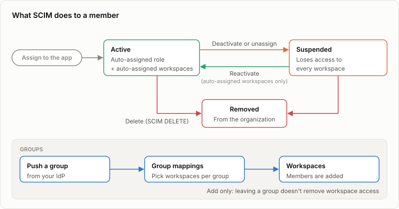
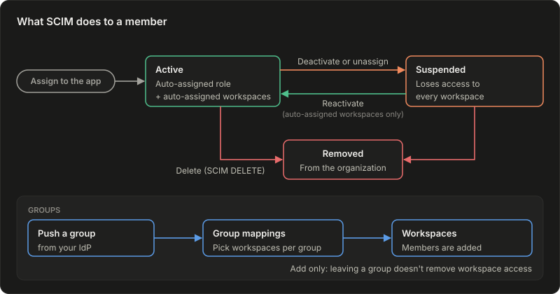

SCIM(System for Cross-domain Identity Management)을 사용하면 Okta나 Microsoft Entra ID 같은 아이덴티티 제공자(IdP)가 CloudThinker 계정을 대신 관리합니다. IdP에서 누군가를 CloudThinker 앱에 할당하면 조직에 합류하고, 할당을 해제하면 접근이 끝납니다. 수동 초대나 제거가 필요 없습니다.

## 사전 요구사항

- **Scale** 또는 **Enterprise** 플랜의 조직. [요금](/ko/guide/billing/pricing)을 참조하세요.
- 확인된 도메인이 있는 활성 [SSO 연결](/ko/guide/security/sso). 프로비저닝 설정은 SSO가 활성화된 후에만 나타납니다.
- CloudThinker의 조직 **Owner** 역할. Admin은 페이지를 읽기 전용으로 열 수 있지만 SSO나 SCIM을 바꿀 수 없습니다. [역할과 권한](/guide/security/roles)을 참조하세요.
- IdP에서 CloudThinker 앱의 프로비저닝 설정에 대한 관리자 접근 권한.

## SCIM이 CloudThinker에서 바꾸는 것

<Frame caption="할당 해제는 멤버를 정지시킵니다. SCIM DELETE만 멤버를 제거하며, 그룹 매핑은 접근 권한을 추가하기만 합니다.">
  
  
</Frame>

| IdP에서 | CloudThinker에서 |
|---|---|
| 사람을 CloudThinker 앱에 할당 | **Auto-assigned organization role**로 조직에 추가되고 **Auto-assigned workspaces**를 받습니다 |
| 이름이나 이메일 변경 | CloudThinker 프로필이 업데이트됩니다 |
| 비활성화(inactive로 설정) | 멤버십이 정지되고 모든 워크스페이스에 대한 접근을 잃습니다 |
| 다시 활성화 | 자동 할당 워크스페이스와 함께 멤버십이 돌아옵니다 |
| 삭제(SCIM `DELETE`) | 조직에서 제거됩니다 |
| 그룹 푸시 | 그룹이 **Group mappings**에 나타나며, 그곳에서 멤버용 워크스페이스를 고릅니다 |

앱에서 누군가의 할당을 해제하는 것은 보통 삭제가 아니라 비활성화로 처리됩니다. Okta와 Microsoft Entra ID는 모두 사용자 할당을 해제할 때 `active=false`를 보내므로, 그 사람은 CloudThinker에서 제거되지 않고 **정지**됩니다. IdP가 `DELETE`를 보낼 때만 제거됩니다.

SCIM이 켜져 있는 동안에는 IdP가 조직 구성원에 대한 기준이 됩니다.

- **멤버 초대가 꺼집니다.** CloudThinker에서 초대하면 "Member invitations are disabled because this organization uses SCIM provisioning. Manage users through your identity provider."가 반환됩니다.
- **SCIM으로 프로비저닝된 멤버는 CloudThinker에서 제거할 수 없습니다.** 오류는 "This member was provisioned via SCIM."입니다. 대신 IdP에서 제거하세요.
- **Just-in-time 프로비저닝이 꺼집니다.** SCIM과 just-in-time(첫 SSO 로그인 시 계정 생성)은 함께 실행될 수 없습니다. SCIM을 켜면 just-in-time이 자동으로 꺼집니다. IdP가 프로비저닝하지 않은 도메인 사용자는 IdP가 프로비저닝할 때까지 SSO 로그인에서 "No account found. Contact your administrator for access."로 거부됩니다.

CloudThinker에서 멤버의 역할이나 워크스페이스 접근 권한은 여전히 바꿀 수 있습니다. [조직](/ko/guide/organization)을 참조하세요.

## CloudThinker에서 SCIM 켜기

<Steps>
  <Step title="프로비저닝 설정 열기">
    **Settings → Organization → Identity**로 이동하여 **Provisioning** 섹션을 찾습니다.

    섹션이 없다면 SSO 연결이 아직 활성화되지 않은 것입니다. 먼저 [SSO 설정](/ko/guide/security/sso)을 완료하세요.
  </Step>
  <Step title="SCIM 선택">
    **SCIM**(Sync users and groups from your identity provider)을 선택합니다. 다른 옵션은 **Manual**(직접 사람을 초대)과 **Just-in-time**(첫 SSO 로그인 시 계정 생성)입니다.

    **성공 상태:** **SCIM enabled** 대화상자가 열립니다.
  </Step>
  <Step title="두 값 복사">
    대화상자에는 다음이 표시됩니다.

    - **Bearer token**: IdP가 요청이 허용됨을 증명하기 위해 보내는 시크릿입니다.
    - **SCIM base URL**: IdP가 호출하는 엔드포인트입니다. `https://<your-cloudthinker-host>/api/v1/scim/<organization-id>/v2` 형식입니다.

    둘 다 복사한 다음 **Done**을 클릭합니다.

    **성공 상태:** **Provisioning** 섹션에 "SCIM directory sync is active."와 함께 **Directory sync (SCIM)**이 표시됩니다.
  </Step>
</Steps>

<Warning>
Bearer 토큰은 한 번만 표시됩니다. 복사하지 않고 대화상자를 닫았다면 **Rotate token**을 클릭하여 새 토큰을 받으세요.
</Warning>

## 새 멤버의 기본값 설정

프로비저닝 옵션 아래에 있는 두 설정이 새로 프로비저닝된 사람이 받는 것을 결정합니다. IdP가 첫 사용자를 보내기 전에 설정하세요.

| 설정 | 기능 | 기본값 |
|---|---|---|
| **Auto-assigned organization role** | 새 멤버가 받는 조직 역할: **Viewer**, **Developer** 또는 **Admin** | **Viewer** |
| **Auto-assigned workspaces** | 새 멤버가 합류하는 워크스페이스 | 기본 워크스페이스 |

Owner는 이 방식으로 할당할 수 없습니다. 각 역할이 할 수 있는 일은 [역할과 권한](/guide/security/roles)을 참조하세요.

## 아이덴티티 제공자 구성

SSO용으로 만든 CloudThinker 앱을 사용합니다.

<Tabs>
  <Tab title="Okta">
    <Steps>
      <Step title="앱에서 SCIM 활성화">
        CloudThinker 앱을 엽니다. **General** 탭에서 **App Settings** 아래의 **Edit**를 클릭하고, **Provisioning**을 **SCIM**으로 설정한 다음 저장합니다.
      </Step>
      <Step title="연결 정보 입력">
        **Provisioning → Integration**에서 **Edit**를 클릭합니다.

        | Okta 필드 | 값 |
        |---|---|
        | **SCIM connector base URL** | CloudThinker의 **SCIM base URL** |
        | **Unique identifier field for users** | `userName` |
        | **Supported provisioning actions** | **Push New Users**, **Push Profile Updates**, **Push Groups** |
        | **Authentication Mode** | **HTTP Header** |
        | **Authorization** | CloudThinker의 **Bearer token** |

        **Test Connector Configuration**을 클릭한 다음 **Save**를 클릭합니다.
      </Step>
      <Step title="To App 작업 켜기">
        **Provisioning → To App**에서 **Edit**를 클릭하고 **Create Users**, **Update User Attributes**, **Deactivate Users**를 활성화합니다. 저장합니다.
      </Step>
      <Step title="그룹 푸시">
        **Push Groups** 탭에서 워크스페이스에 매핑할 그룹을 추가합니다.
      </Step>
    </Steps>
  </Tab>
  <Tab title="Microsoft Entra ID">
    <Steps>
      <Step title="관리자 자격 증명 설정">
        **Enterprise applications → CloudThinker → Provisioning**을 엽니다. **Provisioning Mode**를 **Automatic**으로 설정합니다. **Admin Credentials**에서 **SCIM base URL**을 **Tenant URL**에, **Bearer token**을 **Secret Token**에 입력합니다. **Test Connection**을 클릭한 다음 **Save**를 클릭합니다.
      </Step>
      <Step title="매핑 확인">
        **Mappings**에서 사용자 및 그룹 프로비저닝을 활성화된 상태로 유지합니다. `userName`에 매핑된 속성이 확인된 도메인의 사용자 이메일을 담고 있는지 확인합니다.
      </Step>
      <Step title="프로비저닝 시작">
        **Settings**에서 **Scope**를 **Sync only assigned users and groups**로 설정합니다. **Provisioning Status**를 **On**으로 설정하고 저장합니다. Entra는 약 40분마다 주기를 실행합니다.
      </Step>
    </Steps>
  </Tab>
  <Tab title="Other SCIM 2.0 provider">
    | IdP 필드 | 값 |
    |---|---|
    | SCIM base URL / Tenant URL | CloudThinker의 **SCIM base URL** |
    | Authentication | HTTP 헤더, bearer 토큰 |
    | Bearer token / Secret token | CloudThinker의 **Bearer token** |
    | Unique identifier for users | `userName`, 사용자 이메일 주소로 설정 |

    사용자 생성, 사용자 속성 업데이트, 사용자 비활성화, 그룹 푸시를 켭니다. IdP에 **Test connection**이 있다면 실행합니다.
  </Tab>
</Tabs>

CloudThinker는 다음 속성을 읽습니다.

| 리소스 | 속성 | 필수 | 용도 |
|---|---|---|---|
| User | `userName` | 예 | `emails`가 비어 있을 때 이메일 |
| User | `emails` | 아니요 | 이메일. `primary` 항목이 우선하며, 없으면 첫 번째 항목입니다. |
| User | `name.givenName`, `name.familyName` | 아니요 | 표시 이름 |
| User | `active` | 아니요(기본값 `true`) | 정지 및 재활성화 |
| User | `externalId` | 아니요 | 필터에서 사용자 매칭 |
| Group | `displayName` | 예 | **Group mappings**에 표시되는 이름 |
| Group | `members` | 아니요 | 그룹의 워크스페이스를 받는 사람 |
| Group | `externalId` | 아니요 | 그룹 매칭 |

**성공 상태:** 테스트 사용자 한 명을 앱에 할당합니다. IdP의 동기화 주기 안에 **Settings → Organization → Members**에 나타나고, **View sync logs**에 상태가 `SUCCESS`인 `CREATE` 항목이 표시됩니다.

IdP 옵션과 맞출 수 있도록 CloudThinker SCIM API가 지원하는 기능:

| 기능 | 지원 |
|---|---|
| Users 및 Groups 리소스(생성, 읽기, 교체, 패치, 삭제) | 예 |
| `userName`, `emails.value`, `externalId`, `active`(사용자) 및 `displayName`(그룹)에 대한 `eq` 필터 | 예, 최대 100개 결과 |
| 대량 작업 | 아니요 |
| 정렬, ETag, 비밀번호 변경 | 아니요 |

<Note>
누군가 다른 조직의 CloudThinker 계정을 이미 가지고 있다면, CloudThinker는 그 이메일 도메인이 확인된 SSO 도메인 중 하나일 때만 기존 계정을 조직에 추가합니다. 그렇지 않으면 IdP는 "User email domain not verified for this organization."을 받습니다.
</Note>

## 그룹을 워크스페이스에 매핑

그룹을 사용하면 IdP에서 한 번만 변경해도 팀 전체를 올바른 워크스페이스에 넣을 수 있습니다.

<Steps>
  <Step title="IdP에서 그룹 푸시">
    IdP에서 그룹을 CloudThinker 앱에 할당하고 푸시합니다.

    **성공 상태:** 각 그룹이 **Settings → Organization → Identity**의 **Group mappings**에 **Group name**과 **Members** 수와 함께 나타납니다. 그 전까지 섹션에는 "No groups synced yet."이 표시됩니다.
  </Step>
  <Step title="그룹별 워크스페이스 선택">
    그룹 행에서 **Auto-assigned workspaces**를 열고 멤버가 합류할 워크스페이스를 선택합니다.
  </Step>
  <Step title="그룹 역할 선택">
    그룹의 **Auto-assigned organization role**을 설정하거나, 위에서 설정한 기본 역할을 쓰려면 **Inherit from connection**으로 둡니다.

    CloudThinker는 멤버를 생성할 때 한 번만 조직 역할을 설정합니다. 이후 동기화는 역할을 바꾸지 않으므로, CloudThinker에서 직접 바꾼 역할은 유지됩니다.
  </Step>
  <Step title="행 저장">
    **Actions** 열에서 **Save**를 클릭합니다.

    **성공 상태:** 그룹의 현재 멤버가 선택한 워크스페이스에 추가되고, 이후 멤버는 IdP가 그룹으로 동기화할 때 추가됩니다.
  </Step>
</Steps>

<Warning>
그룹 매핑은 워크스페이스 접근 권한을 추가하기만 합니다. 누군가를 그룹에서 제거하거나 매핑에서 워크스페이스를 제거해도 그 워크스페이스에서 빠지지 않습니다. [워크스페이스 멤버](/ko/guide/workspace-users)에서 제거하거나, 모든 곳에서 제거하려면 IdP에서 앱 할당을 해제하세요.
</Warning>

첫 동기화 후 **Settings → Organization → Members**에서 새 멤버의 역할을 확인하고 달라야 하는 역할을 조정하세요.

## 누군가 떠날 때 일어나는 일

| IdP 작업 | CloudThinker 멤버십 | 워크스페이스 | 해당 사용자의 자동화 |
|---|---|---|---|
| 비활성화(inactive로 설정) | 정지됨 | 모두에서 제거 | 꺼짐 |
| 다시 활성화 | 좌석이 남아 있으면 다시 활성 | 자동 할당 워크스페이스만. 나머지는 다시 추가 | 누군가 켤 때까지 꺼진 상태 유지 |
| 삭제(SCIM `DELETE`) | 제거됨 | 모두에서 제거 | 꺼짐 |

[Automations](/guide/automation/automations)는 스스로 소유자를 바꾸지 않습니다. 워크스페이스 Admin은 자동화 페이지에서 **Take ownership**을 선택할 수 있으며, 자동화는 그 Admin이 켤 때까지 꺼진 상태로 남습니다. [자동화 소유자](/ko/guide/automation/autonomous-agents)를 참조하세요.

<Note>
플랜이 좌석당 과금을 사용하고 모든 좌석이 사용 중이면, 새로 프로비저닝되거나 다시 활성화된 사람은 비활성으로 추가되어 아직 CloudThinker를 사용할 수 없습니다. 활성 멤버와 대기 중인 초대는 좌석을 사용하며, 정지되거나 비활성인 멤버는 사용하지 않습니다. Owner는 **Settings → Organization → Billing**에서 좌석을 추가합니다. [좌석 추가 또는 제거](/ko/guide/billing/subscription#시트-추가-또는-제거)를 참조하세요. 그런 다음 **Settings → Organization → Members**에서 상태를 확인하세요.
</Note>

## 토큰 교체 또는 끄기

토큰이 유출되었을 수 있거나 정책상 필요한 경우 **토큰을 교체합니다**.

<Steps>
  <Step title="교체">
    **Directory sync (SCIM)**에서 **Rotate token**을 클릭한 다음 확인 창에서 **Rotate**를 클릭합니다.

    **성공 상태:** 대화상자에 새 **Bearer token**과 **SCIM base URL**이 표시됩니다. 이전 토큰은 24시간 동안 계속 동작합니다.
  </Step>
  <Step title="IdP 업데이트">
    새 토큰을 IdP의 프로비저닝 설정에 붙여 넣고 연결을 테스트합니다. 24시간 안에 하지 않으면 동기화가 인증 오류로 실패하기 시작합니다.
  </Step>
</Steps>

**SCIM을 끄려면** **Provisioning**에서 **Manual** 또는 **Just-in-time**을 선택한 다음 확인 창에서 **Disable SCIM**을 클릭합니다. 그러면 토큰이 즉시 폐기되고 디렉터리 동기화가 중지됩니다. 기존 멤버는 계정을 유지하며, 이후에는 CloudThinker에서 관리합니다. IdP에서도 프로비저닝을 끄세요. 그렇지 않으면 실패하는 요청을 계속 보냅니다.

토큰 변경(생성, 교체, 폐기)과 SCIM이 프로비저닝, 업데이트, 제거하는 모든 사용자와 그룹은 [감사 로그](/guide/security/audit-logs)에 기록됩니다.

## 동기화 활동 확인

**Directory sync (SCIM)**에서 **View sync logs**를 클릭하여 **SCIM sync logs**를 엽니다.

| 열 | 표시 내용 |
|---|---|
| **Timestamp** | CloudThinker가 요청을 처리한 시간 |
| **Action** | `CREATE`, `UPDATE`, `DEACTIVATE` 또는 `DELETE` |
| **Resource** | `User` 또는 `Group`과 그 ID |
| **Status** | `SUCCESS`, `SKIPPED` 또는 `FAILED` |

CloudThinker는 하루에 한 번 7일 동안 동기화 활동이 없는 SCIM 프로비저닝 사용자를 확인하고, 각 사용자에 대해 상태가 `SKIPPED`인 `UPDATE` 항목을 추가합니다. 이것은 알림일 뿐이며 CloudThinker는 접근 권한을 바꾸지 않습니다. 그 사람이 IdP에서 여전히 할당되어 있는지 확인하고, 떠났다면 그곳에서 할당을 해제하세요.

## 문제 해결

<AccordionGroup>
  <Accordion title="Provisioning 섹션이 없음">
    이 섹션은 SSO 연결이 활성화된 경우에만 표시됩니다. 도메인 확인을 포함해 [SSO 설정](/ko/guide/security/sso)을 완료하세요. 변경하려면 Owner 역할이 필요합니다.
  </Accordion>
  <Accordion title="Group mappings에 그룹이 나타나지 않음">
    CloudThinker는 그룹을 가져오지 않습니다. IdP가 푸시해야 합니다. IdP에서 그룹을 CloudThinker 앱에 할당하고 푸시를 실행한 다음 **View sync logs**에서 `Group` 항목을 찾으세요.
  </Accordion>
  <Accordion title="사용자가 프로비저닝되지 않음">
    IdP에서 사용자가 CloudThinker 앱에 할당되었는지 확인한 다음, 동기화 로그에서 `FAILED` 항목을 찾으세요. 흔한 원인: 토큰이 24시간 넘게 전에 교체되었거나 폐기됨, 그 사람의 기존 계정이 확인되지 않은 이메일 도메인을 사용함("User email domain not verified for this organization"), 또는 이메일이 CloudThinker 내부 계정용으로 예약됨("This email belongs to a CloudThinker System user"). 마지막 경우에는 다른 이메일을 사용하거나 지원팀에 문의하세요.
  </Accordion>
  <Accordion title="누군가 떠났지만 여전히 로그인할 수 있음">
    CloudThinker 앱 자체에서 할당을 해제하거나 비활성화하세요. 그룹에서 제거하는 것은 그룹 멤버십만 바꿉니다. 일부 IdP는 일정에 따라 동기화하므로(Microsoft Entra ID는 약 40분마다 실행), 다음 주기를 기다린 후 동기화 로그를 확인하세요.
  </Accordion>
  <Accordion title="모든 동기화가 인증 오류로 실패함">
    IdP의 토큰이 더 이상 유효하지 않습니다. 토큰이 24시간 넘게 전에 교체되었거나 SCIM이 꺼졌습니다. **Rotate token**을 클릭하고 새 값을 IdP에 붙여 넣으세요. SCIM이 꺼졌다면 **SCIM**을 다시 선택해 새 토큰을 받으세요.
  </Accordion>
  <Accordion title="Cannot enable JIT provisioning while SCIM is active">
    Just-in-time과 SCIM은 함께 실행될 수 없습니다. **Provisioning**에서 **Just-in-time**을 선택하고 **Disable SCIM**을 확인하세요. 그러면 토큰이 폐기되고 디렉터리 동기화가 중지됩니다.
  </Accordion>
  <Accordion title="멤버를 초대하거나 제거할 수 없음">
    SCIM이 켜져 있는 동안에는 정상입니다. 대신 IdP에서 사람을 할당하거나 할당을 해제하세요.
  </Accordion>
</AccordionGroup>

## 다음 단계

<CardGroup cols={2}>
  <Card title="역할과 권한" icon="user-shield" href="/guide/security/roles">
    프로비저닝된 멤버에게 맞는 기본 역할을 고릅니다.
  </Card>
  <Card title="워크스페이스 멤버" icon="users" href="/ko/guide/workspace-users">
    각 워크스페이스를 열 수 있는 사람을 세밀하게 조정합니다.
  </Card>
  <Card title="감사 로그" icon="clipboard-list" href="/guide/security/audit-logs">
    토큰 변경과 프로비저닝 해제를 검토합니다.
  </Card>
  <Card title="싱글 사인온" icon="key" href="/ko/guide/security/sso">
    SSO 연결이나 확인된 도메인을 변경합니다.
  </Card>
</CardGroup>
