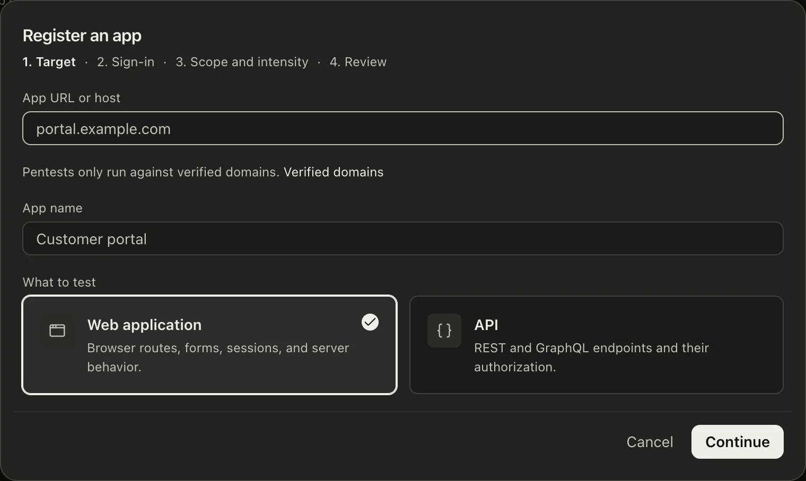
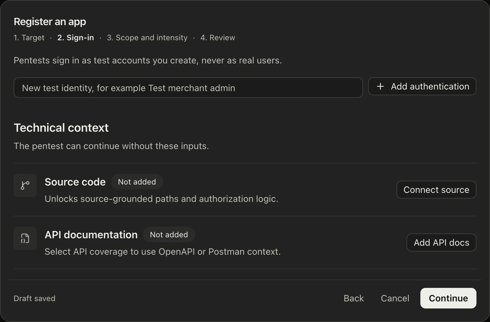
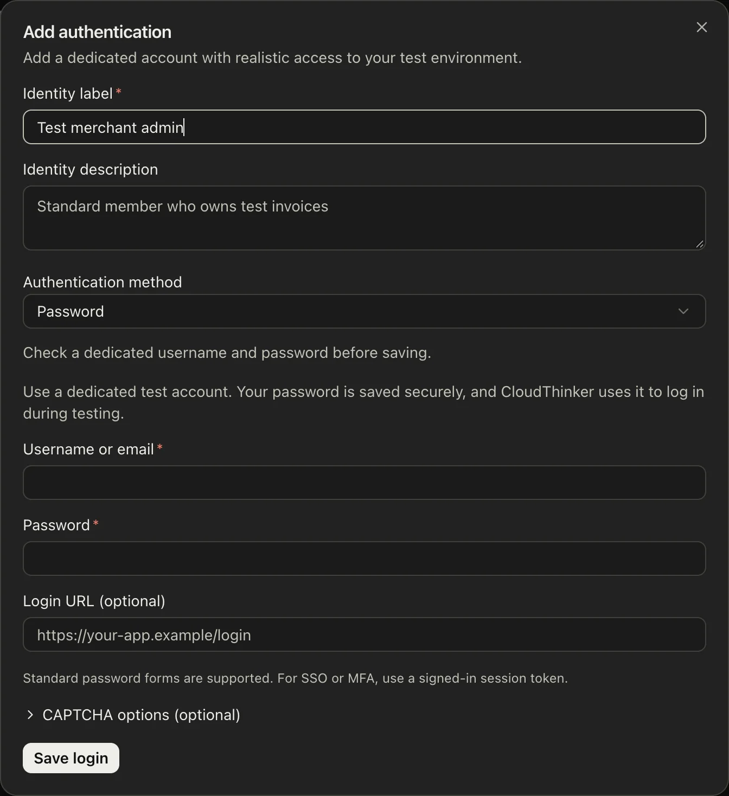
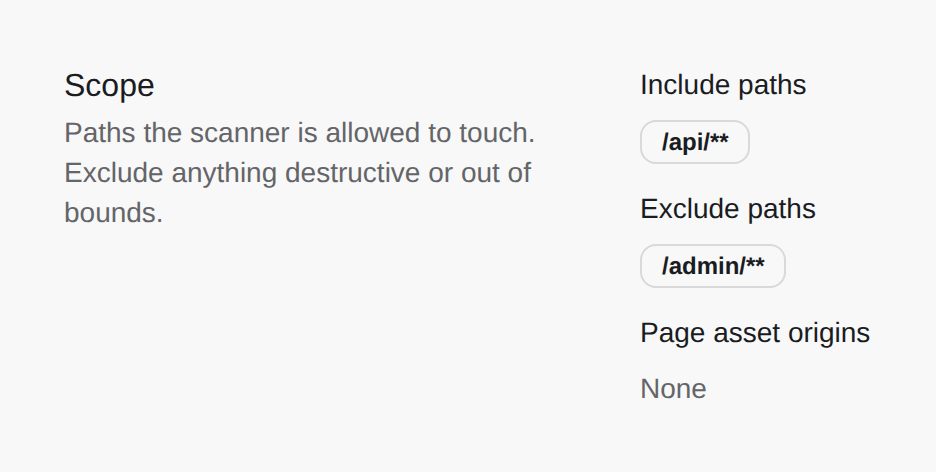
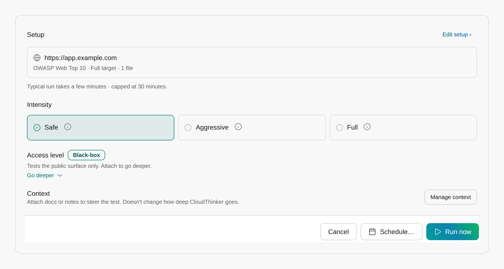
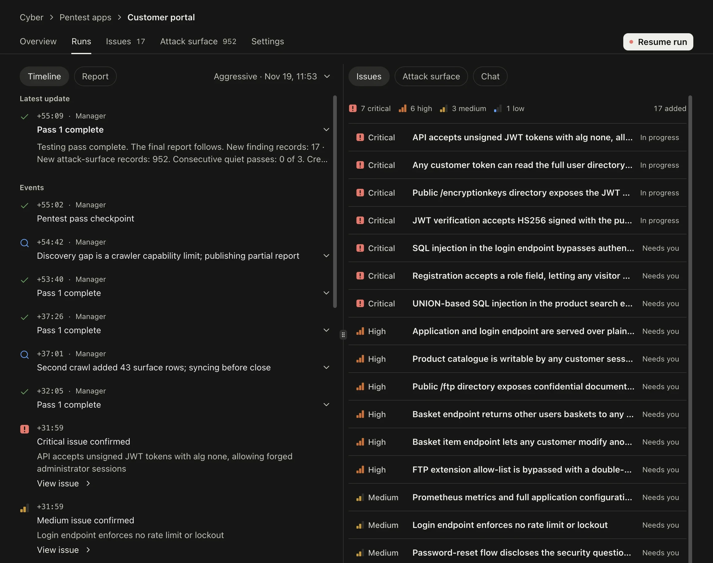

펜테스트 실행은 실행 중인 앱 하나에 대한 DAST 스캔입니다. CloudThinker는 사용자가 설정한 한도 안에서 앱을 테스트하고, 확인한 모든 문제에 대해 요청과 응답 증거를 기록합니다. 이 페이지는 모든 설정 옵션을 다룹니다. 최소한의 첫 실행은 [Cyber 빠른 시작](/guide/security/cyber-quickstart)을 사용하세요.

## 사전 요구 사항

- 테스트 권한이 있고 도메인 URL로 접근할 수 있는 앱. **Safe**보다 높은 강도에는 스테이징을 사용하세요.
- 도메인의 DNS 레코드에 대한 액세스와, 도메인을 확인할 워크스페이스 관리자 권한.
- 실행에 필요한 크레딧. 모든 실행이 크레딧을 사용하며, Deep dive와 Fortress가 가장 많이 사용합니다. [사용량](/ko/guide/billing/usage)을 참조하세요.
- 선택 사항: 전용 테스트 계정, OpenAPI 스펙 또는 Postman 컬렉션, 화이트박스 테스트를 위한 [Git 연결](/guide/connections/github).

## 앱 등록

<Steps>
  <Step title="대상 설정">
    **Cyber**를 열고 **Pentest apps**로 이동한 뒤 **Register an app**을 클릭합니다. 대화 상자는 **Target**, **Sign-in**, **Scope and intensity**, **Review**의 네 단계로 구성됩니다. **Target**에서 **App URL or host**와 **App name**을 입력하고 **What to test** 아래에서 **Web application** 또는 **API**를 선택합니다. **Continue**를 클릭합니다.

    이 선택에 따라 커버리지 보고서가 측정하는 OWASP 카테고리가 정해집니다. 둘을 결합하거나 나중에 변경할 수 없습니다. 같은 호스트를 API로 테스트하려면 두 번째 앱을 만드세요.

    <Frame>
      
    </Frame>
  </Step>
  <Step title="도메인 확인">
    **Target ownership** 아래에서 **Create DNS proof**를 클릭합니다. 표시된 **DNS record name**과 **TXT value**를 DNS 제공자에 TXT 레코드로 추가한 뒤 **Check again**을 클릭합니다. 제공자가 영역 이름을 자동으로 붙인다면 그 접미사는 빼세요.

    **완료 상태:** **Target ownership**에 **Verified**가 표시됩니다. 이미 확인한 도메인이 해당 호스트를 포함하면 카드에 그 도메인의 **Proof reused from**이 표시되며 새 레코드가 필요하지 않습니다.
  </Step>
  <Step title="액세스 추가">
    **Sign-in**에서 테스트 사용자, **Source code**, **API documentation**을 추가합니다. 세 가지 모두 선택 사항입니다. 각각은 아래 섹션을 참조하세요.

    <Frame>
      
    </Frame>
  </Step>
  <Step title="강도 선택 및 검토">
    **Scope and intensity**에서 **Default intensity**를 선택하고, 매주 실행하려면 **Weekly pentest**를 켭니다. **Continue**를 클릭합니다. **Review**에서 요약을 확인한 뒤, 앱을 등록하고 실행을 시작하려면 **Register app**을, 실행하지 않고 저장만 하려면 **Run later**를 클릭합니다.

    설정 단계에서는 포함 또는 제외 경로를 지정하지 않으므로 **Register app**은 대상 전체를 대상으로 실행됩니다. 첫 실행에는 **Safe**를 선택하고 **Run later**를 클릭한 뒤, 실행하기 전에 앱의 **Settings** 아래 [Scope](#범위-및-컨텍스트-설정)에서 포함 및 제외 경로를 설정하세요. [Cyber 빠른 시작](/guide/security/cyber-quickstart)에서 이 과정을 안내합니다.

    **완료 상태:** **Register app**은 첫 실행을 시작합니다. **Run later**는 실행 없이 저장된 앱을 엽니다.
  </Step>
</Steps>

워크스페이스 전체의 확인된 도메인은 **Cyber → Settings**에서 관리할 수 있습니다. 도메인을 확인하면 해당 도메인에 대한 테스트가 승인됩니다. 앱의 범위가 넓어지지는 않습니다.

## 테스트 사용자 추가

테스트 사용자를 사용하면 Cyber가 로그인 뒤의 페이지에 접근하고 권한 부여를 검사할 수 있습니다. 예: 사용자 A가 사용자 B의 데이터를 볼 수 있는가? 설정 중에는 이름을 입력하고 **Add authentication**을 클릭합니다. 앱의 **Settings**에서는 **Test identities** 행의 **Add** 또는 **Manage**를 사용합니다. **Run pentest** 대화 상자에서는 **Add auth**를 클릭합니다. 세 가지 모두 같은 양식을 엽니다. 사용자를 설명(**Identity label**, **Identity description**)한 뒤 **Authentication method**를 선택합니다.

| 방법 | 입력하는 내용 | 확인 방식 |
| --- | --- | --- |
| **Password** | **Username or email**, **Password**, **Login URL (optional)** | 로그인하지 않고 저장됩니다. 실행이 시작될 때 로그인하며, 로그인에 실패하면 실행이 **Incomplete**로 끝납니다. [CAPTCHA 로그인 처리](/ko/guide/security/captcha#로그인-구성)를 참조하세요 |
| **Session token** | 브라우저의 Network 패널에서 cURL로 복사한, 로그인된 상태의 `GET` 요청 | **Verify and attach**가 요청을 한 번 보내고 성공할 때만 저장합니다. CloudThinker는 **Run pentest**를 열 때와 실행이 시작될 때 두 번 더 다시 확인합니다 |
| **Long-lived token** | 행마다 헤더 이름과 값 하나. 예: 이름 `Authorization`, 값 `Bearer <token>`. 첫 번째 이름이 비어 있으면 `Authorization`이 기본값입니다. | 확인 없이 저장됩니다. 액세스가 거부되면 실행이 이를 보고합니다. |
| **Agent creates new account** | 가입 페이지나 관리자 API를 통해 사용자를 만드는 **Instructions** | 각 수동 실행이 새 사용자를 만들고 가입과 로그인이 성공했는지 보고합니다. 가입은 앱에 실제 계정을 만들므로 이 방법에는 **Aggressive** 이상을 선택하세요 |

**Agent creates new account**의 경우, 만들 역할을 지정하고 자격 증명에 `<generated_username>`과 `<generated_password>`를 사용하며 로그인 성공을 판단하는 기준을 적은 지침을 작성하세요.

```text
Sign up at /register with <generated_username> and <generated_password>.
Create one "member" and one "admin" user.
Login succeeded when the page shows "Welcome back" and the URL is /dashboard.
```

지침은 암호화되어 저장되며 다시 표시되지 않습니다. 변경하려면 앱 **Settings**의 **Test identities** 행에서 계정을 열고 새 지침을 입력하면 저장된 지침이 대체됩니다. 이메일이나 SMS 코드가 필요한 가입은 지원되지 않습니다.

예약 실행은 **Long-lived token** 사용자로만 로그인합니다. 무인으로 재사용해도 안전한 것은 이 방식뿐이기 때문입니다. 세션은 만료되며, 비밀번호 로그인과 에이전트가 만든 로그인은 일정에서 사용되지 않습니다. 일정은 스스로 꺼지지 않습니다. 실행 시점에 토큰이 삭제되어 있으면 해당 회차는 **Incomplete**로 끝나고 알림이 전송되며, 작동하는 토큰이 저장되는 즉시 다음 회차가 다시 로그인합니다. long-lived token이 없으면 일정은 테스트 사용자로 로그인하지 않고 실행되므로 로그인 뒤의 어떤 것도 테스트하거나 재확인할 수 없습니다. 이러한 검사는 수동으로 실행하거나 long-lived token 사용자를 추가하세요.

<Tip>
  서로 다른 역할이나 테넌트의 사용자 두 명을 추가하세요. 두 명이 있으면 Cyber가 한 사용자가 다른 사용자의 데이터를 읽거나 변경할 수 있는지 테스트할 수 있습니다.
</Tip>

복사한 cURL 요청에는 활성 세션이 들어 있습니다. 비밀번호처럼 취급하고 이 양식에만 붙여 넣으세요. 로그인에 CAPTCHA가 있다면 먼저 설정하세요. [CAPTCHA 로그인 처리](/ko/guide/security/captcha)를 참조하세요.

<Frame>
  
</Frame>

## 범위 및 컨텍스트 설정

앱을 열고 **Settings**를 클릭합니다. 페이지에는 **General**, **Testing**, **Schedule**, **Reports**, **Archive** 섹션이 있습니다. 대상과 프레임워크는 설정 후 고정되므로 여기에 표시되지 않습니다.

| 섹션 | 설정할 내용 |
| --- | --- |
| **Scope** (Testing) | **Edit**을 클릭해 **Manage scope**를 엽니다. **Include paths**, **Exclude paths**, **Page asset origins**를 설정한 뒤 **Save scope**를 클릭합니다. 규칙이 없으면 행에 **Whole target**이 표시됩니다. |
| **Context files** (Testing) | OpenAPI 스펙, Postman 컬렉션, 런북, 아키텍처 노트 또는 기타 문서. 크롤링으로 찾을 수 없는 엔드포인트를 Cyber가 찾는 데 도움이 됩니다. |
| **Repositories** (Testing) | 연결된 리포지토리와 브랜치. 실행을 화이트박스로 만듭니다. |
| **Test identities** (Testing) | 설정 단계와 같은 방법 |
| **Schedule** | 앱의 반복 실행으로, 켜거나 끄고, 편집하거나 삭제할 수 있습니다. 없으면 **Add schedule**을 클릭합니다 |
| **Default intensity** (General) | 이후 실행에 미리 선택되는 강도 |
| **Reports** | 각 실행이 보고서를 작성하는 방식. [Cyber 보고서](/ko/guide/security/cyber-reports)를 참조하세요 |

앱 이름, 기본 강도, 보고서 설정의 편집 내용은 **Save changes** 바에서 함께 저장됩니다.

경로 규칙은 전체 경로와 비교되는 glob입니다.

| 패턴 | 일치 | 일치하지 않음 |
| --- | --- | --- |
| `/api/*` | `/api/users` (한 세그먼트) | `/api/users/42` |
| `/api/**` | `/api/users`, `/api/users/42` (모든 깊이) | `/api` 자체 |
| **Exclude paths**의 `/admin/**` | `/admin/` 아래의 모든 것 | `/administrator` |

- **제외가 항상 우선합니다.** 두 목록에 모두 일치하는 경로는 테스트 대상에서 제외됩니다.
- **포함 규칙이 없으면 대상 전체입니다.** 규칙을 하나 추가하기 전까지 앱 호스트의 모든 경로가 범위에 포함됩니다.
- **다른 호스트는 제외됩니다.** **Page asset origins**는 `https://cdn.example.com`과 같은 정확한 HTTPS origin만 받으며, 페이지가 그곳에서 스크립트, 스타일, 이미지, 폰트를 불러오는 것만 허용합니다. 탐색과 능동적 요청은 대상에 머뭅니다.
- 각 목록에는 최대 100자의 규칙을 최대 100개까지 넣을 수 있습니다.

<Frame>
  
</Frame>

## 액세스 수준과 강도 선택

액세스 수준은 설정이 아니라 사용자가 제공한 내용으로 정해집니다.

| 액세스 수준 | 제공한 내용 |
| --- | --- |
| **Black-box** | URL만 |
| **Gray-box** | URL과 테스트 사용자 |
| **White-box** | URL과 리포지토리(테스트 사용자 유무와 무관) |

강도는 실행이 할 수 있는 일을 정합니다. 다음은 모든 Cyber 페이지의 기준 표입니다.

| 강도 | 동작 | 실행 대상 |
| --- | --- | --- |
| **Safe** | 읽기 요청(`GET`, `HEAD`, `OPTIONS`)만으로 경로와 응답을 탐색합니다. 쓰기와 삭제는 꺼져 있습니다. | 새 앱의 첫 실행, 그리고 데이터가 바뀌면 안 되는 모든 환경 |
| **Aggressive** (UI에 **Recommended**로 표시) | 양식과 비즈니스 흐름을 테스트하기 위해 `POST`, `PUT`, `PATCH`를 추가합니다. 테스트 데이터를 만들고 편집할 수 있습니다. `DELETE`는 꺼져 있습니다. | Safe 실행으로 범위와 로그인을 확인한 뒤의 스테이징 |
| **Full** | `DELETE`를 추가하고, 범위 내 데이터의 변경과 삭제를 포함한 고영향 작업을 테스트합니다. 먼저 확인을 요청합니다. | 일회용 데이터가 있는 스테이징만 |
| **Deep dive** | Full의 모든 동작을, 연결된 다단계 결함을 따라가는 여러 패스에 걸쳐 수행합니다. 시간과 크레딧을 가장 많이 사용합니다. 먼저 확인을 요청합니다. | 일회용 데이터가 있는 스테이징만. [Deep dive 테스트](/guide/security/deep-dive-testing)를 참조하세요 |
| **Fortress** (**Enterprise**로 표시) | 범위 내에서 악용 가능한 경로를 검증하고, 영향을 증명하며, 증거를 하나의 보고서로 연결하는 에이전트 팀입니다. Full처럼 파괴적입니다. 먼저 확인을 요청합니다. Enterprise 플랜이 없으면 비활성화됩니다. | 일회용 데이터가 있는 스테이징만 |

Safe는 의도적인 데이터 변경을 피하지만, 앱이 `GET`에서 상태를 바꾼다면 읽기 요청도 데이터를 변경할 수 있습니다. 어느 경우든 첫 실행 전에 포함 경로를 설정하세요. **Password** 테스트 사용자의 로그인 단계는 강도 제한과 별개이므로, Safe를 포함한 모든 강도에서 로그인 양식을 제출할 수 있습니다.

**Deep dive**와 **Fortress**에서는 **Stop when**으로 실행 종료 방식을 설정합니다. **Investigation complete**(기본값) 또는 **Duration**(1~168 사이의 정수 시간, 프리셋 1, 4, 8, 24)입니다.

<Warning>
  **Full**, **Deep dive**, **Fortress**는 `DELETE`를 포함한 파괴적인 요청을 대상에 보냅니다. 시작하기 전에 대화 상자가 확인을 요청합니다. 일회용 환경과 테스트 계정을 사용하세요. 저장된 범위 안의 데이터는 영구적으로 변경되거나 삭제될 수 있습니다.
</Warning>

## 지금 실행 또는 예약 실행

<Steps>
  <Step title="실행 대화 상자 열기">
    앱 페이지에서 **Run pentest**를 클릭합니다. 대화 상자는 앱의 저장된 설정으로 열리며 **Domain verification required**와 같은 차단 요인을 표시합니다. 저장된 범위, 컨텍스트 및 기타 선택 설정은 **Advanced options** 아래에 있습니다.
  </Step>
  <Step title="강도와 스캔 범위 선택">
    강도를 선택합니다. Deep dive나 Fortress에서는 **Stop when**도 설정합니다. 화이트박스 앱에서는 **Scan scope**도 설정합니다. **Changes only**는 마지막 성공 실행이 기록한 커밋 이후, 연결된 각 리포지토리의 저장된 브랜치에 있는 커밋을 테스트합니다. **Whole codebase**는 모든 것을 테스트합니다. 첫 실행은 **Whole codebase**를 사용해야 하며, 새 커밋이 없는 브랜치는 전체 코드베이스 패스를 받습니다.
  </Step>
  <Step title="실행 또는 예약">
    지금 시작하려면 **Run Safe pentest**(레이블은 강도에 따라 바뀜)를 클릭합니다. 반복하려면 대신 **Schedule…**을 클릭하고 **Daily**, **Weekly**, **Monthly**, **Once** 같은 주기를 선택하거나 **Advanced · Cron expression** 아래에 cron 식을 입력합니다. 시간은 브라우저의 로컬 시간대 기준입니다. 만료 날짜도 설정할 수 있습니다. **Schedule**을 클릭해 저장합니다. **Full**, **Deep dive**, **Fortress**에서는 대화 상자가 일정을 확인하도록 요청합니다. 일정은 **Long-lived token** 테스트 사용자로만 로그인합니다([테스트 사용자 추가](#테스트-사용자-추가) 참조).

    **완료 상태:** 실행은 상태가 **Running**인 워크벤치를 엽니다. 일정은 앱 **Settings**의 **Schedule** 섹션에 켜진 상태로 표시됩니다.
  </Step>
</Steps>

<Frame>
  
</Frame>

일정을 변경하려면 앱 **Settings**의 해당 카드에서 **Edit**을 클릭합니다. 끄더라도 구성은 유지됩니다. 앱은 한 번에 하나의 펜테스트만 실행하므로, 실행이 진행 중일 때 헤더 버튼은 **View run**으로 표시됩니다.

<Warning>
  예약된 **Full**, **Deep dive**, **Fortress** 실행은 회차마다 아무도 확인하지 않은 채 파괴적인 요청을 보냅니다. 일회용 데이터와 좁은 범위의 스테이징에만 예약하세요.
</Warning>

## 실행 지켜보기

워크벤치는 실행 기록, 저장되는 이슈, Cyber가 발견한 앱 표면을 보여 줍니다. 각 실행에는 실시간 활동을 위한 **Timeline** 탭과 완료된 보고서를 위한 **Report** 탭이 있으며, 보고서에는 로그인 실패 뒤의 영역처럼 실행이 테스트하지 못한 항목이 나열됩니다. Fortress 실행에는 **Graph** 탭도 있습니다. 실행은 **Completed**, **Incomplete**, **Stopped** 중 하나로 끝납니다.

실행을 시작한 사람은 실행이 끝나면 알림을 받습니다. 실행이 실패하거나 차단되면 워크스페이스 owner도 알림을 받습니다. 실행 시작 시 **Session token**이 확인에 실패하면 실행은 아무것도 테스트하지 않고 **Incomplete**로 끝나며, 알림에는 **Pentest run blocked**가 표시됩니다. **Password** 로그인이 실패해도 실행은 **Incomplete**로 끝납니다. **Long-lived token**은 미리 확인되지 않으므로, 앱이 토큰을 거부해도 실행은 멈추지 않습니다. 실행은 계속되며 보고서에 테스트하지 못한 항목이 나열됩니다. 앱 **Settings**의 **Test identities** 행에서 로그인을 업데이트하고 새 실행을 시작하세요.

**Stop run**은 실행을 취소합니다. 그때까지 저장된 이슈는 유지됩니다. 실패한 실행이나 중지된 Fortress 실행은 저장된 작업에서 계속할 수 있을 때 **Resume run**을 표시합니다. 실패하거나 중지된 실행은 완료되지 않은 테스트이므로, 그 결과를 문제없음으로 해석하지 마세요.

<Frame caption="Runs 탭의 실행: 왼쪽에 Timeline, 오른쪽에 실행이 확인한 문제">
  
</Frame>

## 문제 해결

모든 Cyber 문제를 한곳에서 보려면 [Cyber 문제 해결](/guide/security/cyber-troubleshooting)을 참조하세요.

<AccordionGroup>
  <Accordion title="Run pentest가 Domain verification required로 차단됨">
    도메인이 아직 확인되지 않았거나 TXT 확인이 실패했습니다. DNS 레코드를 **Target ownership**의 **DNS record name** 및 **TXT value**와 비교하고, 중복된 영역 접미사를 수정한 뒤 **Check again**을 클릭하세요. 워크스페이스 관리자가 아니라면 관리자에게 확인을 요청하세요.
  </Accordion>
  <Accordion title="실행이 로그인 단계에서 차단되거나 실패함">
    저장된 로그인이 작동하지 않았습니다. 세션 토큰은 두 번 다시 확인됩니다. **Run pentest**를 열 때는 대화 상자에 **A saved login no longer works**가 표시되고 실행을 시작할 수 없으며, 실행이 시작될 때는 실패하면 실행이 **Incomplete**로 끝납니다. 비밀번호는 미리 확인되지 않습니다. 실행이 시작될 때 처음 시도되며, 로그인에 실패하면 실행이 **Incomplete**로 끝납니다. 앱 **Settings**의 **Test identities** 행에서 비밀번호를 업데이트하거나, cURL 세션을 새로 고치거나, 토큰을 교체한 뒤 다시 실행하세요.
  </Accordion>
  <Accordion title="보고서에 제한된 검사가 표시됨">
    검사에 두 번째 역할, 테넌트, 리포지토리, API 문서 등 제공하지 않은 항목이 필요했습니다. 추가하고 다시 실행하세요. 제한된 검사는 통과한 검사가 아닙니다.
  </Accordion>
  <Accordion title="Changes only가 잠겨 있음">
    마지막 성공 실행과 비교하기 때문입니다. 먼저 **Whole codebase** 실행을 한 번 완료하세요.
  </Accordion>
</AccordionGroup>

## 다음 단계

<CardGroup cols={2}>
  <Card title="Cyber 문제 해결" icon="wrench" href="/guide/security/cyber-troubleshooting">
    원인, 확인, 해결 방법과 함께 모든 Cyber 문제를 한곳에서
  </Card>
  <Card title="이슈 분류" icon="list-check" href="/guide/security/cyber-findings">
    증거를 읽고, 수정하고, 다시 테스트합니다
  </Card>
  <Card title="Cyber 보고서" icon="file-lines" href="/ko/guide/security/cyber-reports">
    이슈를 내보내거나 실행 보고서를 다운로드합니다
  </Card>
  <Card title="Code Audit 실행" icon="code" href="/ko/guide/security/code-audit">
    방금 테스트한 앱의 소스 코드를 감사합니다
  </Card>
</CardGroup>
