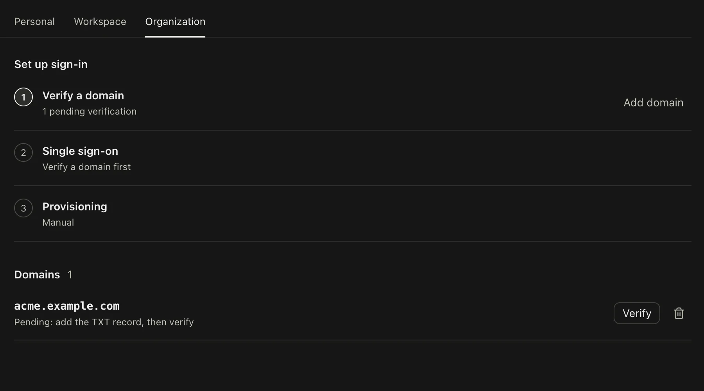

싱글 사인온(SSO)을 사용하면 팀이 Okta, Microsoft Entra ID, Google Workspace 같은 회사 아이덴티티 제공자(IdP)를 통해 CloudThinker에 로그인하므로, 접근 권한을 한곳에서 관리할 수 있습니다. 이 페이지는 확인되지 않은 도메인에서 시작해 동작하며 강제 적용되는 SSO 연결까지 안내합니다.

## 사전 요구사항

- **Scale** 또는 **Enterprise** 플랜의 조직. 다른 플랜에서는 **Settings → Organization → Identity**에 **Unlock SSO with the Scale plan**이 표시되고, Owner에게는 **Upgrade plan** 버튼이 보입니다. [요금](/ko/guide/billing/pricing)을 참조하세요.
- 조직 **Owner** 역할. Owner만 SSO를 바꿀 수 있습니다. Admin은 페이지를 읽기 전용으로 열 수 있으며 **Only organization owners can change single sign-on**이 표시됩니다. [역할과 권한](/guide/security/roles)을 참조하세요.
- TXT 레코드 하나를 추가할 수 있는 DNS 제공자 접근 권한.
- 아이덴티티 제공자에 대한 관리자 접근 권한.

## 설정이 진행되는 방식

**Settings → Organization → Identity**를 열면 번호가 매겨진 세 행으로 된 **Set up sign-in** 섹션이 있습니다. 각 행은 다음 행을 잠금 해제하며, 완료된 행에는 체크 표시가 나타납니다.

| 행 | 할 일 | 완료 기준 |
|---|---|---|
| 1. **Verify a domain** | DNS TXT 레코드로 이메일 도메인 소유권을 증명합니다 | 행에 예를 들어 **1 verified**가 표시됩니다 |
| 2. **Single sign-on** | 아이덴티티 제공자에 대한 SAML 또는 OIDC 연결을 만듭니다 | 행에 연결 이름, 프로토콜, **Active**가 표시됩니다 |
| 3. **Provisioning** | 사용자 계정이 생성되는 방식을 선택합니다 | 행에 **Just-in-time provisioning** 또는 **SCIM directory sync**가 표시됩니다 |

<Frame caption="Organization → Identity: 도메인을 확인하고, Single Sign-On을 설정한 다음, 프로비저닝을 선택합니다">
  
</Frame>

## 도메인 확인

도메인은 CloudThinker에 어떤 로그인을 아이덴티티 제공자로 보낼지 알려 줍니다. 이메일이 확인된 도메인으로 끝나는 사람은 누구나 SSO로 라우팅됩니다.

<Steps>
  <Step title="도메인 추가">
    **Settings → Organization → Identity**로 이동합니다. **Verify a domain** 행에서 **Add domain**을 클릭합니다. **Update organization email domains** 대화상자에서 이메일 도메인(예: `example.com`)을 입력하고 **+** 버튼을 클릭한 다음 대화상자를 닫습니다.

    하나의 도메인은 하나의 CloudThinker 조직에만 속할 수 있습니다. 다른 조직이 이미 도메인을 등록했다면 오류가 표시되며, 그 조직의 Owner에게 연락해야 합니다.
  </Step>
  <Step title="DNS TXT 레코드 추가">
    **Domains** 섹션에서 도메인 옆의 **Verify**를 클릭합니다. **Verify domain** 대화상자에 두 값이 표시됩니다. 이 값으로 DNS 제공자에 TXT 레코드를 만듭니다.

    | DNS 필드 | 값 |
    |---|---|
    | Name / Host | `_cloudthinker`(DNS 제공자가 `.example.com`을 덧붙입니다) |
    | Type | `TXT` |
    | Value | 대화상자에 표시된 **Record Value**, 예: `cloudthinker-domain-verification=Xy7...` |
  </Step>
  <Step title="확인 점검">
    레코드가 전파될 때까지 기다린 다음 **Check verification**을 클릭합니다. 전파는 보통 몇 분이지만 DNS 제공자에 따라 더 오래 걸릴 수 있습니다.

    **성공 상태:** **Domains** 섹션에서 도메인에 **Verified**가 표시되고, **Single sign-on** 행에 **Set up SSO** 버튼이 표시됩니다.

    CloudThinker는 **Check verification**을 클릭할 때만 레코드를 확인합니다. 이후에 다시 확인하지 않으므로, 도메인이 확인되면 TXT 레코드를 삭제해도 됩니다.
  </Step>
</Steps>

`example.com`과 `example.co.uk`처럼 여러 도메인을 확인할 수 있습니다. 연결이 활성화된 동안에는 마지막으로 확인된 도메인을 제거할 수 없습니다. 먼저 연결을 비활성화하세요.

## 연결 만들기

조직에는 SSO 연결이 하나 있으며, 그 연결이 확인된 모든 도메인을 처리합니다. 아이덴티티 제공자가 지원하는 프로토콜을 고르세요. 둘 다 지원한다면 어느 쪽이든 동작하며, 엔터프라이즈 IdP에서는 SAML이 가장 흔한 선택입니다.

| 프로토콜 | 사용하는 경우 | 가이드 |
|---|---|---|
| **SAML 2.0** | IdP가 Okta, Entra ID, Google Workspace, AWS IAM Identity Center, OneLogin 또는 다른 SAML 2.0 제공자인 경우 | [SAML 설정](/guide/security/sso-saml) |
| **OpenID Connect (OIDC)** | IdP가 OAuth 2.0 클라이언트를 발급하고 OIDC 디스커버리 문서를 게시하는 경우 | [OIDC 설정](/guide/security/sso-oidc) |

<Steps>
  <Step title="마법사 시작">
    **Single sign-on** 행에서 **Set up SSO**를 클릭합니다. **SAML 2.0** 또는 **OpenID Connect (OIDC)**를 선택하고 **Next**를 클릭합니다.
  </Step>
  <Step title="제공자 가이드 따르기">
    위의 SAML 또는 OIDC 가이드를 열고 제공자에 맞는 단계를 완료한 다음 **Create Connection**을 클릭합니다.

    **성공 상태:** 대화상자에 **SSO Connection Created**가 표시됩니다. 연결은 즉시 활성화되며, SSO 로그인을 사용할 수 있지만 아직 필수는 아닙니다.
  </Step>
  <Step title="연결 테스트 실행">
    **Single sign-on** 행에서 **Edit**를 클릭합니다. **Manage SSO** 대화상자의 **Overview** 탭에 있는 **Connection test**에서 **Run connection test**를 클릭합니다.

    이 테스트는 전체 로그인이 아니라 구성을 확인합니다. SAML의 경우 IdP Entity ID, SSO URL, 인증서를 확인합니다. OIDC의 경우 디스커버리 문서에 도달할 수 있는지, issuer가 일치하는지, 필요한 엔드포인트가 있는지, 서명 키에 도달할 수 있는지를 확인합니다.

    **성공 상태:** **All checks passed**. **Some checks failed**가 표시되면 실패한 점검과 오류 메시지가 나열됩니다. **Configuration** 탭에서 값을 고치고 **Save Changes**를 클릭하세요.
  </Step>
  <Step title="SSO로 로그인">
    시크릿 브라우저 창에서 `https://app.cloudthinker.io/auth/login`의 CloudThinker 로그인 페이지를 열고, 확인된 도메인의 이메일을 입력하고, **Continue with email**을 클릭한 다음 **Continue with SSO**를 클릭합니다. **Sign in with SSO**를 클릭하고 **Work email**을 입력할 수도 있습니다.

    **성공 상태:** IdP 로그인 페이지가 열리고, 로그인 후 이름이 표시된 CloudThinker로 돌아옵니다.
  </Step>
</Steps>

<Note>
  연결이 활성화되는 즉시, 확인된 도메인의 새 사용자는 Google 또는 GitHub 로그인으로 계정을 만들 수 없습니다. "Your organization signs in with SSO."라는 안내를 받습니다. 기존 사용자는 SSO를 필수로 설정하기 전까지 SSO 화면에서 **Use an email code instead**를 계속 선택할 수 있습니다.

  이미 CloudThinker 계정이 있는 사람은 계정을 유지합니다. 첫 SSO 로그인 시 이메일로 계정을 매칭하고 IdP에 연결하므로 중복 계정이 생기지 않습니다.
</Note>

## 사용자 프로비저닝 방식 선택

프로비저닝은 회사의 누군가를 위해 CloudThinker 계정이 생성되는 방식입니다. **Provisioning** 섹션은 연결이 활성화되면 나타납니다.

| 모드 | 동작 | 선택하는 경우 |
|---|---|---|
| **Manual** | 계정이 자동으로 생성되지 않습니다. 각 사람을 직접 초대합니다. | 모든 멤버를 직접 승인하려는 경우 |
| **Just-in-time** | 누군가 처음 SSO로 로그인할 때 계정이 생성됩니다. 새 연결의 기본값입니다. | IdP가 허용하는 모든 사람이 접근해야 하는 경우 |
| **SCIM** | IdP가 사용자와 그룹을 자동으로 생성, 업데이트, 비활성화합니다 | 입사자와 퇴사자를 디렉터리가 처리하길 원하는 경우. [SCIM 프로비저닝](/ko/guide/security/scim)을 참조하세요 |

**Just-in-time**과 **SCIM**의 경우 다음도 설정합니다.

- **Auto-assigned organization role**: **Viewer**(기본값), **Developer** 또는 **Admin**. Viewer로 시작하고 나중에 승격하세요.
- **Auto-assigned workspaces**: 새 사용자가 자동으로 합류하는 워크스페이스. 기본값은 조직의 기본 워크스페이스입니다. [워크스페이스](/ko/guide/workspaces)를 참조하세요.

## SSO 필수 적용

SSO가 선택 사항이면 도메인의 사용자는 여전히 이메일 코드로 로그인할 수 있습니다. **Require single sign-on**을 켜면 그 옵션이 제거됩니다.

<Steps>
  <Step title="SSO가 동작하는지 확인">
    먼저 자신의 계정으로 위의 로그인 테스트를 완료하세요.
  </Step>
  <Step title="Require single sign-on 켜기">
    **Sign-in rules** 섹션에서 **Require single sign-on**을 켭니다.

    **성공 상태:** 스위치가 켜진 상태로 유지됩니다. 확인된 도메인의 사용자는 아이덴티티 제공자를 통해 로그인해야 합니다. Google과 GitHub 로그인은 "Your organization signs in with SSO."로 거부되며, **Use an email code instead**로는 더 이상 로그인할 수 없습니다.
  </Step>
</Steps>

**Require single sign-on**은 로그인 시점에 확인됩니다. 이미 로그인한 사람을 로그아웃시키지 않으며, 그들은 다음 로그인 때 SSO로 전환됩니다. 이 토글은 연결이 **Active**인 동안에만 표시됩니다.

SSO를 필수로 하면 초대도 바뀝니다. 확인된 도메인의 이메일만 초대할 수 있습니다. **SCIM**을 선택하면 수동 초대가 꺼지고, IdP에서 사람을 관리합니다.

### IdP를 사용할 수 없는 경우

각 조직에는 정확히 한 명의 Owner가 있으며, Owner는 **Require single sign-on**에서 제외되므로 IdP 장애나 만료된 인증서 때문에 잠기지 않습니다. Owner는 로그인 페이지에서 이메일을 입력한 다음, SSO 화면에서 **Use an email code instead**를 선택합니다. 다른 모든 사람은 IdP가 복구되거나 Owner가 **Sign-in rules**에서 **Require single sign-on**을 끌 때까지 기다려야 합니다.

<Warning>
  **Require single sign-on**을 켜기 전에 Owner의 이메일 주소가 IdP 밖에서 메일을 받을 수 있는지 확인하세요. 예를 들어 모니터링되는 공유 메일함입니다. 그 받은편지함이 다시 들어올 수 있는 길입니다.
</Warning>

## 연결 관리 또는 제거

**Single sign-on** 행에서 **Edit**를 클릭합니다. **Manage SSO** 대화상자에는 두 개의 탭이 있습니다.

| 탭 | 할 수 있는 일 |
|---|---|
| **Overview** | **Status**, **Protocol**, **Display name**, **Verified domains**, **SCIM**, **Created**를 확인합니다. 연결을 **Activate**, **Deactivate** 또는 **Delete**하고, 연결 테스트를 실행합니다. |
| **Configuration** | 교체된 인증서나 새 클라이언트 시크릿 같은 IdP 값을 편집한 다음 **Save Changes**를 클릭합니다. SAML의 경우 이 탭에 **SP Metadata URL**도 표시됩니다. |

| 상태 | 설정되는 방식 | 사용자에게 보이는 것 |
|---|---|---|
| **Active** | 확인된 도메인에서 유효한 연결을 만들면 자동으로 설정되거나, **Activate**를 클릭해 설정 | 확인된 도메인의 로그인이 IdP로 갑니다. **Require single sign-on**이 켜져 있으면 적용됩니다. |
| **Inactive** | **Deactivate**를 클릭 | SSO가 사용되지 않습니다. 사람들은 이메일 코드, Google 또는 GitHub로 로그인하며, **Require single sign-on**은 적용되지 않습니다. 설정은 유지되므로 **Activate**로 다시 켤 수 있습니다. |
| **Testing** | 대시보드에서 설정하지 않음 | **Active**처럼 동작 |

**Delete**는 영구적이며 비활성화보다 더 많은 일을 합니다.

- **Require single sign-on**이 연결과 함께 사라지고, 사용자는 이메일 코드 로그인으로 돌아갑니다.
- SCIM이 제거됩니다. 토큰이 동작을 멈추고, 그룹 매핑과 동기화 로그가 삭제됩니다. IdP에서도 프로비저닝을 끄세요.
- just-in-time 또는 SCIM 프로비저닝으로 생성된 사람을 포함해 멤버 계정과 역할은 유지됩니다.

SSO를 일시 중지하려면 대신 비활성화하세요.

## 문제 해결

<AccordionGroup>
  <Accordion title="Set up SSO 버튼이 없음">
    **Single sign-on** 행에 **Verify a domain first**가 표시됩니다. **Domains** 섹션에서 도메인의 **Verify**를 열고, TXT 레코드 이름이 `_cloudthinker`이고 값이 **Record Value**와 정확히 일치하는지 확인하세요. 일부 DNS 제공자는 도메인을 자동으로 덧붙이므로, `_cloudthinker.example.com`이라는 이름이 `_cloudthinker.example.com.example.com`이 될 수 있습니다. 그런 다음 **Check verification**을 다시 클릭하세요.
  </Accordion>
  <Accordion title="Identity에 Unlock SSO with the Scale plan이 표시됨">
    조직의 플랜에 SSO가 포함되어 있지 않습니다. Owner가 **Upgrade plan**을 클릭하거나, [구독 관리](/ko/guide/billing/subscription)를 참조하세요.
  </Accordion>
  <Accordion title="'Only organization owners can change single sign-on'">
    Admin으로 로그인했으므로 페이지가 읽기 전용입니다. 조직 Owner에게 변경을 요청하거나 [역할 변경](/guide/security/roles)을 요청하세요.
  </Accordion>
  <Accordion title="SSO를 필수로 한 후 사용자가 로그인할 수 없음">
    아이덴티티 제공자에서 사용자가 CloudThinker 앱에 할당되어 있는지 확인하세요. 그래도 실패하면, IdP 쪽을 고치는 동안 Owner가 **Require single sign-on**을 끌 수 있습니다.
  </Accordion>
  <Accordion title="사용자가 여전히 이메일 코드로 로그인함">
    **Require single sign-on**이 꺼져 있거나, 사용자 이메일이 확인된 도메인에 없거나, 사용자가 설계상 제외되는 조직 Owner입니다.
  </Accordion>
  <Accordion title="이름이 이메일 주소로 표시됨">
    아이덴티티 제공자가 이름과 성을 보내지 않습니다. [SAML](/guide/security/sso-saml) 또는 [OIDC](/guide/security/sso-oidc) 가이드에서 속성 매핑을 고치세요.
  </Accordion>
  <Accordion title="SSO 로그인이 실패한 이유 찾기">
    그 사람이 이미 CloudThinker 계정을 가지고 있다면, 실패한 SSO 로그인은 [감사 로그](/guide/security/audit-logs)에 `security.sso_login_failed`로 기록됩니다. 어떤 경우든 CloudThinker 로그인 페이지에서 사용자가 보는 메시지부터 시작하세요.

    | 메시지 | 원인 |
    |---|---|
    | "SSO login is not available for this domain" | 이메일 도메인이 확인되지 않았거나, 연결이 **Inactive**입니다 |
    | "No account found. Contact your administrator for access." | 프로비저닝이 **Manual** 또는 **SCIM**이고, 그 사람에게 계정이나 초대가 없습니다 |
    | "You are not a member of this organization. Please ask your administrator to invite you." | 그 사람에게 CloudThinker 계정은 있지만 조직에 속하지 않으며, just-in-time 프로비저닝이 꺼져 있습니다 |
    | "This organization has reached its seat limit." | 모든 좌석이 사용 중이어서 대기 중인 초대를 수락할 수 없습니다 |
    | "SSO authentication did not provide an email address" | IdP가 이메일을 보내지 않습니다. 속성 매핑을 고치세요 |
    | "Your identity provider's signature could not be verified. Ask your administrator to check the SSO certificate." | CloudThinker가 IdP의 서명을 확인할 수 없었습니다. 예를 들어 CloudThinker의 SAML 인증서가 오래된 경우입니다 |
    | "SSO sign-in failed. Try again or contact your administrator." | 서명되지 않았거나 암호화된 assertion, 시계 차이 등 다른 이유로 CloudThinker가 SAML 또는 OIDC 응답을 거부했습니다. 다른 실패는 확인할 것을 알려 주는 더 구체적인 메시지를 표시합니다. [SAML](/guide/security/sso-saml#troubleshooting) 또는 [OIDC](/guide/security/sso-oidc#troubleshooting) 문제 해결을 참조하세요 |
  </Accordion>
</AccordionGroup>

## 다음 단계

<CardGroup cols={2}>
  <Card title="SAML 설정" icon="shield" href="/guide/security/sso-saml">
    Okta, Entra ID, Google Workspace 등을 위한 단계별 SAML 구성
  </Card>
  <Card title="OIDC 설정" icon="id-badge" href="/guide/security/sso-oidc">
    Google, Entra ID, Okta 등을 위한 단계별 OIDC 구성
  </Card>
  <Card title="SCIM 프로비저닝" icon="users-gear" href="/ko/guide/security/scim">
    디렉터리가 사용자를 자동으로 추가하고 제거하게 합니다
  </Card>
  <Card title="역할과 권한" icon="user-shield" href="/guide/security/roles">
    자동 프로비저닝된 사용자가 할 수 있는 일을 정합니다
  </Card>
</CardGroup>
