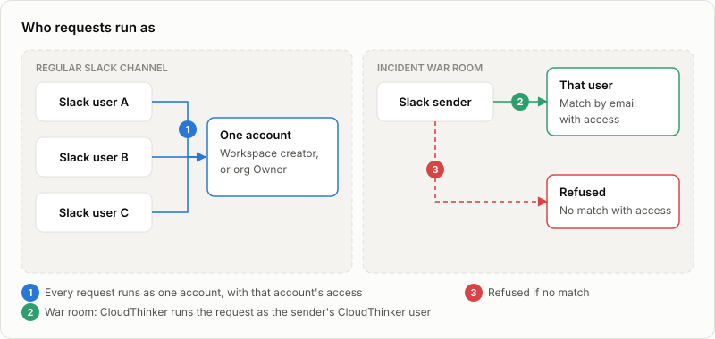
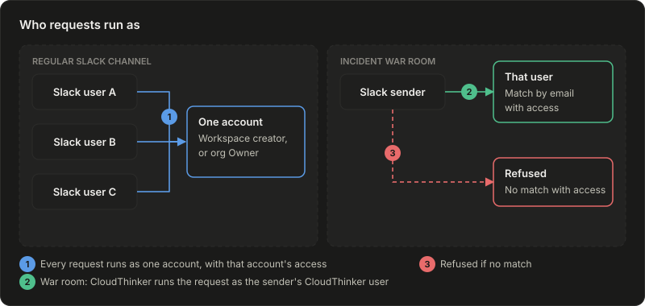

import PromptSyntaxBasics from '/snippets/ko/prompt-syntax-basics.mdx';

Slack을 한 번 연결하면 매핑된 채널의 누구나 `@CloudThinker`를 멘션하여 클라우드에 대해 질문하고, 스레드에서 대화를 이어갈 수 있습니다. 같은 연결이 알림, 코드 리뷰 요약 같은 [알림](/ko/guide/notifications)을 선택한 채널로 전달합니다.

## 사전 요구사항

- CloudThinker 조직 **Owner** 또는 **Admin**. 다른 역할은 Slack 페이지를 볼 수 있지만 연결하거나 변경할 수 없습니다.
- Team, Scale 또는 Enterprise 플랜. Free 플랜에서는 Slack 행에 **Requires Team plan**이 표시되고 **Configure** 버튼이 없습니다. [요금](/ko/guide/billing/pricing)을 참조하세요.
- Slack 워크스페이스에 앱을 설치할 권한. Slack 워크스페이스가 앱 승인을 사용한다면 Slack Workspace Owner 또는 앱 관리자가 CloudThinker를 승인해야 합니다.
- app.cloudthinker.io에서 호스팅되는 CloudThinker. 셀프 호스팅 설치에서는 Slack 행에 **Not available on self-host**가 표시됩니다.

각 Slack 워크스페이스는 하나의 CloudThinker 조직에 연결할 수 있습니다.

## Slack 연결

<Warning>
봇이 들어가 있지만 매핑이 없는 채널도 조직 Owner의 기본 워크스페이스에서, 그 워크스페이스의 연결로 요청을 실행합니다. 매핑되지 않은 채널이 요청을 거부하게 하는 설정은 없습니다. 초대할 때마다 바로 매핑을 확인하고, 인프라에 도달해서는 안 되는 채널에서는 봇을 제거하세요.
</Warning>

<Steps>
  <Step title="Slack 연동 열기">
    **Settings → Organization → Chat integrations**로 이동하여 **Slack** 행을 찾고 **Configure**를 클릭합니다. Settings를 열려면 사이드바 상단의 워크스페이스 메뉴를 클릭한 다음 **Settings**를 클릭합니다.
  </Step>
  <Step title="Connect with Slack 클릭">
    Slack이 인증 화면을 엽니다. Slack 워크스페이스를 선택하고 **Allow**를 클릭합니다.

    연결하면 이 조직이 이전에 연결한 Slack 워크스페이스가 교체됩니다.

    **성공 상태:** **Slack connected successfully** 메시지와 함께 Slack 페이지로 돌아오고, **Setup** 카드의 **Connect to Slack** 아래에 Slack 워크스페이스 이름과 Team ID가 표시됩니다.
  </Step>
  <Step title="봇을 채널에 초대">
    Slack에서 팀이 사용할 채널을 열고 다음을 실행합니다.

    ```text
    /invite @CloudThinker
    ```

    CloudThinker는 채널을 CloudThinker 워크스페이스에 자동으로 매핑합니다. 조직 Owner의 기본 워크스페이스를 선택하며, Owner에게 없으면 가장 오래된 워크스페이스를 선택합니다.

    **성공 상태:** Slack 페이지의 **Configure channel-workspace mappings**에 채널이 나타납니다.
  </Step>
  <Step title="각 채널이 사용하는 워크스페이스 확인">
    **Configure channel-workspace mappings**에서 각 채널 행의 **Select workspace** 메뉴를 열고, 그 채널이 사용해야 할 연결을 가진 워크스페이스를 고릅니다.

    **성공 상태:** **Channel mapping updated** 메시지가 나타나고 행에 새 워크스페이스가 표시됩니다.
  </Step>
  <Step title="테스트 메시지 보내기">
    채널에서 질문과 함께 봇을 멘션합니다.

    ```text
    @CloudThinker What drove our cloud spend up last week?
    ```

    **성공 상태:** CloudThinker가 메시지 아래 스레드에 답합니다. 후속 질문은 그 스레드에 답글로 남기세요. 봇을 다시 멘션할 필요는 없습니다.
  </Step>
</Steps>

## 요청이 실행되는 계정

<Frame caption="일반 채널에서는 모든 요청이 하나의 계정으로 실행되며, 워룸에서만 이메일로 발신자를 매칭합니다.">
  
  
</Frame>

일반 채널에서 CloudThinker는 Slack 사용자를 CloudThinker 계정과 매칭하지 않으며, Slack에는 계정 연결 기능이 없습니다. 각 요청을 발신자로 실행하는 [Google Chat](/guide/google-chat-integration)과 달리, 모든 요청은 하나의 계정으로 실행됩니다. 매핑된 워크스페이스를 만든 사람, 또는 조직이 소유한 워크스페이스라면 조직 **Owner**이며, 그 계정의 접근 권한이 적용됩니다. Slack 사용자는 질문하는 데 CloudThinker 계정이 필요하지 않습니다. CloudThinker는 대화의 각 메시지에 Slack 발신자의 이름과 Slack 사용자 ID를 기록합니다.

인시던트 워룸은 예외입니다. 워룸은 Resolve가 하나의 인시던트를 위해 만드는 Slack 채널입니다([Slack 워룸 추가](/guide/incident/oncall#add-a-slack-war-room) 참조). 워룸에서는 CloudThinker가 이메일로 발신자를 매칭하여 그 CloudThinker 사용자로 요청을 실행하고, 접근 권한이 있는 일치하는 사용자가 없으면 거부합니다. 워룸 질문은 **Settings → Organization → Audit log**에도 발신자 이름으로 표시됩니다.

따라서 채널 멤버십을 접근 권한으로 취급하세요. 채널의 모든 사람이 사용해도 되는 워크스페이스에만 채널을 매핑하세요.

## Slack에서 CloudThinker에 질문하기

모든 요청은 `@CloudThinker`로 시작합니다. 그다음에는 웹 앱에서 입력하는 것과 같은 요청을 작성합니다.

<PromptSyntaxBasics />

```text
@CloudThinker Which EC2 instances ran under 10% CPU for the last 14 days?
@CloudThinker Summarize open critical security findings for production
@CloudThinker Why did checkout latency spike at 14:00 UTC today?
```

스레드에서 볼 수 있는 것:

| 보이는 것 | 의미 |
| --- | --- |
| **is typing...** | CloudThinker가 요청을 처리하고 있습니다 |
| 스레드의 답글 | 답변입니다. 전체 대화는 CloudThinker 웹 앱에도 표시됩니다 |
| **View in CloudThinker**가 있는 도구의 **Permission required to use** | 요청에 [Approvals](/guide/approvals/overview) 설정이 사람을 위해 보류하는 작업이 필요합니다. 인시던트 워룸 밖에서는 Slack에서 승인할 수 없습니다. 링크를 열면 허용된 [승인자](/guide/approvals/approvers)가 웹 앱에서 승인하거나 거부합니다. 워룸에서는 카드에 **Approve**와 **Reject** 버튼이 있습니다 |

CloudThinker는 채널의 멘션과 자신의 스레드의 답글에 응답합니다. 새 주제를 시작하려면 새 메시지에서 `@CloudThinker`를 멘션하세요. 비공개 채널도 봇을 초대하면 같은 방식으로 동작합니다. CloudThinker는 다이렉트 메시지에 응답하지 않습니다. Slack의 **Home** 탭은 채널에서 멘션하라고 안내합니다. CloudThinker는 메시지의 텍스트만 읽으므로, 파일을 첨부하는 대신 읽게 할 내용을 붙여 넣으세요.

## Slack으로 알림 보내기

Slack은 워크스페이스 알림의 대상이기도 합니다. 각 CloudThinker 워크스페이스는 자체 Slack 채널을 가지므로, 먼저 사이드바 상단의 워크스페이스 전환기에서 올바른 워크스페이스로 전환하세요.

<Steps>
  <Step title="알림 설정 열기">
    Slack 페이지의 **Configure notifications**에서 **Go to notification settings**를 클릭합니다. **Settings → Workspace → Notifications**로 이동할 수도 있습니다.
  </Step>
  <Step title="워크스페이스의 기본 채널 선택">
    **Delivery channels**에서 Slack 카드를 찾습니다(설정 전에는 **Pick a channel**로 표시됨). 설정 아이콘(**Change Slack channel**)을 클릭한 다음 **Slack channel**에서 채널을 검색하여 선택합니다. 모든 공개 채널, 또는 봇을 초대한 비공개 채널을 고를 수 있습니다.
  </Step>
  <Step title="알림 유형별 재정의(선택 사항)">
    **What to send**에서 이벤트의 Slack 셀을 켠 다음, 옆의 **→ #channel** 칩을 클릭하여 그 이벤트를 다른 채널로 보냅니다. **Alerts**와 **Keepers** 행에는 심각도 선택기도 있습니다. 전체 유형 목록은 [알림](/ko/guide/notifications)을 참조하세요.

    **성공 상태:** 다음으로 일치하는 이벤트가 선택한 채널에 게시됩니다.
  </Step>
</Steps>

## 코드 리뷰 알림

[Review](/ko/guide/code-review/overview)가 연결된 저장소의 풀 리퀘스트나 머지 리퀘스트를 끝내면, CloudThinker는 Slack에 요약을 게시할 수 있습니다.

- 심각도별 발견 항목 수
- 해결되지 않은 발견 항목 최대 5개(각각 제목, 파일 경로, 줄 번호 포함)
- 이전 발견 항목 중 이제 해결된 개수
- CloudThinker에서 리뷰를 여는 **View Review** 버튼
- 리뷰에 문제가 없을 때 **No issues found**

리뷰의 채널과 심각도 임계값은 [알림](/ko/guide/notifications)에서 선택합니다.

## 보안 및 권한

| 질문 | 답변 |
| --- | --- |
| 어떤 메시지에 반응하나요 | `@CloudThinker`를 멘션한 메시지, 그리고 CloudThinker가 시작한 스레드의 답글. 기존 스레드에서 호출하면 컨텍스트를 위해 그 스레드를 읽을 수 있습니다 |
| CloudThinker가 저장하는 것 | 매핑된 워크스페이스에 대화로 저장된 요청과 답변, 그리고 각 Slack 스레드와 그 대화 사이의 연결 |

CloudThinker는 다음 Slack 봇 스코프를 요청합니다.

| 스코프 | 이유 |
| --- | --- |
| `app_mentions:read` | `@CloudThinker`를 멘션한 메시지 수신 |
| `channels:history`, `groups:history` | 공개 및 비공개 채널에서 자신의 스레드 답글과 호출된 스레드 읽기 |
| `channels:read`, `groups:read` | 매핑 표와 알림 선택기에 채널 나열 |
| `channels:manage` | 인시던트 워룸 채널 생성 및 응답자 초대 |
| `chat:write` | 답글과 알림 게시 |
| `chat:write.public` | 먼저 참여하지 않고 공개 채널에 알림 게시 |
| `files:write` | 보고서처럼 CloudThinker가 만든 파일을 스레드에 게시 |
| `users:read` | 대화에 발신자 표시 이름 표시 |
| `users:read.email` | 이메일로 워룸 발신자를 CloudThinker 계정과 매칭 |
| `im:read`, `im:history`, `im:write`, `mpim:read`, `mpim:history` | 앱이 요청합니다. CloudThinker는 현재 다이렉트 메시지나 그룹 메시지에 응답하지 않습니다 |

## 연결 관리

| 작업 | 방법 |
| --- | --- |
| 채널을 다른 워크스페이스로 이동 | **Configure channel-workspace mappings**에서 해당 행의 **Select workspace**를 변경합니다 |
| 채널 라우팅 중지 | Slack에서 채널에 `/remove @CloudThinker`를 실행합니다. 행도 함께 삭제됩니다. 행만 제거하지 마세요. 봇이 채널에 남아 있고 채널은 기본 워크스페이스로 돌아갑니다 |
| 새 권한을 위해 다시 연결 | 페이지에 **Slack needs one more permission**이 표시되면 **Reconnect Slack**을 클릭합니다. 기존 메시지와 알림 채널은 계속 동작합니다 |
| 연결 해제 | Slack 페이지 하단의 **Disconnect from Slack**을 클릭합니다. CloudThinker가 Slack에서 앱을 제거하고 모든 채널 매핑, Slack 스레드와 대화 간의 연결, Slack 알림 설정을 삭제합니다. 다시 연결하면 처음부터 시작합니다 |

## 문제 해결

<AccordionGroup>
  <Accordion title="Slack authorization not completed">
    Slack이 인증을 거부하거나 취소했거나, Slack 워크스페이스에 관리자 승인이 필요합니다. Slack Workspace Owner나 앱 관리자에게 Slack 앱 관리에서 CloudThinker를 승인하도록 요청한 다음 **Connect with Slack**을 다시 클릭하세요.
  </Accordion>
  <Accordion title="Slack workspace already connected">
    그 Slack 워크스페이스는 이미 다른 CloudThinker 조직에 연결되어 있습니다. Slack 워크스페이스는 하나의 조직에만 연결할 수 있습니다. 먼저 다른 조직에서 연결을 해제하거나, 다른 Slack 워크스페이스를 사용하세요.
  </Accordion>
  <Accordion title="Not authorized">
    조직 Owner와 Admin만 Slack을 구성할 수 있습니다. 그중 한 명에게 연결을 요청하거나, [조직 역할](/guide/security/roles) 변경을 요청하세요.
  </Accordion>
  <Accordion title="봇이 응답하지 않음">
    봇이 채널에 있는지(`/invite @CloudThinker`), 새 메시지에서 봇을 멘션했는지 확인하세요. 멘션이 없는 메시지는 CloudThinker가 이미 시작한 스레드 안에서만 응답을 받습니다.

    CloudThinker가 **No workspace is configured for this channel**이라고 답하면 사용할 워크스페이스를 찾지 못한 것입니다. 조직에 활성 워크스페이스가 없거나, 채널 행이 이 조직 밖의 워크스페이스를 가리킵니다. Slack 페이지를 열고 채널 행에 워크스페이스를 설정하세요.
  </Accordion>
  <Accordion title="답변이 잘못된 계정이나 클러스터를 사용함">
    채널이 예상과 다른 워크스페이스에 매핑되어 있습니다. **Configure channel-workspace mappings**에서 해당 행을 확인하고 **Select workspace**를 변경하세요.
  </Accordion>
  <Accordion title="You don't have access to this incident in CloudThinker">
    인시던트 워룸 채널은 그 워크스페이스에 CloudThinker 계정이 있고 인시던트와 채팅에 접근할 수 있는 사람의 요청만 실행합니다. CloudThinker는 이메일로 매칭하므로 Slack과 CloudThinker에서 같은 이메일을 사용하거나, 워크스페이스 Admin에게 접근 권한을 요청하세요.
  </Accordion>
  <Accordion title="알림이 도착하지 않음">
    **Delivery channels**의 Slack 카드에 워크스페이스용 채널이 설정되어 있는지, 알림 유형이 켜져 있는지, 이벤트가 심각도 임계값을 충족하는지 확인하세요. 비공개 채널이라면 먼저 봇을 초대하세요.
  </Accordion>
</AccordionGroup>

## 다음 단계

<CardGroup cols={2}>
  <Card title="CloudThinker Language" icon="terminal" href="/guide/commands">
    @, #, /로 더 정확한 요청을 작성합니다
  </Card>
  <Card title="알림" icon="bell" href="/ko/guide/notifications">
    어떤 이벤트가 어떤 심각도로 Slack에 도달할지 선택합니다
  </Card>
  <Card title="Approvals" icon="shield-check" href="/guide/approvals/overview">
    CloudThinker가 실행하기 전에 사람이 필요한 작업을 정합니다
  </Card>
  <Card title="Microsoft Teams" icon="/images/icons/teams.svg" href="/ko/guide/teams-integration">
    Teams에서 같은 워크플로를 설정합니다
  </Card>
</CardGroup>
