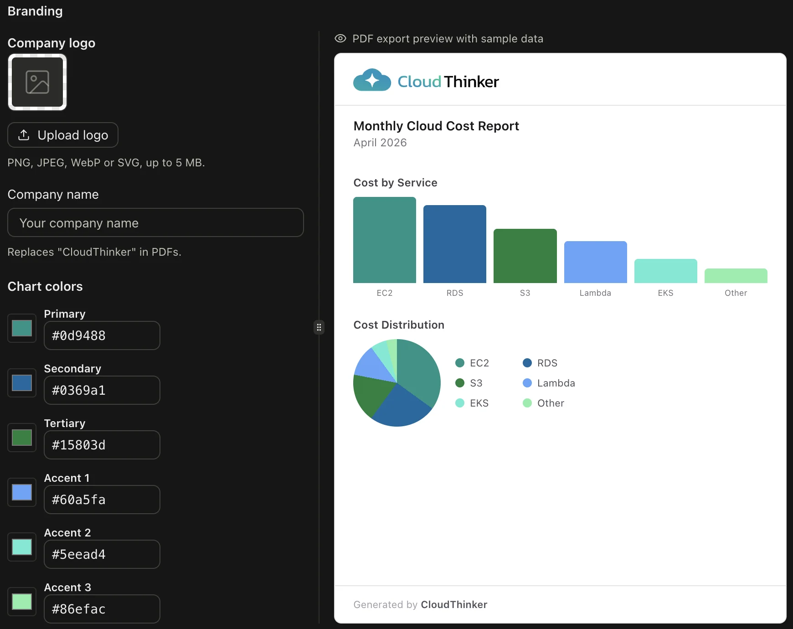
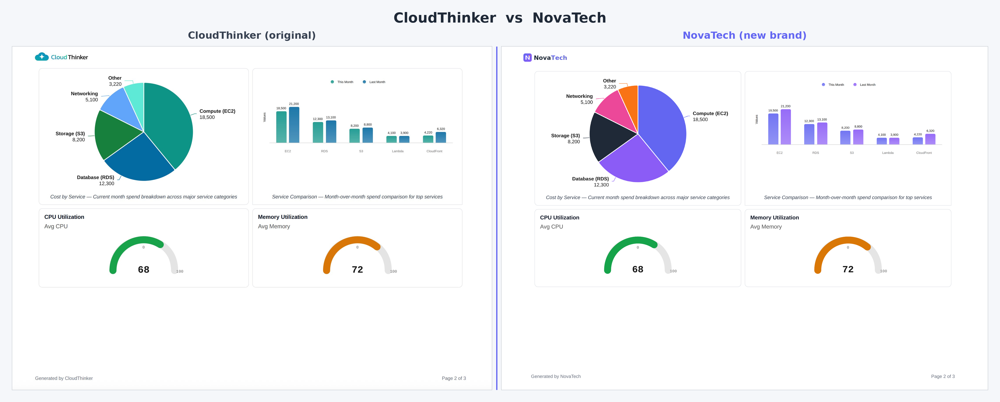

워크스페이스마다 브랜딩을 한 번 설정하면, 그 워크스페이스의 모든 PDF 내보내기 헤더에 로고가, 푸터에 회사 이름이, 차트에 6색 팔레트가 적용됩니다. 같은 팔레트는 앱에서 아티팩트(에이전트가 생성하는 대시보드와 보고서)를 볼 때 차트 색상에도 사용됩니다.

## 사전 요구사항

| 요구사항 | 세부 정보 |
| --- | --- |
| 플랜 | **Scale** 또는 **Enterprise**. Free 또는 Team에서는 **Branding** 섹션에 편집기 대신 **Brand customization requires the Scale plan**이 표시됩니다. [요금](/ko/guide/billing/pricing)을 참조하세요. |
| 역할 | 워크스페이스의 **Admin**. 조직 Owner와 Admin은 모든 워크스페이스에서 Admin입니다. Developer와 Viewer는 페이지를 열 수 있지만 양식이 비활성화되어 있습니다. |
| 로고 파일 | PNG, JPEG, WebP 또는 SVG, 5 MB 이하. 투명 배경의 가로로 긴 로고가 가장 잘 어울립니다. |

## 브랜딩 설정

<Steps>
  <Step title="Branding 열기">
    **Settings → Workspace → General**로 이동하여 **Branding** 섹션으로 스크롤합니다. Settings를 열려면 사이드바 상단의 워크스페이스 메뉴를 클릭한 다음 **Settings**를 클릭합니다.

    편집기는 왼쪽에 있습니다. 오른쪽에는 편집하는 대로 업데이트되는 샘플 데이터의 PDF 내보내기 미리보기가 표시되므로, 아무것도 내보내지 않고 결과를 확인할 수 있습니다.

    <Frame>
      
    </Frame>
  </Step>
  <Step title="로고 업로드">
    **Company logo** 영역에 파일을 끌어다 놓거나, **Upload logo**를 클릭하고 파일을 고릅니다. 로고는 체크무늬 배경 위에 표시되므로 투명도가 유지되었는지 확인할 수 있습니다.

    **성공 상태:** 편집기와 미리보기 헤더에 로고가 표시되고, **Upload logo** 옆에 **Remove** 버튼이 나타납니다.

    <Note>
    로고는 업로드가 끝나는 즉시 저장되며, **Remove**도 즉시 적용됩니다. **Save branding**은 회사 이름과 차트 색상만 다룹니다.
    </Note>
  </Step>
  <Step title="회사 이름 입력">
    **Company name**에 입력합니다(최대 255자). PDF 푸터의 "CloudThinker"를 대체하며, 푸터는 "Generated by Your Company"가 됩니다.
  </Step>
  <Step title="차트 색상 선택">
    **Chart colors**에는 **Primary**, **Secondary**, **Tertiary**, **Accent 1**, **Accent 2**, **Accent 3**의 여섯 슬롯이 있습니다. 각 슬롯에서 견본을 클릭하여 시스템 색상 선택기를 사용하거나, `#6366F1` 같은 hex 코드를 입력합니다.

    브랜드 색상이 하나뿐이라면 **Primary**만 설정하고 나머지는 기본값으로 두세요. **Reset to defaults**는 여섯 색상을 모두 CloudThinker 팔레트로 되돌립니다.

    미리보기의 막대 차트와 원형 차트는 각각 여섯 색상을 모두 사용하므로, 저장하기 전에 나란히 놓고 대비를 확인할 수 있습니다.
  </Step>
  <Step title="저장">
    이름이나 색상을 바꾸면 **Save branding**과 **Discard**가 나타납니다. **Save branding**을 클릭합니다.

    **성공 상태:** "Workspace updated successfully" 알림이 나타나고 버튼이 사라집니다. 저장이 실패하면 편집 내용이 양식에 남아 있으므로 고친 다음 다시 시도할 수 있습니다.
  </Step>
  <Step title="실제 내보내기 확인">
    아무 보고서나 대시보드를 열고 페이지 상단의 **Download PDF**를 클릭합니다(**More actions**(⋯) 메뉴에도 있습니다). 모든 페이지의 헤더에 로고가, 차트에 색상이, 푸터에 "Generated by Your Company"가 표시되어야 합니다.

    <Frame>
      
    </Frame>
  </Step>
</Steps>

나중에 브랜딩을 제거하려면 로고 아래의 **Remove**를 클릭하고, **Company name**을 비우고, **Reset to defaults**를 클릭한 다음 저장하세요.

## 여섯 색상 고르기

차트는 슬롯을 순서대로 사용합니다. 계열이 네 개인 차트는 Primary부터 Accent 1까지 사용하고, 계열이 여섯 개를 넘는 차트는 다시 Primary부터 시작합니다.

- 주 브랜드 색상을 **Primary**에 넣으세요. 대부분의 단일 계열 차트는 그 슬롯만 사용합니다.
- 명도만이 아니라 색조를 다양하게 하세요. 여섯 가지 파란색은 다중 계열 차트를 읽기 어렵게 만듭니다.
- 앞쪽 슬롯에 아주 연한 색은 피하세요. PDF는 흰색 위에 렌더링되므로 연한 막대나 선은 페이지에 묻힙니다. 기본 Accent 2와 Accent 3는 연하지만, 계열이 다섯 개 이상인 차트만 이 슬롯에 도달합니다.
- 빨간색과 초록색을 인접한 슬롯에 두지 마세요. 색각 이상이 있는 독자는 구별할 수 없습니다.

변경하기 전까지 모든 워크스페이스가 사용하는 기본 팔레트:

| 슬롯 | Hex |
| --- | --- |
| Primary | `#0d9488` |
| Secondary | `#0369a1` |
| Tertiary | `#15803d` |
| Accent 1 | `#60a5fa` |
| Accent 2 | `#5eead4` |
| Accent 3 | `#86efac` |

## 참조

| 설정 | 규칙 | 표시되는 곳 |
| --- | --- | --- |
| 로고 | PNG, JPEG, WebP 또는 SVG, 최대 5 MB. 파일 내용이 유형과 일치해야 합니다. SVG는 정리(sanitize)되므로 스크립트와 안전하지 않은 속성이 제거됩니다. 새 로고를 업로드하면 이전 로고가 교체됩니다. | PDF 헤더 및 공유 링크 |
| 회사 이름 | 일반 텍스트, 최대 255자. 기본값은 "CloudThinker"입니다. | PDF 푸터 및 공유 링크 푸터 |
| 차트 색상 | `#RRGGBB` 형식의 정확히 여섯 색상. `#fff` 같은 세 자리 약식은 거부됩니다. | PDF 내보내기의 차트, 그리고 앱에서 보는 아티팩트의 차트 |
| 공유 링크 | 별도 설정 없음 | 로고와 "Shared from Your Company" 푸터. [공유](/guide/sharing#what-viewers-see)를 참조하세요 |

브랜딩은 하나의 워크스페이스에 속합니다. 조직의 각 워크스페이스는 자체 로고, 이름, 팔레트를 가질 수 있습니다. 인시던트나 Review 분석처럼 앱의 다른 곳에 있는 차트는 항상 CloudThinker 팔레트를 유지합니다. 브랜딩은 알림이나 이메일에는 적용되지 않습니다.

## 문제 해결

<AccordionGroup>
  <Accordion title="Branding에 Brand customization requires the Scale plan이 표시됨">
    조직이 브랜딩이 없는 플랜을 사용하고 있습니다. 안내에서 업그레이드하거나 [구독](/ko/guide/billing/subscription)을 참조하세요.
  </Accordion>
  <Accordion title="양식이 회색으로 비활성화됨">
    보기 전용 권한이 있으며, 배너에 **View only.**가 표시됩니다. 워크스페이스 Admin에게 변경을 요청하거나 Admin 역할을 요청하세요. [워크스페이스 멤버](/ko/guide/workspace-users)를 참조하세요.
  </Accordion>
  <Accordion title="업로드가 거부됨">
    "Unsupported file type"은 파일이 PNG, JPEG, WebP, SVG가 아니거나 내용이 확장자와 일치하지 않는다는 뜻입니다. "File too large"는 5 MB를 넘는다는 뜻입니다. 디자인 도구에서 로고를 다시 내보내고 다시 시도하세요.
  </Accordion>
  <Accordion title="로고가 흐리거나 주변에 흰 상자가 있음">
    흐린 경우: 원본 이미지가 너무 작습니다. 더 넓은 PNG로 내보내거나 SVG를 사용하세요. 흰 상자: 파일에 투명도가 없습니다. 투명 배경의 PNG나 SVG로 내보내세요. SVG가 디자인 도구와 다르게 보인다면 정리 과정에서 제거된 스크립트나 애니메이션에 의존했을 가능성이 높으므로, 대신 정적 PNG로 내보내세요.
  </Accordion>
  <Accordion title="이전에 다운로드한 PDF에 여전히 이전 브랜딩이 있음">
    정상입니다. 각 PDF는 다운로드할 때 활성화된 브랜딩을 사용합니다. 현재 브랜딩을 받으려면 아티팩트를 다시 다운로드하세요.
  </Accordion>
  <Accordion title="브랜딩 없이 내보낼 수 있나요?">
    옵션으로는 없습니다. 모든 내보내기는 워크스페이스의 현재 브랜딩을 사용합니다. 브랜딩 없는 사본을 받으려면 로고를 제거하고, 회사 이름을 비우고, 색상을 재설정하고, 저장하고, 내보낸 다음 설정을 복원하세요. 그 사이에 워크스페이스에서 내보내는 모든 사람도 브랜딩 없는 PDF를 받습니다. 브랜딩 없는 내보내기가 자주 필요하다면 브랜딩이 없는 별도 워크스페이스를 사용하세요.
  </Accordion>
</AccordionGroup>

## 다음 단계

<CardGroup cols={2}>
  <Card title="Artifacts" icon="file-chart-column" href="/ko/guide/artifacts/overview">
    브랜딩이 적용되는 대시보드와 보고서를 생성합니다.
  </Card>
  <Card title="공유" icon="share-nodes" href="/guide/sharing">
    브랜딩된 아티팩트를 워크스페이스 밖의 사람들과 공유합니다.
  </Card>
</CardGroup>
