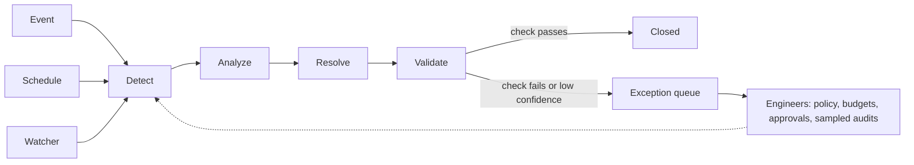

*Eleven chapters built and hardened one loop. The end state is a fleet of narrow, standing missions that start themselves, check their own work, and run under policy, while engineers supervise from above. This chapter maps that path and the five conditions that make it safe.*

## 12.1 From conversation to standing mission

Most deployments today are conversational. An engineer opens a session, asks, approves, and closes the tab. That works, but it's capped by human attention: the agent only works while someone watches.

The unit that removes the cap is the **mission**: a standing objective with its own triggers, a bounded set of allowed actions, and a verification check built into the loop. "Help me with Kubernetes" isn't a mission. These are:

- Review every pull request for infrastructure impact.
- Keep image vulnerabilities below a set threshold.
- Hold this service to its SLO.

You don't use a mission the way you use a chat. You commission it, then you supervise a queue of its results and exceptions.

Missions wake in three ways, and a production platform needs all three:

| Trigger | Examples | Design note |
|---|---|---|
| **Event** | An alert fires, a pull request opens, a CVE lands, a scanner finding arrives | Filter and promote events so the expensive loop runs only on what matters (the two-engine pattern in [Chapter 4](/learn/aio-engineer/chapter-4-orchestration-economics)) |
| **Schedule** | Nightly cost sweep, weekly patch audit, daily hygiene pass | Unglamorous and compounding. Often the largest share of daily agent work in early deployments |
| **Watcher** | SLO burn, configuration drift, spend against a baseline | Holds a baseline continuously instead of answering a question |

Chat doesn't disappear. It becomes the exception surface: where you question a mission's work, not where the work happens.

## 12.2 Vertical missions: autonomy through narrowness

[Chapter 7](/learn/aio-engineer/chapter-7-evaluating-agents) showed that on open-ended incident resolution, agents on current models resolve roughly one SRE benchmark scenario in seven. That doesn't mean autonomy is years away. It means autonomy is earned per mission, and narrower missions earn it sooner. Shrink the objective, bound the actions, and make verification cheap, and the same models become production-grade because the harness can check their work.

| Mission | Trigger | The loop | Verification |
|---|---|---|---|
| Code review | Every pull request | Infrastructure impact, security, and cost change in the diff | Agent comments are advisory, and a person still merges |
| Infrastructure-as-code upkeep | Schedule plus drift events | Reconcile drift, update dependencies, patch images | Plan-diff review, and CI must pass |
| Incident response | Alert or promoted event | Detect, analyze, resolve, and validate on known failure classes | SLO recovery probe plus automatic rollback |
| Security | CVE feed plus scheduled scans | Triage findings, confirm exposure, patch or escalate | A rescan proves the finding is gone |
| Cost | Nightly sweep | Rightsize, clean up orphaned resources, flag anomalies | Billing change; every action reversible |

The last column is the one that matters. Each mission closes on a check the machine runs itself: a rescan, a plan-diff, a CI gate, an SLO probe, a billing line. That gives you the promotion rule in one sentence:

<Note>
A mission earns autonomy when its verification is cheaper than its supervision.
</Note>

Where verification is expensive or needs judgment, the mission stays gated. Architecture changes, deleting stateful resources, and anything irreversible belong here. Keeping them gated is the system working.

## 12.3 Engineers on the loop, not in the loop

"Human in the loop" hides a ceiling. If a person must click yes on every action, you've built a slower engineer. Per-action approval is a stage, not the destination. The destination is "on the loop": engineers set the controls and handle what the controls can't decide.

| Control | What it does |
|---|---|
| **Policy** | Decides what runs unattended, per mission and per blast radius ([Chapter 6](/learn/aio-engineer/chapter-6-policy-approvals)) |
| **Approvals** | Reserved for irreversible actions |
| **Exception queue** | Collects low-confidence and out-of-policy cases for a person to judge |
| **Sampled audits** | Re-check a slice of unattended work every week, because silent regression is how trust fails |
| **Budgets** | Caps on spend, actions, and tokens that stop a runaway loop before it does damage |

Promotion is per mission and based on evidence, the same way you promote code. A mission starts read-only. Next, it proposes changes that a person approves. Then specific, reversible actions run unattended within policy. Each step needs passing eval scores and a clean incident history (the gates from [Chapter 7](/learn/aio-engineer/chapter-7-evaluating-agents)), and a mission can be demoted the same way.

Oversight stops being a meeting and becomes a control plane of policies, budgets, queues, and audit views. Supervising ten missions this way is a part-time job. Doing those ten missions by hand is ten jobs.

## 12.4 Five conditions, honestly stated

This future is conditional. Each condition is a chapter of this book. Use the table as a readiness check before you let any mission run unattended.

| # | Condition | Why it's required | Built in |
|---|---|---|---|
| 1 | Verification cheaper than supervision | Without it, autonomy is just unpriced risk | [Chapter 7](/learn/aio-engineer/chapter-7-evaluating-agents) |
| 2 | An event-driven substrate | Missions need an event stream and a scheduler, not a chat box | [Chapter 4](/learn/aio-engineer/chapter-4-orchestration-economics) |
| 3 | Policy, approvals, and execution safety as code | Unattended action without machine-readable guardrails is negligence | [Chapter 6](/learn/aio-engineer/chapter-6-policy-approvals) |
| 4 | Trace-level observability | You can't audit what you didn't record | [Chapter 8](/learn/aio-engineer/chapter-8-observing-the-observer) |
| 5 | Fleet discipline | Versioned missions, canaried rollouts, and cost curves, because fifty standing loops are a production system | [Chapter 9](/learn/aio-engineer/chapter-9-agentops-day-2) |

Teams that hold all five run operations as intent plus exceptions. Teams that hold none find that "autonomous" was only a label.

## 12.5 Building the future

The shift arrives one mission at a time, in roughly this order:

1. **Code review** goes unattended first, as advisory comments, because verification is nearly free.
2. **Cost** missions follow, because every action is reversible.
3. **Security and incident response** graduate one failure class at a time. Back each promotion with a [golden set](/learn/aio-engineer/appendix-c-glossary#evaluation) ([Chapter 7](/learn/aio-engineer/chapter-7-evaluating-agents)) and three months of clean sampled audits.

None of this waits for a smarter model. It waits for a stronger harness. To start, pick one reversible mission, run it read-only for two weeks, then promote it one step.

<Info>
**In practice: missions on CloudThinker**

CloudThinker runs these missions on one shared set of [connections](/guide/connections/overview), one [Approvals](/guide/approvals/overview) system, and one [audit log](/guide/security/audit-logs).

| Mission shape | Where it runs today |
|---|---|
| Every pull request | [Review](/guide/code-review/overview) reviews each pull or merge request on the repositories you pick, with no one starting it. It posts a summary comment and inline findings. A person still decides to merge. |
| Event-driven | [Pulse](/guide/pulse/overview) groups incoming alerts into clusters, drops noise, and hands actionable ones to [Resolve](/guide/incident/overview) triage |
| Scheduled or triggered | [Automations](/guide/automation/automations) run saved instructions on a schedule, a webhook call, or a repository event |
| Watcher | A [probe](/guide/automation/automations#probe) is the watcher trigger: a bash script that checks a condition every 5, 15, 30, or 60 minutes and starts a run when it fires. Ask for one in chat, for example "Watch the orders-api p95 latency every 15 minutes and start a run if it's above 800 ms." |
| Scheduled security testing | [Cyber](/guide/security/cyber-overview) runs pentests on running web apps and APIs on a schedule, and retests a finding after you fix it. It isn't a CVE-feed mission. For image or package CVE triage, point your scanner at an Automation's webhook trigger. |
| Cost | [Optimize](/guide/cost-optimization/overview) scans AWS, GCP, or Azure billing read-only and ranks savings findings. **Implement** on a [finding](/guide/cost-optimization/recommendations) makes the change, and that change goes through your Rules and Approval mode like any other write. |

**The promotion ladder in settings**

| Step | Setting |
|---|---|
| Read-only | Connect with viewer or read-only credentials. On AWS, Google Cloud, and Azure, also turn off **Allow writes** on the [connection](/guide/connections/overview). |
| Propose, a person approves | [Approval mode](/guide/approvals/approval-mode) **Manual**: a person approves every write |
| Unattended within policy | **Auto** mode, with **Allow** [Rules](/guide/approvals/rules) for the specific reversible writes. Set **Runs from** to **Automations** so the Rule covers only scheduled work. |

Every write passes your Rules first, then the Approval mode. Automations default to **Auto · Rules + AI · Refuse**: Rules decide first, then AI judgment allows a safe write that no Rule covers, and anything still undecided is refused, because no one may be online to answer. See the [four Auto choices](/guide/approvals/approval-mode#the-two-modes).

**The on-the-loop controls**

| Control | Where it lives |
|---|---|
| Exception queue | A write waiting for a person shows an approval card in the run's conversation, and the run shows **Required Approval** on the **Runs** tab of **Automations**. **Approvals → Overview** shows what needs you and how many calls were refused in the last 7 days. A refused write doesn't fail the run, so read the conversation to see what was skipped. |
| Sampled audits | [Activity](/guide/activity) lists every run with its status. **Approvals → Activity** shows what each Rule decided and exports it as CSV. [Audit Logs](/guide/security/audit-logs) filter by actor, for example **Actor Type: Agent**. |
| Budgets | [Credit limits](/guide/billing/credit-limits) set a monthly spend cap per workspace |
| Kill switch | There's no single halt-all switch. On AWS, Google Cloud, and Azure connections, turn off **Allow writes** to refuse every change while reads keep working. On other connections, a **Deny** Rule refuses the write in every mode. Turn automations off from their cards. Drill this before you need it. |

Audit Logs and Credit limits need a Scale, Scale+, or Enterprise plan.
</Info>

<Tip>
**Key takeaway**

The future is a fleet of narrow, standing missions, triggered by events, schedules, and watchers. Each one earns autonomy when its verification is cheaper than its supervision, under policy and budgets, with engineers on the loop judging exceptions. The harness earns autonomy per mission. The model doesn't grant it per platform.
</Tip>

## Next steps

Start with the mission 12.5 recommends first: set up [Review](/guide/code-review/setup) on one repository. For your first scheduled mission, follow the [Automation quickstart](/guide/automation/quickstart). If you're evaluating a platform, take [Appendix A · The POC Test Plan](/learn/aio-engineer/appendix-a-poc-test-plan) into your proof of concept.
