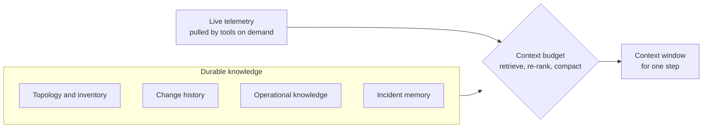

*Give two agents the same model, the same tools, and the same incident, and one can be ten times more useful than the other. The difference is context: what the agent is given to reason about.*

## 2.1 Why context beats model choice

Frontier models are increasingly interchangeable for operations reasoning. What they are given is not. An agent that knows your topology, deploy history, conventions, and past incidents will out-diagnose a smarter model that knows none of them.

**Context engineering** is the deliberate design of what enters the model's context window (the text the model reads on each step), how it is structured, and when it is dropped or refreshed. Two lessons from current practice anchor it:

- **Bigger windows did not solve it.** Model quality drops as the window fills with irrelevant material. Curation beats accumulation.
- **Context multiplies cost.** When several agents work one task, each pays for every token it carries. Sending each agent only what its task needs is what keeps the economics viable (Chapter 4).

The practical rule: when an agent underperforms, audit its context before you blame its model. Section 2.6 gives you the checklist.

## 2.2 The five context sources of an operations agent

| Source | What it holds | How it enters the loop | What breaks when it's missing or stale |
|---|---|---|---|
| **Topology and inventory** | Services, dependencies, resources, owners | Discovered and refreshed automatically | "What changed upstream of the symptom?" has no answer. Stale topology is worse than none, because the agent trusts it. |
| **Change history** | Deploys, config changes, infrastructure changes, feature flags, in time order with an author | Queried per investigation | Most incidents correlate with a change. Without the change stream, the agent investigates with one eye closed. |
| **Operational knowledge** | Runbooks, SLO definitions, architecture notes, conventions ("we always drain before scaling down"), known failure patterns | Retrieved per task | The agent gives generic advice instead of your procedure. Imperfect knowledge is fine; absent knowledge is not. |
| **Incident memory** | Past investigations: root cause, what fixed it, what didn't | Recalled at the start of an investigation | The second occurrence of a failure takes as long as the first. |
| **Live telemetry** | Metrics, logs, traces, events | Pulled on demand by tools during the loop, never bulk-loaded | The agent reasons from a stale or partial picture. |

The first four are durable knowledge, assembled per task. The fifth is fetched step by step: the context layer decides what is worth pulling, the tool layer pulls it (Chapter 3), and summarization decides what survives into the next step.



## 2.3 Assembly: the context budget

Treat the context window as a production resource with a budget and an allocation policy. A workable starting allocation for one investigation step:

| Slot | Contents | Rule |
|---|---|---|
| System core | Identity, policies, output format | Stable across steps |
| Task frame | The incident record so far | Pinned, so it can't scroll away |
| Retrieved knowledge | The few most relevant runbooks and similar past incidents | Re-ranked, each with a citation back to its source |
| Working set | Tool results | Recent results verbatim; older ones as agent-written summaries with a pointer to the full data |

Retrieval discipline matters more than retrieval technology. Retrieve broadly, then re-rank hard down to a precise few. Dumping fifty chunks into the window fails in a measurable way: models miss facts buried in the middle of long contexts.

Eviction is the other half. Long investigations must **compact**: the agent summarizes its own trajectory ("checked X, ruled out Y because Z"), drops the raw excerpts, and keeps pointers so any claim can be expanded and audited later. Compaction is also where fabrication sneaks in. Every summary must trace back to the evidence it compresses, which makes it an evaluation target in Chapter 7.

<Info>
**IN PRACTICE: OVERSIZED TOOL OUTPUT**

CloudThinker compresses an oversized tool result before the model reads it and keeps the full original in the conversation's sandbox, so an agent can reopen the raw data when a claim needs checking. A large log query costs a summary's worth of context, not the whole dump.
</Info>

## 2.4 Memory: what to write, what to decay

Persistent memory is what makes an agent deployment hard to copy, and it can quietly rot. Four rules hold up in production:

1. **Write conclusions, not transcripts.** Persist the symptom, root cause, fix, and verification, not the 300,000-token trajectory. Give it a fixed structure so retrieval matches on the pattern, not the prose.
2. **Record provenance on every memory.** Who wrote it (human, agent, import), from which incident, when, and how confident. Unattributed memory is how one bad conclusion poisons a hundred later investigations.
3. **Decay and challenge.** Topology changes invalidate old causal paths. Lower the weight of old memories, and let contradicting evidence flag a memory for review instead of letting the two silently coexist.
4. **Keep a human-curated tier.** A small, high-trust layer of conventions and standing decisions ("never do X on the payments cluster") that only humans edit and that always outranks learned memory. This is a policy surface as much as a quality one.

<Info>
**IN PRACTICE: STRUCTURED INCIDENT MEMORY**

[Incident memory](/guide/incident/incident-memory) in CloudThinker follows these rules. Each investigation that reaches a disposition writes one recollection with a fixed shape:

```text
Symptom: checkout-api 5xx rate above 20% on target group tg-checkout at 14:02 (CloudWatch)
Root cause: Inferred. Connection pool exhausted after max connections was lowered
Origin changed: unknown
Fix: operator-applied. Pool size restored to its previous value
Verify-with: 5xx rate on tg-checkout over 15 minutes; expected below 1%
```

A recalled entry is a lead, never evidence: the verdict still rests on data from your systems. A lesson is kept only if it cites at least two incidents, and a fix whose follow-up check fails stays on record as a counter-example.

Outside incidents, [workspace memory](/guide/memory) is the human-curated tier. Every member can read it and correct it in plain words, only workspace Admins can edit or delete an item directly, and the nightly [Dreaming](/guide/memory-dreaming) run merges duplicates and removes what newer conversations contradict.
</Info>

## 2.5 Discovery: context as onboarding

The strongest platforms treat context acquisition as a product phase, not a documentation request. On connection, the system walks the account or cluster read-only, records what exists and how it is set up, and shows its understanding to a human before anything else happens.

Discovery makes an agent useful on day one and safer later: a system that understands the estate can predict blast radius before it ever asks to change anything. It is also the foundation for operations where nobody has to prompt, because the system already knows the estate well enough to bring findings, plans, and evidence for approval. Without a context layer, that direction is reckless.

<Info>
**IN PRACTICE: DISCOVERY BEFORE ACTION**

The first time a [connection](/guide/connections/overview) reaches **Connected**, CloudThinker runs **Discovery**, one background investigation of the service you just connected. The **Discovery** section of the connection's detail panel then shows evidence (each fact cites the read that produced it), related connections worth adding, and suggested recurring checks you can turn into [automations](/guide/automation/automations). Reads run freely; every change still goes through [Approvals](/guide/approvals/overview).

The question to ask of any platform: what does it know about your estate one hour after you connect it, and can it show you the evidence?
</Info>

## 2.6 Audit an agent's context

Run this checklist when an agent gives a weak or wrong answer, before you change models or prompts:

| Question | If the answer is no |
|---|---|
| Could the agent see the service's dependencies and owner? | Connect the missing source, or run discovery again |
| Did it see the changes made in the hour before the symptom? | Connect the deploy or change source |
| Did it retrieve your runbook for this failure class? | Add the runbook to a [knowledge base](/guide/knowledge), or turn it into a [skill](/guide/skills/overview) if it's a procedure |
| Did it recall the last occurrence of this incident? | Check that the earlier investigation reached a disposition and its fix was confirmed |
| Does every claim in its summary trace to a tool result? | Treat the summary as unverified and evaluate compaction (Chapter 7) |

<Tip>
**KEY TAKEAWAY**

Context is both the moat and the failure mode. Engineer it like a subsystem: five sources, a budgeted assembly policy, traceable compaction, provenance-tagged memory with decay, and automated discovery. When an agent underperforms, audit its context before you blame its model.
</Tip>

## Next steps

<CardGroup cols={2}>
  <Card title="Chapter 3 · Tools, Skills, and the Protocol Layer" icon="toolbox" href="/learn/aio-engineer/chapter-3-tools-skills-protocol">
    How tool design decides safety and reliability, and how to run MCP in production.
  </Card>
  <Card title="Workspace memory" icon="brain" href="/guide/memory">
    See, teach, and correct what CloudThinker remembers about your workspace.
  </Card>
</CardGroup>
