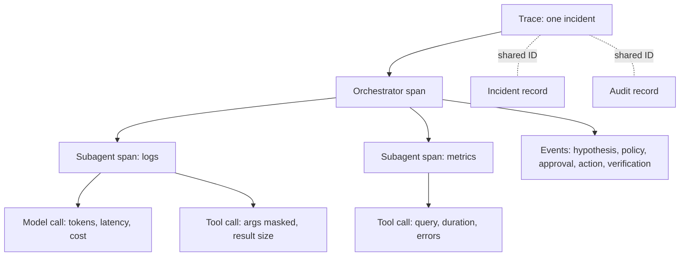

*You would never run a production service without traces, metrics, and SLOs, and an agent fleet is a production service whose failures are bad decisions, not exceptions. This chapter shows what to instrument and which numbers deserve an SLO.*

## 8.1 Why agent observability is different

An agent can look healthy on every classic signal (no exception, fast response, HTTP 200) and still be confidently wrong. So request and response logs aren't enough. You need the **decision graph**: what the agent saw, what it considered, which tools it called with which arguments, what came back, what it concluded, and what it spent.

The industry is converging on the **OpenTelemetry GenAI semantic conventions**, a shared schema for model calls, agent and tool spans, token usage, and cost. Major observability vendors ingest it, and mainstream agent frameworks emit it. Conventions for multi-agent work (tasks, handoffs, memory operations) are still being drafted in the OpenTelemetry GenAI working group.

The buying rule follows from that. Agent telemetry in an open schema means you can move it and audit it. Telemetry in a proprietary format locks you in at the layer you can least afford.

## 8.2 The trace anatomy

Record one trace per incident. Nest it like this:

| Level | Span | What to record |
|---|---|---|
| Root | The task (one incident or one request) | Incident ID, trigger, start and end time, final outcome |
| Child | Each agent invocation (the orchestrator and every subagent) | Agent name, goal it was given, total tokens and cost |
| Grandchild | Model call | Model, tokens in and out, latency, cost |
| Grandchild | Tool call | Tool name, arguments with secrets masked, result size, duration, errors |
| Event | Semantic milestone | Hypothesis formed, evidence attached, policy evaluated, approval requested and answered, action run, verification passed or failed, escalation |

Give the trace the same IDs as the incident record ([Chapter 4](/learn/aio-engineer/chapter-4-orchestration-economics)) and the audit record ([Chapter 6](/learn/aio-engineer/chapter-6-policy-approvals)). That gives you three views of one event, joined by shared IDs. An engineer can then go from "this felt slow" to "step 23 pulled 400 KB of logs and re-sent them four times" in one query.

## 8.3 Metrics and SLOs for the fleet

The eight program KPIs in the Field Guide ([§8](/learn/aio/chapter-8-measuring)) measure outcomes. Underneath them, the fleet needs an engineering layer:

| Family | Metrics | Why it matters |
|---|---|---|
| **Quality** | Diagnosis accuracy on the golden set, per incident class; online acceptance rate; rollback and intervention rate; evidence-integrity failures caught | This is the agent's error budget |
| **Latency** | Time to first finding, time to plan, end-to-end resolution time, as percentiles split by incident class and by engine (sensing promotion lag versus resolver duration) | Shows where the time goes, and which engine to fix |
| **Cost** | Tokens and spend per step, per investigation, and per resolved incident; promotion rate between the two engines; spend by model and by agent | A looping agent is a cost incident with excellent prose. Alert on cost anomalies the way you alert on cloud-spend anomalies |
| **Behavior drift** | Tool-call mix per incident class, step counts, escalation rate, refusal rate | Drift after a model swap, a prompt change, or no visible change at all is your early warning. It feeds the regression gates in [Chapter 7](/learn/aio-engineer/chapter-7-evaluating-agents) |
| **Security** | Injection patterns found in context, new egress destinations, spikes in policy denials, unusual tool sequences | The detection layer from [Chapter 5](/learn/aio-engineer/chapter-5-threat-model), turned into metrics |

The "two engines" are the cheap sensing layer that watches every signal and the resolver that does deep reasoning on the few it promotes ([Chapter 4](/learn/aio-engineer/chapter-4-orchestration-economics)).

Don't put an SLO on everything. Pick the few that carry the program, for example:

- Time to first finding on promoted P1 incidents.
- Diagnosis accuracy for each incident class that has graduated to more autonomy.
- Cost per resolved incident.

With SLOs and error budgets, the trust ladder ([Field Guide §7.3](/learn/aio/chapter-7-humans-on-the-loop)) stops being a judgment call. A class graduates when it stays inside its budget, and drops back when it burns through it.

<Info>
**IN PRACTICE: WHO WATCHES THE AGENTS?**

A fair objection to any agent platform: "we're deploying it to cut toil, so who operates it?" The answer should be instrumented software, held to the same discipline it brings to your estate. Here is where CloudThinker shows you its own agents:

| You want to see | Where |
|---|---|
| Each tool call an agent made, and its reasoning | The conversation itself. Every tool call appears as a step, and **Show reasoning** expands the agent's thinking |
| Every action an agent took in a connected system | **Admin Settings → Audit Logs**. Agent rows carry a bot badge with the agent's name, the **Agent Actions** tile counts them, and an event links to its Resolve incident ID. Export to CSV before the 90-day retention ends |
| Who and what spends credits | **Admin Settings → Usage**, sliced **By Feature**, **By User**, and **By Workspace** |
| A hard stop on runaway spend | **Admin Settings → Credit limits** (Scale plan and up). **Throttle** blocks paid spend at the monthly limit, and optional alerts fire at 80% and 100% |
| Whether diagnoses were right | **Resolve → Insights → Accuracy & trust**, built from your team's verdicts |

See [Audit Logs](/guide/security/audit-logs), [Usage](/guide/billing/usage), [Credit limits](/guide/billing/credit-limits), and [Resolve Insights](/guide/incident/insights). Ask every vendor, us included, to show you these records for their own agents and how you get them out.
</Info>

<Tip>
**KEY TAKEAWAY**

Instrument decisions, not just calls. Record one trace per incident with model, tool, and milestone spans in an open schema. Track fleet metrics for quality, latency, cost, drift, and security. Put SLOs on the few that carry the program, so graduating a class to more autonomy becomes arithmetic. If you can't see what the agent decided and spent, you aren't supervising it.
</Tip>

## Next steps

<CardGroup cols={2}>
  <Card title="Chapter 9 · AgentOps: Running the Fleet on Day 2" icon="calendar-check" href="/learn/aio-engineer/chapter-9-agentops-day-2">
    Version changes, migrate models, keep memory clean, and run postmortems for agents.
  </Card>
  <Card title="Audit Logs" icon="clipboard-list" href="/guide/security/audit-logs">
    Filter, inspect, and export every action agents and people take.
  </Card>
</CardGroup>
