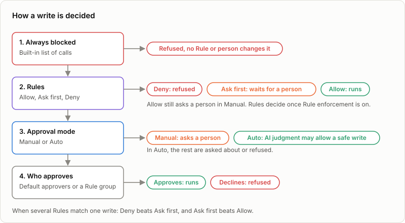
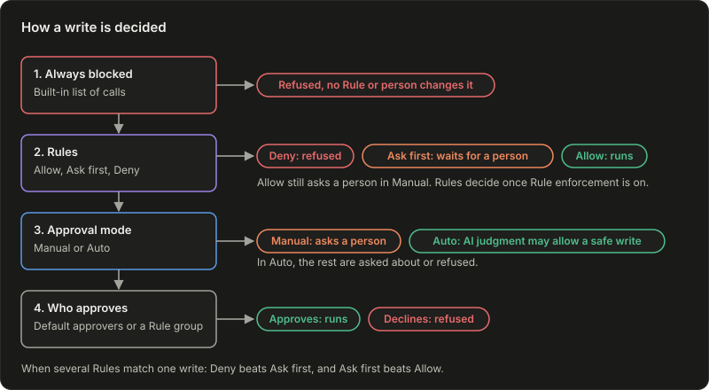
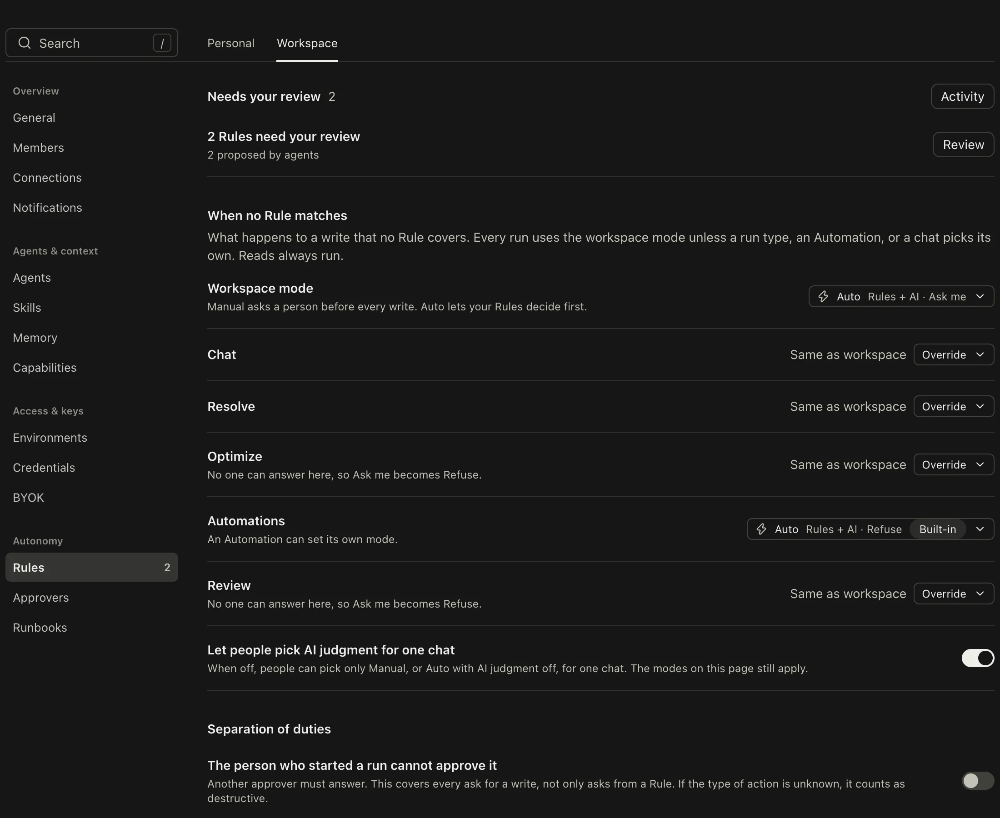

import AutonomyModes from '/snippets/vi/autonomy-modes.mdx';

Approvals kiểm soát điều xảy ra khi agent muốn thay đổi thứ gì đó qua một [kết nối](/vi/guide/connections/overview), chẳng hạn khởi động lại một dịch vụ hoặc sửa một tài nguyên cloud. Mỗi thao tác ghi sẽ chạy, chờ người duyệt hoặc bị từ chối, còn thao tác đọc luôn chạy.

## Cách quyết định một thao tác ghi

**Thao tác ghi** là bất kỳ lệnh gọi nào của agent làm thay đổi một trong các hệ thống đã kết nối của bạn. Mọi thao tác ghi đi qua các bước sau theo thứ tự, và bước đầu tiên đưa ra câu trả lời sẽ quyết định.

<Frame caption="Bước đầu tiên đưa ra câu trả lời sẽ quyết định thao tác ghi được chạy, chờ người duyệt hay bị từ chối.">
  
  
</Frame>

| Bước | Yếu tố quyết định | Kết quả |
|------|--------------|--------|
| 1. Always blocked | Danh sách tích hợp sẵn các lệnh gọi không bao giờ chạy, chẳng hạn dừng ghi log CloudTrail, đóng tài khoản AWS hoặc xóa namespace `kube-system` | Bị từ chối. Không người nào và không Rule nào thay đổi được điều này. |
| 2. [Rules](/vi/guide/approvals/rules) | Các Rule bạn đã chấp nhận. Mỗi Rule chỉ định một loại thao tác ghi. | **Allow** cho chạy, trừ ở chế độ **Manual**, khi đó vẫn phải hỏi người duyệt. **Ask first** chờ người duyệt. **Deny** từ chối. |
| 3. [Approval mode](/vi/guide/approvals/approval-mode) | **Manual** hoặc **Auto** cho lượt chạy này | Manual hỏi người duyệt. Auto có thể để AI judgment cho phép một thao tác ghi an toàn, rồi hỏi bạn hoặc từ chối phần còn lại. |
| 4. [Người phê duyệt](/vi/guide/approvals/approvers) | Người phê duyệt mặc định, hoặc nhóm mà một Rule chỉ định | Một người phê duyệt hoặc từ chối. |

Khi nhiều Rule khớp với một thao tác ghi, **Deny** thắng **Ask first**, và **Ask first** thắng **Allow**.

Approvals kiểm tra mọi lệnh gọi ra ngoài CloudThinker: lệnh gọi qua các kết nối của bạn, CLI cho cloud và cluster như `aws` và `kubectl`, chương trình từ xa như `ssh` và `psql`, Git push và pull, và các lệnh gửi một [credential](/vi/guide/credentials) đã lưu, chẳng hạn `curl` với `$STRIPE_API_KEY`. Approvals không kiểm tra tệp mà agent thay đổi trong thư mục làm việc riêng của agent. Trên một [Environment](/vi/guide/workers), các lệnh shell của agent chạy trên máy của bạn thay vì trong sandbox do CloudThinker quản lý. Lệnh gọi đến hệ thống của bạn vẫn được kiểm tra như cũ, nhưng đừng trông cậy vào Approvals để chặn một lệnh chỉ tác động lên máy đó, chẳng hạn `rm` hoặc ghi tệp cục bộ.

## Cấu hình mặc định

Workspace mới bắt đầu với **Auto · Rules + AI · Ask me**. Trên thực tế:

- Thao tác đọc chạy mà không hỏi.
- Thao tác ghi được một Rule cho phép sẽ chạy.
- Thao tác ghi không có Rule nào bao phủ sẽ được chuyển cho AI judgment. Nếu được đánh giá là an toàn, thao tác sẽ chạy. Nếu không, agent tạm dừng và hỏi người duyệt. Ví dụ, khởi động lại một pod staging mà bạn vừa yêu cầu agent khởi động lại thì có thể chạy luôn. Xóa một RDS snapshot là thao tác phá hủy, nên agent sẽ hỏi bạn.
- Automation, vốn thường chạy khi không có ai theo dõi, mặc định dùng **Auto · Rules + AI · Refuse**, nên bỏ qua thao tác ghi thay vì chờ mãi.

<AutonomyModes />

Agent đề xuất Rule trong quá trình làm việc. Rule được đề xuất không có tác dụng gì cho đến khi workspace Admin chấp nhận.

## Xem lại thiết lập

Approvals nằm trong **Settings → Workspace → Autonomy**, gồm ba trang: **Rules**, **Approvers** và **Runbooks**. Mở Settings từ menu workspace ở đầu thanh bên, hoặc nhấn ⌘, (Ctrl+, trên Windows và Linux). Xem lại thiết lập một lần khi bắt đầu, sau đó mỗi khi **Rules** trong menu Settings hiển thị số Rule cần bạn xem lại.

<Steps>
  <Step title="Mở Rules">
    Mở **Settings → Workspace → Autonomy → Rules**.

    <Frame caption="Settings → Workspace → Autonomy → Rules: các Rule đang chờ xem xét, sau đó là When no Rule matches và Separation of duties">
      
    </Frame>
  </Step>
  <Step title="Xem lại các Rule được đề xuất">
    Nếu **Needs your review** ở trên cùng cho biết có Rule cần bạn xem lại, nhấn **Review**. Chấp nhận các Rule phù hợp với cách nhóm bạn làm việc và loại bỏ phần còn lại.

    Chưa có đề xuất nào? Trong **Rules**, nhấn **Find rules**. CloudThinker đọc các kết nối, phát hiện của Optimize, sự cố, cảnh báo và lịch sử phê duyệt của bạn, rồi đề xuất Rule. Không có gì thay đổi cho đến khi bạn chấp nhận.

    **Trạng thái thành công:** mục **Needs your review** biến mất và danh sách **Rules** hiển thị các Rule đang hoạt động của bạn.
  </Step>
  <Step title="Kiểm tra chế độ của workspace">
    Trong **When no Rule matches**, bộ chọn **Workspace mode** hiển thị chế độ hiện tại. Đổi chế độ tại đây. Để đặt chế độ khác cho chat, automation và các loại lượt chạy khác, dùng các hàng loại lượt chạy bên dưới.
  </Step>
  <Step title="Kiểm tra người phê duyệt">
    Mở **Settings → Workspace → Autonomy → Approvers**. Khi **Default approvers** trống, mọi Developer trở lên đều có thể phê duyệt. Thêm người để thu hẹp phạm vi. Để ngăn mọi người tự phê duyệt lượt chạy của chính mình, dùng **Separation of duties** trên trang **Rules**.

    **Trạng thái thành công:** hàng **Default approvers** liệt kê những người trả lời phần lớn các yêu cầu.
  </Step>
</Steps>

## Trả lời yêu cầu phê duyệt

Khi một thao tác ghi phải chờ người duyệt, agent tạm dừng và chat hiển thị thẻ phê duyệt nêu tên hành động cùng kết nối bị tác động.

| Nút | Tác dụng |
|--------|--------------|
| **Approve** | Chạy đúng lệnh gọi này. |
| **Approve for…** | Chạy lệnh gọi này và cho phép cùng thao tác trên cùng kết nối chạy mà không hỏi, chỉ trong chat hoặc sự cố này, trong **1 hour**, **This incident** hoặc **30 days**. Thao tác này tạo một Rule có thời hạn gọi là [Window](/vi/guide/approvals/rules#window). |
| **Approve and draft rule** | Chạy lệnh gọi này ngay. Một chat phụ soạn một Rule để bạn chấp nhận, còn chat này tiếp tục chạy. |
| **Decline** | Từ chối lệnh gọi. Hãy cho agent biết lý do để agent thử cách khác. |
| **Break glass…** | Chạy một lần một lệnh gọi đã bị Rule **Deny** từ chối. Chỉ chủ sở hữu workspace và workspace Admin thấy nút này, và chỉ khi [break-glass](/vi/guide/approvals/approvers#break-glass) đang bật. |

**Approve for…** chỉ xuất hiện với một thao tác ghi thông thường trên một kết nối ở chế độ Auto, và chỉ với workspace Admin. Thao tác xóa, lệnh gọi ở chế độ Manual, hoặc lệnh gọi mà một Rule Ask first bao phủ không bao giờ cung cấp Window.

Nếu bạn không thể phê duyệt, thẻ hiển thị "Waiting for an approver." Người bắt đầu cuộc hội thoại có thể nhấn **Notify approvers** để báo cho họ. Bất kỳ ai có thể chat đều có thể **Decline**. Trong [Google Chat](/vi/guide/google-chat-integration), thẻ có các nút **Approve**, **Approve with reason** và **Reject**. [Slack](/vi/guide/slack-integration) và [Microsoft Teams](/vi/guide/teams-integration) chỉ liên kết đến ứng dụng web, nên bạn quyết định ở đó. Để nhận các yêu cầu này qua email hoặc chat, bật **Agent approvals** trong [Notifications](/vi/guide/notifications).

## Approvals nằm ở đâu

| Nơi | Việc bạn làm ở đó |
|-------|-------------------|
| **Settings → Workspace → Autonomy → Rules** | Xem lại các Rule được đề xuất trong **Needs your review**. Đặt chế độ cho workspace, cho từng loại lượt chạy và những gì mọi người có thể chọn trong một chat ở **When no Rule matches**. Bật quy tắc hai người trong **Separation of duties**. Tìm, chấp nhận, sửa và tắt Rule trong **Rules**, và nhập hoặc xuất policy dưới dạng tệp YAML hoặc JSON. |
| Nút **Activity** trên trang **Rules** | Xem mỗi Rule đã quyết định gì trong một khoảng thời gian và xuất ra CSV |
| **Settings → Workspace → Autonomy → Approvers** | Đặt Default approvers, nhóm người phê duyệt và break-glass |
| **Settings → Workspace → Autonomy → Runbooks** | Quản lý runbook của bạn |

## Ai có thể thay đổi Approvals

| Vai trò workspace | Xem trang | Thay đổi Rule, chế độ và người phê duyệt | Phê duyệt thao tác ghi |
|----------------|---------------|-------------------------------------|-----------------|
| Admin | Có | Có | Có |
| Developer | Có | Không | Có, trừ khi một nhóm giới hạn |
| Viewer | Có | Không | Không |

Owner và Admin của tổ chức là workspace Admin trong mọi workspace, nên một workspace có thể có nhiều Admin. Các điều khiển bạn không dùng được vẫn hiển thị và ghi "Ask a workspace admin". Một số thông báo ghi "Ask a workspace owner"; điều đó có nghĩa là chủ sở hữu workspace hoặc bất kỳ workspace Admin nào.

## Khắc phục sự cố

<AccordionGroup>
  <Accordion title="Một thao tác ghi vẫn hỏi tôi dù có Rule cho phép">
    Lượt chạy đang dùng chế độ **Manual**, vốn hỏi trước mọi thao tác ghi. Kiểm tra chế độ trong chat, trên automation, và cho loại lượt chạy cũng như cho workspace ở **When no Rule matches** trên trang **Rules**.
  </Accordion>
  <Accordion title="Một automation bỏ qua thao tác ghi thay vì hỏi">
    Automation mặc định dùng **Auto · Rules + AI · Refuse**, vì có thể không có ai ở đó để trả lời. Thêm một Rule Allow cho thao tác ghi đó, hoặc đổi chế độ của automation.
  </Accordion>
  <Accordion title="Tôi không thấy nút Approve">
    Máy chủ kiểm tra ai có thể phê duyệt ở mỗi lần nhấn. Một Rule có thể chỉ định nhóm người phê duyệt mà bạn không thuộc về, hoặc Default approvers có thể không bao gồm bạn. Nhấn **Notify approvers** nếu bạn bắt đầu cuộc hội thoại, hoặc **Decline**.
  </Accordion>
  <Accordion title="Tôi có thể phê duyệt một lệnh gọi bị Always blocked từ chối không?">
    Không. Lệnh gọi thuộc Always blocked không bao giờ chạy, và break-glass cũng không thể ghi đè.
  </Accordion>
  <Accordion title="Agent có thể tự bật Rule của mình không?">
    Không. Agent có thể đề xuất một Rule, sửa đề xuất của chính mình hoặc đề xuất tắt một Rule. Workspace Admin phải chấp nhận từng đề xuất.
  </Accordion>
  <Accordion title="Tool Permissions và Command Permissions đã đi đâu?">
    Rules đã thay thế chúng. Các quyền cấp cũ trở thành đề xuất Rule với nguồn **Imported**. Chúng chờ trong **Needs review** trên trang **Rules** và không có tác dụng cho đến khi bạn chấp nhận.
  </Accordion>
</AccordionGroup>

## Bước tiếp theo

<CardGroup cols={2}>
  <Card title="Rules" icon="list-check" href="/vi/guide/approvals/rules">
    Tìm, xem lại và chấp nhận các Rule được đề xuất cho từng loại thao tác ghi
  </Card>
  <Card title="Approval mode" icon="bolt" href="/vi/guide/approvals/approval-mode">
    Chọn Manual hoặc Auto cho workspace, một loại lượt chạy hoặc một chat
  </Card>
  <Card title="Người phê duyệt và Activity" icon="users" href="/vi/guide/approvals/approvers">
    Chọn người phê duyệt và kiểm tra mỗi Rule đã quyết định gì
  </Card>
  <Card title="Notifications" icon="bell" href="/vi/guide/notifications">
    Gửi yêu cầu phê duyệt đến email, Slack, Teams hoặc Google Chat
  </Card>
</CardGroup>
