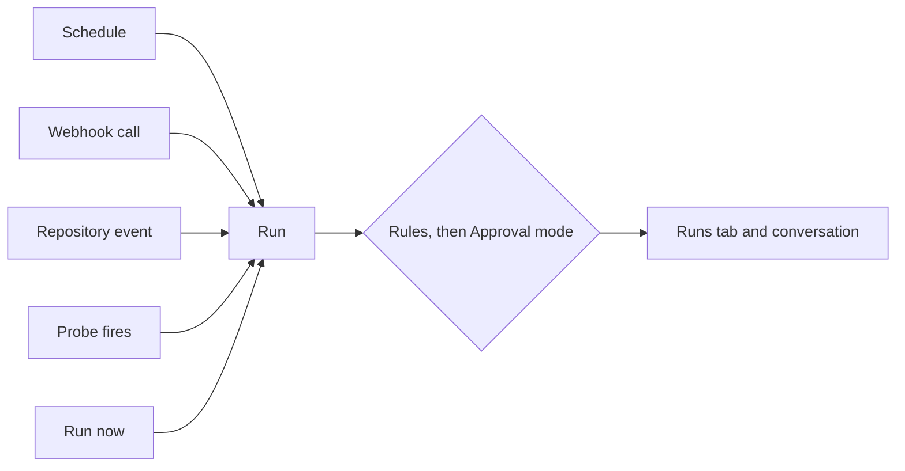

import { AutomationScene } from '/snippets/iso/automation.jsx';

**Put routine cloud ops on autopilot.**

Automation chạy Frontier Investigation Agent theo lịch hoặc theo sự kiện. Mỗi automation là một bộ hướng dẫn cho agent được lưu lại, cùng các trigger khởi chạy automation đó: lịch, lệnh gọi webhook đến, sự kiện repository hoặc script probe. CloudThinker chạy automation cho bạn, và mỗi lượt chạy giữ một cuộc hội thoại cho thấy agent đã kiểm tra, tìm thấy và thay đổi những gì.

Dùng automation cho những việc mà nếu không có nó, ai đó phải tự nhớ để làm: kiểm tra chi phí hằng ngày, bản tổng hợp sự cố hằng tuần, một lượt phân loại cho mỗi pull request mới, hoặc phản ứng với cảnh báo từ một công cụ khác.

## Điều kiện tiên quyết

- Gói Team trở lên. Khi gói của bạn giới hạn số lượng automation, **New automation** hiển thị `<used> of <limit> automations used`. Xem [Bảng giá](/vi/guide/billing/pricing).
- Với trigger repository: các repository đã kết nối trong **Review** và đã bật review. Xem [Thiết lập code review](/vi/guide/code-review/setup).
- Vai trò workspace phù hợp với công việc:

| Vai trò | Có thể |
|------|-----|
| **Admin** | Tạo, sửa, nhân bản, xóa, bật hoặc tắt, **Run now**, và **Enable** một đề xuất |
| **Developer**, **Viewer** | Xem danh sách, các lượt chạy, lịch và cuộc hội thoại của mỗi lượt chạy |

<AutomationScene />

## Cách hoạt động

1. **Trigger kích hoạt,** hoặc ai đó chọn **Run now**. Bất kỳ trigger nào cũng có thể bắt đầu một lượt chạy, và công tắc của automation phải bật thì trigger mới kích hoạt.
2. **Lượt chạy bắt đầu.** CloudThinker đọc hướng dẫn của automation, cùng phần body của sự kiện khi lượt chạy do webhook, sự kiện repository hoặc probe khởi chạy. Body đó được coi là dữ liệu, không bao giờ là hướng dẫn: agent có thể dùng một giá trị trong đó khi hướng dẫn của bạn yêu cầu (ví dụ tên dịch vụ trong một cảnh báo), nhưng văn bản trong body không thể thay đổi hướng dẫn hay phê duyệt.
3. **Approvals kiểm soát mọi thao tác ghi.** Thao tác đọc luôn chạy. Automations mặc định dùng **Auto · Rules + AI · Refuse**, vì có thể không có ai trực tuyến để trả lời. Thao tác ghi đi qua các bước sau theo thứ tự:

   | Bước | Tác dụng |
   |------|--------------|
   | **Rules** | [Rules](/vi/guide/approvals/rules) của bạn quyết định trước: cho phép, hỏi trước hoặc từ chối |
   | **AI** | Đánh giá của AI có thể cho phép một thao tác ghi an toàn mà không Rule nào bao phủ |
   | **Refuse** | Mọi thao tác vẫn chưa được cho phép sẽ bị từ chối thay vì để chờ |

   Các lựa chọn khác có trong [Vận hành tự động](/vi/guide/automation/autonomous-agents#cách-quyết-định-một-thao-tác-ghi). Ở chế độ **Manual**, mọi thao tác ghi đều hỏi một người, kể cả thao tác mà một Allow Rule bao phủ. Rules chỉ quyết định khi Rule enforcement đã được bật cho workspace của bạn; khi bước **Rules** trên **Approvals** hiển thị **In preview**, chỉ Approval mode quyết định. Xem [Khắc phục sự cố Rules](/vi/guide/approvals/rules#khắc-phục-sự-cố).
4. **Kết quả xuất hiện trong Runs.** Mỗi lượt chạy hiển thị trạng thái và liên kết đến cuộc hội thoại của nó. Kết hợp với [thông báo](/vi/guide/notifications) để nhận lỗi và cảnh báo qua Slack, Teams, Google Chat hoặc email.



### Mỗi lần chỉ một lượt chạy

Automation không bao giờ chạy hai lượt cùng lúc. Điều xảy ra với một lần khởi chạy đến giữa lúc đang chạy:

| Đến giữa lúc đang chạy | Kết quả |
|-----------------|--------|
| Lệnh gọi webhook | Được giữ lại và thử lại mỗi phút trong tối đa 30 phút. Mỗi trigger chỉ giữ một lệnh gọi: lệnh gọi mới hơn sẽ thay thế lệnh gọi cũ. |
| Sự kiện repository | Được giữ lại theo cùng cách: một sự kiện mỗi trigger, giữ sự kiện mới nhất, tối đa 30 phút |
| Probe kích hoạt | Không khởi chạy gì |
| **Run now** | Bị từ chối với "A run is already in progress for this task" (thông báo gọi automation là task) |

Lần khởi chạy được giữ lại nhưng không bao giờ chạy sẽ hiển thị trên thẻ trigger là **Did not run**, kèm lý do.

## Trigger

| Trigger | Bắt đầu một lượt chạy khi |
|---------|-------------------|
| **Schedule** | Đến một thời điểm: **Daily**, **Weekly**, **Monthly**, **No Repeat** (một lần), hoặc **Custom** (cron). Tối đa một cho mỗi automation; các loại trigger khác có thể thêm nhiều lần. |
| **Webhook** | Một lệnh gọi HTTP đến một URL do CloudThinker cấp |
| **Repository** | Một push, pull hoặc merge request, bình luận, hoặc kết quả pipeline xuất hiện trong một repository đã kết nối trong module code review của CloudThinker ([Review](/vi/guide/code-review/setup) trong thanh bên) |
| **Probe** | Một script ngắn do agent viết phát hiện điều gì đó, được kiểm tra mỗi 5, 15, 30 hoặc 60 phút |

Bạn có thể thêm bất kỳ trigger nào từ form hoặc chat, trừ probe (chỉ chat mới tạo được probe). Trigger là tùy chọn. Automation được lưu mà không có trigger nào sẽ hiển thị "No trigger yet" và chỉ chạy khi ai đó chọn **Run now**.

### Schedule

**Custom** nhận một biểu thức cron 5 trường: `minute hour day month weekday`. Trường phút và giờ nhận một giá trị, `*`, hoặc một bước nhảy như `*/15`. Danh sách hoặc khoảng giá trị trong hai trường này bị từ chối với "This schedule format is not supported." Ngày, tháng và thứ trong tuần nhận khoảng và danh sách. Thứ trong tuần được đánh số từ `0` (Chủ nhật) đến `6` (Thứ bảy), và một tên ngày đơn lẻ như `MON` sẽ được chuyển đổi cho bạn.

```text
*/15 * * * *     Every 15 minutes
0 */6 * * *      Every 6 hours
0 9 * * 1-5      09:00 on weekdays
```

Để một lịch lặp lại dừng, đánh dấu **Set expiration date** trên lịch và chọn ngày cuối cùng.

<Note>
Mọi lịch, kể cả cron **Custom**, được đọc theo múi giờ của trình duyệt dùng để lưu lịch. CloudThinker chuyển đổi sang UTC với độ lệch của múi giờ đó vào ngày 15 tháng 1, và giữ giờ UTC đó cả năm. Ở múi giờ có giờ mùa hè, các lượt chạy sẽ lệch một giờ trong một phần của năm:

- **New York**, lưu lúc 09:00: chạy lúc 09:00 từ tháng 11 đến giữa tháng 3, và lúc 10:00 từ giữa tháng 3 đến tháng 11.
- **Sydney**, lưu lúc 09:00: chạy lúc 09:00 từ tháng 10 đến tháng 4, và lúc 08:00 từ tháng 4 đến tháng 10.

Đồng nghiệp ở múi giờ khác sẽ thấy lịch theo múi giờ của họ. Nếu họ lưu mà không đổi giờ, giờ UTC giữ nguyên. Không có bộ chọn múi giờ, nên với nhóm ở nhiều múi giờ, hãy quyết định giờ chạy theo UTC và chọn một giờ mà lệch một tiếng về hai phía vẫn ổn.
</Note>

### Webhook

Khi bạn lưu một trigger webhook, hộp thoại **Webhook trigger added** hiển thị URL, một secret và một **Test command** sẵn sàng để dán. Bên gọi gửi secret trong header `Authorization: Bearer`.

```bash
curl -X POST '<your trigger URL>' \
  -H 'Authorization: Bearer <your secret>' \
  -H 'Content-Type: application/json' \
  -d '{"message": "hello"}'
```

- **Secret chỉ hiển thị một lần.** Sao chép secret trước khi chọn **Done**. Nếu bạn làm mất, dùng **Rotate webhook secret** trên thẻ trigger: URL giữ nguyên. Secret cũ ngừng hoạt động trong vài giây, không có thời gian chồng lấn, nên hãy cập nhật bên gọi ngay sau khi xoay vòng. Trước khi bạn cập nhật, các lệnh gọi từ bên gọi sẽ nhận `403`.
- **Gửi một JSON object.** Body được nối sau hướng dẫn của bạn, nên agent thấy mọi trường. Body không phải JSON object (văn bản thuần, mảng) vẫn bắt đầu lượt chạy, nhưng agent chỉ nhận được hướng dẫn của bạn. Body được giới hạn ở 1 MB.
- **60 lệnh gọi mỗi giờ cho mỗi trigger.** Các lệnh gọi vượt quá vẫn nhận `200`, không bắt đầu lượt chạy, và hiển thị **Rate limited** trên thẻ. Vượt quá 600 trong một giờ, bên gọi nhận `429`. Giới hạn này cố định: form không có cài đặt để tăng.
- **Lệnh gọi giữa lúc đang chạy được giữ lại,** như trong [Mỗi lần chỉ một lượt chạy](#mỗi-lần-chỉ-một-lượt-chạy).
- **Bảo mật.** Trigger dùng xác thực bearer với secret do CloudThinker cấp, được lưu trữ mã hóa. Form không có tùy chọn ký request. Lệnh gọi đi từ công cụ của bạn đến CloudThinker, nên không có IP nguồn nào của CloudThinker cần cho phép. Xem [Bảo mật](/vi/guide/security/overview).

| Phản hồi | Ý nghĩa |
|----------|---------|
| `200` | Đã nhận. JSON body chứa `success` và `request_id`. Lệnh gọi vượt giới hạn 60 lượt chạy mỗi giờ nhận cùng body này. |
| `400` | Automation hoặc trigger đang tắt, hoặc automation đã bị xóa |
| `401` | Không có header `Authorization`, hoặc URL không phải là trigger |
| `403` | Sai secret |
| `413` | Body vượt quá 1 MB |
| `429` | Hơn 600 lệnh gọi trong một giờ, 10 lần xác thực thất bại trong 15 phút, hoặc dịch vụ đang bận tạm thời. Thử lại sau. |

<Warning>
Phản hồi không thể cho bên gọi biết lệnh gọi đã bị giới hạn tần suất, nên một nguồn gửi nhiều có thể làm mất cảnh báo mà không báo lỗi. Hãy cấp cho mỗi nguồn cảnh báo một trigger riêng, và loại trùng hoặc gom nhóm cảnh báo trong công cụ gửi.
</Warning>

Mỗi lệnh gọi được liệt kê trên thẻ trigger kèm trạng thái:

| Trạng thái gửi | Ý nghĩa | Đã bắt đầu lượt chạy? |
|----------------|---------|----------------|
| **Accepted** | Đã nhận và xếp hàng | Chưa |
| **Processed** | Đã chuyển cho automation | Có, hoặc được giữ để chạy sau lượt chạy hiện tại |
| **Failed** | Đã nhận, rồi không thể bắt đầu lượt chạy, kèm nội dung lỗi. Ví dụ, automation đã bị tắt hoặc xóa sau khi lệnh gọi đến. | Không |
| **Rate limited** | Hơn 60 lệnh gọi trong giờ | Không |

Lệnh gọi đang được giữ mà bị lệnh gọi mới hơn thay thế vẫn ở trạng thái **Processed**. Dòng **Did not run** trên thẻ là nơi hiển thị lệnh gọi bị bỏ.

Ví dụ, trỏ một công cụ cảnh báo đến URL với body như sau:

```json
{"service": "orders-api", "alert": "p95 latency above 800 ms", "env": "production"}
```

Rồi viết hướng dẫn có nêu tên trường:

```text
Investigate the service in the service field of the alert. Summarize the most likely cause and the evidence for it.
```

Trong công cụ cảnh báo, thêm một đích webhook với URL của trigger và một header tùy chỉnh `Authorization` đặt thành `Bearer <your secret>`. Với cảnh báo giám sát từ các công cụ như Datadog, Grafana hoặc PagerDuty cần mở sự cố, một tín hiệu webhook của Resolve phù hợp hơn. Xem [Webhooks](/vi/guide/webhooks/overview).

### Repository

Chọn repository và một hoặc nhiều sự kiện: **Pull or merge request**, **Push**, **Comment**, hoặc **Pipeline finished**. Chỉ có thể thêm repository đã bật review trong Review.

| Sự kiện | GitHub | GitLab | Bitbucket | Azure DevOps | AWS CodeCommit |
|-------|:-:|:-:|:-:|:-:|:-:|
| Pull hoặc merge request | ✓ | ✓ | ✓ | ✓ | ✓ |
| Push | ✓ | ✓ | ✓ | ✓ | ✓ |
| Comment | ✓ | ✓ | ✓ | ✓ | ✓ |
| Pipeline finished | ✓ | ✓ | | ✓ | |

| Bộ lọc | Áp dụng cho | Để trống nghĩa là |
|--------|-----------|-------------|
| Branch: một tên chính xác, hoặc một glob phân biệt hoa thường. `*` khớp với mọi ký tự, kể cả `/`, nên `release/*` cũng khớp `release/2026/q4`. `?` khớp một ký tự. | Chỉ sự kiện push và pull hoặc merge request. Với push, là branch được cập nhật. Với pull hoặc merge request, là branch đích. | Mọi branch |
| Action: **Opened**, **New commits**, **Merged**, **Closed** | Sự kiện pull hoặc merge request | Cả bốn |

<Warning>
**Comment** và **Pipeline finished** không có bộ lọc: mỗi sự kiện như vậy trên các repository đã chọn đều bắt đầu một lượt chạy, và mỗi lượt chạy đều dùng credit. Trên một repository bận rộn, hãy dự kiến một lượt chạy cho mỗi bình luận. Hãy bắt đầu với một vài repository.
</Warning>

Sự kiện repository đến giữa lúc đang chạy sẽ được giữ lại, như trong [Mỗi lần chỉ một lượt chạy](#mỗi-lần-chỉ-một-lượt-chạy).

- Thay đổi label, assignee, yêu cầu review và phê duyệt không bao giờ bắt đầu lượt chạy.
- Bình luận từ bot review của CloudThinker không bao giờ bắt đầu lượt chạy, nên một automation không thể lặp vô hạn trên chính đầu ra của nó.

### Probe

Probe là một script bash do agent viết và lưu làm trigger. Chỉ chat mới tạo được:

1. Mở một cuộc chat và mô tả cần theo dõi gì, tần suất bao lâu, và thuộc automation nào (hoặc yêu cầu một automation mới):

   ```text
   Create an automation that watches the orders-api p95 latency every 15 minutes and starts a run if it's above 800 ms.
   ```

2. Agent viết script và chạy thử một lần. Agent từ chối lưu script không thoát với `0` hoặc `1`.
3. Mở automation. Thẻ trigger probe hiển thị khoảng thời gian và đường dẫn script là dấu hiệu probe đã được lưu.

Mỗi lần kiểm tra, script chạy tối đa 120 giây trên CloudThinker Cloud, nơi chạy các lệnh của agent, với thông tin xác thực chỉ đọc cho các kết nối mà agent đã nêu khi viết probe. Mỗi lần kiểm tra chỉ chạy script, không chạy agent, nên không bắt đầu lượt chạy. Lượt chạy khi kích hoạt và lượt chạy sửa lỗi là các lượt chạy agent bình thường và dùng credit như mọi lượt chạy khác ([Usage](/vi/guide/billing/usage)).

| Mã thoát của script | Điều xảy ra |
|------------------|--------------|
| `0` | Yên lặng. Không có gì chạy. |
| `1` | Kích hoạt. Lượt chạy bắt đầu với 2.000 ký tự đầu tiên của đầu ra script, trừ khi thời gian chờ kể từ lần kích hoạt trước vẫn đang có hiệu lực. |
| Giá trị khác | Lỗi. Sau 3 lỗi liên tiếp, một lượt chạy sửa lỗi bắt đầu, và agent được yêu cầu sửa script hoặc thay đổi probe. |

Thời gian chờ mặc định là 60 phút. Có thể là 5, 15, 60, 240 hoặc 1.440 phút. Để thay đổi thời gian chờ, khoảng kiểm tra hoặc script, hãy hỏi trong chat và nêu tên automation, ví dụ "Set the probe cooldown on the orders-api latency automation to 240 minutes."

Thẻ trigger hiển thị khoảng thời gian, đường dẫn script, lần kiểm tra gần nhất (ví dụ "Quiet · checked 5 minutes ago"), và **Last output**. Bạn có thể tạm dừng hoặc xóa probe từ thẻ. Cả thẻ lẫn chat đều không liệt kê các kết nối mà probe đọc. Để xem probe làm gì, hãy yêu cầu trong chat hiển thị script tại đường dẫn trên thẻ. Với các gói có [audit log](/vi/guide/security/audit-logs), mỗi probe mới được ghi lại là "added a probe trigger".

## Tạo một automation

[Automation quickstart](/vi/guide/automation/quickstart) hướng dẫn từ đầu đến cuối. Tóm tắt: mở **Automations** trong thanh bên, chọn **New automation**, rồi chọn một trong ba cách bắt đầu.

| Bắt đầu | Dùng khi |
|-------|-------------|
| **Create with chat** | Bạn muốn mô tả công việc. CloudThinker hỏi những gì còn thiếu, rồi tạo automation. Tương tự gõ `/create-automation` trong chat. |
| Một template trong lưới **Or start from a template**, bên dưới ô chat | Có template phù hợp. Template mở form đã điền sẵn. |
| **Start from a blank form** | Bạn biết chính xác mình muốn gì. |

Mọi template đều bắt đầu với một trigger **Schedule** và hướng dẫn, cả hai đều có thể thay đổi:

| Template | Lịch | Hướng dẫn yêu cầu gì |
|----------|----------|-------------------------------|
| **Weekly cost report** | Mỗi thứ Hai, 09:00 | Chi tiêu tuần trước theo dịch vụ và tài khoản, với ba mục biến động lớn nhất và nguyên nhân của từng mục |
| **Daily cost anomaly alert** | Mỗi ngày, 08:00 | Các dịch vụ vượt hơn 20% so với trung bình 14 ngày gần nhất, kèm nguyên nhân có khả năng |
| **Daily security drift check** | Mỗi ngày, 07:00 | Các storage bucket công khai mới, security group mở ra internet, và thông tin xác thực admin không dùng kể từ hôm qua |
| **Weekly incident digest** | Mỗi thứ Hai, 09:00 | Sự cố trong bảy ngày qua, các lần lặp lại, và nguyên nhân tái diễn hàng đầu |
| **Monthly idle resource sweep** | Ngày đầu tiên của tháng, 09:00 | Instance, volume và load balancer không hoạt động trong 30 ngày, xếp hạng theo khoản tiết kiệm hằng tháng |
| **Weekly expiry check** | Mỗi thứ Tư, 09:00 | Chứng chỉ TLS, access key và secret hết hạn trong 30 ngày tới, kèm chủ sở hữu và bước gia hạn |

Mỗi template cần một kết nối đọc được dữ liệu mà template hỏi tới, chẳng hạn dữ liệu billing cho các template chi phí.

| Trường | Nhập gì |
|-------|---------------|
| **What should the agent do?** | Hướng dẫn cho mọi lượt chạy. Gõ `#` để chỉ agent đến một kết nối; nếu không, agent chọn trong số các kết nối của workspace. |
| Bộ chọn model | **Pro** hoặc **Ultra**. Ultra tốn gấp 1,7 lần credit so với Pro, nên hãy giữ Pro trừ khi câu trả lời của lượt chạy quá yếu. Không có chi phí credit cố định cho mỗi lượt chạy ([Usage](/vi/guide/billing/usage)). |
| **Approval** | Để ở tùy chọn được đánh dấu **Default** để dùng loại lượt chạy **Automations** cho mọi automation (xem [Approval mode](/vi/guide/approvals/approval-mode)). Chọn tùy chọn khác để ghi đè chỉ cho automation này. |
| Trigger | Một hoặc nhiều trigger ở trên |
| **Name** | Một cụm danh từ ngắn. CloudThinker gợi ý một tên từ hướng dẫn. |
| **Advanced** | Các cài đặt bên dưới |

| Cài đặt | Tùy chọn | Chọn khi |
|---------|---------|-------------|
| **Conversation** | **New conversation each run** (mặc định: mỗi lượt chạy bắt đầu mới và chỉ đọc hướng dẫn của nó cùng [bộ nhớ workspace](/vi/guide/memory)) hoặc **Continue one conversation** (mọi lượt chạy đăng vào một cuộc hội thoại và thấy các lượt chạy trước; lịch sử dài được nén lại, nên chi tiết cũ hơn được tóm tắt) | Continue cho bản tổng hợp cần so sánh với lượt chạy trước. New cho các kiểm tra độc lập. |
| **Run in** | **CloudThinker Cloud** (mặc định), hoặc một [Worker](/vi/guide/workers) dùng chung | Worker khi chỉ có thể truy cập mục tiêu từ mạng của bạn |

### Từ một đề xuất trong chat

Khi công việc trong chat đáng được lặp lại, phản hồi của agent có thể kết thúc bằng một thẻ đề xuất hiển thị một lịch. Admin chọn **Enable** để tạo automation với lịch đó và phê duyệt của loại lượt chạy **Automations**, hoặc **Dismiss** để bỏ.

Thẻ cũng có thể hiển thị một điều kiện cần theo dõi, bên cạnh biểu tượng con mắt. Khi một lượt chạy của automation đó đáp ứng điều kiện, CloudThinker gửi [thông báo](/vi/guide/automation/autonomous-agents#thông-báo-cho-các-lượt-chạy-không-người-giám-sát) **Watched condition met**.

## Lượt chạy và trạng thái

Trang **Automations** có ba tab: **Automations** (danh sách), **Runs** (mọi lượt chạy, mới nhất trước, được gắn nhãn **Schedule**, **Manual**, **Webhook**, **Repository** hoặc **Probe**), và **Calendar** (các lượt chạy theo lịch đã qua và sắp tới theo tháng).

| Trạng thái | Ý nghĩa |
|--------|---------|
| **Pending** | Đang xếp hàng, hoặc đang chờ một cuộc hội thoại bận |
| **Running** | Đang chạy |
| **Succeeded** | Đã hoàn tất. Thao tác ghi bị Approvals từ chối không làm lượt chạy thất bại, nên hãy đọc cuộc hội thoại để xem những gì đã bị bỏ qua. |
| **Failed** | Kết thúc với lỗi |
| **Required Approval** | Tạm dừng ở một thao tác ghi cần một người. Mở cuộc hội thoại của lượt chạy để phê duyệt hoặc từ chối. |
| **Cancelled** | Dừng trước khi hoàn tất |

Lệnh gọi hoặc sự kiện không bắt đầu lượt chạy nào (ví dụ một lệnh gọi webhook được giữ lại chờ quá lâu, hoặc một probe kích hoạt giữa lúc đang chạy) không thêm hàng nào vào **Runs**. Thẻ trigger của nó hiển thị **Did not run** kèm lý do.

## Quản lý automation

Mỗi thẻ có **Run now**, một công tắc bật/tắt, và menu **…** với **Edit**, **Duplicate** và **Delete**. Tắt một automation vẫn giữ cài đặt và lịch sử của nó, và **Run now** vẫn hoạt động khi automation đang tắt. Chỉnh sửa chỉ áp dụng cho các lượt chạy trong tương lai, không áp dụng cho lượt chạy đang chạy. Sau khi xóa, các URL webhook của nó trả về `400` và không khởi chạy gì. Các lượt chạy trước đây vẫn nằm trong **Runs** dưới tên cuộc hội thoại của chúng, và các cuộc hội thoại vẫn đọc được.

Không có API hay Terraform provider để quản lý automation. Quản lý chúng trên trang này hoặc bằng cách hỏi trong chat. [Trigger webhook](#webhook) là cách để mã bên ngoài bắt đầu một lượt chạy.

<Warning>
Sau 10 lượt chạy thất bại liên tiếp, CloudThinker tắt automation và gửi thông báo **Automation turned off**. **Run now** vẫn hoạt động để bạn gỡ lỗi. Bật lại sau khi đã khắc phục nguyên nhân.
</Warning>

## Khắc phục sự cố

<AccordionGroup>
  <Accordion title="Bên gọi webhook nhận 401 hoặc 403">
    `401` nghĩa là thiếu header `Authorization` hoặc sai URL. `403` nghĩa là sai secret. Kiểm tra header có dạng `Bearer <secret>` với đúng một dấu cách. Nếu mất secret, dùng **Rotate webhook secret** trên thẻ trigger và cập nhật bên gọi. Sau 10 lần thất bại trong 15 phút, bên gọi nhận `429` trong một khoảng thời gian.
  </Accordion>
  <Accordion title="Custom báo &quot;This schedule format is not supported&quot;">
    Trường phút hoặc giờ có danh sách hoặc khoảng giá trị, chẳng hạn `0 9,17 * * *`. Dùng một giá trị, `*`, hoặc một bước nhảy ở đó. Để chạy mỗi 12 giờ, `0 */12 * * *` hoạt động. Với hai thời điểm không liên quan, hãy tạo automation thứ hai.
  </Accordion>
  <Accordion title="Probe liên tục báo lỗi">
    Script thoát với giá trị khác `0` hoặc `1`. Sau 3 lỗi liên tiếp, một lượt chạy sửa lỗi bắt đầu. Đọc **Last output** trên thẻ, rồi yêu cầu trong chat sửa script.
  </Accordion>
  <Accordion title="Lượt chạy cứ ở trạng thái Pending">
    Lượt chạy đang xếp hàng, hoặc cuộc hội thoại của nó đang bận với lượt khác. Lượt chạy bắt đầu khi cuộc hội thoại rảnh. Nếu bạn chọn **Continue one conversation**, một cuộc chat trong cuộc hội thoại đó có thể giữ lượt chạy đó lại.
  </Accordion>
  <Accordion title="Lượt chạy thành công nhưng không có gì thay đổi">
    Có thể Approvals đã từ chối thao tác ghi. Thao tác ghi bị từ chối không làm lượt chạy thất bại. Mở cuộc hội thoại của lượt chạy để xem những gì đã bị bỏ qua và vì sao. Với một thao tác ghi mà automation cần thực hiện mỗi lần, hãy đặt loại lượt chạy **Automations** sang một lựa chọn **Ask me** để nó chờ bạn thay vì bị từ chối, và thêm một [Rule](/vi/guide/approvals/rules) **Allow** với **Runs from** đặt là **Automations** để có hiệu lực khi Rule enforcement được bật ([chi tiết](/vi/guide/approvals/rules#khắc-phục-sự-cố)).
  </Accordion>
  <Accordion title="Trigger đã kích hoạt nhưng không có gì trong Runs">
    Kiểm tra thẻ trigger. **Did not run** cho biết lý do, chẳng hạn đang có một lượt chạy khác hoặc automation đang tắt. Lần gửi webhook vượt giới hạn mỗi giờ hiển thị **Rate limited**.
  </Accordion>
</AccordionGroup>

## Bắt đầu

<CardGroup cols={2}>
  <Card title="Automation quickstart" icon="rocket" href="/vi/guide/automation/quickstart">
    Xây dựng một kiểm tra bất thường chi phí hằng ngày gửi cảnh báo đến Slack trong 10 phút
  </Card>
  <Card title="Vận hành tự động" icon="robot" href="/vi/guide/automation/autonomous-agents">
    Đặt giới hạn an toàn cho công việc chạy mà không ai theo dõi
  </Card>
  <Card title="Approval mode" icon="bolt" href="/vi/guide/approvals/approval-mode">
    Chọn cách quyết định thao tác ghi cho một automation hoặc tất cả
  </Card>
  <Card title="Thông báo" icon="bell" href="/vi/guide/notifications">
    Chuyển lỗi và cảnh báo của agent đến Slack, Teams hoặc email
  </Card>
</CardGroup>
