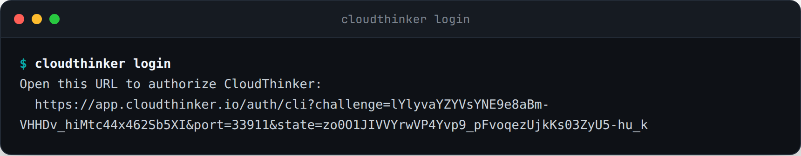

CloudThinker CLI đăng nhập qua trình duyệt và lưu một thông tin xác thực cho mỗi workspace, nên bạn không bao giờ phải dán API key. Trang này hướng dẫn đăng nhập trên laptop hoặc máy từ xa, chuyển workspace và xác thực cho script cùng job CI.

## Điều kiện tiên quyết

- Đã cài CLI. Xem [Tổng quan CLI](/vi/guide/cli/overview).
- Tài khoản CloudThinker có quyền truy cập ít nhất một workspace. Workspace là dự án chứa các connection và cuộc hội thoại của bạn.

## Đăng nhập

<Steps>
  <Step title="Bắt đầu đăng nhập">
    ```bash
    cloudthinker login
    ```

    Trên terminal tương tác, CLI hỏi **How would you like to log in?**

    | Lựa chọn | Dùng khi |
    | --- | --- |
    | **Log in with browser** | Bạn đang ở máy của mình và có trình duyệt. Khuyến nghị cho hầu hết người dùng |
    | **Log in with a code** | Bạn đang trong phiên SSH hoặc phiên từ xa không có trình duyệt |

    Dùng phím mũi tên hoặc nhấn `1` hay `2`, rồi nhấn Enter.
  </Step>

  <Step title="Phê duyệt trên trình duyệt">
    CLI in ra `Open this URL to authorize CloudThinker:` kèm đường link và mở link đó. Nếu trình duyệt không mở, nhấn `c` để sao chép link. Đăng nhập, chọn workspace và phê duyệt yêu cầu trong vòng năm phút.

    <Frame>
      
    </Frame>

    **Trạng thái thành công:** terminal in ra `Logged in to <workspace>.`

    Nếu bạn chọn **Log in with a code**, hãy làm theo [Đăng nhập trên máy từ xa](#đăng-nhập-trên-máy-từ-xa).
  </Step>

  <Step title="Xác minh thông tin xác thực">
    ```bash
    cloudthinker whoami
    ```

    `whoami` hỏi API chứ không đọc tệp cục bộ, nên lệnh này chứng minh thông tin xác thực thực sự hoạt động.

    **Trạng thái thành công:** một dòng chứa các giá trị `host=`, `email=` và `workspace=`. Thêm `--json` để nhận đầu ra cho máy đọc.
  </Step>
</Steps>

### Đăng nhập trên máy từ xa

Qua SSH, hoặc trên Linux không có màn hình, CLI tự chọn luồng mã và thông báo: `No local browser detected (SSH session). Using device-code login.` CLI in ra một URL đã điền sẵn mã, chính mã đó, và thời gian mã còn hiệu lực. Mở URL trên bất kỳ trình duyệt, bất kỳ thiết bị nào, và kiểm tra rằng trang hiển thị đúng mã đó trước khi phê duyệt.

```text
Open this URL to authorize CloudThinker:
  <verification URL with the code>

Confirm that it shows this code:
  <code>
(or enter it at <verification URL>)

The code expires in <m:ss>.
```

Trong lúc chờ, terminal hiển thị `Waiting for approval: … elapsed, code expires in …`.

| Để | Chạy |
| --- | --- |
| Buộc dùng luồng mã | `cloudthinker login --device-auth` |
| In URL mà không mở trình duyệt | `cloudthinker login --no-browser` |
| Luôn dùng một luồng trên máy này | Đặt `CLOUDTHINKER_LOGIN=browser` hoặc `CLOUDTHINKER_LOGIN=device` |

## Làm việc với nhiều workspace

Đăng nhập một lần cho mỗi workspace. Mỗi lần đăng nhập được lưu theo host và workspace, nên đăng nhập workspace thứ hai vẫn giữ workspace thứ nhất.

| Để | Chạy |
| --- | --- |
| Liệt kê các workspace đã đăng nhập và xem workspace đang hoạt động | `cloudthinker auth status` |
| Chuyển sang một lần đăng nhập đã lưu khác | `cloudthinker auth switch Production` |
| Dùng một workspace cho một lệnh | `cloudthinker --workspace Production whoami` |
| Dùng một workspace cho cả phiên shell | `export CLOUDTHINKER_WORKSPACE=Production` |

`--workspace`, `auth switch` và `CLOUDTHINKER_WORKSPACE` nhận workspace ID hoặc đúng tên workspace. Đặt tên có khoảng trắng trong dấu nháy. `--workspace` đứng trước tên lệnh:

```bash
cloudthinker --workspace 11111111-1111-4111-8111-111111111111 chat -p "Check the error budget"
```

### Dùng host tùy chỉnh

Để dùng host khác `https://app.cloudthinker.io`, chạy `cloudthinker login --url <origin>` một lần. Các lệnh sau sẽ nhớ host này. Bạn cũng có thể đặt `CLOUDTHINKER_URL`. Xem [Tra cứu CLI](/vi/guide/cli/reference#biến-môi-trường).

## Xác thực cho script hoặc job CI

Pipeline không có trình duyệt, nên không thể phê duyệt đăng nhập. Thay vào đó, hãy đưa cho pipeline một token [service account](/guide/api/tokens#service-accounts) hoặc một [API token cá nhân](/guide/api/tokens) trong `CLOUDTHINKER_TOKEN`. Xem [Dùng CloudThinker trong CI/CD](/guide/api/ci-cd).

| Cách | Dùng khi |
| --- | --- |
| Token service account trong `CLOUDTHINKER_TOKEN` (khuyến nghị) | Một job CI. Token `ct_sat_` hoạt động với danh nghĩa service account, không phải một người, và có hiệu lực cho đến khi hết hạn hoặc bị Admin thu hồi |
| API token cá nhân trong `CLOUDTHINKER_TOKEN` | Một script của riêng bạn. Token `ct_pat_` hoạt động với danh nghĩa của bạn, giới hạn trong các scope bạn đã chọn và vai trò của chính bạn |
| `cloudthinker login --token < token.txt` | Một job cần giữ lần đăng nhập đã lưu. Lệnh đọc API token cá nhân (`ct_pat_`) từ stdin, không bao giờ từ dòng lệnh, kiểm tra token với máy chủ, và lưu token cho từng workspace mà token bao phủ. Lệnh in ra `Logged in with an access token. Active workspace: …`, các scope của token và thời hạn của nó |
| Đăng nhập trên runner | Job chạy trên runner bạn quản lý. Chạy `cloudthinker login --device-auth` trên runner một lần. Lần đăng nhập đã lưu tự làm mới |
| Token ngắn hạn từ `auth token` trong `CLOUDTHINKER_TOKEN` | Một job ngắn nhận token 30 phút từ một wrapper. CLI không bao giờ làm mới token, nên job thất bại với [mã thoát 3](/vi/guide/cli/reference#mã-thoát) khi token hết hạn |
| `cloudthinker auth token` (cho công cụ khác) | Một công cụ khác cần bearer. Lệnh in access token hiện tại ra stdout và không in gì thêm, tự làm mới trước nếu token sắp hết hạn |

<Warning>
Lần đăng nhập trên runner mang danh nghĩa người đã đăng nhập, nên mọi job trên runner đó chạy với quyền truy cập của người này. Hãy ưu tiên token service account. Để thu hồi, chạy `cloudthinker logout` trên runner.
</Warning>

```bash
# Short job: a wrapper hands the CLI a fresh token
export CLOUDTHINKER_TOKEN="$(cloudthinker auth token)"
cloudthinker chat -p "Summarize last night's failed runs" --json
```

Token từ `cloudthinker auth token` xác thực với danh nghĩa của bạn cho tới khi hết hạn. Hãy coi token như mật khẩu: không ghi log, không commit, không dán vào chat.

Token đã xác định workspace của nó, nên mọi lệnh trừ `review setup` và `doctor`, kể cả `cloudthinker api`, đều thoát với [mã 2](/vi/guide/cli/reference#mã-thoát) khi `--workspace` hoặc `CLOUDTHINKER_WORKSPACE` được đặt cùng `CLOUDTHINKER_TOKEN`. Hãy bỏ đặt `CLOUDTHINKER_WORKSPACE` trước khi export token. API token (`ct_pat_` hoặc `ct_sat_`) dùng được với `cloudthinker chat`, `cloudthinker incident ls` và `incident status`, các lệnh public API, và [`cloudthinker api`](/guide/cli/api#pick-the-workspace); phần lớn các lệnh khác cần một lần đăng nhập hoặc token từ `auth token`.

## Thông tin xác thực nằm ở đâu

CLI ghi thông tin xác thực dưới dạng JSON thuần vào một tệp duy nhất, chỉ người dùng của bạn đọc được (mode 0600). CLI không dùng keychain của hệ điều hành; các bản phát hành trước 0.5.3 có dùng, và khi nâng cấp, các lần đăng nhập đó được chuyển vào tệp.

| Hệ điều hành | Đường dẫn |
| --- | --- |
| macOS | `~/Library/Application Support/cloudthinker/credentials.json` |
| Linux | `$XDG_CONFIG_HOME/cloudthinker/credentials.json`, hoặc `~/.config/cloudthinker/credentials.json` khi biến đó chưa được đặt |
| Bất kỳ, khi đặt `CLOUDTHINKER_CONFIG_DIR` | `$CLOUDTHINKER_CONFIG_DIR/credentials.json`. Khi đó `whoami` in ra đường dẫn thông tin xác thực |

Tệp chứa mọi lần đăng nhập workspace, khóa theo host và workspace.

## Đăng xuất

```bash
cloudthinker logout          # the selected or active workspace
cloudthinker logout --all    # every workspace stored for this host
```

Lệnh đăng xuất yêu cầu máy chủ thu hồi thông tin xác thực, rồi xóa khỏi tệp cục bộ. Bản sao cục bộ vẫn bị xóa kể cả khi không kết nối được máy chủ.

**Trạng thái thành công:** terminal in ra `Logged out.`, hoặc `Logged out of all workspaces for this host.`

## Khắc phục sự cố

<AccordionGroup>
  <Accordion title="Lệnh báo bạn chưa đăng nhập (mã thoát 3)">
    Thông tin xác thực bị thiếu hoặc đã hết hạn, hoặc máy chủ từ chối truy cập. Chạy lại `cloudthinker login`. Trong shell không tương tác, CLI không bao giờ mở trình duyệt: CLI in ra lệnh đăng nhập cần chạy rồi dừng.
  </Accordion>
  <Accordion title="CLOUDTHINKER_TOKEN bị từ chối, hoặc auth switch không có tác dụng">
    Token môi trường được ưu tiên hơn thông tin xác thực đã lưu, nên đăng nhập lại hay chạy `auth switch` đều không thay đổi gì. Hãy thay token, hoặc chạy `unset CLOUDTHINKER_TOKEN` và dùng các lần đăng nhập đã lưu.
  </Accordion>
  <Accordion title="Hết thời gian phê duyệt trên trình duyệt">
    Link đồng ý có hiệu lực trong năm phút. Chạy lại `cloudthinker login`, hoặc dùng `cloudthinker login --device-auth` để phê duyệt từ thiết bị khác.
  </Accordion>
  <Accordion title="Tên workspace không được chấp nhận">
    `--workspace` khớp đúng tên hoặc workspace ID. Chạy `cloudthinker auth status` để xem các workspace đã lưu, và đặt tên có khoảng trắng trong dấu nháy.
  </Accordion>
</AccordionGroup>

## Bước tiếp theo

<CardGroup cols={2}>
  <Card title="Chat không giao diện" icon="terminal" href="/vi/guide/cli/headless-chat">
    Gửi prompt từ script và CI bằng thông tin xác thực bạn vừa thiết lập
  </Card>
  <Card title="Tra cứu CLI" icon="book" href="/vi/guide/cli/reference">
    Mọi cờ, biến môi trường và mã thoát
  </Card>
</CardGroup>
