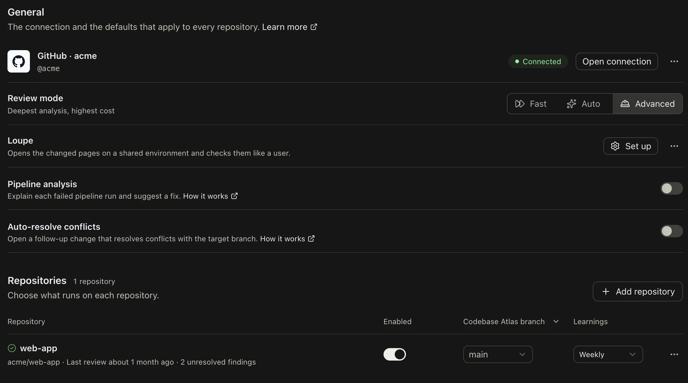

Kết nối Git provider một lần, chọn các kho cần theo dõi, và mọi pull request (PR) hoặc merge request (MR) mới trong các kho đó đều được review mà không cần kích hoạt thủ công. Mới dùng Review? Hãy đọc [tổng quan](/vi/guide/code-review/overview) trước.

## Điều kiện tiên quyết

- Một workspace CloudThinker mà bạn là **Admin** của workspace. Developer và Viewer xem được review nhưng không chạy được thiết lập. Xem [vai trò](/vi/guide/security/roles).
- Tài khoản GitHub, GitLab, Bitbucket Cloud hoặc Azure DevOps có quyền cài app hoặc tạo access token cho các kho bạn muốn review.
- Khoảng mười phút. GitLab và Azure DevOps cần thêm một bước cấu hình webhook.
- Chỉ với GitLab tự host: CloudThinker phải truy cập được URL GitLab của bạn qua HTTPS, và instance GitLab phải truy cập được URL webhook mà trình hướng dẫn hiển thị.

<Note>
  Mỗi workspace kết nối một Git provider. Nếu nhóm bạn dùng hai provider, hãy thiết lập Review trong một workspace riêng cho từng provider.
</Note>

## Kết nối provider và kho

<Steps>
  <Step title="Mở Review">
    Nhấn **Review** trong thanh điều hướng bên trái. Trước khi thiết lập, trang hiển thị **AI reviews every pull request and analyzes failed pipelines.**
  </Step>
  <Step title="Bắt đầu thiết lập">
    Nhấn **Connect repository**, hoặc chọn provider của bạn trong **Where is your code hosted?** trên cùng trang. Một sheet thiết lập mở ra với ba bước: **Provider**, **Connect** và **Finish**.
  </Step>
  <Step title="Chọn provider">
    Trong **Where is your code hosted?**, chọn **GitHub**, **GitLab**, **Bitbucket** hoặc **Azure DevOps**. Sheet chuyển sang **Connect**.
  </Step>
  <Step title="Kết nối tài khoản">
    Xác thực theo cách provider của bạn hỗ trợ:

    | Provider | Cách kết nối |
    |---|---|
    | GitHub | **Install GitHub App** |
    | GitLab | Tab **OAuth** (**Connect to GitLab**, chỉ GitLab.com) hoặc tab **Access Token** |
    | Bitbucket | Tab **OAuth** (**Connect to Bitbucket**) hoặc tab **Access Token** |
    | Azure DevOps | Personal access token, rồi **Check token** và **Connect** |

    Chưa biết chọn cách nào? Khi thiết lập cho cả nhóm, hãy dùng access token cấp project, group, workspace hoặc repository để bình luận đến từ một bot user. Dùng OAuth khi muốn thử nhanh trên GitLab.com hoặc Bitbucket. [Xác thực provider](/vi/guide/code-review/provider-auth#chọn-phương-thức-xác-thực) có đầy đủ scope và các bước cho từng cách.

    <Tip>
      Access token và PAT có hạn dùng. Hãy ghi lại ngày hết hạn khi tạo, và thay token trước ngày đó bằng [Update token](/vi/guide/code-review/provider-auth#hết-hạn-token).
    </Tip>

    **Trạng thái thành công:** sheet chuyển sang **Finish**.
  </Step>
  <Step title="Chọn kho">
    Trong **Select Repositories**, đánh dấu từng kho cần review. Danh sách chỉ gồm các kho mà kết nối của bạn nhìn thấy. Trên GitHub, kho còn phải được cấp trong phần quyền truy cập kho của app trước (xem [GitHub](/vi/guide/code-review/provider-auth#github)).

    Các kho bạn tạo sau này trên provider không tự xuất hiện: hãy thêm chúng bằng **Add repository** trong **Review → Settings → Repositories**.
  </Step>
  <Step title="Thêm webhook (GitLab, Azure DevOps)">
    Với GitLab và Azure DevOps, **Finish** còn hiển thị **URL** và **Secret token** của webhook. Thêm chúng vào provider kèm các trigger mà bước này liệt kê, rồi nhấn **Mark as Configured**. GitHub và Bitbucket bỏ qua bước này vì webhook của hai provider này tự đăng ký. [Cấu hình webhook](/vi/guide/code-review/provider-auth#cấu-hình-webhook) có các bước cho từng provider.

    <Warning>
      Không có webhook này, CloudThinker không nhận được thông tin về MR hoặc PR mới và không có lượt review nào chạy.
    </Warning>

    Để xem lại URL và secret token sau này, mở **Review → Settings**, rồi trên hàng **Connection** của mục **General** nhấn **Webhook**.
  </Step>
  <Step title="Bắt đầu review">
    Nhấn **Start reviewing** (nút hiển thị số kho bạn đã chọn).

    **Trạng thái thành công:** sheet đánh dấu **Connect your Git provider** và **Save the Review setup** là đã xong, rồi hiển thị số kho đã sẵn sàng. Trong lúc CloudThinker clone một kho, hàng của kho đó trong **Review → Settings → Repositories** hiển thị **Setting up**. Nếu clone thất bại, hàng hiển thị **Setup failed**; xem [sự cố với kho](/vi/guide/code-review/troubleshooting#sự-cố-repository). Khi có một PR đang mở, sheet đề nghị review PR mới nhất của bạn. Nếu không, nhấn **Close** và mở một PR mới.
  </Step>
</Steps>

## Nhận lượt review đầu tiên

<Steps>
  <Step title="Mở pull request hoặc merge request">
    Đẩy một nhánh lên kho đã chọn và mở PR hoặc MR vào kho đó. Đừng mở ở dạng draft: draft bị bỏ qua cho đến khi bạn đánh dấu sẵn sàng để review.

    PR đến trong lúc kho vẫn đang clone sẽ nhận một ghi chú "setting up" và được review khi clone xong.
  </Step>
  <Step title="Đọc phát hiện trên PR">
    CloudThinker đăng một bình luận tiến độ trước, rồi thay bằng bản tóm tắt. Bình luận inline nằm đúng các dòng liên quan, mỗi bình luận có mức độ nghiêm trọng (Critical, High, Medium hoặc Low), phần giải thích và bản sửa đề xuất.

    **Trạng thái thành công:** bình luận tóm tắt xuất hiện trên PR, kèm liên kết quay lại thay đổi đó trong CloudThinker.

    Bình luận đến từ danh tính bạn dùng để kết nối:

    | Cách bạn kết nối | Bình luận hiển thị dưới tên |
    |---|---|
    | GitHub App | GitHub App của CloudThinker |
    | Access token GitLab hoặc Bitbucket | Bot user của token |
    | OAuth GitLab hoặc Bitbucket | Người đã kết nối |
    | PAT Azure DevOps | Người sở hữu PAT |
    | CodeCommit | IAM role hoặc user mà script thiết lập đã tạo |
  </Step>
  <Step title="Trao đổi tiếp ngay trên PR">
    Trả lời trong thread của một phát hiện để phản biện, hoặc mention bot trong một bình luận PR:

    ```text
    @cloudthinker-ai why is this query a problem?
    @cloudthinker-ai review
    @cloudthinker-ai autofix
    ```

    Trên AWS CodeCommit, chỉ câu hỏi và `@cloudthinker-ai help` hoạt động. CodeCommit bỏ qua `review`, `autofix` và các câu trả lời trong thread của phát hiện. Để review lại một PR CodeCommit, hãy đẩy commit mới lên nhánh nguồn của PR.

    Để bỏ qua review cho một PR, đặt `@cloudthinker:ignore` ở bất kỳ đâu trong mô tả PR. Xem [mention commands](/vi/guide/code-review/mention-commands) để có danh sách đầy đủ.
  </Step>
</Steps>

Bạn cũng có thể mở mọi thay đổi đã review, cùng phát hiện và trạng thái, trong **Review → Changes**. Xem [review workspace](/vi/guide/code-review/review-workspace).

## Chọn chế độ review

Chế độ review áp dụng cho mọi kho trong workspace. Thay đổi trong **Review → Settings → General → Review mode**. Workspace mới bắt đầu ở **Fast**.

<Frame caption="Review Settings: provider đã kết nối, chế độ review và Add repository">
  
</Frame>

| Chế độ | Tác dụng | Dùng khi |
|---|---|---|
| **Fast** | Một reviewer đọc thay đổi. Phân tích nhanh, chi phí thấp hơn | Hầu hết các kho, PR nhỏ, cần phản hồi nhanh |
| **Auto** | Chọn Fast cho thay đổi nhỏ và Advanced cho thay đổi phức tạp | Kho có cả thay đổi nhỏ lẫn lớn |
| **Advanced** | Chia thay đổi cho nhiều reviewer chạy song song để phân tích sâu nhất, với chi phí cao nhất | Dịch vụ quan trọng, nơi bỏ sót lỗi phải trả giá đắt |

## Các cài đặt workspace khác

Các cài đặt này nằm trong cùng phần **General** của **Review → Settings** và **tắt** cho đến khi bạn bật.

| Cài đặt | Tác dụng |
|---|---|
| **Pipeline analysis** | Giải thích từng lượt chạy pipeline thất bại và đề xuất cách sửa. Mỗi lần phân tích là một lượt chạy agent và tiêu tốn credit. Xem [pipeline](/vi/guide/code-review/pipelines) |
| **Auto-resolve conflicts** | Mở một MR/PR tiếp theo để giải quyết merge conflict. Không hiển thị trên Azure DevOps. Mỗi lần giải quyết là một lượt chạy agent và tiêu tốn credit. Xem [tự động giải quyết conflict](/vi/guide/code-review/conflict-resolution) |

Về công tắc kho, nhánh Atlas và thay đổi hàng loạt, xem [Manage Review Repositories](/guide/code-review/repository-management). Để đổi các mục trong bản tóm tắt, giọng văn hoặc ngôn ngữ, xem [Review Personalization](/guide/code-review/customizations).

## Lọc những PR được review

Mỗi kho có thể có bộ lọc để CloudThinker bỏ qua những PR bạn không muốn review, chẳng hạn PR nâng phiên bản dependency do bot tạo.

<Steps>
  <Step title="Mở bộ lọc của kho">
    Vào **Review → Settings → Repositories**, mở menu thao tác (⋯) của kho, rồi nhấn **Configure filters**.
  </Step>
  <Step title="Thêm quy tắc">
    Nhấn **Add Filter Rule**, chọn loại bộ lọc, **Include** hoặc **Exclude**, và các giá trị. Sau đó nhấn **Save Filters**.
  </Step>
</Steps>

| Bộ lọc | Khớp với |
|---|---|
| **Authors** | Username của tác giả PR, khớp chính xác, không phân biệt hoa thường. Không hỗ trợ wildcard. Ví dụ `dependabot[bot]` |
| **Branches** | Nhánh đích (nhánh được merge vào). Hỗ trợ glob pattern, ví dụ `release/*`. Phân biệt hoa thường |
| **Labels** | Nhãn của PR hoặc MR, khớp chính xác, không phân biệt hoa thường. Ví dụ `needs-review` |

Cách các quy tắc kết hợp:

- Quy tắc Exclude được kiểm tra trước. PR khớp bất kỳ quy tắc exclude nào sẽ bị bỏ qua.
- Sau đó mọi quy tắc include đều phải đạt. Trong một quy tắc, chỉ cần khớp một trong các giá trị là đủ.

<Note>
  Hãy đặt nhiều nhánh trong **một** quy tắc Branches. Hai quy tắc include **Branches** riêng biệt phải cùng khớp một nhánh đích, nên gần như mọi PR đều bị bỏ qua.
</Note>

| Quy tắc | Được review | Bị bỏ qua |
|---|---|---|
| **Include** Branches `main`, `release/*` (một quy tắc) | PR vào `main` hoặc bất kỳ nhánh `release/` nào | PR vào mọi nhánh khác |
| **Include** Branches `main` cùng **Include** Branches `release/*` (hai quy tắc) | Không PR nào | Mọi PR: không nhánh đích nào vừa là `main` vừa là nhánh `release/` |
| **Include** Branches `main` cùng **Include** Labels `needs-review` | PR vào `main` có nhãn `needs-review` | PR vào `main` không có nhãn này, và mọi PR vào nhánh khác |

Bộ lọc được kiểm tra ở mọi sự kiện mới, nên cũng áp dụng cho các MR/PR mà CloudThinker đang theo dõi, kể từ lần push tiếp theo. Để vẫn review một MR/PR đã bị lọc, hãy bình luận `@cloudthinker-ai review` trên đó. CodeCommit không có lệnh `review`, nên PR CodeCommit bị lọc sẽ không được review cho đến khi bạn đổi bộ lọc và đẩy commit mới.

Ví dụ, **Exclude** Authors `dependabot[bot]` cùng **Include** Branches `main` sẽ review mọi PR vào `main` trừ PR của Dependabot. PR bị bỏ qua vẫn được theo dõi nhưng không được review: PR đó hiển thị trong **Review → Changes** ở tab **All** với verdict **Skipped**. Xem [verdict](/vi/guide/code-review/review-workspace#phân-loại-danh-sách-changes).

## Khắc phục sự cố

<AccordionGroup>
  <Accordion title="Không có bình luận nào trên PR mới">
    **Nguyên nhân:** PR đang là draft, kho chưa được chọn hoặc vẫn đang clone, một bộ lọc đã loại PR, hoặc thiếu webhook.

    **Kiểm tra:** mở **Review → Settings → Repositories** và xác nhận công tắc **Enabled** của kho đang bật. Sau đó kiểm tra provider:

    - **GitHub:** trong cài đặt tổ chức hoặc tài khoản, mở **GitHub Apps**, nhấn **Configure** cạnh app CloudThinker, và xác nhận kho đã được cấp quyền truy cập.
    - **Bitbucket:** trong **Repository settings → Webhooks**, xác nhận webhook CloudThinker tồn tại và các request gần đây đều thành công.
    - **GitLab:** trong **Settings → Webhooks**, sửa webhook CloudThinker và xem **Recent events** để tìm request thất bại.
    - **Azure DevOps:** trong **Project Settings → Service hooks**, mở từng subscription của CloudThinker và xem **History**.
    - **CodeCommit:** không có log webhook. Trong Amazon EventBridge, ở region của kho, xác nhận các rule `CloudThinker-CodeCommit-*` tồn tại. Nếu không có, hãy chạy lại script thiết lập webhook cho CodeCommit.

    **Cách sửa:** đánh dấu PR sẵn sàng để review, bật kho, hoặc [thêm lại webhook](/vi/guide/code-review/provider-auth#cấu-hình-webhook). Sau đó bình luận `@cloudthinker-ai review` trên PR để bắt đầu review mà không cần push. Trên CodeCommit, hãy đẩy commit mới lên nhánh nguồn của PR.
  </Accordion>
  <Accordion title="Review hiển thị Reconnect your Git provider">
    **Nguyên nhân:** token đã hết hạn hoặc bị thu hồi, hoặc quyền OAuth đã bị gỡ.

    **Cách sửa:** trang Review hiển thị cảnh báo **Connection needs attention**. Nếu bạn kết nối bằng OAuth, nhấn **Reconnect with GitLab** (hoặc **Bitbucket**) và cấp quyền lại. Nếu bạn dùng token, nhấn **Update Token** (trên CodeCommit là **Update Credentials**), dán token mới và xác thực. Các kho và cài đặt của bạn được giữ nguyên.

    PR được mở trong lúc kết nối bị hỏng có thể chưa được review. Bình luận `@cloudthinker-ai review` trên PR đó để bắt đầu, hoặc trên CodeCommit, đẩy commit mới lên nhánh nguồn.

    Để thay token trước khi hết hạn, mở **Review → Settings**, rồi trên hàng **Connection** của mục **General** mở menu thao tác (⋯) và nhấn **Update token**.
  </Accordion>
  <Accordion title="Lượt review dừng trước khi đăng bản tóm tắt">
    **Kiểm tra:** bình luận tiến độ trên PR giờ hiển thị **CloudThinker Review Did Not Finish**, có thể kèm lý do, ví dụ CloudThinker không mở được kho. Trong CloudThinker, mở lượt review và dùng **More actions (⋯) → View review conversation** để xem lượt chạy.

    **Cách sửa:** nếu không mở được kho, hãy kết nối lại trong **Review → Settings**. Sau đó bình luận `@cloudthinker-ai review` trên PR để tiếp tục từ commit được review gần nhất. Trên CodeCommit, hãy đẩy commit mới lên nhánh nguồn của PR.
  </Accordion>
  <Accordion title="PR báo workspace đã hết credit">
    **Nguyên nhân:** bình luận tiến độ hiển thị **CloudThinker Review Did Not Finish** với nguyên nhân "this workspace is out of credits. Add credits or upgrade the plan in CloudThinker, then run the review again."

    **Kiểm tra:** **Settings → Organization → Usage** hiển thị số credit còn lại của tổ chức (Owner và Admin mở được trang này). Workspace cũng có thể chạm [giới hạn credit](/vi/guide/billing/credit-limits) riêng.

    **Cách sửa:** thêm credit, nâng cấp gói hoặc chờ credit được làm mới (xem [mức sử dụng và credit](/vi/guide/billing/usage) để biết khi nào từng loại credit được đặt lại), rồi bình luận `@cloudthinker-ai review` trên PR. Trên CodeCommit, hãy đẩy commit mới lên nhánh nguồn của PR.
  </Accordion>
  <Accordion title="Kho hiển thị Setup failed hoặc mãi ở trạng thái Setting up">
    **Kiểm tra:** trong **Review → Settings → Repositories**, hàng hiển thị **Setup failed**, kèm lỗi clone nếu có. Lỗi thường do token hết hạn hoặc thiếu quyền truy cập kho đó.

    **Cách sửa:** khắc phục quyền truy cập, rồi nhấn **Retry** trên hàng. Nếu kho mãi ở **Setting up**, nhấn **Cancel** và xác nhận **Cancel clone**. Hàng hiển thị **Setup cancelled**; nhấn **Retry**.
  </Accordion>
</AccordionGroup>

## Bước tiếp theo

**Hướng dẫn thực tế:** xem Review chặn một thay đổi có thể làm hỏng production trong [Bắt pull request rủi ro với Review](/vi/guide/use-cases/review-risky-pull-request).

<CardGroup cols={2}>
  <Card title="Xác thực provider" icon="key" href="/vi/guide/code-review/provider-auth">
    Scope token và các bước cấu hình webhook cho từng Git provider.
  </Card>
  <Card title="Mention commands" icon="at" href="/vi/guide/code-review/mention-commands">
    Đặt câu hỏi, review lại và sửa phát hiện từ một bình luận PR.
  </Card>
  <Card title="Review workspace" icon="table-list" href="/vi/guide/code-review/review-workspace">
    Theo dõi mọi thay đổi đã review và các phát hiện của chúng trong CloudThinker.
  </Card>
  <Card title="Learnings" icon="scroll" href="/vi/guide/code-review/learnings">
    Dạy review những mẫu lỗi mà nhóm bạn cứ phải sửa đi sửa lại.
  </Card>
</CardGroup>
