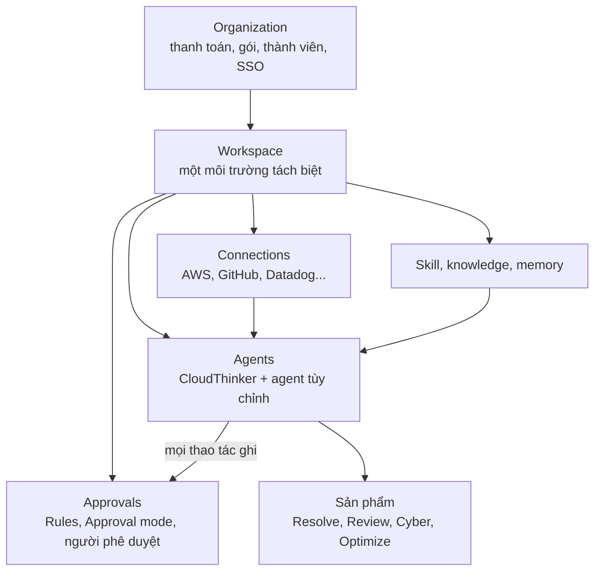

CloudThinker được xây dựng từ vài thành phần: một tổ chức chứa các workspace, và mỗi workspace chứa kết nối, agent, skill, phê duyệt và memory mà mọi sản phẩm vận hành dựa trên đó. Nắm các thành phần này một lần, bạn sẽ đọc mọi trang sản phẩm theo cùng một cách.



## Tổng quan các khái niệm

| Khái niệm | Là gì | Nơi quản lý |
|---|---|---|
| [Tổ chức](/vi/guide/organization) | Ranh giới thanh toán và thành viên. Sở hữu gói, credit, thành viên và single sign-on. | Admin Settings |
| [Workspace](/vi/guide/workspaces) | Một môi trường tách biệt trong tổ chức, chẳng hạn production và staging, hoặc mỗi nhóm một workspace. Chứa kết nối, cuộc chat và dữ liệu. | Bộ chọn workspace ở đầu thanh bên |
| [Kết nối](/vi/guide/connections/overview) | Thông tin xác thực cho một hệ thống bên ngoài: một tài khoản AWS, một cluster Kubernetes, một tổ chức GitHub. | **More → Workspace settings → Connections** |
| [Agent](/vi/guide/agents/overview) | AI đọc yêu cầu của bạn, dùng kết nối để tra cứu, rồi trả lời hoặc hành động. | **More → Workspace settings → Agents** |
| [Skill](/vi/guide/skills/overview) | Bộ hướng dẫn tái sử dụng cho một loại tác vụ, chạy từ menu `/` hoặc được dùng khi phù hợp. | **More → Workspace settings → Skills** |
| [Knowledge](/vi/guide/knowledge) | Runbook, chính sách và tài liệu của bạn, được tải lên hoặc crawl, để agent trích dẫn. | **More → Workspace settings → Knowledge** |
| [Approvals](/vi/guide/approvals/overview) | Các bước kiểm tra mà mọi thao tác ghi phải qua trước khi chạy: Rules, Approval mode và người phê duyệt. | **Approvals** trên thanh bên (áp dụng cho workspace hiện tại) |
| [Memory](/vi/guide/memory) | Những gì agent ghi nhớ giữa các cuộc hội thoại về môi trường và sở thích của bạn. | **More → Workspace settings → Memory** |

## Tổ chức và workspace

Đăng ký sẽ tạo một tổ chức với một workspace. Mọi thứ bạn kết nối hoặc xây dựng đều nằm trong một workspace, và không có gì được chia sẻ giữa các workspace trừ khi bạn thiết lập.

| Nằm trong tổ chức | Nằm trong từng workspace |
|---|---|
| Thanh toán, gói và credit | Kết nối và [thông tin xác thực](/vi/guide/credentials) |
| Thành viên và vai trò tổ chức: Owner, Admin, Developer, Viewer | Agent tùy chỉnh, skill, knowledge và memory |
| Single sign-on và audit log | Automation, lệnh và cài đặt phê duyệt |

Owner và Admin của tổ chức là Admin trong mọi workspace. Những người khác nhận vai trò workspace theo từng workspace:

| Vai trò workspace | Chat với CloudThinker | Tạo agent tùy chỉnh | Thêm kết nối, đổi Rule và Approval mode |
|---|---|---|---|
| **Admin** | Có | Có | Có |
| **Developer** | Có | Có | Không, chỉ xem |
| **Viewer** | Không | Không, chỉ xem | Không, chỉ xem |

Ai được phê duyệt một thao tác ghi được thiết lập riêng, qua [người phê duyệt](/vi/guide/approvals/approvers). Xem danh sách đầy đủ tại [Quyền workspace](/vi/guide/security/roles#quyền-workspace).

<Tip>
Dùng workspace riêng cho production và non-production. Khi đó, kết nối, quyền của kết nối và cài đặt phê duyệt không thể lẫn từ môi trường này sang môi trường kia.
</Tip>

## Kết nối đặt giới hạn ngoài cùng

Agent chỉ có thể thấy và hành động trong phạm vi kết nối của workspace cho phép. Nếu role AWS của bạn chỉ đọc, không agent nào có thể thay đổi tài khoản AWS, bất kể cài đặt phê duyệt ra sao. Hãy bắt đầu với quyền chỉ đọc và mở rộng khi bạn muốn agent thực hiện thay đổi.

## Agent

| Agent | Làm gì | Cách gọi |
|---|---|---|
| **CloudThinker** | Trợ lý tích hợp sẵn. Luôn hoạt động, có thể dùng mọi kết nối trong workspace. Với câu hỏi lớn, trợ lý khởi chạy các [subagent](/vi/guide/agents/overview#subagent) ngắn hạn để kiểm tra nhiều thứ cùng lúc, rồi gộp kết quả thành một câu trả lời. | Gửi tin nhắn không nhắc ai, hoặc nhắc `@CloudThinker` |
| [Agent tùy chỉnh](/vi/guide/agents/customize) | Agent do nhóm bạn tạo, mỗi agent có hướng dẫn riêng và chỉ các kết nối bạn gán. | Nhắc agent, chẳng hạn `@db-reviewer` |

Yêu cầu có dạng `@agent #connection request`, và cả hai phần đều tùy chọn. Viết bằng ngôn ngữ tự nhiên vẫn được:

```text
Which pods in the production namespace restarted more than 3 times in the last 24 hours, and why?
```

Xem [Commands](/vi/guide/commands) để biết cú pháp đầy đủ.

## Skill, knowledge và memory

Ba thứ này cung cấp ngữ cảnh cho agent trước khi bạn gõ bất cứ điều gì. Mỗi loại do một bên khác nhau bổ sung.

| | Chứa gì | Ai thêm | Dùng khi |
|---|---|---|---|
| [Skills](/vi/guide/skills/overview) | Hướng dẫn từng bước cho một loại tác vụ | Bạn; một agent tùy chỉnh có cài đặt **Skill Learning** là **Auto** hoặc **Offer**; và [Dreaming](/vi/guide/memory-dreaming), mặc định chạy hằng đêm và có thể tạo, cập nhật, gộp và xóa custom skill | Cùng một quy trình nên chạy theo cùng một cách mọi lần |
| [Knowledge](/vi/guide/knowledge) | Tài liệu của bạn, đúng như đã viết | Bạn, bằng cách tải file lên hoặc crawl trang web | Agent nên trích dẫn runbook hoặc chính sách của bạn |
| [Memory](/vi/guide/memory) | Ghi chú ngắn về môi trường, sở thích và sự kiện gần đây của bạn | Agent, trong lúc làm việc. Admin sửa hoặc xóa trực tiếp; bất kỳ ai có thể chat đều có thể nhờ CloudThinker thay đổi | Bạn không muốn lần nào cũng phải giải thích lại thiết lập của mình |

Mỗi đêm, [Dreaming](/vi/guide/memory-dreaming) dọn dẹp memory: gộp mục trùng lặp và xóa những gì đã lỗi thời. Dreaming mặc định bật, và Admin của workspace có thể tắt. Bản tóm tắt thay đổi của từng lượt chạy nằm ở **More → Workspace settings → Memory → Run history**. Để lấy lại một mục memory đã xóa, hãy nhờ CloudThinker khôi phục từ lịch sử phiên bản. Custom skill bị Dreaming xóa thì không thể khôi phục.

## Approvals kiểm soát mọi thay đổi

Thao tác đọc luôn được chạy. Thao tác ghi (bất cứ thao tác nào làm thay đổi hệ thống) được kiểm tra theo thứ tự sau:

1. **Luôn bị chặn.** Một danh sách tích hợp sẵn các lệnh gọi không bao giờ chạy, chẳng hạn dừng ghi log CloudTrail, đóng tài khoản AWS hoặc xóa namespace `kube-system`. Không người nào hay Rule nào có thể ghi đè.
2. **Rules.** Mỗi Rule cho phép một loại thao tác ghi, yêu cầu hỏi người phê duyệt trước, hoặc từ chối. Rule **Deny** và **Ask first** áp dụng trong mọi chế độ. Xem [Rules](/vi/guide/approvals/rules).

   Rules chỉ quyết định khi Rule enforcement được bật cho workspace của bạn. Tính năng này mặc định tắt, và CloudThinker bật cho từng workspace. Khi bước **Rules** trên **Approvals** hiển thị **In preview**, Rules chỉ ghi lại quyết định mà Rules sẽ đưa ra, còn quyết định thực tế do riêng Approval mode đưa ra. Xem [Khắc phục sự cố Rules](/vi/guide/approvals/rules#khắc-phục-sự-cố).
3. **Approval mode.** Quyết định phần còn lại. Xem [Approval mode](/vi/guide/approvals/approval-mode).

| Chế độ | Điều gì xảy ra với thao tác ghi không bị Rule Deny hay Ask first nào bắt |
|---|---|
| **Manual** | Người phê duyệt phải duyệt, kể cả thao tác đã được Rule Allow bao phủ. |
| **Auto · Rules · Ask me** | Rule Allow cho chạy. Những gì không Rule nào bao phủ sẽ chờ người phê duyệt. |
| **Auto · Rules · Refuse** | Rule Allow cho chạy. Những gì không Rule nào bao phủ bị từ chối. |
| **Auto · Rules + AI · Ask me** | Rule Allow cho chạy. Phán đoán AI có thể cho phép một thao tác ghi an toàn mà không Rule nào bao phủ. Phần còn lại chờ người phê duyệt. |
| **Auto · Rules + AI · Refuse** | Rule Allow cho chạy. Phán đoán AI có thể cho phép một thao tác ghi an toàn mà không Rule nào bao phủ. Phần còn lại bị từ chối. |

Khi một thao tác ghi phải chờ, thẻ phê duyệt được gửi đến [người phê duyệt](/vi/guide/approvals/approvers) của bạn, tức những người được phép phản hồi yêu cầu đó.

Phán đoán AI coi một thao tác ghi là an toàn khi thao tác đó khớp với điều bạn yêu cầu và nằm trong phạm vi đó, chẳng hạn thêm tag bạn yêu cầu vào tài nguyên bạn chỉ định. Thao tác ghi mang tính phá hủy, hoặc có tác động không rõ ràng, sẽ được chuyển cho người phê duyệt hoặc bị từ chối.

Workspace mới bắt đầu với **Auto · Rules + AI · Ask me**. Bạn có thể đặt chế độ khác cho một cuộc chat từ ô nhập prompt.

## Các sản phẩm

CloudThinker có bốn sản phẩm: Resolve, Review, Cyber và Optimize. Mỗi sản phẩm điều tra một loại vấn đề và chỉ cần kết nối riêng, nên hãy [chọn sản phẩm đầu tiên](/vi#products) và thêm các sản phẩm còn lại sau.

Approvals, Customize và Automation không phải sản phẩm. Đây là các phần hỗ trợ hoạt động xuyên suốt cả bốn sản phẩm: Approvals quyết định thao tác ghi nào được chạy, Customize định hình agent bằng agent, skill và knowledge của riêng bạn, và Automation chạy agent theo lịch hoặc theo sự kiện. Memory thuộc về workspace, nên những gì agent học được trong một lượt chạy sẽ có sẵn cho các lượt chạy sau trong cùng workspace, bất kể sản phẩm nào khởi chạy.

## Nơi kết quả xuất hiện

| Nơi | Bạn tìm thấy gì |
|---|---|
| [Home](/vi/guide/activity) | **Needs you** (các phê duyệt và quyết định đang chờ bạn), **Products** và **Automation today** |
| [Activity](/vi/guide/activity#tìm-báo-cáo-cũ-trong-activity) | Mọi báo cáo agent đã gửi bạn, có thể tìm kiếm và lọc |
| **Investigation** trên thanh bên | Mọi sự cố, nguyên nhân gốc, bằng chứng và cách khắc phục đề xuất |
| **Automations → Runs** | Mọi lượt chạy của mọi automation, kèm trạng thái và cuộc chat |
| [Artifacts](/vi/guide/artifacts/overview) | Dashboard, báo cáo và file mà agent đã tạo cho bạn |

## Liên quan

<CardGroup cols={2}>
  <Card title="Bắt đầu nhanh" icon="bolt" href="/vi/quickstart">
    Áp dụng các khái niệm này: kết nối một hệ thống và nhận câu trả lời đầu tiên trong khoảng 10 phút
  </Card>
  <Card title="Agent" icon="robot" href="/vi/guide/agents/overview">
    Xem cách CloudThinker, subagent và agent tùy chỉnh chia sẻ công việc
  </Card>
  <Card title="Approvals" icon="user-check" href="/vi/guide/approvals/overview">
    Quyết định thay đổi nào tự chạy và thay đổi nào chờ người duyệt
  </Card>
  <Card title="Thuật ngữ" icon="book" href="/vi/guide/glossary">
    Tra cứu bất kỳ thuật ngữ nào bạn gặp trong sản phẩm hoặc tài liệu này
  </Card>
</CardGroup>
