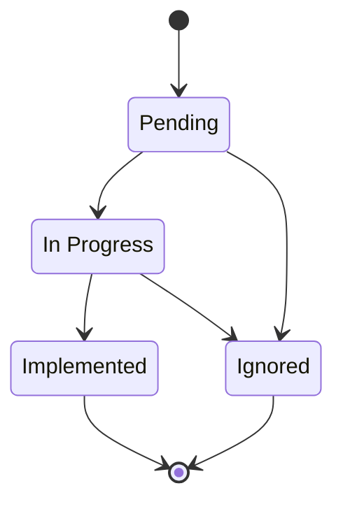

import ApprovalDefault from '/snippets/vi/approval-default.mdx';

Phát hiện là một cơ hội tiết kiệm mà lượt quét Optimize tìm thấy trong tài khoản cloud, kèm khoản tiết kiệm ước tính hằng tháng và bằng chứng đi kèm. **Optimize → Findings** là nơi nhóm bạn quyết định xử lý từng phát hiện, từ lúc mới thấy cho đến khi đã triển khai hoặc bỏ qua.

## Điều kiện tiên quyết

- Một kết nối Optimize đã hoàn tất lượt quét đầu tiên. Xem [Bắt đầu nhanh với Optimize](/vi/guide/cost-optimization/quickstart).
- Vai trò workspace phù hợp với việc bạn muốn làm. Xem [Vai trò](/vi/guide/security/roles).

| Tác vụ | Vai trò workspace tối thiểu |
|---|---|
| Xem phát hiện và đọc bằng chứng | Viewer |
| Di chuyển, chỉnh sửa hoặc giao phát hiện, chạy lượt quét, bắt đầu một hành động như **Implement** | Developer |
| Đánh dấu phát hiện là expected, snoozed hoặc disputed | Admin |

Đánh dấu cần Admin vì thao tác này thay đổi những gì Optimize nêu ra và tính toán về sau: phát hiện expected sẽ không được nêu lại trừ khi bạn đặt ngày hết hạn, và mọi đánh dấu đều đưa phát hiện ra khỏi tổng khoản tiết kiệm.

## Cách đọc một phát hiện

Mỗi phát hiện có một class và một huy hiệu bằng chứng. Hãy đọc cả hai trước khi hành động.

| Class | Ý nghĩa | Tính vào khoản tiết kiệm tiềm năng |
|---|---|---|
| Quick win | Bằng chứng đã xác minh, ít công sức và có thể hoàn tác. Phải thỏa cả ba điều kiện. | Có |
| Needs review | Cơ hội thật nhưng không đạt ít nhất một tiêu chí quick win, nên cần thêm ngữ cảnh hoặc cẩn trọng hơn | Có |
| No action | Khoản chi mà lượt quét đã kiểm tra và thấy hợp lý | Không |

| Huy hiệu bằng chứng | Agent xác lập phát hiện như thế nào |
|---|---|
| Verified | Agent đã đọc tài nguyên thực tế và xác nhận các giá trị |
| Inferred | Agent suy ra phát hiện từ dữ liệu thanh toán và cấu hình mà không đọc tài nguyên |
| Assumed | Agent không kiểm tra được một phần của phát hiện. Hãy tự xác nhận phần đó trước khi hành động. |

**Needs review** ở đây chỉ là một class phát hiện. Cùng cụm từ này cũng là tên một trạng thái của bất thường trên [Anomalies](/vi/guide/cost-optimization/anomalies#xem-xét-một-bất-thường) và một kết quả trong [Code Audit](/vi/guide/security/code-audit), và ba thứ này không ảnh hưởng lẫn nhau.

Huy hiệu bổ sung thông tin cho phát hiện, không dùng để xếp hạng: phát hiện inferred vẫn có thể là khoản tiết kiệm lớn nhất của tài khoản.

**Effort** và **Risk** mỗi thứ có một trong ba mức: **Low**, **Medium** hoặc **High**. Chỉ phát hiện có Effort Low mới có thể là quick win.

Phát hiện **No action** không có cột riêng. Thẻ tóm tắt đếm chúng bên cạnh các phát hiện cần xử lý (ví dụ **6 need action · 3 need no action**). Đó là kết luận của lượt quét. Còn đánh dấu là kết luận của bạn về một phát hiện mà lượt quét cho là cần xử lý.

## Ưu tiên các phát hiện

<Steps>
  <Step title="Mở Findings">
    Trên thanh bên, chọn **Optimize → Findings**, rồi chọn tài khoản cloud ở phần đầu trang.

    **Trạng thái thành công:** ba thẻ tóm tắt hiển thị **Potential monthly savings**, **Quick wins** và **Needs review**, bên dưới là bảng.
  </Step>
  <Step title="Bắt đầu với quick win">
    Chọn thẻ **Quick wins** hoặc **Needs review** để lọc bảng theo class đó. Chọn lại thẻ, hoặc chọn **Potential monthly savings**, để bỏ lọc.
  </Step>
  <Step title="Thu hẹp danh sách">
    Gõ vào **Search findings…** để khớp tiêu đề và mô tả, hoặc lọc theo **Service**, **Effort** và **Risk**. URL của trang giữ các bộ lọc, nên bạn có thể gửi link cho đồng nghiệp và họ sẽ thấy cùng danh sách.
  </Step>
  <Step title="Chọn bố cục">
    Chuyển giữa **Kanban** (cột theo trạng thái) và **Table** (dòng kèm menu dòng).
  </Step>
  <Step title="Mở một phát hiện">
    Chọn thẻ hoặc dòng để mở phát hiện. Tab **Overview** hiển thị bằng chứng, ước tính, effort, risk, khả năng hoàn tác và tài nguyên bị ảnh hưởng.
  </Step>
</Steps>

## Đưa phát hiện qua quy trình

Các cột của bảng là trạng thái của phát hiện. Optimize Findings dùng bốn trạng thái riêng, tách biệt với các trạng thái dùng ở nơi khác trong CloudThinker. Bạn có thể chuyển phát hiện từ bất kỳ trạng thái nào sang trạng thái khác, kể cả quay lại **Pending**. Sơ đồ thể hiện lộ trình thường gặp.

| Trạng thái | Dùng cho |
|---|---|
| Pending | Việc mới chưa ai bắt đầu |
| In Progress | Nhóm bạn đang đánh giá hoặc triển khai |
| Implemented | Nhóm bạn đã thực hiện thay đổi |
| Ignored | Nhóm bạn quyết định không theo đuổi |



Để đổi trạng thái, kéo thẻ sang cột khác trong **Kanban**, hoặc trong **Table** mở menu **⋯** của dòng và chọn trạng thái trong **Move to**.

**Trạng thái thành công:** thẻ xuất hiện ở cột mới. Chỉ phát hiện ở **Pending** và **In Progress** được tính vào **Potential monthly savings**, nên chuyển thẻ sang **Implemented** hoặc **Ignored** sẽ làm giảm tổng, còn chuyển giữa Pending và In Progress thì không thay đổi tổng.

## Xử lý một phát hiện

<Steps>
  <Step title="Mở Actions">
    Trên trang của phát hiện, chọn **Actions** ở phần đầu trang.
  </Step>
  <Step title="Chọn hành động">
    | Hành động | CloudThinker làm gì |
    |---|---|
    | **Impact Analytics** | So sánh trạng thái trước và sau, mức sử dụng, chi phí theo giá hiện tại, tác động hiệu năng và rủi ro. Đây là lựa chọn mặc định |
    | **Generate Guidelines** | Viết hướng dẫn triển khai từng bước, kèm kiểm thử, kế hoạch rollback và tiêu chí thành công |
    | **Custom Prompt** | Trả lời câu hỏi riêng của bạn về phát hiện |
    | **Implement** | Thực hiện thay đổi trong tài khoản cloud của bạn. Cần quyền ghi trên kết nối (xem bên dưới) |

    Với **Custom Prompt**, gõ điều bạn muốn biết, ví dụ:

    ```text
    Would moving this instance to the next smaller size break the nightly batch job? Check its peak CPU and memory over the last 30 days.
    ```
  </Step>
  <Step title="Bắt đầu cuộc trò chuyện">
    Chọn **Start**. CloudThinker mở một cuộc trò chuyện mới có đính kèm phát hiện. Mọi hành động đều kiểm tra trước rằng tài nguyên vẫn tồn tại và vẫn khớp với phát hiện. Nếu không, CloudThinker cho biết điều gì đã thay đổi và dừng lại.

    **Implement** cũng dừng nếu một dependency sẽ bị hỏng hoặc không có cách rollback.

    <ApprovalDefault />
  </Step>
</Steps>

<Note>
**Implement** cần quyền ghi. [Bắt đầu nhanh với Optimize](/vi/guide/cost-optimization/quickstart) chỉ cấp quyền chỉ đọc, nên với thiết lập đó CloudThinker phân tích được phát hiện nhưng không thay đổi được. Hãy thêm quyền ghi cần cho thay đổi vào role, service account hoặc service principal, và giữ **Allow writes** bật cho kết nối. Xem quyền ghi cho [AWS](/vi/guide/connections/aws#quyền-ghi), [GCP](/vi/guide/connections/gcp#quyền-ghi) và [Azure](/vi/guide/connections/azure#quyền-ghi).
</Note>

**Trạng thái thành công:** cuộc trò chuyện kết thúc với phân tích hoặc hướng dẫn bạn yêu cầu, hoặc với **Implement** là bản ghi những gì đã thay đổi và những gì cần theo dõi. Tự chuyển phát hiện sang **Implemented** khi thay đổi đã hoàn tất.

## Đánh dấu phát hiện không cần xử lý

Dùng đánh dấu khi phát hiện cần rời khỏi hàng đợi đang xử lý nhưng bạn vẫn muốn giữ bản ghi và lý do.

<Steps>
  <Step title="Chọn kiểu đánh dấu">
    Trên trang của phát hiện, chọn **Mark finding**. Trong **Table**, dùng menu **⋯** của dòng.
  </Step>
  <Step title="Nêu lý do">
    Chọn một tùy chọn trong bảng bên dưới, điền lý do, thêm ngày nếu tùy chọn yêu cầu, rồi xác nhận. Mọi đánh dấu đều cần lý do dài ít nhất một câu ngắn, và ngày **Snooze until…** phải từ ngày mai trở đi. CloudThinker đọc lý do của bạn khi kiểm tra lại phát hiện bị dispute.

    **Trạng thái thành công:** phát hiện expected và snoozed biến mất khỏi bảng, và nút bật tắt **hidden** (ví dụ **3 hidden**) xuất hiện trên thanh công cụ. Phát hiện bị dispute vẫn ở trên bảng với nhãn **Disputed**. Mọi đánh dấu đều đưa phát hiện ra khỏi **Potential monthly savings**.
  </Step>
</Steps>

| Đánh dấu | Dùng khi | Điều gì xảy ra tiếp theo |
|---|---|---|
| Mark as expected | Khoản chi là có chủ đích | Agent vẫn cập nhật bằng chứng nhưng không nêu lại phát hiện, trừ khi bạn đặt ngày hết hạn tùy chọn. Khi qua ngày đó, đánh dấu hết hiệu lực: phát hiện quay lại bảng và được tính vào tổng như cũ, giống một lần snooze kết thúc. |
| Snooze until… | Có thể quan trọng về sau | Phát hiện rời khỏi bảng và quay lại vào ngày bạn đặt (bắt buộc). |
| Dispute… | Bằng chứng hoặc kết luận có vẻ sai | Phát hiện vẫn hiển thị, và agent kiểm tra lại ở lượt quét tiếp theo. |

Để xem các phát hiện bị ẩn, chọn nút **hidden** trên thanh công cụ. Nếu mọi phát hiện đang mở đều bị ẩn, bảng hiển thị nút **Show hidden findings** thay thế. Để hủy đánh dấu, mở phát hiện và chọn **Clear mark** (menu dòng) hoặc **Change mark**.

## Sửa ước tính

Khi nhóm bạn biết con số thực tế, mở phát hiện, chọn **Edit** ở cuối bảng chi tiết (cạnh **Mark finding**) và đổi **Potential savings ($/mo)**.

**Trạng thái thành công:** tổng khoản tiết kiệm phản ánh con số mới, và thay đổi hiển thị trên tab **Activity** của phát hiện.

Các lượt quét sau không bao giờ ghi đè giá trị đã sửa. Nếu lượt quét đo được con số khác, CloudThinker báo trong cuộc trò chuyện của lượt quét, mở bằng **Open analysis**. Không có nút khôi phục con số từ lượt quét: để quay lại, hãy sửa giá trị một lần nữa bằng con số trong cuộc trò chuyện đó. Khi tài nguyên thay đổi, bạn cần tự kiểm tra lại con số đã sửa, nếu không tổng vẫn giữ số cũ.

## Thảo luận và giao việc

Mở phát hiện và chọn tab **Discussion** để giữ quyết định ngay cạnh bằng chứng. Gõ `@` để mention đồng nghiệp, trả lời theo thread, và đánh dấu thread đã giải quyết khi xong. Đặt **Assignee** trong chi tiết phát hiện để một người chịu trách nhiệm theo dõi. Người được giao nhận thông báo, người bị gỡ giao cũng vậy. Họ có thể tắt các thông báo này trong tùy chọn thông báo, mục **Recommendation assignments**.

## Đọc tổng khoản tiết kiệm

**Potential monthly savings** cộng các ước tính của phát hiện Quick win và Needs review đang ở **Pending** hoặc **In Progress** cho tài khoản đã chọn, không tính phát hiện đã đánh dấu. Hãy coi con số này là giới hạn trên, vì hai phát hiện có thể ước tính khoản tiết kiệm trên cùng một khoản chi. Tổng chỉ thay đổi theo bộ lọc **Service**. Ô tìm kiếm, các thẻ class và bộ lọc **Effort**, **Risk** chỉ thay đổi những gì bảng hiển thị, không thay đổi tổng. Xem [nơi con số xuất hiện](/vi/guide/cost-optimization/savings#con-số-xuất-hiện-ở-đâu). Đọc [Ước tính khoản tiết kiệm](/vi/guide/cost-optimization/savings) trước khi đưa con số này vào dự báo.

## Làm mới phát hiện

Chọn **Re-scan** phía trên bảng để chạy lượt quét mới. Lượt quét một tài khoản có thể mất hàng chục phút, và tiến độ hiển thị bên dưới thanh công cụ trong khi chạy. Chọn **Open analysis** để đọc cuộc trò chuyện của agent từ lượt quét gần nhất, bao gồm các lệnh chỉ đọc mà agent đã chạy. Khi lượt quét do bạn khởi chạy đang chạy, chính nút **Re-scan** hiển thị **Open CloudThinker's conversation** và mở cùng cuộc trò chuyện đó.

Lượt quét lại giữ nguyên công việc của bạn. Lượt quét làm mới bằng chứng trên các phát hiện **Pending** và **In Progress** ngay tại chỗ, không bao giờ đổi trạng thái, và giữ nguyên người được giao, thảo luận cùng các đánh dấu expected hoặc snoozed. Nếu một vấn đề bạn đã đặt **Implemented** hoặc **Ignored** xuất hiện lại, lượt quét mở một phát hiện **Pending** mới cho vấn đề đó.

Nút là **Re-scan** trên bảng đã có phát hiện, và **Run scan** trên tài khoản chưa từng được quét.

<Note>
Nếu một số dịch vụ thất bại, bảng vẫn giữ các phát hiện đã hoàn tất và hiển thị **Scan finished with errors**, kèm số dịch vụ không quét được. Sửa vấn đề về quyền hoặc thanh toán được nêu trong cảnh báo trên trang, rồi quét lại.
</Note>

## Khắc phục sự cố

<AccordionGroup>
  <Accordion title="Các tùy chọn đánh dấu bị mờ">
    **Nguyên nhân:** đánh dấu phát hiện cần vai trò workspace Admin. **Cách sửa:** nhờ workspace Admin đánh dấu, hoặc đổi vai trò của bạn trong [Workspace users](/vi/guide/workspace-users).
  </Accordion>
  <Accordion title="Tôi không kéo được thẻ hoặc không thấy Re-scan">
    **Nguyên nhân:** vai trò của bạn là Viewer. Di chuyển phát hiện và quét cần Developer trở lên. **Cách sửa:** nhờ workspace Admin cấp vai trò Developer.
  </Accordion>
  <Accordion title="Implement báo không thể thực hiện thay đổi">
    **Nguyên nhân:** kết nối chỉ đọc. Role, service account hoặc service principal thiếu quyền ghi, hoặc **Allow writes** đang tắt trên kết nối. **Kiểm tra:** đọc cuộc trò chuyện để tìm thay đổi bị từ chối hoặc lỗi access-denied từ nhà cung cấp. **Cách sửa:** chỉ cấp những quyền ghi mà thay đổi này cần và bật **Allow writes**. Xem quyền ghi cho [AWS](/vi/guide/connections/aws#quyền-ghi), [GCP](/vi/guide/connections/gcp#quyền-ghi) và [Azure](/vi/guide/connections/azure#quyền-ghi). Sau đó chạy lại **Implement**.
  </Accordion>
  <Accordion title="Bảng trống nhưng vẫn có phát hiện">
    **Kiểm tra:** nếu trang báo các phát hiện đã được đánh dấu expected hoặc snoozed, nghĩa là mọi phát hiện đang mở đều đã bị đánh dấu. **Cách sửa:** chọn **Show hidden findings** để xem lại. Nếu đang bật bộ lọc, hãy xóa ô tìm kiếm và các bộ lọc **Service**, **Effort**, **Risk**.
  </Accordion>
  <Accordion title="Trang báo tài khoản này chưa có lượt quét nào">
    **Nguyên nhân:** tài khoản này chưa từng được quét. **Cách sửa:** chọn **Run scan**.
  </Accordion>
</AccordionGroup>

## Bước tiếp theo

<CardGroup cols={2}>
  <Card title="Ước tính khoản tiết kiệm" icon="chart-pie" href="/vi/guide/cost-optimization/savings">
    Tìm hiểu phát hiện nào được tính vào tổng và vì sao tổng là giới hạn trên
  </Card>
  <Card title="Bất thường chi phí" icon="wave-pulse" href="/vi/guide/cost-optimization/anomalies">
    Xem các đợt tăng chi phí hằng ngày và phát hiện nào giải thích chúng
  </Card>
  <Card title="Báo cáo Optimize" icon="file-chart-column" href="/vi/guide/cost-optimization/reports">
    Biến các phát hiện đang mở thành báo cáo cơ hội tiết kiệm được xếp hạng
  </Card>
  <Card title="Khắc phục sự cố Optimize" icon="wrench" href="/vi/guide/cost-optimization/troubleshooting">
    Mọi vấn đề của Optimize ở một nơi, kèm nguyên nhân, cách kiểm tra và cách sửa
  </Card>
</CardGroup>
