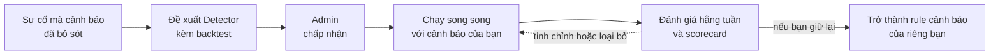

**Detector** là một kiểm tra nhỏ do CloudThinker viết cho một sự cố mà rule cảnh báo của bạn không bắt được. Detector chạy bên trong CloudThinker trên các công cụ bạn đã kết nối, nên không cần cài đặt gì trong các công cụ đó.

Bạn tìm thấy Detector trong **Resolve → Detectors**, giữa Pulse và Investigation. Trang có ba tab: **Needs you** cho các đề xuất và quyết định đang chờ người xử lý, **Detectors** cho các detector đang chạy, và **Alert health** cho kết quả đánh giá các rule cảnh báo hiện có của bạn.

## Detector bổ sung gì cho hệ thống cảnh báo

Rule cảnh báo kích hoạt khi một metric vượt qua ngưỡng ai đó đã chọn trước. Detector đi theo chiều ngược lại: một sự cố mà không cảnh báo nào bắt được. CloudThinker xem xét những gì đã xảy ra trước sự cố đó, viết một kiểm tra cho mẫu hình, và kiểm chứng kiểm tra đó trên các sự cố trong quá khứ trước khi có ai dựa vào.

| | Rule cảnh báo của bạn | Detector |
|---|---|---|
| Đến từ đâu | Một người chọn ngưỡng | CloudThinker viết từ một sự cố mà cảnh báo của bạn bỏ sót |
| Đọc được gì | Dữ liệu bên trong một công cụ | Bất kỳ công cụ nào đã kết nối với CloudThinker |
| Khi nào biết có hiệu quả | Trên production, sau khi sự việc đã xảy ra | Từ backtest trên các sự cố trong quá khứ, trước khi bạn chấp nhận |
| Cải thiện thế nào | Ai đó nhớ ra để sửa | Lần đánh giá hằng tuần tinh chỉnh hoặc loại bỏ |

<Frame caption="Detector kích hoạt trước cảnh báo giám sát đầu tiên trên cùng sự cố">
  
  
</Frame>

Ví dụ các mẫu hình mà Detector bắt được:

- **Tiêu hao âm ỉ.** Error budget bị tiêu hao quá nhanh trên cả cửa sổ ngắn lẫn dài, trước khi bất kỳ metric đơn lẻ nào trông có vấn đề.
- **Bất thường so với khung giờ này.** Lưu lượng hoặc độ trễ nằm ngoài khoảng bình thường của cùng giờ đó trong tuần, thay vì một ngưỡng cố định.
- **Giới hạn không ai đặt cảnh báo.** Connection pool gần mức tối đa, chứng chỉ sắp hết hạn, hoặc quota gần dùng hết.
- **Vấn đề chỉ hiện ra khi kết hợp hai công cụ.** Một kiểm tra có thể so sánh hai công cụ đã kết nối, ví dụ lỗi 5xx tăng trong Datadog trong khi CloudWatch cho thấy cơ sở dữ liệu đã chạm giới hạn kết nối.

## Bật tính năng

Detectors ở trạng thái tắt cho đến khi **Admin** workspace bật tính năng này. Developer và Viewer có thể đọc trang Detectors nhưng không thể thay đổi gì trên đó. Xem [Vai trò](/vi/guide/security/roles).

<Steps>
  <Step title="Mở cài đặt Detectors">
    Vào **Resolve → Settings** và cuộn đến phần **Detectors**, bên dưới **Behaviour**.
  </Step>
  <Step title="Bật Detectors">
    Bật công tắc **Detectors**.

    **Trạng thái thành công:** công tắc hiển thị "Your Detectors run, and Resolve reviews them each week", và CloudThinker bắt đầu lần đánh giá đầu tiên đối với các rule cảnh báo bạn đang có.
  </Step>
  <Step title="Xem các đề xuất đầu tiên">
    Vào **Resolve → Detectors**. Các đề xuất xuất hiện trên tab **Needs you**, mỗi đề xuất kèm backtest. Không có gì chạy cho đến khi Admin chấp nhận.
  </Step>
</Steps>

## Backtest chứng minh một kiểm tra như thế nào

**Backtest** phát lại một kiểm tra trên dữ liệu quá khứ để cho thấy kiểm tra đó lẽ ra đã bắt được những sự cố nào trước đây, và sớm hơn cảnh báo của bạn bao lâu.

| Cài đặt backtest | Giá trị |
|---|---|
| Khoảng nhìn lại | Mặc định 30 ngày, tối đa 90 |
| Được tính là bắt được | Kiểm tra kích hoạt trong khoảng từ một giờ trước khi sự cố bắt đầu đến thời điểm sự cố được mở |
| Hiển thị tỷ lệ bắt được | Chỉ khi có ít nhất ba sự cố trong quá khứ trong khoảng thời gian. Nếu ít hơn, bạn thấy số đếm thuần |

<Frame caption="Cửa sổ bắt của backtest: từ một giờ trước khi sự cố bắt đầu đến thời điểm sự cố được mở">
  
  
</Frame>

Backtest so sánh kiểm tra với các sự cố mà Resolve đã ghi nhận, dùng dữ liệu mà công cụ đã kết nối vẫn còn lưu. Nếu công cụ không trả về được dữ liệu cho toàn bộ khoảng thời gian, backtest được đánh dấu là chưa đầy đủ hoặc không thực hiện được thay vì hiển thị một điểm số gây hiểu lầm.

## Detector truy cập những gì

| | Giá trị |
|---|---|
| Thông tin xác thực | Các công cụ giám sát bạn đã kết nối với CloudThinker. Mỗi Detector nêu rõ các kết nối được dùng |
| Lịch chạy | Mỗi 5, 15, 30 hoặc 60 phút. Mặc định là 15 |
| Khoảng lặng giữa các lần kích hoạt | 5 phút đến 24 giờ. Mặc định là 60 phút |
| Chi phí và quota | Mỗi lượt chạy truy vấn API của công cụ, nên được tính vào giới hạn tốc độ và chi phí truy vấn thông thường của công cụ đó |
| Giới hạn mỗi workspace | Tối đa 50 Detector đang hoạt động, 5 đề xuất đang mở và 200 lần kích hoạt mỗi ngày |

## Cách hoạt động

1. **Tìm một sự cố bị bỏ sót.** CloudThinker bắt đầu từ một sự cố mà cảnh báo của bạn không bắt được. Trên chính sự cố đó bạn sẽ thấy một dòng như "No Detector fired. No Detector watches this service", kèm liên kết đến **Detectors**.
2. **Đề xuất một Detector.** Với một lỗ hổng có thể chứng minh bằng bằng chứng, CloudThinker viết một kiểm tra, chạy thử một lần và backtest kiểm tra đó. Các đề xuất chờ trên tab **Needs you**.
3. **Admin chấp nhận.** Không có gì chạy cho đến khi một Admin workspace đồng ý.
4. **Chạy song song với cảnh báo của bạn.** Lần kích hoạt của Detector đi đến [Pulse](/vi/guide/pulse/overview), nơi loại bỏ nhiễu và nhóm các cảnh báo liên quan, rồi đến triage, nơi khớp lần kích hoạt với một sự cố, rồi đến [phân tích nguyên nhân gốc](/vi/guide/incident/root-cause-analysis), giống như mọi cảnh báo khác.
5. **Đánh giá hằng tuần.** CloudThinker gắn nhãn mỗi lần kích hoạt là thật hay nhiễu, siết chặt hoặc nới lỏng Detector, loại bỏ các Detector vẫn gây nhiễu, đề xuất Detector mới, và xây dựng một scorecard bao quát 30 ngày gần nhất. CloudThinker cũng đăng scorecard lên kênh chat của bạn trong những tuần có thông tin mới.
6. **Nâng cấp thành rule của riêng bạn.** Khi bạn quyết định một Detector đáng giữ lại, CloudThinker có thể biến Detector đó thành rule gốc trong công cụ cảnh báo của bạn, dưới dạng merge request nháp trong repository chứa rule cảnh báo, hoặc dưới dạng văn bản rule để bạn tự sao chép. Bạn review và merge; CloudThinker không bao giờ thay đổi rule trực tiếp trong công cụ cảnh báo của bạn.

<Frame caption="Scorecard hằng tuần: từng Detector, và các sự cố mà Detector bắt được trước cảnh báo giám sát của bạn">
  
  
</Frame>

## Cài đặt

Detectors có phần riêng trong **Resolve → Settings**, bên dưới Behaviour. Bản thân công tắc **Detectors** được mô tả trong [Bật tính năng](#bật-tính-năng).

| Cài đặt | Tác dụng |
|---|---|
| **Weekly review** | Ngày, giờ và múi giờ của lần đánh giá. Mặc định chạy vào thứ Hai lúc 09:00 |
| **Ignored services** | Các service mà Detectors không đánh giá cũng không theo dõi. Dùng `*` làm ký tự đại diện, ví dụ `*-staging`. Nếu không đặt gì, Detectors xem xét mọi service |
| **Sources** | Các công cụ mà Detectors đánh giá và viết kiểm tra trên đó. Tắt một nguồn sẽ bỏ qua rule và dữ liệu của nguồn đó, nhưng cảnh báo của nguồn vẫn được tính trong scorecard |

Để CloudThinker mở merge request nháp cho các Detector được nâng cấp, bật **Propose alert rule changes** cho nền tảng Git của bạn trong [tích hợp Resolve](/vi/guide/incident/integrations). CloudThinker chỉ mở bản nháp để bạn review và merge.

## Alert health

CloudThinker cũng đánh giá các rule cảnh báo bạn đang có và đánh dấu những rule gây nhiễu, hiếm khi hữu ích, hoặc không bao giờ có thể kích hoạt. Kết quả xuất hiện trên tab **Alert health**, nơi xếp hạng những gì cần sửa trước.

## Ai được thay đổi gì

- **Cảnh báo của bạn vẫn giữ nguyên.** Detector chạy bên cạnh rule của bạn, không bao giờ thay thế chúng.
- **Lượt chạy theo lịch chỉ có thể thu hẹp, không bao giờ khởi tạo.** Khi tự chạy, lần đánh giá hằng tuần chỉ tạm dừng, tiếp tục, loại bỏ hoặc nới lỏng một Detector bạn đã chấp nhận. Lần đánh giá này không thể chấp nhận hay bác bỏ một đề xuất, thay đổi cài đặt Detectors, bắt đầu một lượt chạy, hay bật tắt Detectors cho workspace: mỗi việc đó đều chờ một người.
- **Bạn được thông báo về mọi thay đổi tự động.** Khi một lượt chạy theo lịch tạm dừng, loại bỏ hoặc nới lỏng một Detector, người đã bật Detectors nhận được thông báo, cùng với scorecard hằng tuần. Nếu người đó rời đi hoặc mất quyền truy cập, trang hiển thị **Detectors have no owner who can run them** và một Admin workspace khác có thể nhấn **Take over**.
- **Quyền của bạn được áp dụng.** Yêu cầu CloudThinker thay đổi một Detector trong chat chỉ làm những gì vai trò của chính bạn cho phép. Viewer và Developer có thể đọc trang; chấp nhận, tạm dừng, loại bỏ hoặc cấu hình một Detector cần vai trò **Admin** workspace.
- **Mọi thay đổi đều được ghi log.** Mỗi lần chấp nhận, bác bỏ, tạm dừng, loại bỏ và thay đổi cài đặt đều được ghi trong **Admin Settings → Audit Logs**, kèm người hoặc agent đã thực hiện.

## Bước tiếp theo

<CardGroup cols={2}>
  <Card title="Kết nối công cụ giám sát" icon="plug" href="/vi/guide/incident/connect-alert-sources">
    Gửi cảnh báo từ Datadog, Grafana và các công cụ khác vào Resolve, để Detectors có lịch sử để học.
  </Card>
  <Card title="Nhóm cảnh báo với Pulse" icon="wave-pulse" href="/vi/guide/pulse/overview">
    Giảm nhiễu bằng cách nhóm các tín hiệu liên quan trước triage.
  </Card>
  <Card title="Ghi lại sự cố bị bỏ sót" icon="pen" href="/vi/guide/incident/manual-logging">
    Ghi lại các sự cố mà cảnh báo bỏ sót, để có lịch sử cho backtest.
  </Card>
  <Card title="Cài đặt Resolve" icon="gear" href="/vi/guide/incident/settings">
    Đặt lịch đánh giá hằng tuần, các service bị bỏ qua và các nguồn mà Detectors dùng.
  </Card>
</CardGroup>
