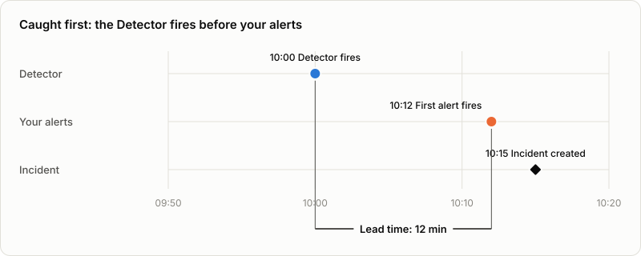
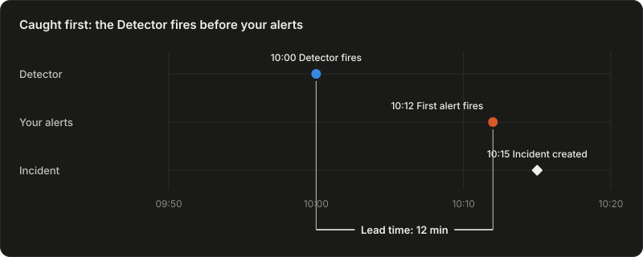
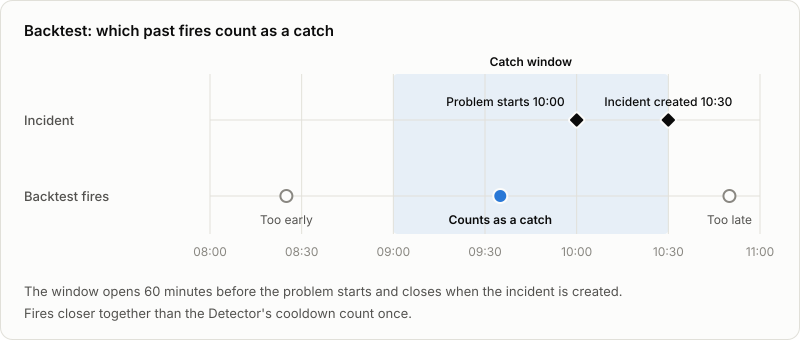
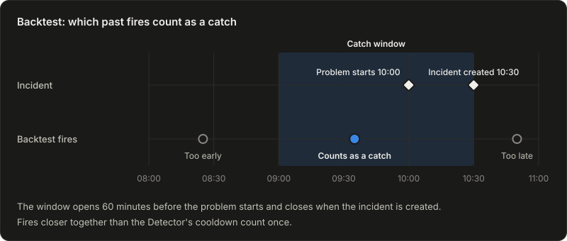
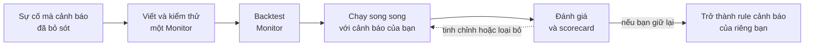
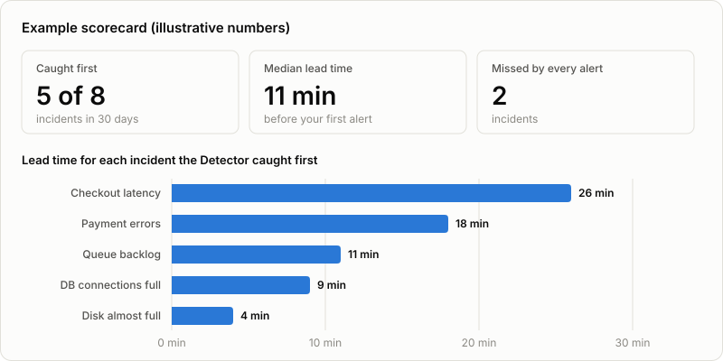
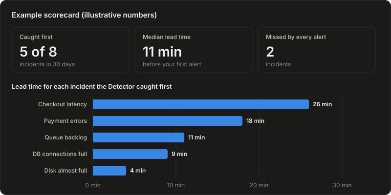

Detectors tạo và duy trì các **Monitor**: những kiểm tra nhỏ do CloudThinker viết cho các sự cố mà rule cảnh báo của bạn không bắt được. Monitor chạy bên trong CloudThinker trên các công cụ bạn đã kết nối, nên không cần cài đặt gì trong các công cụ đó.

Bạn tìm thấy chúng trong **Resolve → Detectors**. Trang hiển thị một danh sách Monitor với các pill tab **Needs attention**, **Running** và **All**. **Review now** và biểu tượng **Settings** nằm ở đầu bên phải của hàng bộ lọc.

## Detectors bổ sung gì cho hệ thống cảnh báo

Rule cảnh báo kích hoạt khi một metric vượt qua ngưỡng ai đó đã chọn trước. Monitor đi theo chiều ngược lại: một sự cố mà không cảnh báo nào bắt được. CloudThinker xem xét những gì đã xảy ra trước sự cố đó, viết một kiểm tra cho mẫu hình, và kiểm chứng kiểm tra đó trên các sự cố trong quá khứ trước khi có ai dựa vào.

| | Rule cảnh báo của bạn | Monitor |
|---|---|---|
| Đến từ đâu | Một người chọn ngưỡng | CloudThinker viết từ một sự cố mà cảnh báo của bạn bỏ sót |
| Đọc được gì | Dữ liệu bên trong một công cụ | Bất kỳ công cụ nào đã kết nối với CloudThinker |
| Khi nào biết có hiệu quả | Trên production, sau khi sự việc đã xảy ra | Từ một lượt chạy thử và backtest trên các sự cố trong quá khứ, trước khi Monitor chạy |
| Cải thiện thế nào | Ai đó nhớ ra để sửa | Một lần đánh giá tinh chỉnh hoặc loại bỏ |

<Frame caption="Monitor kích hoạt trước cảnh báo giám sát đầu tiên trên cùng sự cố">
  
  
</Frame>

Ví dụ các mẫu hình mà Monitor bắt được:

- **Tiêu hao âm ỉ.** Error budget bị tiêu hao quá nhanh trên cả cửa sổ ngắn lẫn dài, trước khi bất kỳ metric đơn lẻ nào trông có vấn đề.
- **Bất thường so với khung giờ này.** Lưu lượng hoặc độ trễ nằm ngoài khoảng bình thường của cùng giờ đó trong tuần, thay vì một ngưỡng cố định.
- **Giới hạn không ai đặt cảnh báo.** Connection pool gần mức tối đa, chứng chỉ sắp hết hạn, hoặc quota gần dùng hết.
- **Vấn đề chỉ hiện ra khi kết hợp hai công cụ.** Một kiểm tra có thể so sánh hai công cụ đã kết nối, ví dụ lỗi 5xx tăng trong Datadog trong khi CloudWatch cho thấy cơ sở dữ liệu đã chạm giới hạn kết nối.

## Bật tính năng

Detectors ở trạng thái tắt cho đến khi **Admin** workspace bật tính năng này. Developer và Viewer có thể đọc trang Detectors nhưng không thể thay đổi gì trên đó. Xem [Vai trò](/vi/guide/security/roles).

<Steps>
  <Step title="Mở Detectors">
    Vào **Resolve → Detectors**. Khi Detectors đang tắt, trang hiển thị **Detectors are off**.
  </Step>
  <Step title="Bật Detectors">
    Nhấn **Turn on**. Bạn cũng có thể nhấn biểu tượng **Settings** và bật công tắc **Detectors** ("Builds and maintains Monitors").

    **Trạng thái thành công:** trang hiển thị **Finding what to watch…** trong lúc CloudThinker đánh giá các rule cảnh báo bạn đang có.
  </Step>
  <Step title="Xem các Monitor đầu tiên">
    Các Monitor đã được kiểm thử xuất hiện trong danh sách và tự bắt đầu chạy. Không ai cần chấp nhận chúng. Mở một Monitor để xem **Status**, **Watches** và **Fires** của nó, hoặc để tạm dừng nó.
  </Step>
</Steps>

## Backtest chứng minh một kiểm tra như thế nào

**Backtest** phát lại một kiểm tra trên dữ liệu quá khứ để cho thấy kiểm tra đó lẽ ra đã bắt được những sự cố nào trước đây, và sớm hơn cảnh báo của bạn bao lâu.

| Cài đặt backtest | Giá trị |
|---|---|
| Khoảng nhìn lại | Mặc định 30 ngày, tối đa 90 |
| Được tính là bắt được | Kiểm tra kích hoạt trong khoảng từ một giờ trước khi sự cố bắt đầu đến thời điểm sự cố được mở |
| Hiển thị tỷ lệ bắt được | Chỉ khi có ít nhất ba sự cố trong quá khứ trong khoảng thời gian. Nếu ít hơn, bạn thấy số đếm thuần |

<Frame caption="Cửa sổ bắt của backtest: từ một giờ trước khi sự cố bắt đầu đến thời điểm sự cố được mở">
  
  
</Frame>

Backtest so sánh kiểm tra với các sự cố mà Resolve đã ghi nhận, dùng dữ liệu mà công cụ đã kết nối vẫn còn lưu. Nếu công cụ không trả về được dữ liệu cho toàn bộ khoảng thời gian, backtest được đánh dấu là chưa đầy đủ hoặc không thực hiện được thay vì hiển thị một điểm số gây hiểu lầm.

## Monitor truy cập những gì

| | Giá trị |
|---|---|
| Thông tin xác thực | Các công cụ giám sát bạn đã kết nối với CloudThinker. Mỗi Monitor nêu rõ các kết nối được dùng |
| Lịch chạy | Mỗi 5, 15, 30 hoặc 60 phút. Mặc định là 15 |
| Khoảng lặng giữa các lần kích hoạt | 5 phút đến 24 giờ. Mặc định là 60 phút |
| Chi phí và quota | Mỗi lượt chạy truy vấn API của công cụ, nên được tính vào giới hạn tốc độ và chi phí truy vấn thông thường của công cụ đó |
| Giới hạn | Tối đa 50 Monitor đang hoạt động mỗi workspace. Số lần kích hoạt bị giới hạn ở 24 lần mỗi ngày cho mỗi Monitor và 200 lần mỗi ngày cho mỗi workspace |

## Cách hoạt động

1. **Tìm một sự cố bị bỏ sót.** CloudThinker bắt đầu từ một sự cố mà cảnh báo của bạn không bắt được.
2. **Viết và kiểm thử một Monitor.** Với một lỗ hổng có thể chứng minh bằng bằng chứng, CloudThinker viết một kiểm tra và chạy thử một lần. Kiểm tra không vượt qua lượt chạy thử sẽ không được lưu.
3. **Backtest và kích hoạt.** Monitor đã được kiểm thử tự kích hoạt, và CloudThinker backtest nó trên các sự cố trong quá khứ.
4. **Chạy song song với cảnh báo của bạn.** Lần kích hoạt của Monitor đi đến [Signals](/vi/guide/pulse/overview), nơi loại bỏ nhiễu và nhóm các cảnh báo liên quan, rồi đến triage, nơi khớp lần kích hoạt với một sự cố, rồi đến [phân tích nguyên nhân gốc](/vi/guide/incident/root-cause-analysis), giống như mọi cảnh báo khác.
5. **Đánh giá.** Mỗi tuần, CloudThinker gắn nhãn mỗi lần kích hoạt là thật hay nhiễu, siết chặt hoặc nới lỏng Monitor, loại bỏ các Monitor vẫn gây nhiễu, viết Monitor mới, và xây dựng một scorecard bao quát 30 ngày gần nhất. CloudThinker cũng đăng scorecard lên kênh chat của bạn trong những tuần có thông tin mới. Bạn có thể thêm lịch đánh giá thường xuyên hơn trong cài đặt Detectors, hoặc nhấn **Review now**.
6. **Nâng cấp thành rule của riêng bạn.** Khi bạn quyết định một Monitor đáng giữ lại, CloudThinker có thể biến Monitor đó thành rule gốc trong công cụ cảnh báo của bạn, dưới dạng merge request nháp trong repository chứa rule cảnh báo, hoặc dưới dạng văn bản rule để bạn tự sao chép. Bạn review và merge; CloudThinker không bao giờ thay đổi rule trực tiếp trong công cụ cảnh báo của bạn.

<Frame caption="Scorecard hằng tuần: từng Monitor, và các sự cố mà Monitor bắt được trước cảnh báo giám sát của bạn">
  
  
</Frame>

## Cài đặt

Nhấn biểu tượng **Settings** trên **Resolve → Detectors** để mở **Detectors settings**. Phần này có ba hàng.

| Hàng | Tác dụng |
|---|---|
| **Detectors** | Bật hoặc tắt Detectors cho workspace. Các Monitor đã lưu vẫn được giữ khi tắt. Xem [Bật tính năng](#bật-tính-năng) |
| **Review** | Tần suất CloudThinker đánh giá các Monitor của bạn: **Off**, hoặc mỗi 15m, 30m, 1h, 3h, 6h, 12h hoặc 1d. Chỉ một người mới đặt được |
| **Fire limit** | Chỉ đọc: 24 lần kích hoạt mỗi ngày cho mỗi Monitor, 200 lần cho mỗi workspace |

Để bỏ qua một service, hoặc một công cụ mà Detectors không nên đánh giá, hãy hỏi CloudThinker trong chat. Detectors settings không có trường nào cho việc này.

Để CloudThinker mở merge request nháp cho các Monitor được nâng cấp, bật **Propose alert rule changes** cho nền tảng Git của bạn trong [Triggers & Outcomes của Resolve](/vi/guide/incident/triggers-and-outcomes#outcomes). CloudThinker chỉ mở bản nháp để bạn review và merge.

## Ai được thay đổi gì

- **Cảnh báo của bạn vẫn giữ nguyên.** Monitor chạy bên cạnh rule của bạn, không bao giờ thay thế chúng.
- **Lượt chạy theo lịch không thể thay đổi phần thiết lập.** Khi tự chạy, một lần đánh giá có thể viết, tạm dừng, tiếp tục, loại bỏ hoặc nới lỏng Monitor. Lần đánh giá này không thể thay đổi cài đặt Detectors, bắt đầu một job, hay bật tắt Detectors cho workspace: mỗi việc đó đều chờ một người.
- **Bạn được thông báo về mọi thay đổi tự động.** Khi một lượt chạy theo lịch tạm dừng, loại bỏ hoặc nới lỏng một Monitor, người đã bật Detectors nhận được thông báo, cùng với scorecard hằng tuần. Nếu người đó rời đi hoặc mất quyền truy cập, trang hiển thị **Monitors have no owner who can run them** và một Admin workspace khác có thể nhấn **Take over**.
- **Quyền của bạn được áp dụng.** Yêu cầu CloudThinker thay đổi một Monitor trong chat chỉ làm những gì vai trò của chính bạn cho phép. Viewer và Developer có thể đọc trang; tạm dừng, tiếp tục hoặc cấu hình Monitor cần vai trò **Admin** workspace.
- **Mọi thay đổi đều được ghi log.** Mỗi lần tạm dừng, loại bỏ và thay đổi cài đặt đều được ghi trong **Settings → Organization → Audit log**, kèm người hoặc agent đã thực hiện.

## Bước tiếp theo

<CardGroup cols={2}>
  <Card title="Kết nối công cụ giám sát" icon="plug" href="/vi/guide/incident/connect-alert-sources">
    Gửi cảnh báo từ Datadog, Grafana và các công cụ khác vào Resolve, để Detectors có lịch sử để học.
  </Card>
  <Card title="Nhóm cảnh báo với Signals" icon="wave-pulse" href="/vi/guide/pulse/overview">
    Giảm nhiễu bằng cách nhóm các tín hiệu liên quan trước triage.
  </Card>
  <Card title="Ghi lại sự cố bị bỏ sót" icon="pen" href="/vi/guide/incident/manual-logging">
    Ghi lại các sự cố mà cảnh báo bỏ sót, để có lịch sử cho backtest.
  </Card>
  <Card title="Cài đặt Resolve" icon="gear" href="/vi/guide/incident/settings">
    Tìm vị trí của từng điều khiển trong Resolve.
  </Card>
</CardGroup>
