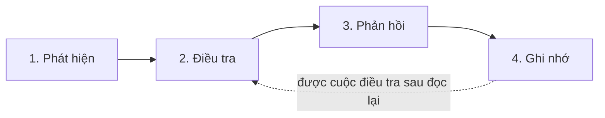

import { ResolveScene } from '/snippets/iso/resolve.jsx';

**Finds the root cause. In minutes.**

Resolve là Frontier Investigation Agent cho sự cố production. Resolve nhận cảnh báo mà các công cụ của bạn vẫn gửi, loại bỏ nhiễu, điều tra phần còn lại tới nguyên nhân gốc, và chỉ gọi người vào khi sự cố cần đến họ. Để bắt đầu, bạn cần một nguồn cảnh báo. Để CloudThinker xác minh được nguyên nhân gốc, hãy kết nối thêm tài khoản cloud hoặc observability mà cảnh báo nói tới.

<ResolveScene />

## Cách hoạt động

Trong Resolve, một cảnh báo đi qua bốn giai đoạn. Đây là các bước riêng của Resolve trong vòng lặp nền tảng được mô tả trong [AgenticOps field guide](/vi/learn/aio/chapter-4-architecture).

| Giai đoạn | Điều gì xảy ra | Xem ở đâu |
|---|---|---|
| 1. Phát hiện | [Pulse](/vi/guide/pulse/overview), lớp phát hiện, chặn các nhiễu đã biết và gom các cảnh báo liên quan thành cluster, để một lần sập chỉ là một mục. | **Resolve → Pulse** |
| 2. Điều tra | CloudThinker phân loại từng cluster cần hành động, mở mới hoặc mở lại một sự cố, và chạy phân tích nguyên nhân gốc (RCA) trên các hệ thống đã kết nối. | **Resolve → Investigation** |
| 3. Phản hồi | Khi bạn bật [On-call](/vi/guide/incident/oncall), Resolve mở Incident Room cho những người phản hồi khi cần đến người. On-call mặc định tắt. Mọi bản sửa CloudThinker chạy đều đi qua [Approvals](/vi/guide/approvals/overview), kể cả lệnh trong runbook. Workspace mới bắt đầu ở **Auto · Rules + AI · Ask me**: thao tác ghi không được Rule nào cho phép chỉ chạy nếu AI đánh giá là an toàn, nếu không thì chờ một người. Hiệu ứng **Require Approval** của runbook chỉ áp dụng ở nơi **Policies** đang bật (xem [Runbooks](/vi/guide/incident/runbooks#kiểm-soát-effect-của-lệnh)). Chọn **Manual** để tự phê duyệt mọi thay đổi. Xem [những gì có sẵn ngay từ đầu](/vi/guide/approvals/overview#cấu-hình-mặc-định). | Incident Room, Slack war room |
| 4. Ghi nhớ | CloudThinker ghi [bộ nhớ sự cố](/vi/guide/incident/incident-memory) để các cuộc điều tra sau đọc ngay khi bắt đầu. Không có màn hình để xem hay sửa bộ nhớ này: CloudThinker tự điều chỉnh các mục khi có bằng chứng mới. | Trong các kết quả RCA sau có trích dẫn một sự cố cũ |

Không phải sự cố nào cũng đi hết mọi giai đoạn. Cuộc điều tra có thể kết thúc mà không tìm ra nguyên nhân gốc, và sự cố **Track only** (có thật nhưng không khẩn cấp, nên không gọi ai) nằm lại trong hàng đợi trừ khi có người nâng mức.

## Thiết lập theo thứ tự này

Bạn cần role **Admin** của workspace để thay đổi thiết lập và tích hợp của Resolve. Xem [Roles](/vi/guide/security/roles).

1. **Kết nối một nguồn cảnh báo.** Trỏ một công cụ giám sát tới Resolve, hoặc thử trước với nguồn thử nghiệm trong [bắt đầu nhanh](/vi/guide/incident/quickstart). [Kết nối nguồn cảnh báo](/vi/guide/incident/connect-alert-sources) cho biết công cụ của bạn đi theo đường nào; [Kết nối nguồn Pulse](/vi/guide/pulse/setup) có các bước cụ thể.
2. **Quyết định về On duty.** On duty bật sẵn trong workspace mới, nên CloudThinker tự phân loại và điều tra. Hãy tạm dừng trong lúc bạn kết nối và tinh chỉnh nguồn thật đầu tiên, rồi bật lại. Xem [bên dưới](#chọn-ai-khởi-động-cuộc-điều-tra).
3. **Thiết lập On-call.** Chọn người phản hồi và, nếu muốn, một Slack war room. Xem [On-call](/vi/guide/incident/oncall).
4. **Xem lại chính sách Approvals.** Chính sách này quyết định bản sửa nào tự chạy và bản sửa nào chờ một người. Xem [Approvals](/vi/guide/approvals/overview).

## Bắt đầu từ Overview

Mở **Resolve → Overview** để xem việc gì đang cần bạn và việc gì Resolve đã tự xử lý.

| Ô | Đếm gì |
|---|---|
| **Needs your decision** | Sự cố đang chờ một người: **Cause found**, **Paused** (CloudThinker đã hỏi bạn và đang chờ câu trả lời), **Investigation complete**, **Checks incomplete**, hoặc cuộc điều tra đã dừng hay bị hủy. Xem [hàng đợi điều tra](/vi/guide/incident/root-cause-analysis#hàng-đợi-điều-tra). |
| **Awaiting your approval** | Runbook đã chuẩn bị và đang chờ quyết định phê duyệt |
| **Critical & high open** | Sự cố chưa giải quyết ở hai mức nghiêm trọng cao nhất |
| **AI is handling** | Sự cố đang được điều tra, không cần hành động |

Mỗi ô mở phần tương ứng của hàng đợi Investigation. Trang này cũng hiện phễu từ cảnh báo tới sự cố. Nếu một nguồn đã kết nối ngừng gửi, một banner sẽ báo, để luồng dữ liệu bị hỏng không bị nhầm thành hệ thống đang yên ổn.

| Bước trong phễu | Ý nghĩa |
|---|---|
| **Event** | Một thông báo thô từ một nguồn, chẳng hạn một CloudWatch alarm |
| **Signal** | Event còn lại sau khi chặn nhiễu |
| **Cluster** | Nhóm các signal liên quan mà Pulse coi là một vấn đề |
| **Incident** | Bản ghi mà một cluster cần hành động được lưu thành, và cũng là bản ghi một người tạo trực tiếp. CloudThinker điều tra bản ghi này. |

[Pulse](/vi/guide/pulse/overview) trình bày chi tiết ba bước đầu.

## Chọn ai khởi động cuộc điều tra

Công tắc tự chủ của CloudThinker nằm trên header của **Resolve → Investigation**, và nhãn cho biết trạng thái: **On duty** hoặc **Paused**. Đây không phải lịch trực on-call của con người. Công tắc bật sẵn trong workspace mới, và chỉ Admin của workspace mới đổi được. [Thiết lập Resolve](/vi/guide/incident/settings) liệt kê mọi điều khiển khác của Resolve.

| Trạng thái công tắc | Hành vi |
|---|---|
| **On duty** | CloudThinker phát hiện, phân loại từng cluster cần hành động, và tự điều tra. Mỗi lần phân loại và điều tra là một lượt chạy tiêu tốn [credit](/vi/guide/billing/usage), nên nguồn càng nhiễu thì càng tốn. |
| **Paused** | Pulse vẫn phát hiện và gom cảnh báo, và cluster cần hành động vẫn được lưu thành sự cố với trạng thái **Open** để bạn xem. CloudThinker không tự phân loại hay điều tra: mỗi sự cố chờ đến khi có người nhấn **Investigate**. Sự cố do một người tạo hoặc nâng mức vẫn được điều tra ngay. |

Tùy chọn theo từng webhook, sự cố được tạo thủ công và lượt khởi động thủ công làm thay đổi hành vi này. [Điều gì khởi động một cuộc điều tra](/vi/guide/incident/settings#điều-gì-khởi-động-một-cuộc-điều-tra) gom toàn bộ quy tắc trong một bảng.

**Send to triage**, **Investigate** và **Log Incident** luôn hoạt động, dù công tắc ở trạng thái nào.

## Bạn có thể làm gì

| Việc | Bao gồm | Đọc |
|---|---|---|
| Thử từ đầu đến cuối | Gửi một cảnh báo thử và theo dõi nó từ Pulse tới sự cố | [Bắt đầu nhanh với Resolve](/vi/guide/incident/quickstart) |
| Theo một bài hướng dẫn | Một sự cố production, từ cảnh báo đầu tiên tới nguyên nhân gốc đã xác minh, bản sửa đã phê duyệt và sự cố đã đóng | [Điều tra trọn vẹn một sự cố checkout](/vi/guide/use-cases/resolve-checkout-incident) |
| Kết nối nguồn cảnh báo | Công cụ của bạn đi vào Resolve theo đường nào: webhook, AWS polling, hay kênh chat | [Kết nối nguồn cảnh báo](/vi/guide/incident/connect-alert-sources) |
| Chọn những gì Resolve gửi lại | Ticket theo dõi, postmortem, cập nhật trên chat, và huy hiệu sẵn sàng trên từng nền tảng | [Tích hợp](/vi/guide/incident/integrations) |
| Xử lý luồng cảnh báo | Lane, cluster, Escalate, Attach to incident, snooze | [Pulse](/vi/guide/pulse/overview) |
| Đọc nguyên nhân gốc | Kết luận, độ tin cậy, bằng chứng, dòng thời gian, đề xuất khắc phục | [Điều tra và RCA](/vi/guide/incident/root-cause-analysis) |
| Gọi người vào | Người phản hồi, gọi trực, Incident Room và Slack war room | [On-call](/vi/guide/incident/oncall) |
| Ghi nhận điều Pulse không thấy | Phản ánh từ khách hàng hoặc linh cảm của người vận hành | [Ghi nhận sự cố](/vi/guide/incident/manual-logging) |
| Quản lý bản sửa | Thao tác nào tự chạy và thao tác nào chờ một người | [Approvals](/vi/guide/approvals/overview) |
| Thêm quy trình khắc phục | Quy trình bằng văn bản của bạn từ Confluence, GitHub, GitLab hoặc Markdown, được đọc trong lúc RCA. Runbook vẫn hoạt động; thanh bên đánh dấu chúng là **Legacy**. | [Runbooks](/vi/guide/incident/runbooks) |
| Bắt những gì cảnh báo bỏ sót | Các kiểm tra do CloudThinker viết và backtest cho những sự cố không rule cảnh báo nào bắt được, chạy song song với cảnh báo của bạn | [Detectors](/vi/guide/incident/detectors) |
| Đo kết quả | Xu hướng, độ chính xác và độ tin cậy theo từng dịch vụ | [Insights](/vi/guide/incident/insights) |
| Tinh chỉnh hành vi | Mọi điều khiển của Resolve và vị trí của chúng, kể cả cập nhật tiến độ trực tiếp | [Thiết lập](/vi/guide/incident/settings) |

## Bắt đầu

<CardGroup cols={2}>
  <Card title="Bắt đầu nhanh với Resolve" icon="rocket" href="/vi/guide/incident/quickstart">
    Gửi một cảnh báo thử và xem Pulse biến nó thành sự cố trong khoảng 10 phút.
  </Card>
  <Card title="Kết nối một nguồn" icon="plug" href="/vi/guide/incident/integrations">
    Trỏ một công cụ giám sát sẵn có tới Resolve.
  </Card>
  <Card title="Thiết lập On-call" icon="users" href="/vi/guide/incident/oncall">
    Chọn ai tham gia Incident Room khi sự cố cần đến người.
  </Card>
  <Card title="Đọc một cuộc điều tra" icon="magnifying-glass" href="/vi/guide/incident/root-cause-analysis">
    Hiểu từng phần của kết quả RCA nghĩa là gì và hành động dựa trên đó thế nào.
  </Card>
</CardGroup>
