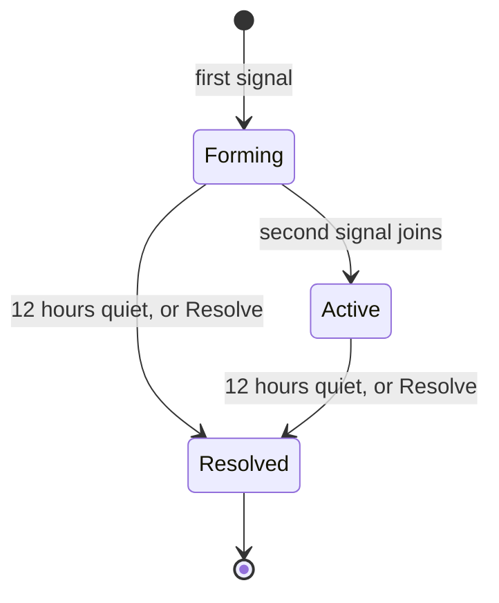

**Cluster** là một nhóm tín hiệu liên quan mà Pulse coi là một vấn đề (**tín hiệu** là một sự kiện đã vượt qua bước lọc nhiễu), nên một alarm chập chờn kích hoạt 18 lần sẽ thành một mục với 18 thành viên. Trang này trình bày cách cluster mở và đóng, những gì Pulse loại bỏ trước khi gom cluster, và tác dụng của từng thao tác. Mọi thao tác trên cluster, kể cả **Snooze**, đều cần vai trò workspace **Admin**. Developer và Viewer đọc được cluster nhưng không thấy các thao tác. Xem [Vai trò](/vi/guide/security/roles).

## Vòng đời cluster

Cluster có ba trạng thái. Chỉ tín hiệu của chính cluster, hoặc một người, mới chuyển được trạng thái.

Cluster đã resolved không bao giờ mở lại. Tín hiệu khớp tiếp theo sẽ bắt đầu một cluster mới. Quy tắc 12 giờ chỉ xét tín hiệu của chính cluster, nên cũng đóng cả cluster đã được định tuyến.

| Trạng thái | Ý nghĩa |
|---|---|
| **Forming** | Hiện mới có một tín hiệu. |
| **Active** | Có từ hai tín hiệu trở lên. |
| **Resolved** | Không có tín hiệu nào trong 12 giờ, hoặc một người đã resolve. Đây là trạng thái đóng duy nhất. |

**Routed là một lane, không phải trạng thái.** Cluster được coi là routed khi một sự cố đang mở giữ cluster đó, và bên dưới cluster vẫn ở Forming hoặc Active. Từ đó có ba quy tắc:

- Tín hiệu khớp mới sẽ gia nhập cluster đã routed và cập nhật sự cố. Tín hiệu không bắt đầu cuộc điều tra thứ hai.
- Đóng sự cố không đóng cluster. Nếu cùng lỗi đó kích hoạt lại, bước triage quyết định mở lại sự cố đó hay mở sự cố mới.
- Khi sự cố đã đóng, bạn có thể escalate cluster lần nữa.

## Tín hiệu gia nhập cluster như thế nào

Pulse so sánh mỗi tín hiệu mới với các tín hiệu trong 6 giờ qua mà cluster của chúng vẫn đang mở. Quy tắc đầu tiên khớp sẽ quyết định tín hiệu đi về đâu:

1. **Cùng tài nguyên hoặc cùng tiêu đề.** Các tín hiệu có chung resource ID, hoặc chung tiêu đề (không phân biệt chữ hoa chữ thường). Chung tiêu đề không được tính khi hai tín hiệu mang resource ID khác nhau: cùng một tên cảnh báo trên hai tài nguyên là hai lỗi.
2. **Cùng service.** Các tín hiệu có chung giá trị **Service**. Tín hiệu không có service (hiển thị là `unknown`) và tin nhắn chat bỏ qua quy tắc này. Quy tắc này không xét resource ID, nên hai lỗi trên hai tài nguyên khác nhau vẫn gộp chung khi cùng nêu một service.

Nếu không quy tắc nào khớp, tín hiệu mở một cluster mới ở trạng thái **Forming**. Cluster đã resolved không bao giờ nhận tín hiệu mới.

Resource ID lấy từ **Resource ID Path**, hoặc từ key `resource_id` ở cấp cao nhất khi không đặt path. Alarm CloudWatch dùng ARN của alarm khi cả hai cách đều không tìm thấy giá trị. Trường **Resource** (tên hiển thị) không được dùng. Vì vậy, với nguồn webhook:

- Ánh xạ **Resource ID Path** để các lần lặp của cùng một lỗi được gộp chung dù tiêu đề khác nhau, và để cùng một cảnh báo trên hai tài nguyên được tách riêng.
- Chỉ ánh xạ **Service Path** tới giá trị chỉ đúng một service, như `checkout-api`. Giá trị chung chung như `prod` sẽ gộp các lỗi không liên quan vào một cluster.

## Lọc nhiễu

Trước khi một sự kiện thô trở thành tín hiệu, Pulse chạy bốn bước kiểm tra theo thứ tự. Bước đầu tiên khớp sẽ loại sự kiện.

| Bước kiểm tra | Loại bỏ | Ngoại lệ |
|---|---|---|
| Dedup | Lần lặp y hệt: cùng nguồn, loại sự kiện, tài nguyên, tiêu đề và mức độ nghiêm trọng, với timestamp trong cùng phút với một sự kiện trước đó. Pulse nhớ mỗi sự kiện trong một giờ để bắt các lần lặp. | Không có. |
| Rate limit | Sự kiện vượt quá 100 mỗi phút từ một nguồn. Giới hạn này cố định, không phải cài đặt. | Sự kiện critical và high luôn được đi qua. |
| Snooze | Sự kiện khớp với một snooze ai đó đã đặt. | Không có. |
| Verdict | Lần lặp của một mẫu mà CloudThinker đã học được là nhiễu trong lúc điều tra. Khoảng thời gian im lặng tăng dần từ 6 giờ lên 24 giờ rồi 7 ngày. | Sự kiện critical và high luôn được đi qua. |

Timestamp là thời gian của chính sự kiện: với webhook, đó là trường mà **Timestamp Path** trỏ tới, hoặc key `timestamp` ở cấp cao nhất khi không đặt path. Khi trường đó thiếu hoặc không phải ngày giờ mà Pulse đọc được, Pulse dùng thời điểm nhận sự kiện. Ví dụ, công cụ gửi lại cảnh báo 20 phút sau với timestamp gốc sẽ bị loại như bản trùng. Hai lần gửi không có timestamp, cách nhau một phút, thì không bị loại.

Dedup đếm mỗi lần lặp bị loại trên tín hiệu gốc. Rate limit, Snooze và Verdict giữ lại sự kiện, đánh dấu là đã bị triệt tiêu, thay vì xóa. Sự kiện bị triệt tiêu không gia nhập cluster. Để xem có bao nhiêu sự kiện như vậy, di chuột lên biểu đồ phễu ở đầu **Resolve → Pulse**, nơi đếm mọi sự kiện thô đã đến, hoặc mở **Resolve → Insights → Pulse analysis** để xem **Noise suppressed** và **Top noisy sources**. Xem [Pulse Analytics](/vi/guide/pulse/analytics).

Các mẫu Verdict đã học không được liệt kê ở nơi nào bạn chỉnh sửa được. Có ba cách kết thúc sớm một mẫu: một sự kiện critical hoặc high cùng mẫu, được đi qua và xóa mẫu; **Unsnooze** trên một tín hiệu đang bị snooze khớp mẫu, cũng xóa mẫu; hoặc khoảng thời gian im lặng hết hạn, tối đa sau 7 ngày.

Sau khi tín hiệu gia nhập cluster, CloudThinker phân loại tín hiệu. Tín hiệu bị đánh giá **Not actionable** không đưa cluster của nó sang triage, trừ các sự kiện vòng đời IAM, SSO và KMS key, vốn không bao giờ bị loại theo cách này.

## Phân loại một cluster

<Steps>
  <Step title="Mở cluster">
    Trong **Resolve → Pulse**, bắt đầu với lane **Needs you**, sau đó tới **Active**. Nhấn vào một cluster để mở bảng chi tiết. Bảng hiển thị **AI summary**, danh sách **Cluster members**, raw payload của từng tín hiệu, và các bước lọc nhiễu cùng làm giàu dữ liệu mà mỗi tín hiệu đã đi qua.
  </Step>
  <Step title="Acknowledge hoặc assign">
    Nhấn **Acknowledge** để đánh dấu đã xem. Thao tác này đưa cluster ra khỏi **Needs you**, nhưng cluster vẫn mở và tín hiệu mới vẫn gia nhập. Nhấn **Acknowledged** để hoàn tác. Để giao cho người phụ trách, nhấn **Assign** và chọn một đồng đội. Assign không thông báo cho đồng đội, nên hãy tự báo cho họ.

    **Trạng thái thành công:** cluster rời khỏi **Needs you**.
  </Step>
  <Step title="Chuyển cho một sự cố">
    Nhấn **Escalate**, rồi **Send to triage**. Triage ghép cluster với một sự cố đang mở, một sự cố đã đóng nay tái diễn, hoặc một sự cố mới. Để tự chọn sự cố, dùng **Attach to incident...**. Sự cố đang mở được liệt kê trước, và chọn một sự cố đã đóng sẽ mở lại sự cố đó.

    **Trạng thái thành công:** cluster chuyển sang lane **Routed**.
  </Step>
  <Step title="Đóng khi đã sửa xong">
    Nhấn nút **Resolve** của cluster, rồi xác nhận trong **Resolve Cluster**. Không thể hoàn tác: nếu lỗi kích hoạt lại, tín hiệu khớp mới sẽ mở cluster mới. Cluster đã routed ẩn **Escalate** và **Resolve**, vì sự cố của cluster đang sở hữu nó.
  </Step>
</Steps>

## Tham chiếu thao tác

| Thao tác | Ở đâu | Kết quả |
|---|---|---|
| **Acknowledge** | Bảng cluster | Đánh dấu cluster đã xem và đưa ra khỏi **Needs you**. Cluster vẫn mở. |
| **Assign** | Bảng cluster | Giao cluster cho một người phụ trách. |
| **Escalate** | Bảng cluster | Gửi cluster sang triage. Bị ẩn khi một sự cố đang mở giữ cluster. |
| **Attach to incident...** | Bảng cluster | Liên kết cluster với sự cố bạn chọn. Luôn khả dụng. Với cluster đã routed, thao tác này thêm liên kết thứ hai: cluster vẫn gắn với sự cố đầu tiên. |
| **Resolve** | Bảng cluster | Đóng cluster vĩnh viễn. Bị ẩn khi đã routed. |
| **Snooze** | Nút **Snooze** ở cuối bảng của một tín hiệu. Nút chỉ hiện trên dòng tín hiệu không thuộc cluster nào, ví dụ tín hiệu đã bị triệt tiêu. Bảng cluster và danh sách **Cluster members** không có nút này. | Tắt tiếng các tín hiệu khớp trong **1 hour**, **4 hours**, **1 day** hoặc **Forever**. Nhấn **Unsnooze** để hoàn tác. |

Snooze trên tín hiệu có nêu tài nguyên chỉ tắt tiếng các cảnh báo tương tự trên tài nguyên đó. Nếu không, snooze tắt tiếng mọi cảnh báo cùng nguồn và cùng loại sự kiện, nên hãy đọc gợi ý trong menu trước khi chọn thời lượng. Snooze **Forever** không bao giờ hết hạn: các cảnh báo khớp vẫn bị tắt tiếng cho tới khi có người nhấn **Unsnooze** trên tín hiệu đó.

## Khắc phục sự cố

<AccordionGroup>
  <Accordion title="Không thấy Escalate và Resolve">
    Cluster đã routed: một sự cố đang mở giữ cluster. Hãy xử lý từ sự cố, hoặc đóng sự cố trước.
  </Accordion>
  <Accordion title="Triage không bắt đầu sau khi Escalate">
    Bảng cluster hiển thị **Queued for triage** hoặc **Triage could not run**. Nếu triage không chạy được, nhấn **Retry** cạnh thông báo đó. Triage thất bại cũng đưa các cluster critical và high trở lại **Needs you**.
  </Accordion>
  <Accordion title="Một cảnh báo quan trọng không bao giờ xuất hiện">
    Lần lượt kiểm tra từng nguyên nhân:

    - **Snooze:** ai đó đã tắt tiếng nguồn hoặc tài nguyên đó. Mở một tín hiệu khớp và nhấn **Unsnooze**.
    - **Rate limit:** cảnh báo low và medium vượt quá 100 mỗi phút từ một nguồn bị loại trong đợt bùng phát.
    - **Verdict:** CloudThinker đã học được mẫu này là nhiễu. Các lần lặp low và medium bị im lặng tới 7 ngày; xem [Lọc nhiễu](#lọc-nhiễu) để xóa mẫu.
    - **Not actionable:** cảnh báo đã đến và được gom cluster, nhưng bước phân loại đánh giá là không cần xử lý, nên không bao giờ sang triage. Tìm cluster của cảnh báo trong lane **All** và nhấn **Escalate**.

    Di chuột lên biểu đồ phễu ở đầu **Resolve → Pulse** để xem sự kiện có đang bị triệt tiêu hay không.
  </Accordion>
</AccordionGroup>

## Bước tiếp theo

<CardGroup cols={2}>
  <Card title="Phân tích nguyên nhân gốc" icon="magnifying-glass" href="/vi/guide/incident/root-cause-analysis">
    Theo một cluster đã routed vào cuộc điều tra của nó.
  </Card>
  <Card title="Pulse Analytics" icon="chart-line" href="/vi/guide/pulse/analytics">
    Xem Pulse loại bỏ bao nhiêu nhiễu và cluster đóng nhanh tới đâu.
  </Card>
  <Card title="Kết nối nguồn Pulse" icon="plug" href="/vi/guide/pulse/setup">
    Thêm nguồn webhook, polling hoặc chat.
  </Card>
  <Card title="On-call" icon="users" href="/vi/guide/incident/oncall">
    Chọn ai được gọi vào khi một sự cố đủ điều kiện.
  </Card>
</CardGroup>
