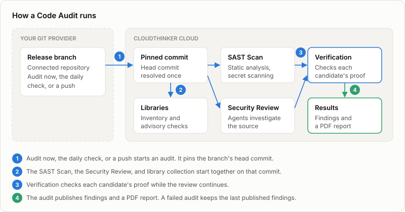
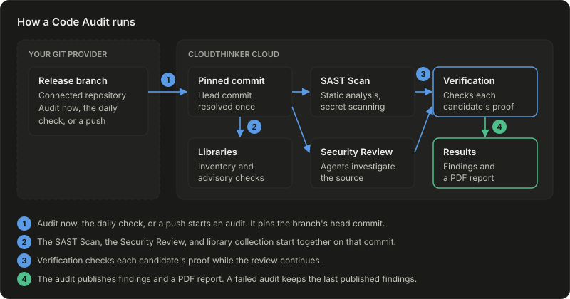
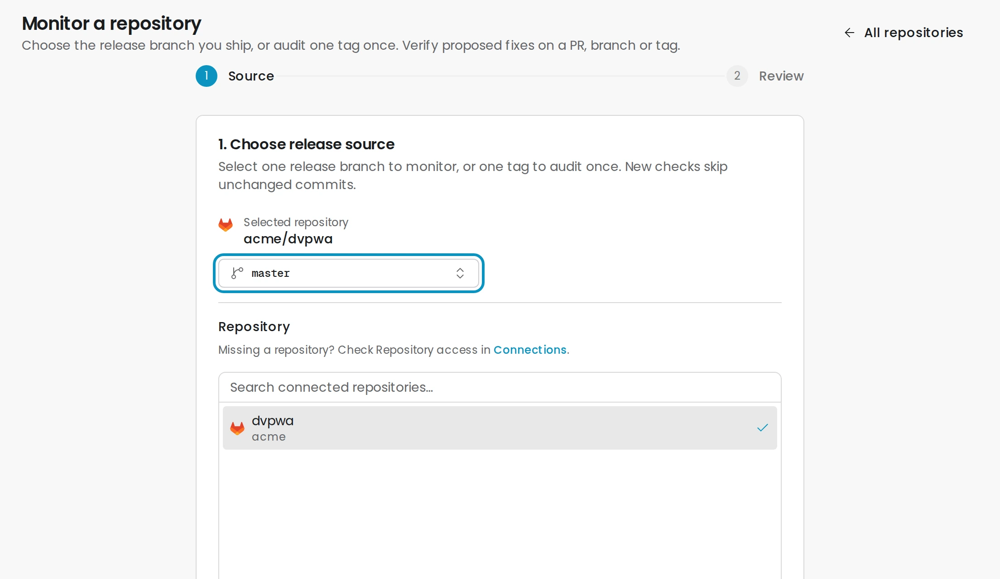
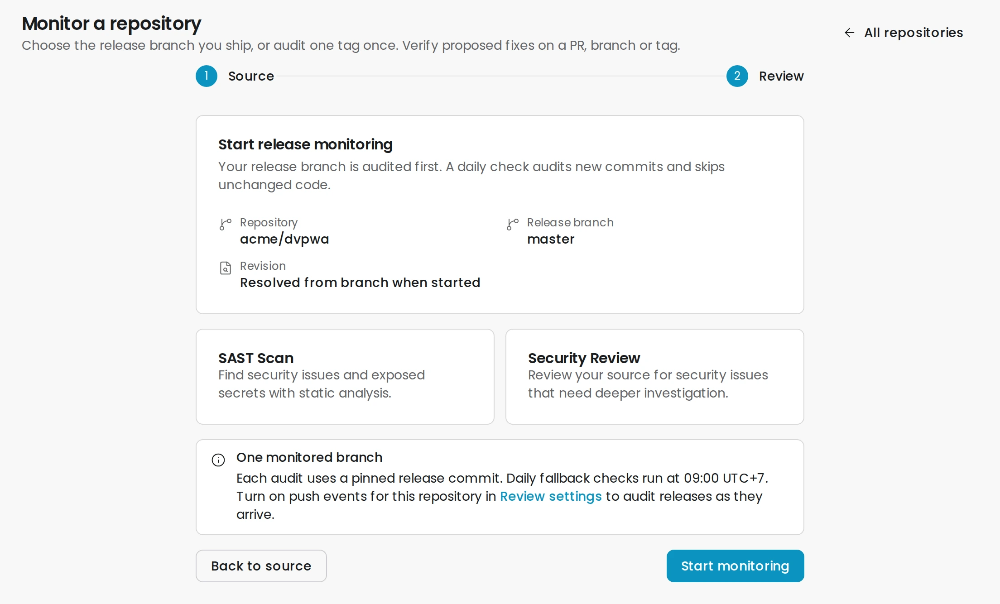
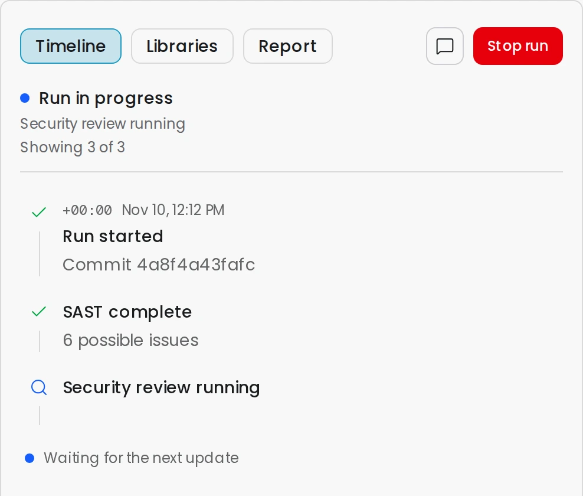
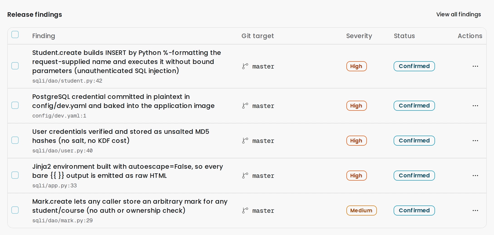
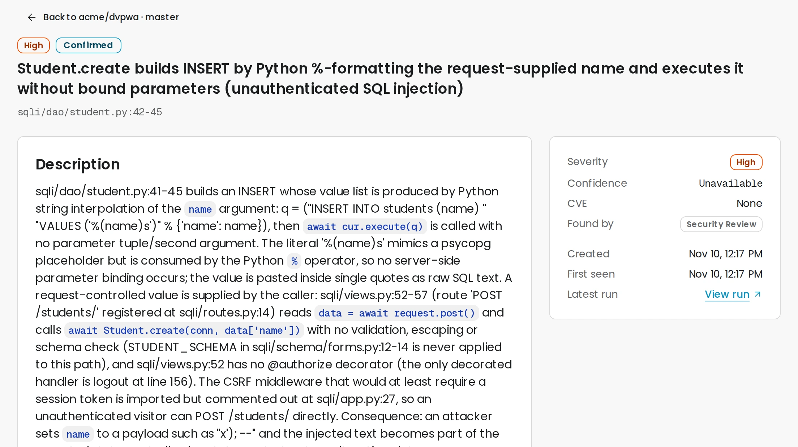
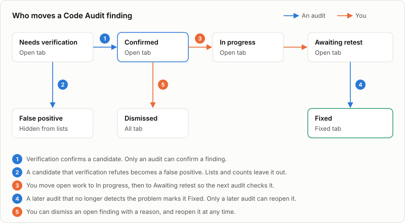
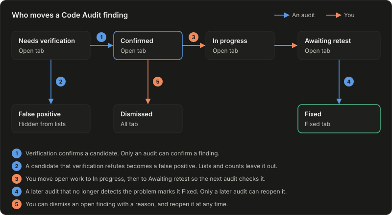
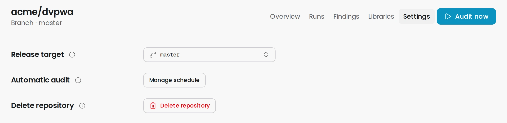

Code Audit đọc mã nguồn của một nhánh hoặc tag trong kho mã, đánh dấu đoạn mã đáng ngờ, điều tra chúng, và xác minh từng ứng viên trước khi báo cáo một vấn đề. Các vấn đề này được tách riêng khỏi [ứng dụng Pentest và các vấn đề của chúng](/vi/guide/security/security-testing), dù cả hai đều xuất hiện trên tab **Issues** của Cyber.

## Điều kiện tiên quyết

- Một [nhà cung cấp Git đã kết nối](/vi/guide/connections/overview) có quyền truy cập kho mã: GitHub, GitLab, Bitbucket, Azure DevOps hoặc AWS CodeCommit.
- Quyền được audit mã nguồn đó. Bạn không cần ứng dụng, URL, bằng chứng DNS hay thông tin đăng nhập thử nghiệm.
- Vai trò workspace phù hợp. Xem [Vai trò](/vi/guide/security/roles).

| Tác vụ | Admin | Developer | Viewer |
| --- | --- | --- | --- |
| Theo dõi một nhánh, đặt lịch của nhánh, xóa kho mã | ✓ | | |
| Audit một tag một lần, **Audit now**, dừng hoặc tiếp tục lượt chạy, xác minh bản sửa | ✓ | ✓ | |
| Phân loại vấn đề, **Open PR** | ✓ | ✓ | |
| Đọc audit, vấn đề, thư viện và báo cáo | ✓ | ✓ | ✓ |

## Cách một audit hoạt động

<Frame caption="Một audit cố định một commit, quét và rà soát song song, xác minh, rồi công bố">
  
  
</Frame>

1. **Audit now**, lượt kiểm tra hằng ngày, hoặc một lần push sẽ bắt đầu audit. Audit cố định commit mới nhất của nhánh, nên một lần push trong lúc chạy không làm thay đổi phần mã được đọc.
2. **SAST Scan** dùng phân tích tĩnh để tìm đoạn mã đáng ngờ và secret bị lộ. **Security Review** để các agent điều tra mã nguồn chuyên sâu. Code Audit cũng thu thập [thư viện](/vi/guide/security/cyber-libraries) của nhánh.
3. Bước xác minh kiểm tra bằng chứng của từng ứng viên trong khi bước rà soát vẫn tiếp tục.
4. Audit công bố các vấn đề và một báo cáo PDF. Audit thất bại vẫn giữ các vấn đề đã công bố gần nhất.

## Bắt đầu theo dõi một kho mã

<Steps>
  <Step title="Chọn kho mã và nhánh">
    Mở **Cyber**, nhấn tab **Code audit**, rồi nhấn **New audit**.

    Trong **1. Choose release source**, chọn kho mã, rồi chọn nhánh bạn phát hành. Chọn một tag để audit một bản phát hành một lần.

    <Frame caption="Bước Source với một kho mã đã chọn và nhánh release của kho mã đó">
      
    </Frame>

    Bạn cũng có thể mở **Review → Settings → Repositories**, rồi chọn **Run Code Audit** từ menu thao tác của một kho mã. Kho mã được chọn sẵn, cùng nhánh mặc định của kho mã đó.
  </Step>
  <Step title="Kiểm tra và bắt đầu">
    Nhấn **Review audit**. Kiểm tra kho mã, nhánh release và giờ kiểm tra hằng ngày, rồi nhấn **Start monitoring**. Với một tag, nút là **Audit tag**.

    <Frame caption="Bước Review cho một nhánh release">
      
    </Frame>

    **Trạng thái thành công:** tab **Runs** của kho mã mở ra ở lượt chạy mới. Mỗi kho mã theo dõi một nhánh release.
  </Step>
</Steps>

Theo dõi một nhánh cũng tạo lượt audit hằng ngày của nhánh đó lúc 09:00 UTC+7. Audit khi push được bật khi kho mã được thiết lập trong [Review](/vi/guide/code-review/setup). Developer có thể audit một tag nhưng không bắt đầu theo dõi một nhánh được.

## Theo dõi một lượt chạy

Tab **Runs** liệt kê mọi lượt chạy trong **Run history**. Chọn một lượt chạy để xem **Timeline**, **Libraries** và **Report** của lượt chạy đó.

<Frame caption="Một lượt chạy đang diễn ra: SAST đã xong, Security Review đang chạy">
  
</Frame>

- **Stop audit** kết thúc lượt chạy sau khi bạn xác nhận.
- Lượt chạy chưa hoàn tất hoặc thất bại có **Restart audit**, **Resume saved work** hoặc **Resume audit**. Mỗi lựa chọn tiếp tục ở cùng commit và giữ phần việc đã xong. **Resume audit** trước tiên yêu cầu thêm số lần thử và giới hạn credit cao hơn cho lượt chạy đó; credit của workspace vẫn được áp dụng.
- Biểu tượng cuộc trò chuyện mở cuộc trò chuyện của agent đằng sau lượt chạy.

Khi một lượt chạy kết thúc, người đã bắt đầu lượt chạy nhận thông báo cho biết audit đã hoàn tất, đã dừng với kết quả một phần, hoặc chưa hoàn tất.

## Đọc kết quả

Tab **Overview** của kho mã hiển thị các vấn đề đang mở theo mức độ nghiêm trọng, các vấn đề release hàng đầu và các lượt chạy gần đây. Các tab của kho mã là **Overview**, **Runs**, **Issues** và **Settings**.

<Frame caption="Release findings trên tab Overview của kho mã (dữ liệu mẫu)">
  
</Frame>

Mỗi vấn đề có một trạng thái:

| Trạng thái | Ý nghĩa |
| --- | --- |
| **Confirmed** | Bước xác minh tìm thấy bằng chứng của vấn đề trong commit được audit |
| **To verify** | Việc xác minh đang chờ, bị chặn hoặc chưa đi đến kết luận. Hãy coi đây là vấn đề chưa được giải quyết |
| **Fixed** | Một audit sau không còn phát hiện vấn đề, hoặc một lượt kiểm tra bản sửa đã chứng minh vấn đề được sửa |
| **Snoozed** | Có người chọn **Remind me later…** để sửa sau một ngày đã chọn |
| **Dismissed** | Có người đã bỏ qua vấn đề kèm lý do |
| **False positive** | Bước xác minh đã bác bỏ ứng viên |

Danh sách, bộ đếm và báo cáo PDF không tính false positive.

Mở một vấn đề để đọc mô tả, đánh giá của agent, **Source trace**, **Source evidence** và hồ sơ **Verification**. **Confidence** là mức tin cậy của agent audit vào đánh giá, không phải xác suất vấn đề có thể bị khai thác.

<Frame caption="Một phát hiện đã xác nhận cùng mô tả và tóm tắt (dữ liệu mẫu)">
  
</Frame>

Bằng chứng trong mã nguồn không chứng minh vấn đề tiếp cận được trên ứng dụng đang chạy. [Pentest](/vi/guide/security/security-testing) kiểm thử điều đó.

## Phân loại vấn đề

Tab **Issues** có các tab **All**, **Open**, **Fixed** và **Snoozed**. Lọc bằng **Search issues…**, **Type** (**Code** hoặc **Libraries**), **Severity**, **Source** và **Status**. Danh sách hiển thị reference mà kho mã theo dõi trong **Settings**.

<Frame caption="Ai chuyển một phát hiện giữa các trạng thái">
  
  
</Frame>

1. Chỉ bước xác minh mới xác nhận một vấn đề.
2. Ứng viên bị bác bỏ trở thành false positive và rời khỏi danh sách.
3. Trên trang vấn đề, chuyển công việc đang mở theo thanh tiến trình sang **In progress**, rồi **Awaiting retest** để audit tiếp theo kiểm tra.
4. Audit sau không còn phát hiện vấn đề sẽ đánh dấu vấn đề là **Fixed**. Bạn cũng có thể chọn **Fixed…** từ trạng thái của vấn đề trên danh sách **Issues**.
5. Nhấn vào trạng thái của vấn đề để chọn **Remind me later…** hoặc **Dismiss…**. Dismiss yêu cầu lý do. Bạn có thể mở lại vấn đề đã bỏ qua hoặc đã snooze từ cùng menu đó, hoặc bằng **Reopen issue** trên trang vấn đề.

Về quy trình dùng chung trong Cyber, xem [Phân loại vấn đề bảo mật](/vi/guide/security/cyber-findings).

## Sửa và xác minh

Nhấn **Open PR** trên một vấn đề đã xác nhận. CloudThinker mở một cuộc chat làm việc trên mã hiện tại của nhánh, commit một bản sửa, và mở pull request để bạn review. **Open conversation** quay lại cuộc chat đó.

Pull request sửa lỗi không làm thay đổi vấn đề. Hãy merge pull request, rồi để audit tiếp theo kiểm tra, hoặc xác minh bản sửa trước:

<Steps>
  <Step title="Chọn các vấn đề">
    Trên tab **Overview** hoặc **Issues**, chọn tối đa 20 vấn đề release và nhấn **Verify fixes**. Với một vấn đề, chọn **Verify fix** trên trang của vấn đề đó.
  </Step>
  <Step title="Chọn đích">
    Trong **Verify against**, chọn pull request, nhánh hoặc tag chứa bản sửa, rồi nhấn **Verify fixes**.

    **Trạng thái thành công:** mỗi vấn đề hiển thị **Fix verified**, **Still detected** hoặc **Unable to verify**.
  </Step>
</Steps>

Một lượt kiểm tra bản sửa tiêu tốn credit. Lượt kiểm tra này không bao giờ đóng vấn đề release; audit release tiếp theo mới làm việc đó.

## Giữ nhánh luôn được audit

Mở tab **Settings** của kho mã. Tab này có các mục **General**, **Auditing**, **Schedule**, **Reports** và **Remove**. Trong **Schedule**, nhấn **Add schedule**, hoặc **Manage schedule** trên lịch đã lưu.

<Frame caption="Tab Settings của kho mã">
  
</Frame>

- Lịch đặt một thời điểm lặp lại theo múi giờ của trình duyệt. Lịch đã lưu mở dưới dạng một [Automation](/vi/guide/automation/automations).
- **Also audit after commits are pushed to this branch** chạy một audit cho mỗi đợt push, khi nhánh đã yên.
- Audit bỏ qua commit đã được audit.

**Audit now** ở đầu trang kho mã, hoặc trên dòng của kho mã trong danh sách **Code audit**, mở hộp thoại xác nhận để bạn chọn **Incremental** hoặc **Full**. Incremental chỉ audit những gì đã thay đổi kể từ audit gần nhất; Full quét lại toàn bộ nhánh và tốn nhiều thời gian và credit hơn.

Code Audit tự chạy lượt quét toàn bộ cho audit đầu tiên, sau bảy ngày, và khi cài đặt trình quét hoặc lịch sử của nhánh thay đổi.

## Tải báo cáo

Mở một lượt chạy đã hoàn tất và chọn **Report**. Mỗi lượt chạy lưu một file PDF gồm các vấn đề confirmed, to-verify và fixed. Chọn **Part** khi một báo cáo lớn được chia nhỏ, rồi nhấn **Download report**. Nếu tạo PDF thất bại, nhấn **Retry PDF**.

## Xóa một kho mã

Trên tab **Settings**, trong **Remove**, nhấn **Remove repository** và xác nhận. Code Audit xóa vĩnh viễn các nhánh, audit, vấn đề, bằng chứng, kết quả thư viện và cuộc trò chuyện audit của kho mã. Kho mã nguồn của bạn, thiết lập Review và các cuộc chat sửa lỗi riêng vẫn được giữ. Thêm lại kho mã sẽ bắt đầu mà không có lịch sử.

Bạn không thể xóa kho mã khi một audit đang chạy.

## Khắc phục sự cố

Để xem mọi sự cố của Cyber ở một chỗ, xem [Khắc phục sự cố Cyber](/vi/guide/security/cyber-troubleshooting).

<AccordionGroup>
  <Accordion title="Không thấy kho mã ở bước Source">
    Kiểm tra quyền truy cập của kho mã trong Connections; bước Source có liên kết tới đó. Kho mã được thiết lập cho Review không được thêm vào Code Audit cho đến khi bạn chọn kho mã đó ở đây.
  </Accordion>
  <Accordion title="Theo dõi một nhánh cần quyền sửa lịch">
    Theo dõi một nhánh cũng tạo lịch của nhánh, việc này cần vai trò Admin. Hãy nhờ Admin bắt đầu, hoặc chọn một tag để audit một lần.
  </Accordion>
  <Accordion title="Audit thất bại nhưng vẫn thấy vấn đề cũ">
    Audit thất bại không bao giờ thay thế các vấn đề đã công bố gần nhất. Đọc timeline của lượt chạy để tìm nguyên nhân, rồi dùng nút restart hoặc resume của lượt chạy, hoặc nhấn **Audit now**.
  </Accordion>
  <Accordion title="Audit có thể bị kẹt">
    Lượt chạy đã lâu không báo tiến độ. Mở cuộc trò chuyện của lượt chạy để xem agent đang làm gì, hoặc nhấn **Stop audit** và bắt đầu audit mới.
  </Accordion>
  <Accordion title="Bản sửa đã merge nhưng vấn đề không đổi">
    Vấn đề chỉ thay đổi khi một audit sau kiểm tra bản sửa. Nhấn **Audit now**, hoặc dùng **Verify fix** trên nhánh.
  </Accordion>
</AccordionGroup>

## Bước tiếp theo

<CardGroup cols={2}>
  <Card title="Theo dõi lỗ hổng thư viện" icon="cubes" href="/vi/guide/security/cyber-libraries">
    Đọc advisory của thư viện phụ thuộc và tác động lên mã của bạn
  </Card>
  <Card title="Chạy kiểm thử bảo mật" icon="crosshairs" href="/vi/guide/security/security-testing">
    Kiểm thử ứng dụng đang chạy và thu thập bằng chứng lúc chạy
  </Card>
  <Card title="Connections" icon="plug" href="/vi/guide/connections/overview">
    Quản lý quyền truy cập kho mã mà Code Audit sử dụng
  </Card>
</CardGroup>
