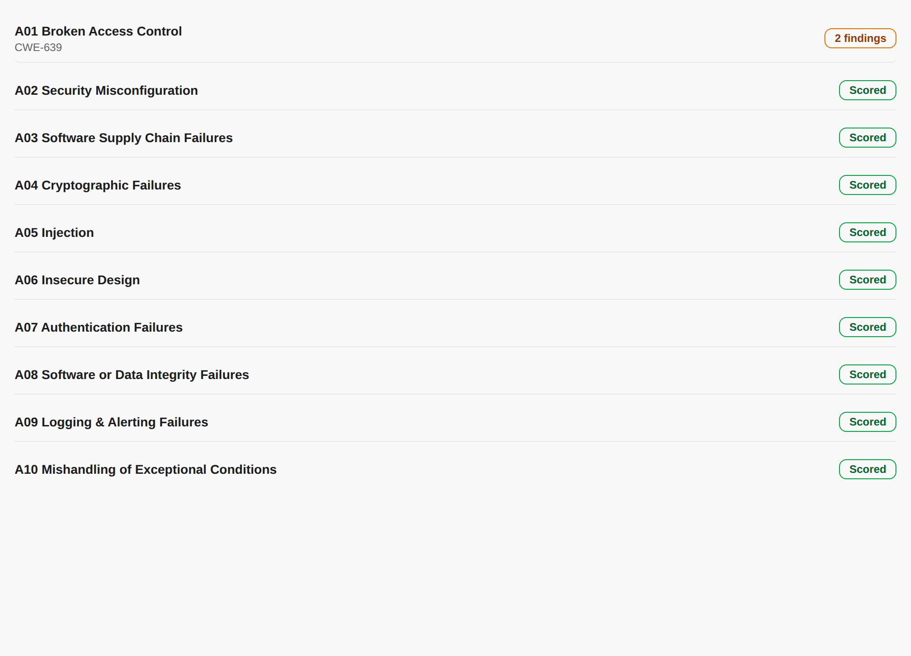
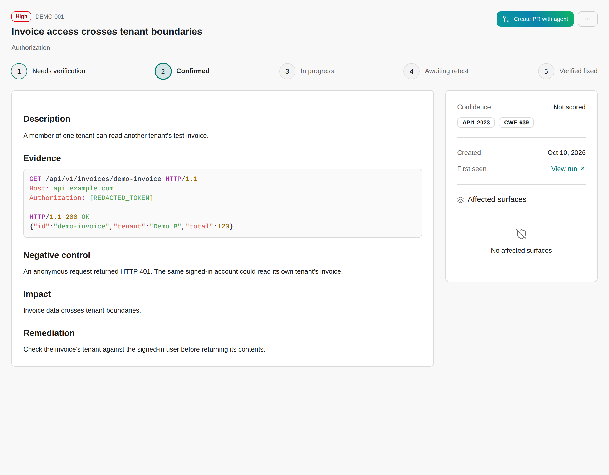

Issue là một vấn đề bảo mật mà một [lượt pentest](/vi/guide/security/security-testing) đã xác minh trên ứng dụng đang chạy của bạn, được lưu cùng các request, response và ảnh chụp màn hình thể hiện vấn đề đó. Mỗi ứng dụng giữ một danh sách issue liên tục qua mọi lượt chạy, nên lần quét sau cập nhật cùng issue thay vì tạo bản trùng lặp.

## Điều kiện tiên quyết

- Một ứng dụng Cyber có ít nhất một lượt chạy đã hoàn tất. Xem [Chạy kiểm thử bảo mật](/vi/guide/security/security-testing).
- Vai trò workspace **Admin** hoặc **Developer** để phân loại, loại bỏ hoặc mở lại issue. Viewer có thể duyệt, sao chép và tải xuống issue. Xem [Vai trò](/vi/guide/security/roles).

## Issue nằm ở đâu

Cyber gọi mỗi phát hiện là một **issue**. Tab **Issues** ở đầu Cyber liệt kê mọi ứng dụng và repository cùng nhau. Mỗi ứng dụng cũng có tab **Issues** riêng: mở ứng dụng từ **Pentest apps**, và header của ứng dụng hiển thị các tab sau:

| Tab | Bạn dùng để làm gì |
| --- | --- |
| **Overview** | Kết luận hiện tại của ứng dụng, số issue theo mức độ nghiêm trọng và hàng đợi sửa lỗi gồm các issue đang mở |
| **Runs** | Dòng thời gian và báo cáo của từng lượt chạy, cùng những gì lượt chạy đã thêm, đã sửa hoặc còn để mở |
| **Issues** | Danh sách làm việc đầy đủ các issue của ứng dụng, kèm **Export** |
| **Settings** | Phạm vi, thông tin đăng nhập kiểm thử, ngữ cảnh mã nguồn, giá trị mặc định, lịch chạy và cài đặt báo cáo |

Trên **Issues**, các tab trạng thái chia danh sách. Lọc bằng **Search issues**, **Priority** (Critical, High, Medium, Low, Info) và **Weakness**. Danh sách toàn Cyber có thêm **Target**.

| Tab | Hiển thị các issue |
| --- | --- |
| **Open** | Chưa đóng |
| **Needs verification** | Các manh mối Cyber chưa chứng minh được (trạng thái **To verify**) |
| **Confirmed** | Đã được Cyber chứng minh |
| **In progress** | Đã được nhóm của bạn nhận xử lý |
| **Awaiting retest** | Đang chờ một lần quét để kiểm tra bản sửa |
| **Fixed** | Đã sửa, dù được lần quét xác minh hay do bạn đánh dấu đã sửa |
| **Snoozed** | Được tạm gác bằng **Remind me later…** cho đến ngày bạn chọn |
| **All** | Mọi thứ, kể cả các issue **Dismissed**, vốn không có tab riêng |

**Overview** của ứng dụng phân loại issue theo danh mục OWASP:

<Frame>
  
</Frame>

## Ai quyết định điều gì

Hai bên sở hữu các phần khác nhau của một issue. Biết bên nào sở hữu phần nào sẽ giải thích mọi quy tắc trên trang này.

| Quyết định | Bên sở hữu | Thay đổi thế nào |
| --- | --- | --- |
| Issue có thật không, còn tồn tại không, hay đã được chứng minh là đã sửa? | CloudThinker | Một lần quét phát lại bằng chứng. Chỉ một lần quét mới mở lại được bản sửa mà một lần quét đã chứng minh |
| Issue đang ở đâu trong công việc của nhóm bạn? | Bạn | Bạn chuyển issue giữa **Needs you**, **In progress** và **Awaiting retest**, hoặc tự đánh dấu đã sửa, tạm hoãn hay loại bỏ issue |

Issue **Needs verification** là một manh mối, chưa được chứng minh. Chuyển issue sang **Awaiting retest** để lần quét tiếp theo kiểm tra. Nếu bạn đã tự tái hiện được, nhấn vào trạng thái của issue trên danh sách **Issues** và chọn **Confirm issue**.

## Đọc bằng chứng của issue

Mở một issue để xem mô tả, luồng bằng chứng, bằng chứng, mức ảnh hưởng và cách khắc phục.

<Frame>
  
</Frame>

| Bằng chứng | Hiển thị gì |
| --- | --- |
| **HTTP captures** | Các request và response đã ghi lại chứng minh vấn đề. Secret hiển thị dưới dạng placeholder đã được che |
| **Screenshots** | Các trang được chụp khi vấn đề phụ thuộc vào những gì trình duyệt hiển thị. Issue chỉ liên quan đến API không cần ảnh chụp |
| **Affected** | Các route hoặc endpoint nơi tìm thấy vấn đề |

Để tự kiểm tra bằng chứng, hãy phát lại request bằng thông tin đăng nhập kiểm thử của riêng bạn thay cho các placeholder.

Mức độ nghiêm trọng là đánh giá của CloudThinker theo thang từ Critical đến Info. Issue không có điểm CVSS. Mỗi issue cũng hiển thị danh mục **Weakness** của nó.

## Đưa issue qua quy trình làm việc

Trang issue hiển thị thanh tiến trình vòng đời: **Needs you**, **In progress**, **Awaiting retest**, **Verified fixed**. Nhấn vào một giai đoạn để chuyển issue sang đó. Trên danh sách **Issues**, nhấn vào trạng thái của issue để có cùng các thao tác chuyển.

<Steps>
  <Step title="Nhận issue">
    Mở một issue **Confirmed** và nhấn **In progress** trên thanh tiến trình.

    **Trạng thái thành công:** issue chuyển sang **In progress**.
  </Step>
  <Step title="Sửa issue">
    Nhấn **Open PR** để mở một cuộc chat, nơi CloudThinker chuẩn bị bản sửa dưới dạng pull request, hoặc tự sửa theo cách của bạn. Trên issue vẫn còn cần bạn xử lý, **Open PR** cũng chuyển issue sang **In progress**. Cuộc chat làm việc trên các repository gắn với ứng dụng, nên hãy gắn một repository trước nếu chưa có (xem [Kết nối Git provider](/vi/guide/connections/github)). Hãy review và kiểm thử mọi thay đổi được đề xuất trước khi merge. Khi đã liên kết PR, **View fix PR** sẽ mở PR đó.
  </Step>
  <Step title="Yêu cầu kiểm tra lại">
    Sau khi bản sửa được phát hành, nhấn **Awaiting retest** trên thanh tiến trình.

    **Trạng thái thành công:** issue nằm ở **Awaiting retest**. Thao tác này không bắt đầu lần quét nào.
  </Step>
  <Step title="Để lần quét tiếp theo quyết định">
    Chạy lại pentest, hoặc chờ theo lịch. Lượt chạy theo lịch chỉ đăng nhập bằng người dùng kiểm thử **Long-lived token**, nên với issue nằm sau trang đăng nhập, hãy chạy thủ công trừ khi ứng dụng có người dùng như vậy. Nếu bằng chứng không còn tái hiện được, lần quét chuyển issue sang **Verified fixed**. Bạn không thể tự chọn giai đoạn này. Nếu bằng chứng vẫn tái hiện được, issue vẫn mở.
  </Step>
</Steps>

Để hỏi về một issue, nhấn **Ask Cyber** trong header của issue. Một cuộc chat mở ra bên cạnh issue. Trong **More**, **Verify Issue…** yêu cầu CloudThinker phát lại bằng chứng trên ứng dụng đang chạy của bạn ngay lập tức, không cần bắt đầu một lượt pentest đầy đủ, và báo cáo issue có còn tái hiện được không. Thao tác này tốn credit như mọi cuộc chat. Xem [Mức sử dụng](/vi/guide/billing/usage).

## Loại bỏ issue

<Steps>
  <Step title="Mở hộp thoại loại bỏ">
    Trên danh sách **Issues**, nhấn vào trạng thái của issue, rồi chọn **Dismiss…**.
  </Step>
  <Step title="Chọn lý do">
    Trong **Dismiss this issue**, chọn một **Reason**: **False positive** (không phải lỗ hổng thật), **Acceptable risk** (có thật, nhưng bạn chấp nhận) hoặc **Out of scope** (không thuộc trách nhiệm sửa của bạn). Thêm **Note (optional)** về những gì bạn đã kiểm tra, để người rà soát sau không phải làm lại.
  </Step>
  <Step title="Xác nhận">
    Nhấn **Dismiss issue**.

    **Trạng thái thành công:** issue chuyển sang **Dismissed**, và các lần quét sau không nêu issue đó nữa.
  </Step>
</Steps>

Việc loại bỏ không phải là cuối cùng. Mở lại issue từ trạng thái của nó trên danh sách **Issues**, hoặc bằng **Reopen issue** trong **More** trên trang issue, và CloudThinker sẽ kiểm thử lại issue đó.

## Tạm hoãn issue

Để sửa một issue sau, chọn **Remind me later…** từ trạng thái của issue trên danh sách **Issues** hoặc trong **More** trên trang issue. Chọn một ngày trong **Remind me in**, thêm ghi chú nếu muốn, rồi xác nhận. Issue chuyển sang **Snoozed** cho đến ngày đó.

## Đánh dấu đã sửa hoặc mở lại

- **Fixed…** trong menu trạng thái của issue đóng một issue bạn đã khắc phục mà không cần chờ lần quét. Thao tác này yêu cầu bạn xác nhận, vì không có gì chứng minh bản sửa. Lần quét tiếp theo vẫn có thể mở lại issue.
- **Reopen issue** xuất hiện trên mọi issue bạn đã loại bỏ hoặc đánh dấu đã sửa. Thao tác này đưa issue trở lại công việc đang mở của bạn.
- Issue mà CloudThinker đã xác minh là đã sửa chỉ có thể được mở lại bởi một lần quét chứng minh vấn đề đã quay lại.

## Chia sẻ một issue

Trong **More** trên trang issue, **Copy as Markdown** sao chép issue để dùng cho ticket hoặc chat, còn **Download Markdown** lưu issue thành tệp. Để chia sẻ nhiều issue trong một tài liệu, dùng **Export** trên danh sách **Issues**. Xem [Tạo báo cáo Cyber](/vi/guide/security/cyber-reports).

## Khắc phục sự cố

Để xem mọi vấn đề của Cyber ở một nơi, xem [Khắc phục sự cố Cyber](/vi/guide/security/cyber-troubleshooting).

<AccordionGroup>
  <Accordion title="Không nhấn được một giai đoạn trên thanh tiến trình">
    Bạn chỉ có thể chuyển các issue **Confirmed** và **Needs verification**. **Verified fixed** không bao giờ là một nút: chỉ một lần kiểm tra lại thành công mới đặt được trạng thái này. Issue đã bị loại bỏ hiển thị trạng thái thay cho thanh tiến trình.
  </Accordion>
  <Accordion title="Tôi không thể phân loại, loại bỏ hay mở lại bất cứ thứ gì">
    Bạn có vai trò Viewer. Hãy đề nghị admin của workspace cấp vai trò Developer. Bạn vẫn có thể sao chép và tải xuống issue.
  </Accordion>
  <Accordion title="Tôi đã loại bỏ nhầm một issue">
    Mở issue và chọn **Reopen issue** trong **More**, hoặc mở lại từ trạng thái của issue trên danh sách **Issues**. CloudThinker sẽ đưa issue vào các lần quét trở lại.
  </Accordion>
  <Accordion title="Một issue đã sửa lại xuất hiện">
    Một lần quét sau đã chứng minh lại vấn đề. Mở tab **Runs** của ứng dụng để xem lượt chạy nào đã mở lại issue, rồi mở issue để xem bằng chứng mới.
  </Accordion>
  <Accordion title="Awaiting retest không bao giờ được xóa">
    Chuyển issue sang **Awaiting retest** không bắt đầu lần quét nào. Nhấn **Run pentest** trong header của ứng dụng, hoặc kiểm tra lịch chạy đã bật trong **Settings**. Lịch chạy không thể kiểm tra lại một issue nằm sau trang đăng nhập trừ khi ứng dụng có người dùng kiểm thử **Long-lived token**, nên hãy chạy thủ công các issue đó.
  </Accordion>
</AccordionGroup>

## Bước tiếp theo

<CardGroup cols={2}>
  <Card title="Tạo báo cáo Cyber" icon="file-lines" href="/vi/guide/security/cyber-reports">
    Xuất issue hoặc tải báo cáo đầy đủ của một lượt chạy
  </Card>
  <Card title="Chạy kiểm thử bảo mật" icon="crosshairs" href="/vi/guide/security/security-testing">
    Chạy hoặc lên lịch các lần quét xác minh bản sửa của bạn
  </Card>
</CardGroup>
