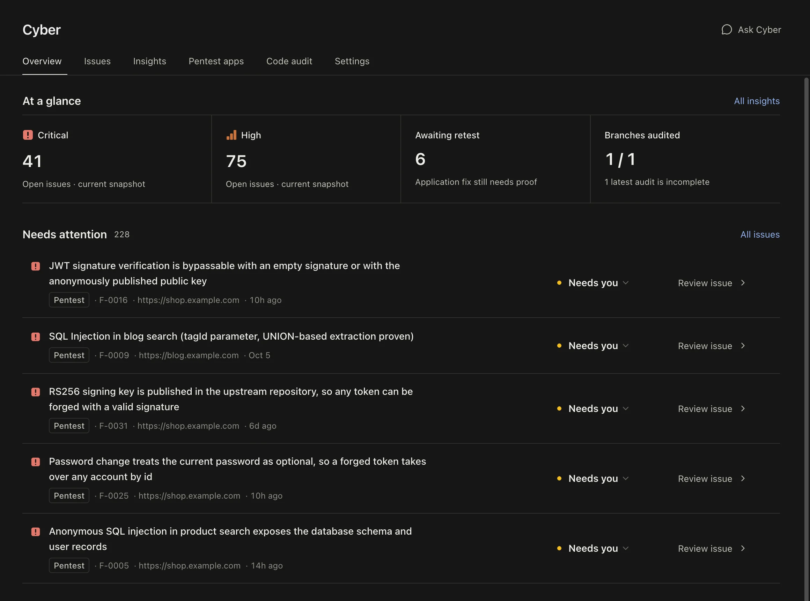

import { CyberScene } from '/snippets/iso/cyber.jsx';

**Find the real vulnerabilities in your running app, and fix them.**

Cyber là Frontier Investigation Agent cho bảo mật ứng dụng, được thiết kế để chủ động bảo mật ứng dụng trong toàn bộ vòng đời phát triển. Cyber kiểm thử ứng dụng đang chạy của bạn, xác minh mọi phát hiện bằng bằng chứng request và response, rồi soạn bản sửa dưới dạng merge request.

<CyberScene />

Công cụ quét chỉ liệt kê những gì có thể sai. Cyber xác minh điều đó: một phát hiện đã xác nhận từ lượt kiểm thử là vấn đề Cyber đã tái hiện trên ứng dụng đang chạy của bạn, kèm các request và response đằng sau, còn một phát hiện mã nguồn mang theo kết quả xác minh đã quyết định nó. Kiểm tra nào không chạy được, chẳng hạn trang được bảo vệ mà không có người dùng thử nghiệm, sẽ được đánh dấu là giới hạn thay vì an toàn.

## Cách hoạt động

Cyber kiểm thử hai bề mặt. [Lượt kiểm thử](/vi/guide/security/security-testing) kiểm thử động ứng dụng đang chạy; [Code Audit](/vi/guide/security/code-audit) đọc mã nguồn đằng sau ứng dụng. Lượt kiểm thử diễn ra như sau:

| Giai đoạn | Điều xảy ra |
| --- | --- |
| 1. Đăng ký ứng dụng | Bạn nhấn **Register an app** trên **Pentest apps** và thêm một URL hoặc host của ứng dụng cùng đối tượng kiểm thử, **Web application** hoặc **API**. Lựa chọn này xác định các danh mục OWASP mà báo cáo độ bao phủ đo lường. |
| 2. Chứng minh quyền sở hữu | Bạn công bố một bản ghi DNS TXT cho tên miền. Cyber không chạy trên tên miền cho đến khi tên miền hiển thị **Verified**. |
| 3. Đặt ranh giới | Bạn thêm người dùng thử nghiệm, repository và tài liệu API tùy chọn, chọn cường độ, rồi bao gồm hoặc loại trừ đường dẫn trong **Settings** của ứng dụng. |
| 4. Kiểm thử | CloudThinker khám phá ứng dụng, chạy các bài kiểm thử bảo mật trong phạm vi và ghi lại từng request và response. Bạn theo dõi lượt chạy trực tiếp và có thể dừng lượt chạy, hoặc tiếp tục lượt chạy khi có **Resume run**. |
| 5. Chứng minh và sửa | Mỗi vấn đề mang theo bằng chứng. Bạn phân loại, mở pull request sửa lỗi với agent, và xác minh lại hoặc chạy lại để xác nhận bản sửa. |

Code Audit bỏ qua bước 1 đến 3: bạn chọn một repository đã kết nối và nhánh release của repository đó, rồi audit quét mã, điều tra những gì tìm thấy và xác minh từng ứng viên trên commit đã cố định. Sau đó audit theo dõi nhánh đó, audit nhánh mỗi ngày hoặc ở mỗi lần push, và theo dõi thư viện của nhánh để phát hiện [advisory](/vi/guide/security/cyber-libraries) mới.

Nhấn **Cyber** trong thanh bên để mở trang tổng quan: các ứng dụng, kết quả mới nhất và hoạt động gần đây. Cyber có các tab **Overview**, **Issues**, **Insights**, **Pentest apps**, **Code audit** và **Settings**. **Pentest apps** liệt kê các ứng dụng của bạn, **Code audit** liệt kê các repository mà Code Audit theo dõi, và **Settings** chứa các tên miền đã xác minh.

<Frame caption="Cyber Overview: các vấn đề đang mở theo mức độ nghiêm trọng, các bản sửa đang chờ kiểm tra lại, các nhánh đã audit và các vấn đề cần bạn xử lý">
  
</Frame>

## Mô hình an toàn

Cyber gửi lưu lượng kiểm thử thực đến ứng dụng của bạn, nên mọi lượt chạy đều nằm trong giới hạn của các cài đặt bạn kiểm soát: mục tiêu, các đường dẫn được phép chạm vào, người dùng thử nghiệm dùng để đăng nhập và cường độ kiểm thử.

| Kiểm soát | Bảo vệ điều gì |
| --- | --- |
| **Domain ownership** | Lượt chạy bị chặn cho đến khi bản ghi DNS TXT chứng minh bạn kiểm soát tên miền. Chỉ Admin của workspace mới có thể khai báo và xác minh tên miền. |
| **Scope** | Quy tắc đường dẫn **Include** và **Exclude**. Đường dẫn bị loại trừ luôn nằm ngoài giới hạn. |
| **Intensity** | Cường độ kiểm thử của lượt chạy, từ **Safe** đến **Deep dive**, cùng **Fortress** ở gói Enterprise. Xem [bảng cường độ](/vi/guide/security/security-testing#chọn-mức-truy-cập-và-cường-độ). |
| **Test users** | Các tài khoản riêng bạn tạo để kiểm thử. Cyber đăng nhập bằng các tài khoản này, không bao giờ bằng người dùng thực. Lượt chạy theo lịch chỉ đăng nhập bằng người dùng **Long-lived token**, nên nếu không có người dùng này, lượt chạy không thể kiểm thử hoặc kiểm tra lại gì sau trang đăng nhập. Xem [Thêm người dùng thử nghiệm](/vi/guide/security/security-testing#thêm-người-dùng-thử-nghiệm). |
| **Stop run** | Hủy lượt chạy bất cứ lúc nào. Vấn đề đã lưu vẫn khả dụng. Lượt chạy bị dừng không tạo báo cáo lượt chạy. |

<Warning>
  Aggressive (mức **Recommended** trên giao diện) gửi thao tác ghi tạo và sửa dữ liệu thử nghiệm. Full, Deep dive và Fortress có thể thay đổi hoặc xóa vĩnh viễn dữ liệu trong phạm vi đã lưu. Hãy trỏ mọi mức trên Safe vào staging với tài khoản thử nghiệm, không phải production.
</Warning>

## Trước lượt chạy đầu tiên

Thống nhất những điểm sau với nhóm nền tảng trước khi khởi chạy, để lượt chạy không bị chặn hoặc kích hoạt cảnh báo trực.

| Câu hỏi | Trả lời |
| --- | --- |
| Ai có thể khởi chạy? | Workspace Admin và Developer. Viewer chỉ xem được. Mọi vai trò có thể chạy đều chọn được mọi cường độ, nên hãy giới hạn người giữ các vai trò đó. Xem [Vai trò](/vi/guide/security/roles). |
| Lưu lượng đến từ đâu? | Từ cloud của CloudThinker, không phải mạng của bạn. Hướng dẫn này không liệt kê dải IP nguồn hay header nhận dạng. Nếu WAF hoặc IDS sẽ chặn hoặc cảnh báo lưu lượng kiểm thử bảo mật, hãy [liên hệ chúng tôi](https://cloudthinker.io/contact) trước để có thông tin hiện tại. |
| Có kiểm thử được ứng dụng nội bộ hoặc chỉ qua VPN không? | Không. Mục tiêu phải là một tên miền mà CloudThinker truy cập được. Địa chỉ IP, dải CIDR và `localhost` không được chấp nhận làm mục tiêu. |
| Một lượt chạy mất bao lâu? | Tùy kích thước ứng dụng và cường độ. Với Deep dive và Fortress, bạn chọn quy tắc dừng: **Investigation complete**, hoặc **Duration** từ 1 đến 168 giờ. |
| Lượt chạy có tốn credit không? | Có. Mọi lượt chạy Cyber đều dùng credit, và Deep dive cùng Fortress dùng nhiều nhất. Lượt chạy Deep dive hoặc Fortress thủ công có thể đặt giới hạn credit. Xem [Mức sử dụng](/vi/guide/billing/usage). |
| Cyber lưu dữ liệu gì? | Các request, response và ảnh chụp màn hình chứng minh từng vấn đề, được lưu làm bằng chứng. Mật khẩu, token, cookie và key được thay bằng placeholder, nhưng dữ liệu response khác vẫn được giữ, nên hãy dùng tài khoản thử nghiệm không có dữ liệu khách hàng thực. Xem [Bảo vệ dữ liệu](/vi/guide/security/data-protection). |
| Có giới hạn tốc độ request được không? | Không. Không có cài đặt tốc độ. Để giảm tải, hãy thu hẹp phạm vi hoặc dùng cường độ thấp hơn. |
| Có cần sự cho phép ngoài bằng chứng DNS không? | Có, nếu bạn không sở hữu hạ tầng lưu trữ. DNS chứng minh bạn kiểm soát tên miền, không chứng minh bạn được phép kiểm thử hạ tầng bên dưới. Kiểm tra chính sách kiểm thử bảo mật của nhà cung cấp hosting hoặc cloud, và xin phê duyệt bằng văn bản cho tài sản của bên thứ ba. |

## Những gì bạn có thể làm

| Khả năng | Bạn nhận được gì | Tìm hiểu thêm |
| --- | --- | --- |
| Chạy lượt kiểm thử đầu tiên | Một lượt chạy Safe trên vài đường dẫn của ứng dụng staging, từ đầu đến khi có vấn đề | [Bắt đầu nhanh với Cyber](/vi/guide/security/cyber-quickstart) |
| Theo một hướng dẫn chi tiết | Một lượt kiểm thử có phạm vi trên ứng dụng staging với hai người dùng thử nghiệm, bằng chứng của một phát hiện, và một lần kiểm tra lại xác nhận bản sửa | [Kiểm thử ứng dụng staging với Cyber](/vi/guide/use-cases/cyber-staging-testing) |
| Cấu hình và lên lịch lượt kiểm thử | Người dùng thử nghiệm, phạm vi, cường độ và lượt chạy định kỳ | [Chạy kiểm thử bảo mật](/vi/guide/security/security-testing) |
| Đi sâu vào các luồng phức tạp | Chế độ Deep dive cho lỗ hổng nhiều bước liên kết với nhau và logic nghiệp vụ | [Kiểm thử Deep dive](/vi/guide/security/deep-dive-testing) |
| Phân loại vấn đề | Danh sách Issues, bằng chứng cho từng vấn đề, loại bỏ, snooze, sửa và xác minh | [Phân loại vấn đề](/vi/guide/security/cyber-findings) |
| Chia sẻ kết quả | Báo cáo CSV, PDF hoặc tùy chỉnh về các vấn đề, hoặc báo cáo của một lượt chạy | [Báo cáo Cyber](/vi/guide/security/cyber-reports) |
| Kiểm thử đăng nhập có CAPTCHA | Test key hoặc cơ chế bỏ qua cho đăng nhập bằng mật khẩu | [Xử lý đăng nhập có CAPTCHA](/vi/guide/security/captcha) |
| Kiểm tra mã nguồn | Một nhánh repository được quét, điều tra và xác minh, rồi được theo dõi qua các commit | [Chạy Code Audit](/vi/guide/security/code-audit) |
| Theo dõi dependency | Thư viện có lỗ hổng theo nhánh, bằng chứng cảnh báo và tác động lên mã của bạn | [Giám sát lỗ hổng thư viện](/vi/guide/security/cyber-libraries) |
| Khắc phục sự cố | Nguyên nhân, cách kiểm tra và cách sửa cho các vấn đề Cyber thường gặp | [Khắc phục sự cố Cyber](/vi/guide/security/cyber-troubleshooting) |

## Khái niệm chính

| Thuật ngữ | Ý nghĩa |
| --- | --- |
| App | Mục tiêu đã lưu: URL, framework, cài đặt truy cập, vấn đề và lịch sử chạy |
| Access level | Xác định theo những gì bạn cung cấp. **Black-box** chỉ có truy cập công khai, **Gray-box** thêm người dùng thử nghiệm, **White-box** thêm repository, có hoặc không có người dùng thử nghiệm. |
| Confirmed | Vấn đề đã xác minh: Cyber đã tái hiện được, kèm bằng chứng request và response |
| Needs verification | Ứng viên mà Cyber chưa chứng minh được, hiển thị với trạng thái **To verify**. Hãy coi đó là đầu mối, không phải lỗ hổng. |
| Stale | Ứng dụng có lần quét hoàn tất gần nhất cách đây hơn 30 ngày |
| Monitored branch | Nhánh release duy nhất của mỗi repository mà Code Audit audit theo lịch hoặc khi push, giữ các vấn đề và danh mục thư viện của nhánh đó |

## Bắt đầu

<CardGroup cols={2}>
  <Card title="Bắt đầu nhanh với Cyber" icon="rocket" href="/vi/guide/security/cyber-quickstart">
    Chạy lượt kiểm thử đầu tiên trên một ứng dụng staging
  </Card>
  <Card title="Chạy kiểm thử bảo mật" icon="crosshairs" href="/vi/guide/security/security-testing">
    Thiết lập người dùng thử nghiệm, phạm vi, cường độ và lịch
  </Card>
  <Card title="Phân loại vấn đề" icon="list-check" href="/vi/guide/security/cyber-findings">
    Đọc bằng chứng, sửa và kiểm tra lại
  </Card>
  <Card title="Chạy Code Audit" icon="code" href="/vi/guide/security/code-audit">
    Kiểm tra một nhánh repository và theo dõi nó qua các commit
  </Card>
</CardGroup>
